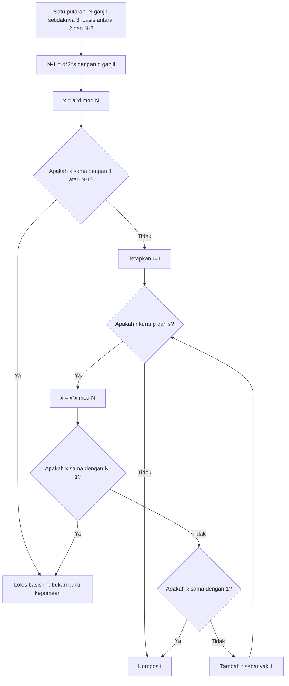
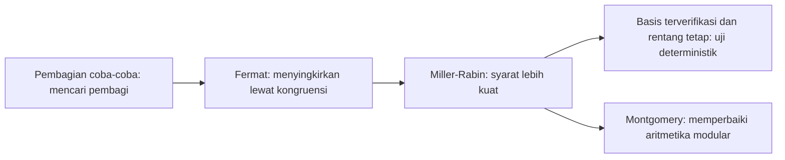

## Pendahuluan: membedakan keprimaan dan faktorisasi

Uji keprimaan menjawab apakah suatu bilangan bulat adalah prima. Mencari faktor-faktor bilangan komposit merupakan tugas berbeda. Pembangkitan bilangan prima besar penting dalam [kriptografi kunci publik seperti RSA](https://kenji.blog/id/p/modern-cryptography-public-key-hash-signature/), tetapi perkalian itu sendiri bukan operasi yang sulit. Menemukan bilangan prima saja juga tidak menjamin keamanan suatu skema kriptografi.

Kita akan membandingkan pembagian coba-coba, uji Fermat, dan Miller–Rabin, lalu memberikan implementasi C++ untuk bilangan bulat tak negatif 64-bit. Domainnya adalah $0\le N<2^{64}$, bukan bilangan ribuan bit yang digunakan untuk membangkitkan kunci RSA. Waktu eksekusi bergantung pada implementasi dan masukan, sehingga tidak ada jaminan durasi atau faktor percepatan universal.

## 1. Bilangan prima dan pembagian coba-coba

Bilangan prima adalah bilangan bulat setidaknya 2 yang hanya memiliki pembagi positif 1 dan dirinya sendiri. Bilangan komposit adalah bilangan bulat setidaknya 2 yang bukan prima. Nol, satu, dan bilangan bulat negatif bukan prima maupun komposit.

Jika bilangan komposit $N=ab$ memiliki faktor dengan $2\le a\le b$, maka $a\le\sqrt N$. Karena itu, pencarian pembagi cukup sampai akar kuadrat. Periksa 2 terlebih dahulu, lalu hanya kandidat ganjil.

```cpp
#include <cstdint>

bool is_prime_trial_division(std::int64_t n) {
    if (n < 2) return false;
    if (n == 2) return true;
    if (n % 2 == 0) return false;
    for (std::int64_t i = 3; i <= n / i; i += 2) {
        if (n % i == 0) return false;
    }
    return true;
}
```

Perkalian bertanda pada `i*i <= n` dapat mengalami overflow. Untuk nilai positif, syarat ekuivalen `i <= n/i` menghindari perkalian itu. Fungsi ini menerima rentang `std::int64_t` dan juga mengembalikan `false` untuk masukan negatif.

Jumlah pembagian pada kasus terburuk adalah $\mathcal{O}(\sqrt N)$. Menguji hanya bilangan ganjil memberi sekitar $\sqrt N/2$ kandidat, tetapi pengujian berulang pada masukan besar tetap dapat mahal. Tidak ada batas jumlah digit desimal yang menentukan kepraktisan secara universal.

## 2. Fermat dan eksponensiasi modular

Teorema kecil Fermat menyatakan bahwa untuk bilangan prima $p$ dan bilangan bulat $a$ dengan $\gcd(a,p)=1$:

$$
a^{p-1}\equiv1\pmod p.
$$

Jadi, untuk $N>2$, jika basis $1<a<N-1$ tidak memenuhi kongruensi tersebut, $N$ pasti komposit. Lolos tidak membuktikan keprimaan. Bilangan Carmichael $561=3\cdot11\cdot17$ lolos untuk semua basis yang koprima dengan 561. Namun, basis 3 tidak koprima, dan $3^{560}\bmod561=375$, sehingga gagal. Mengatakan bahwa setiap basis pasti mengelabui uji ini tidak tepat.

Kita tidak perlu membentuk pangkat bilangan bulat secara utuh. Eksponensiasi biner melakukan reduksi modular setelah setiap perkalian. Fungsi-fungsi pembantu berikut dapat dikompilasi secara terpisah. Basis, eksponen, dan operand perkalian adalah bilangan bulat tak negatif 64-bit; modulus `m` adalah bilangan bulat positif 64-bit. Modulus nol memicu pengecualian.

```cpp
#include <cstdint>
#include <stdexcept>

#if !defined(__SIZEOF_INT128__)
#error "This example requires unsigned __int128 support"
#endif

using u64 = std::uint64_t;
using u128 = unsigned __int128;

u64 mod_mul(u64 a, u64 b, u64 m) {
    if (m == 0) throw std::invalid_argument("Modulus must be positive");
    return static_cast<u64>(static_cast<u128>(a) * b % m);
}

u64 mod_pow(u64 base, u64 exp, u64 m) {
    if (m == 0) throw std::invalid_argument("Modulus must be positive");
    u64 result = 1 % m;
    base %= m;
    while (exp > 0) {
        if (exp & 1) result = mod_mul(result, base, m);
        base = mod_mul(base, base, m);
        exp >>= 1;
    }
    return result;
}
```

Hasilnya adalah sisa tak negatif terkecil. Eksponen nol mengembalikan $1\bmod m$, sehingga hasilnya nol jika modulus satu. Di sini $0^0$ juga mengikuti konvensi komputasi tersebut. Mengirim basis negatif langsung ke parameter tanpa tanda berada di luar penggunaan yang dimaksud.

`unsigned __int128` adalah ekstensi, bukan tipe dalam standar ISO C++. GCC menyediakannya pada target yang sesuai, dan kode mendeteksi ketiadaan dukungan saat kompilasi. Tidak diasumsikan bahwa kode ini berjalan tanpa perubahan pada semua lingkungan MSVC; lihat [dokumentasi GCC](https://gcc.gnu.org/onlinedocs/gcc/_005f_005fint128.html). Untuk menampung semua hasil perkalian dua nilai tanpa tanda 64-bit, diperlukan penyimpanan tanpa tanda 128-bit; tipe bertanda 128-bit tidak mencakup semua hasil itu.

## 3. Syarat Miller–Rabin dan makna probabilitas

Modulo bilangan prima ganjil, akar kuadrat dari 1 hanya 1 dan −1. Miller–Rabin menggabungkan sifat ini dengan teorema kecil Fermat. Untuk bilangan ganjil $N\ge3$, tuliskan:

$$
N-1=d\,2^s,\qquad d\text{ is odd},\quad s\ge1.
$$

Artinya, d ganjil. Basis $a$ dengan $1<a<N-1$ lolos jika salah satu syarat berikut terpenuhi:

$$
a^d\equiv1\pmod N
\quad\text{or}\quad
\exists r\ (0\le r<s):\ a^{d2^r}\equiv-1\pmod N.
$$

Bilangan prima selalu lolos; kegagalan membuktikan bahwa bilangan itu komposit. Jika pengkuadratan berulang menghasilkan 1 padahal nilai sebelumnya bukan 1 maupun −1, hal itu juga membuktikan bahwa bilangan tersebut komposit. Sisa tak negatif terkecil dari −1 adalah $N-1$, tetapi ekspresi C++ bertanda `-1 % N` tidak mengembalikan nilai itu. Misalnya, `-1 % 7` menghasilkan −1. Bedakan sisa matematis dari [aturan pembagian dan sisa C++](https://eel.is/c++draft/expr.mul).

Untuk suatu bilangan komposit ganjil tetap $N$, setiap basis yang dipilih secara independen dan seragam dari $2\le a\le N-2$ lolos dengan probabilitas paling tinggi $1/4$. Maka probabilitas lolos secara keliru dalam seluruh $k$ putaran memenuhi:

$$
\Pr[\text{all }k\text{ rounds pass}\mid N\text{ is composite}]\le4^{-k}.
$$

Ini adalah probabilitas kesalahan atas pemilihan basis secara acak. Nilai itu tidak dapat langsung dinyatakan ulang sebagai probabilitas $4^{-k}$ bahwa bilangan yang telah lolos pengujian itu sebenarnya komposit. Argumen ini juga tidak berlaku untuk sembarang himpunan basis tetap. Untuk N=3, interval basis kosong, sehingga implementasi menanganinya lebih dahulu. [Makalah asli Rabin](https://math.nyu.edu/~goodman/teaching/Algebra_2_2021/MillerRabinTest.pdf) juga membedakan penerimaan probabilistik dari bukti keprimaan.

Diagram berikut menunjukkan satu putaran dengan basis biasa. N=3 sudah ditangani; masukan ganjil harus mempunyai basis yang dapat dipilih dari interval tersebut.



## 4. Uji deterministik dalam rentang tetap

Dalam rentang bilangan bulat terbatas, himpunan basis yang memadai berdasarkan hasil verifikasi yang diketahui memungkinkan pengujian tanpa keacakan. [Catatan basis SPRP](https://miller-rabin.appspot.com/) mencantumkan syarat yang digunakan di sini. Semua batas atas bersifat ketat.

| Rentang masukan | Basis yang diuji |
| --- | --- |
| $N<4759123141$ | 2, 7, 61 |
| $N<1122004669633$ | 2, 13, 23, 1662803 |
| $N<2^{64}$ | 2, 325, 9375, 28178, 450775, 9780504, 1795265022 |

Himpunan terakhir berisi tujuh basis bilangan bulat, bukan tujuh bilangan prima: 325, misalnya, komposit. Catatan itu mengatribusikan hasil tujuh basis kepada Jim Sinclair pada 2011. Artikel ini tidak mengulang seluruh pencarian 64-bit secara independen.

Alternatifnya, dua belas bilangan prima pertama `2, 3, 5, 7, 11, 13, 17, 19, 23, 29, 31, 37` juga cukup untuk rentang 64-bit ini. [Hasil Sorenson–Webster](https://arxiv.org/abs/1509.00864) memberikan 318665857834031151167461 sebagai bilangan komposit terkecil yang merupakan pseudoprima kuat untuk kedua belas basis; nilainya melebihi $2^{64}$. Implementasi berikut menggunakan cabang 3, 4, dan 7 basis pada tabel, bukan alternatif dua belas basis.

## 5. Contoh C++ lengkap

Tipe masukan `u64` mencakup $0\le N\le2^{64}-1$. Nol dan satu mengembalikan `false`, tetapi bukan komposit, jadi keluaran menggunakan `Not prime`. Perkalian modular mengonversi tipe sebelum membentuk hasil kali. Setiap basis direduksi modulo N; jika menjadi nol, hanya basis itu yang dilewati dan basis lain tetap diperiksa. Basis nol sendiri tidak menentukan apakah seluruh bilangan prima atau komposit.

Blok berikut adalah program lengkap beserta fungsi pembantunya. Tidak perlu menggabungkan lagi blok-blok sebelumnya. Pada target GCC yang sesuai, kompilasi dapat dilakukan dengan perintah seperti `g++ -std=c++17 -O2 primality.cpp -o primality`.

```cpp
#include <cstdint>
#include <stdexcept>

#if !defined(__SIZEOF_INT128__)
#error "This example requires unsigned __int128 support"
#endif

using u64 = std::uint64_t;
using u128 = unsigned __int128;

u64 mod_mul(u64 a, u64 b, u64 m) {
    if (m == 0) throw std::invalid_argument("Modulus must be positive");
    return static_cast<u64>(static_cast<u128>(a) * b % m);
}

u64 mod_pow(u64 base, u64 exp, u64 m) {
    if (m == 0) throw std::invalid_argument("Modulus must be positive");
    u64 result = 1 % m;
    base %= m;
    while (exp > 0) {
        if (exp & 1) result = mod_mul(result, base, m);
        base = mod_mul(base, base, m);
        exp >>= 1;
    }
    return result;
}

#include <iostream>
#include <initializer_list>
#include <vector>

bool is_prime_miller_rabin(u64 n) {
    if (n < 2) return false;
    for (u64 p : {2ULL, 3ULL, 5ULL, 7ULL}) {
        if (n == p) return true;
        if (n % p == 0) return false;
    }

    u64 d = n - 1;
    unsigned s = 0;
    while ((d & 1) == 0) {
        d >>= 1;
        ++s;
    }

    std::vector<u64> bases;
    if (n < 4759123141ULL) {
        bases = {2, 7, 61};
    } else if (n < 1122004669633ULL) {
        bases = {2, 13, 23, 1662803};
    } else {
        bases = {2, 325, 9375, 28178, 450775, 9780504, 1795265022};
    }

    for (u64 a : bases) {
        a %= n;
        if (a == 0) continue; // No witness from this base; keep testing the others.
        u64 x = mod_pow(a, d, n);
        if (x == 1 || x == n - 1) continue;

        bool passed = false;
        for (unsigned r = 1; r < s; ++r) {
            x = mod_mul(x, x, n);
            if (x == n - 1) {
                passed = true;
                break;
            }
            if (x == 1) return false;
        }
        if (!passed) return false;
    }
    return true;
}

int main() {
    const std::vector<u64> cases = {
        0, 1, 2, 73, 561, 1000000007, 998244353,
        1000000000000000003ULL, 1000000000000000007ULL,
        18446744073709551557ULL, 18446744073709551615ULL
    };
    for (u64 n : cases) {
        std::cout << n << " is "
                  << (is_prime_miller_rabin(n) ? "Prime" : "Not prime") << '\n';
    }
}
```

Keluaran menggolongkan 0 dan 1 sebagai `Not prime`; 2 dan 73 sebagai `Prime`; 561 sebagai `Not prime`; 1000000007, 998244353, dan 1000000000000000003 sebagai `Prime`; 1000000000000000007 sebagai `Not prime`; 18446744073709551557 sebagai `Prime`; dan 18446744073709551615 sebagai `Not prime`. Bilangan komposit terakhir adalah $2^{64}-1$. Ini adalah contoh pembelajaran dan pengujian bilangan dalam rentang tersebut, bukan pembangkit prima kriptografis, implementasi waktu konstan, atau pustaka yang memvalidasi string masukan.

## 6. Kompleksitas dan perkalian Montgomery

Jika satu perkalian modular dihitung sebagai satu operasi, eksponensiasi biner dan satu putaran Miller–Rabin memakai $\mathcal{O}(\log N)$ operasi; pengujian k basis memakai $\mathcal{O}(k\log N)$. Pembagian coba-coba membutuhkan $\mathcal{O}(\sqrt N)$ pembagian. Dalam panjang masukan $b=\lfloor\log_2 N\rfloor+1$, Miller–Rabin memakai $\mathcal{O}(kb)$ perkalian modular. Untuk bilangan bulat berpresisi sembarang, kompleksitas bit juga harus memasukkan biaya perkalian dan reduksi modular.

Rentang tetap ini memerlukan paling banyak tujuh basis. Akan tetapi, satu bit dapat memerlukan perkalian bersyarat selain pengkuadratan, dan rangkaian pengkuadratan berikutnya menambah operasi. Jadi, $7\times64=448$ bukan batas semua operasi dasar. Perbandingan waktu sebaiknya menyebutkan CPU, kompilator, opsi optimasi, himpunan masukan, dan metode pengukuran.

Perkalian Montgomery mengubah representasi untuk menghindari pembagian oleh modulus ketika operasi berulang memakai modulus yang sama. Dalam konstruksi umum dengan basis penomoran (radix) berupa pangkat dua, modulus harus ganjil dan koprima dengan basis penomoran itu. Selain perkalian dan pergeseran, ada penjumlahan, penanganan carry, serta pengurangan bersyarat; konversi dan praperhitungan juga memiliki biaya. Tidak ada jaminan percepatan dua atau tiga kali. Lihat prosedur dan syarat dalam [HAC bab 14, algoritma 14.32, 14.36, dan 14.94](https://cacr.uwaterloo.ca/hac/about/chap14.pdf). Teknik ini tidak diimplementasikan dalam kode di atas.

## 7. Penutup

Pembagian coba-coba mencari pembagi secara langsung, sedangkan Fermat menyingkirkan kandidat melalui kongruensi. Miller–Rabin memakai syarat yang lebih kuat. Bentuk probabilistik umum harus dibedakan dari pengujian deterministik dengan himpunan basis terverifikasi dan rentang masukan terbatas.



Ketepatan bergantung pada batas masukan, tipe bilangan bulat, overflow, syarat modulus, dan penanganan basis, selain matematika. Jaminan kode 64-bit tidak dapat diperluas ke bilangan dengan panjang sembarang atau ke seluruh sistem kriptografi.

### Referensi

- [HAC bab 4: Fermat, Miller–Rabin, dan syarat probabilitas kesalahan](https://cacr.uwaterloo.ca/hac/about/chap4.pdf) (sumber 1996; bedakan hasil keprimaan berikutnya dan standar pembangkitan kunci saat ini)
- [Rabin (1980): Probabilistic Algorithm for Testing Primality](https://math.nyu.edu/~goodman/teaching/Algebra_2_2021/MillerRabinTest.pdf)
- [Catatan basis SPRP untuk Miller–Rabin deterministik](https://miller-rabin.appspot.com/)
- [Sorenson–Webster: Strong Pseudoprimes to Twelve Prime Bases](https://arxiv.org/abs/1509.00864) (pracetak 2015, publikasi jurnal 2017)
- [GCC: ekstensi bilangan bulat 128-bit](https://gcc.gnu.org/onlinedocs/gcc/_005f_005fint128.html)
- [Draf C++: pembagian dan sisa](https://eel.is/c++draft/expr.mul)
- [HAC bab 14: aritmetika Montgomery](https://cacr.uwaterloo.ca/hac/about/chap14.pdf)
