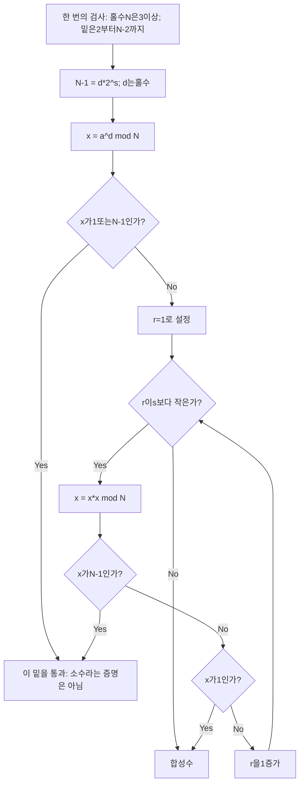
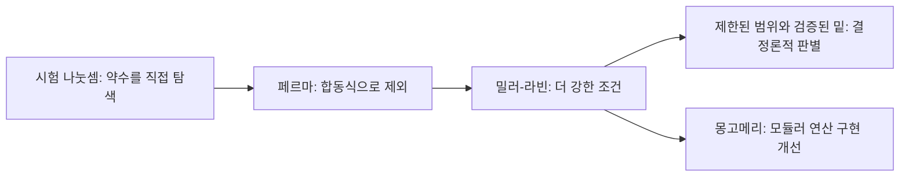

## 들어가며: 소수 판별과 소인수분해의 차이

소수 판별은 주어진 정수가 소수인지 답하는 문제입니다. 합성수의 실제 인수를 찾는 문제와는 다릅니다. [RSA 등의 공개키 암호](https://kenji.blog/ko/p/modern-cryptography-public-key-hash-signature/)에서는 큰 소수를 생성하는 일이 중요하지만, 곱셈 자체가 어려운 것은 아닙니다. 소수를 찾았다는 사실만으로 암호 방식 전체의 안전성이 보장되지도 않습니다.

이 글에서는 시험 나눗셈, 페르마 테스트, 밀러–라빈 테스트를 비교하고 음이 아닌 64비트 정수용 C++ 예제를 제시합니다. 구현의 범위는 $0\le N<2^{64}$이며, RSA 키 생성에 사용하는 수천 비트 정수는 범위 밖입니다. 실행 시간은 구현과 입력에 따라 달라지므로 일정한 초 단위 시간이나 속도 배율을 보장하지 않습니다.

## 1. 소수의 정의와 시험 나눗셈

소수는 양의 약수가 1과 자기 자신뿐인 2 이상의 정수입니다. 합성수는 2 이상이면서 소수가 아닌 정수입니다. 0, 1, 음의 정수는 소수도 합성수도 아닙니다.

합성수 $N=ab$의 인수가 $2\le a\le b$를 만족하면 $a\le\sqrt N$입니다. 따라서 제곱근까지 약수를 찾으면 판별할 수 있습니다. 2를 먼저 검사하고 나머지는 홀수 후보만 검사합니다.

```cpp
#include <cstdint>

bool is_prime_trial_division(std::int64_t n) {
    if (n < 2) return false;
    if (n == 2) return true;
    if (n % 2 == 0) return false;
    for (std::int64_t i = 3; i <= n / i; i += 2) {
        if (n % i == 0) return false;
    }
    return true;
}
```

조건 `i*i <= n`의 부호 있는 곱셈은 오버플로가 발생할 수 있습니다. 양수에서 동치인 `i <= n/i`를 사용하면 이 곱을 만들지 않습니다. 함수의 입력 범위는 `std::int64_t`이며 음수도 `false`를 반환합니다.

최악의 경우 나눗셈 횟수는 $\mathcal{O}(\sqrt N)$입니다. 홀수만 검사하면 후보는 약 $\sqrt N/2$개이지만, 큰 입력에 대해 반복해서 판별하는 비용은 여전히 클 수 있습니다. 실용성의 경계가 일정한 십진 자릿수로 정해지는 것은 아닙니다.

## 2. 페르마 테스트와 모듈러 거듭제곱

소수 $p$와 $\gcd(a,p)=1$을 만족하는 정수 $a$에 대해 페르마의 소정리가 성립합니다.

$$
a^{p-1}\equiv1\pmod p.
$$

따라서 $N>2$에 대해 $1<a<N-1$인 밑을 골랐을 때 이 합동식이 성립하지 않으면 $N$은 합성수입니다. 반대로 통과했다는 사실만으로 소수임이 증명되지는 않습니다. 카마이클 수 $561=3\cdot11\cdot17$은 561과 서로소인 모든 밑에서 통과합니다. 하지만 밑 3은 서로소가 아니며 $3^{560}\bmod561=375$이므로 실패합니다. 어떤 밑을 골라도 항상 속인다는 설명은 정확하지 않습니다.

거대한 정수 거듭제곱 전체를 먼저 만들 필요는 없습니다. 이진 거듭제곱법은 곱셈마다 나머지를 구합니다. 다음 보조 함수들은 독립적으로 컴파일할 수 있습니다. 밑, 지수, 곱셈의 피연산자는 음이 아닌 64비트 정수이고 법 `m`은 양의 64비트 정수입니다. 법이 0이면 예외를 던집니다.

```cpp
#include <cstdint>
#include <stdexcept>

#if !defined(__SIZEOF_INT128__)
#error "This example requires unsigned __int128 support"
#endif

using u64 = std::uint64_t;
using u128 = unsigned __int128;

u64 mod_mul(u64 a, u64 b, u64 m) {
    if (m == 0) throw std::invalid_argument("Modulus must be positive");
    return static_cast<u64>(static_cast<u128>(a) * b % m);
}

u64 mod_pow(u64 base, u64 exp, u64 m) {
    if (m == 0) throw std::invalid_argument("Modulus must be positive");
    u64 result = 1 % m;
    base %= m;
    while (exp > 0) {
        if (exp & 1) result = mod_mul(result, base, m);
        base = mod_mul(base, base, m);
        exp >>= 1;
    }
    return result;
}
```

반환값은 최소 비음수 잉여입니다. 지수가 0이면 $1\bmod m$을 반환하므로 법이 1일 때는 0입니다. 여기서는 $0^0$도 이 계산 규약으로 처리합니다. 음의 밑을 부호 없는 매개변수에 그대로 전달하는 용도는 지원 범위에 포함하지 않습니다.

`unsigned __int128`은 ISO C++ 표준 자료형이 아니라 적절한 대상 플랫폼에서 GCC 등이 제공하는 확장입니다. 코드는 미지원 환경을 컴파일 단계에서 감지하며, 모든 MSVC 환경에서 그대로 동작한다고 가정하지 않습니다. [GCC 문서](https://gcc.gnu.org/onlinedocs/gcc/_005f_005fint128.html)를 참고하세요. 부호 없는 64비트 값 두 개를 곱했을 때 가능한 모든 결과를 저장하려면 부호 없는 128비트가 필요하며, 부호 있는 128비트로는 모든 곱을 표현할 수 없습니다.

## 3. 밀러–라빈 조건과 확률의 의미

홀수 소수를 법으로 할 때 1의 제곱근은 1과 −1뿐입니다. 밀러–라빈 테스트는 이 성질과 페르마의 소정리를 결합합니다. 홀수 $N\ge3$에 대해 다음과 같이 분해합니다.

$$
N-1=d\,2^s,\qquad d\text{ is odd},\quad s\ge1.
$$

즉 d는 홀수입니다. 밑 $a$가 $1<a<N-1$을 만족할 때 통과 조건은 다음 중 하나입니다.

$$
a^d\equiv1\pmod N
\quad\text{or}\quad
\exists r\ (0\le r<s):\ a^{d2^r}\equiv-1\pmod N.
$$

소수는 반드시 통과하며, 실패하면 합성수임을 알 수 있습니다. 반복 제곱 중 직전 값이 1도 −1도 아니었는데 1이 나오면 역시 합성수입니다. 수학에서 −1의 최소 비음수 잉여는 $N-1$이지만, C++의 부호 있는 식 `-1 % N`이 그 값을 반환하는 것은 아닙니다. 예를 들어 `-1 % 7`은 −1입니다. 수학적 잉여와 [C++의 나눗셈·나머지 규칙](https://eel.is/c++draft/expr.mul)을 구분해야 합니다.

고정된 홀수 합성수 $N$에 대해 밑을 $2\le a\le N-2$에서 독립적이고 균등하게 선택하면 한 번 통과할 확률은 최대 $1/4$입니다. 따라서 잘못하여 $k$번 모두 통과할 확률은 다음과 같이 제한됩니다.

$$
\Pr[\text{all }k\text{ rounds pass}\mid N\text{ is composite}]\le4^{-k}.
$$

이는 밑을 무작위로 선택하는 과정의 오류 확률입니다. 통과한 뒤 그 정수가 합성수일 확률이 그대로 $4^{-k}$라고 바꾸어 말할 수는 없습니다. 임의로 고정한 밑의 집합에도 독립 균등 무작위 선택의 논리를 적용할 수 없습니다. N=3에서는 밑의 구간이 비어 있으므로 구현에서 먼저 판별합니다. [라빈의 원논문](https://math.nyu.edu/~goodman/teaching/Algebra_2_2021/MillerRabinTest.pdf)도 확률적 통과와 소수라는 증명을 구별합니다.

다음 그림은 일반적인 밑으로 한 번 검사하는 흐름입니다. N=3은 사전에 처리했으며, 홀수 입력에는 지정 구간에서 선택할 수 있는 밑이 있어야 합니다.



## 4. 범위를 제한한 결정론적 판별

제한된 정수 범위에서는 알려진 검증 결과에 근거한 충분한 밑의 집합으로 난수 없이 판별할 수 있습니다. [SPRP 밑 기록](https://miller-rabin.appspot.com/)에 실린 이번 구현의 조건은 다음과 같습니다. 모든 상한은 엄격한 미만 조건입니다.

| 입력 범위 | 검사할 밑 |
| --- | --- |
| $N<4759123141$ | 2, 7, 61 |
| $N<1122004669633$ | 2, 13, 23, 1662803 |
| $N<2^{64}$ | 2, 325, 9375, 28178, 450775, 9780504, 1795265022 |

마지막 집합은 소수 7개가 아니라 정수 밑 7개입니다. 예를 들어 325는 합성수입니다. 기록에는 이 일곱 밑의 결과가 Jim Sinclair의 2011년 결과로 기재되어 있습니다. 이 글에서 64비트 전체 범위를 독립적으로 다시 탐색한 것은 아닙니다.

다른 방법으로 처음 12개 소수 `2, 3, 5, 7, 11, 13, 17, 19, 23, 29, 31, 37`도 이 64비트 범위를 판별하기에 충분합니다. [Sorenson–Webster의 결과](https://arxiv.org/abs/1509.00864)에서 열두 밑 모두에 대한 가장 작은 강한 유사소수는 318665857834031151167461이며 $2^{64}$보다 큽니다. 아래 구현은 열두 밑의 대안이 아니라 표의 범위별 3·4·7개 밑을 사용합니다.

## 5. 완전한 C++ 예제

입력형 `u64`의 범위는 $0\le N\le2^{64}-1$입니다. 0과 1은 `false`이지만 합성수라는 뜻은 아니므로 출력은 `Not prime`으로 합니다. 모듈러 곱셈은 곱을 만들기 전에 형 변환합니다. 밑을 N으로 나눈 나머지로 줄이고 0이면 해당 밑만 건너뛰어 다른 밑을 계속 검사합니다. 밑이 0이라는 사실만으로 정수 전체의 소수·합성수 여부를 판단할 수 없습니다.

아래 블록은 보조 함수까지 포함한 완전한 프로그램입니다. 앞의 블록을 추가로 이어 붙일 필요가 없습니다. 지원되는 GCC 대상 플랫폼에서는 `g++ -std=c++17 -O2 primality.cpp -o primality`와 같은 명령으로 컴파일할 수 있습니다.

```cpp
#include <cstdint>
#include <stdexcept>

#if !defined(__SIZEOF_INT128__)
#error "This example requires unsigned __int128 support"
#endif

using u64 = std::uint64_t;
using u128 = unsigned __int128;

u64 mod_mul(u64 a, u64 b, u64 m) {
    if (m == 0) throw std::invalid_argument("Modulus must be positive");
    return static_cast<u64>(static_cast<u128>(a) * b % m);
}

u64 mod_pow(u64 base, u64 exp, u64 m) {
    if (m == 0) throw std::invalid_argument("Modulus must be positive");
    u64 result = 1 % m;
    base %= m;
    while (exp > 0) {
        if (exp & 1) result = mod_mul(result, base, m);
        base = mod_mul(base, base, m);
        exp >>= 1;
    }
    return result;
}

#include <iostream>
#include <initializer_list>
#include <vector>

bool is_prime_miller_rabin(u64 n) {
    if (n < 2) return false;
    for (u64 p : {2ULL, 3ULL, 5ULL, 7ULL}) {
        if (n == p) return true;
        if (n % p == 0) return false;
    }

    u64 d = n - 1;
    unsigned s = 0;
    while ((d & 1) == 0) {
        d >>= 1;
        ++s;
    }

    std::vector<u64> bases;
    if (n < 4759123141ULL) {
        bases = {2, 7, 61};
    } else if (n < 1122004669633ULL) {
        bases = {2, 13, 23, 1662803};
    } else {
        bases = {2, 325, 9375, 28178, 450775, 9780504, 1795265022};
    }

    for (u64 a : bases) {
        a %= n;
        if (a == 0) continue; // No witness from this base; keep testing the others.
        u64 x = mod_pow(a, d, n);
        if (x == 1 || x == n - 1) continue;

        bool passed = false;
        for (unsigned r = 1; r < s; ++r) {
            x = mod_mul(x, x, n);
            if (x == n - 1) {
                passed = true;
                break;
            }
            if (x == 1) return false;
        }
        if (!passed) return false;
    }
    return true;
}

int main() {
    const std::vector<u64> cases = {
        0, 1, 2, 73, 561, 1000000007, 998244353,
        1000000000000000003ULL, 1000000000000000007ULL,
        18446744073709551557ULL, 18446744073709551615ULL
    };
    for (u64 n : cases) {
        std::cout << n << " is "
                  << (is_prime_miller_rabin(n) ? "Prime" : "Not prime") << '\n';
    }
}
```

출력은 순서대로 0과 1은 `Not prime`, 2와 73은 `Prime`, 561은 `Not prime`, 1000000007·998244353·1000000000000000003은 `Prime`, 1000000000000000007은 `Not prime`, 18446744073709551557은 `Prime`, 18446744073709551615는 `Not prime`입니다. 마지막 합성수는 $2^{64}-1$입니다. 이는 지정 범위의 교육 및 일반 정수 판별용 예제이며, 암호용 소수 생성기나 상수 시간 구현, 입력 문자열을 검증하는 라이브러리는 아닙니다.

## 6. 계산량과 몽고메리 곱셈

모듈러 곱셈 한 번을 하나의 연산으로 세면 이진 거듭제곱과 한 번의 밀러–라빈 검사는 $\mathcal{O}(\log N)$, k개의 밑은 $\mathcal{O}(k\log N)$번의 연산을 사용합니다. 시험 나눗셈의 나눗셈 횟수는 $\mathcal{O}(\sqrt N)$입니다. 입력 길이 $b=\lfloor\log_2 N\rfloor+1$로 쓰면 밀러–라빈의 모듈러 곱셈 횟수는 $\mathcal{O}(kb)$입니다. 임의 정밀도 정수의 비트 복잡도에는 곱셈과 나머지 계산 비용도 포함해야 합니다.

이번 고정 범위에서는 밑이 최대 7개입니다. 그러나 한 비트에 제곱뿐 아니라 조건부 곱셈이 필요할 수 있고, 이후의 제곱 반복에도 연산이 필요합니다. 따라서 전체 기본 연산 수를 $7\times64=448$로 제한할 수 없습니다. 실행 시간을 비교할 때는 CPU, 컴파일러, 최적화 옵션, 입력 집합, 측정 방법을 명시해야 합니다.

몽고메리 곱셈은 같은 법으로 연산을 반복할 때 표현을 바꾸어 그 법으로 나누는 연산을 피하는 방법입니다. 기수가 2의 거듭제곱인 일반적인 구성에서는 법이 홀수여야 하며 기수와 서로소여야 합니다. 곱셈과 시프트 외에 덧셈, 자리올림 처리, 조건부 뺄셈도 쓰고, 표현 변환과 사전 계산 비용도 듭니다. 항상 2~3배 빨라진다는 보장은 없습니다. 절차와 조건은 [HAC 14장의 알고리즘14.32·14.36·14.94](https://cacr.uwaterloo.ca/hac/about/chap14.pdf)를 참고하세요. 위 코드에는 몽고메리 곱셈을 구현하지 않았습니다.

## 7. 마무리

시험 나눗셈은 약수를 직접 찾고, 페르마 테스트는 합동식을 이용해 후보를 제외합니다. 밀러–라빈은 더 강한 조건을 사용합니다. 일반적인 확률적 판별과, 입력 범위 및 검증된 밑의 집합을 제한한 결정론적 판별을 구분해야 합니다.



정확성은 수학뿐 아니라 입력 범위, 정수형, 오버플로, 법의 조건과 밑의 처리에도 달려 있습니다. 64비트 코드의 보장을 임의 길이 정수나 암호 시스템 전체로 확장해서는 안 됩니다.

### 참고 자료

- [HAC 4장: 페르마·밀러–라빈과 오류 확률의 조건](https://cacr.uwaterloo.ca/hac/about/chap4.pdf) (1996년 자료이므로 이후의 소수 판별 결과 및 현행 키 생성 표준과 구분)
- [Rabin (1980): Probabilistic Algorithm for Testing Primality](https://math.nyu.edu/~goodman/teaching/Algebra_2_2021/MillerRabinTest.pdf)
- [결정론적 밀러–라빈의 SPRP 밑 기록](https://miller-rabin.appspot.com/)
- [Sorenson–Webster: Strong Pseudoprimes to Twelve Prime Bases](https://arxiv.org/abs/1509.00864) (2015년 프리프린트, 2017년 학술지 게재)
- [GCC: 128비트 정수 확장](https://gcc.gnu.org/onlinedocs/gcc/_005f_005fint128.html)
- [C++ 작업 초안: 나눗셈과 나머지](https://eel.is/c++draft/expr.mul)
- [HAC 14장: 몽고메리 연산](https://cacr.uwaterloo.ca/hac/about/chap14.pdf)
