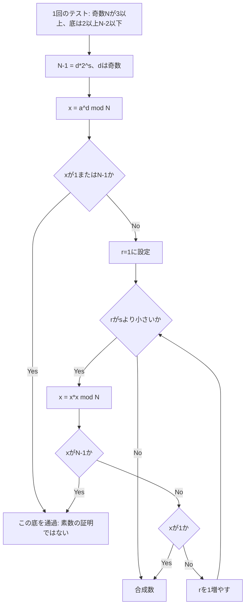
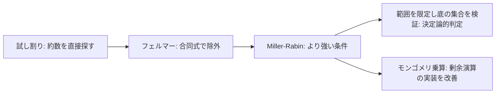

## はじめに：素数判定と因数分解を区別する

素数判定は「この整数は素数か」を答える問題です。合成数の因数を実際に求める問題とは異なります。[RSAなどの公開鍵暗号](https://kenji.blog/p/modern-cryptography-public-key-hash-signature/)では大きな素数の生成が重要ですが、掛け算そのものが難しいわけではありません。また、素数を見つけるだけで暗号方式の安全性が保証されるわけでもありません。

ここでは試し割り、フェルマーテスト、Miller–Rabin法を比較し、非負64ビット整数を判定するC++例を示します。実装の対象は $0\le N<2^{64}$ であり、RSAの鍵生成で扱う数千ビットの整数は範囲外です。実行時間は処理系や入力に依存するため、秒数や速度倍率を一律に保証しません。

## 1. 素数の定義と試し割り

素数は、正の約数が1と自分自身だけである2以上の整数です。合成数は2以上で素数ではない整数で、0・1・負の整数は素数でも合成数でもありません。

合成数 $N=ab$ に $2\le a\le b$ を満たす因数があれば、$a\le\sqrt N$ です。そのため、平方根まで約数を探せば判定できます。2を先に調べ、残りは奇数だけを試します。

```cpp
#include <cstdint>

bool is_prime_trial_division(std::int64_t n) {
    if (n < 2) return false;
    if (n == 2) return true;
    if (n % 2 == 0) return false;
    for (std::int64_t i = 3; i <= n / i; i += 2) {
        if (n % i == 0) return false;
    }
    return true;
}
```

ループ条件を `i*i <= n` にすると符号付き整数の乗算がオーバーフローするおそれがあるため、正の値について同値な `i <= n/i` を使っています。この関数は `std::int64_t` の範囲を対象とし、負数も `false` にします。

最悪の場合の除算回数は $\mathcal{O}(\sqrt N)$ です。奇数だけなら候補はおよそ $\sqrt N/2$ 個ですが、大きな値への多数回の判定には依然として負担になります。特定の桁数だけで実用性の境界は決まりません。

## 2. フェルマーテストと剰余べき乗

素数 $p$ と $\gcd(a,p)=1$ を満たす整数 $a$ について、フェルマーの小定理が成り立ちます。

$$
a^{p-1}\equiv1\pmod p.
$$

したがって、$N>2$ に対して $1<a<N-1$ を選び、この合同式に反すれば $N$ は合成数です。ただし、成立したことだけでは素数とはいえません。$561=3\cdot11\cdot17$ はカーマイケル数で、561と互いに素な底ではすべて通過します。一方、底3は互いに素ではなく、$3^{560}\bmod561=375$ なので失敗します。「どの底でも必ずだます」という説明は正確ではありません。

べき乗を通常の整数として構成する必要はありません。繰り返し二乗法で、各乗算のたびに剰余を取ります。以下は単独でコンパイルできる補助関数群です。`base`・`exp`・乗算の引数は非負64ビット整数、法 `m` は正の64ビット整数を受け取り、法0は例外にします。

```cpp
#include <cstdint>
#include <stdexcept>

#if !defined(__SIZEOF_INT128__)
#error "This example requires unsigned __int128 support"
#endif

using u64 = std::uint64_t;
using u128 = unsigned __int128;

u64 mod_mul(u64 a, u64 b, u64 m) {
    if (m == 0) throw std::invalid_argument("Modulus must be positive");
    return static_cast<u64>(static_cast<u128>(a) * b % m);
}

u64 mod_pow(u64 base, u64 exp, u64 m) {
    if (m == 0) throw std::invalid_argument("Modulus must be positive");
    u64 result = 1 % m;
    base %= m;
    while (exp > 0) {
        if (exp & 1) result = mod_mul(result, base, m);
        base = mod_mul(base, base, m);
        exp >>= 1;
    }
    return result;
}
```

返り値は最小非負剰余です。指数0では $1\bmod m$ を返すので、法1なら0となります。ここでは $0^0$ もこの計算規約で扱います。負の底を符号なし型へそのまま渡す用途は対象外です。

`unsigned __int128` はISO C++の標準型ではなく、対応ターゲット上のGCCなどの拡張です。上のコードは非対応の処理系をコンパイル時に検出します。すべてのMSVC環境でそのまま動くとは限りません。[GCCの型の説明](https://gcc.gnu.org/onlinedocs/gcc/_005f_005fint128.html)を参照してください。符号なし64ビット値2個の積には符号なし128ビットが必要で、符号付き128ビットでは範囲全体を表せません。

## 3. Miller–Rabin法の条件と確率の意味

奇素数を法とすると、1の平方根は1と−1だけです。Miller–Rabin法は、この性質とフェルマーの小定理を組み合わせます。奇数 $N\ge3$ について、次のように分解します。

$$
N-1=d\,2^s,\qquad d\text{ is odd},\quad s\ge1.
$$

底 $a$ が $1<a<N-1$ を満たすとき、通過条件はいずれかです。

$$
a^d\equiv1\pmod N
\quad\text{or}\quad
\exists r\ (0\le r<s):\ a^{d2^r}\equiv-1\pmod N.
$$

素数なら必ず通過し、失敗すれば合成数です。途中の二乗で、直前の値が1でも−1でもなかったのに1になれば、やはり合成数と分かります。数学上の−1の最小非負剰余は $N-1$ ですが、C++の符号付き式 `-1 % N` がその値を返すわけではありません。たとえば `-1 % 7` は−1です。[C++の除算・剰余の規則](https://eel.is/c++draft/expr.mul)と区別してください。

固定した奇合成数 $N$ に対して、底を $2\le a\le N-2$ から独立かつ一様に選ぶ各回の通過確率は高々 $1/4$ です。したがって、$k$ 回すべてを誤って通過する確率は次のように抑えられます。

$$
\Pr[\text{all }k\text{ rounds pass}\mid N\text{ is composite}]\le4^{-k}.
$$

これは乱数の選択に対する誤り確率です。通過後にその整数が合成数である確率を、そのまま $4^{-k}$ と言い換えることはできません。任意の固定した底の集合にも、この独立一様乱数の説明は適用できません。N=3はこの底の区間が空になるため、実装では先に判定します。[Rabinの原論文](https://math.nyu.edu/~goodman/teaching/Algebra_2_2021/MillerRabinTest.pdf)も、確率的な通過と素数の証明を区別しています。

次は通常の底に対する1回の流れです。N=3は事前判定済みとし、実際に底を選べる奇数Nを扱います。



## 4. 範囲を限定した決定論的判定

限られた範囲の整数では、十分な底の集合を既知の検証結果に基づいて選ぶことで、乱数を使わずに判定できます。[SPRPの底の記録](https://miller-rabin.appspot.com/)に掲載された、今回使う条件は以下です。境界はいずれも「未満」です。

| 対象範囲 | 試す底 |
| --- | --- |
| $N<4759123141$ | 2, 7, 61 |
| $N<1122004669633$ | 2, 13, 23, 1662803 |
| $N<2^{64}$ | 2, 325, 9375, 28178, 450775, 9780504, 1795265022 |

最後の7個は「7つの素数」ではなく整数の底です。たとえば325は合成数です。記録はこの7底をJim Sinclairの2011年の結果として掲載しています。本記事で64ビット全域を再探索したわけではありません。

別の選択として、最初の12素数 `2, 3, 5, 7, 11, 13, 17, 19, 23, 29, 31, 37` でもこの64ビット範囲を判定できます。[Sorenson–Websterの結果](https://arxiv.org/abs/1509.00864)による最初の共通強擬素数は318665857834031151167461で、$2^{64}$ より大きいからです。以下は12底ではなく、表の3・4・7底を範囲別に使います。

## 5. C++の完全な例

入力型 `u64` の範囲は $0\le N\le2^{64}-1$ です。0と1は `false` ですが、合成数という意味ではないので、出力は `Not prime` としています。剰余乗算は必ずキャストしてから積を作ります。底はNで縮約し、0ならその底だけを飛ばして残りを調べます。底が0というだけで整数全体の素数・合成数は決められません。

以下のブロックは補助関数も含む完全なプログラムです。前のブロックを追加で連結する必要はありません。対応するGCC環境なら `g++ -std=c++17 -O2 primality.cpp -o primality` のようにコンパイルできます。

```cpp
#include <cstdint>
#include <stdexcept>

#if !defined(__SIZEOF_INT128__)
#error "This example requires unsigned __int128 support"
#endif

using u64 = std::uint64_t;
using u128 = unsigned __int128;

u64 mod_mul(u64 a, u64 b, u64 m) {
    if (m == 0) throw std::invalid_argument("Modulus must be positive");
    return static_cast<u64>(static_cast<u128>(a) * b % m);
}

u64 mod_pow(u64 base, u64 exp, u64 m) {
    if (m == 0) throw std::invalid_argument("Modulus must be positive");
    u64 result = 1 % m;
    base %= m;
    while (exp > 0) {
        if (exp & 1) result = mod_mul(result, base, m);
        base = mod_mul(base, base, m);
        exp >>= 1;
    }
    return result;
}

#include <iostream>
#include <initializer_list>
#include <vector>

bool is_prime_miller_rabin(u64 n) {
    if (n < 2) return false;
    for (u64 p : {2ULL, 3ULL, 5ULL, 7ULL}) {
        if (n == p) return true;
        if (n % p == 0) return false;
    }

    u64 d = n - 1;
    unsigned s = 0;
    while ((d & 1) == 0) {
        d >>= 1;
        ++s;
    }

    std::vector<u64> bases;
    if (n < 4759123141ULL) {
        bases = {2, 7, 61};
    } else if (n < 1122004669633ULL) {
        bases = {2, 13, 23, 1662803};
    } else {
        bases = {2, 325, 9375, 28178, 450775, 9780504, 1795265022};
    }

    for (u64 a : bases) {
        a %= n;
        if (a == 0) continue; // No witness from this base; keep testing the others.
        u64 x = mod_pow(a, d, n);
        if (x == 1 || x == n - 1) continue;

        bool passed = false;
        for (unsigned r = 1; r < s; ++r) {
            x = mod_mul(x, x, n);
            if (x == n - 1) {
                passed = true;
                break;
            }
            if (x == 1) return false;
        }
        if (!passed) return false;
    }
    return true;
}

int main() {
    const std::vector<u64> cases = {
        0, 1, 2, 73, 561, 1000000007, 998244353,
        1000000000000000003ULL, 1000000000000000007ULL,
        18446744073709551557ULL, 18446744073709551615ULL
    };
    for (u64 n : cases) {
        std::cout << n << " is "
                  << (is_prime_miller_rabin(n) ? "Prime" : "Not prime") << '\n';
    }
}
```

出力は順に、0・1が `Not prime`、2・73が `Prime`、561が `Not prime`、1000000007・998244353・1000000000000000003が `Prime`、1000000000000000007が `Not prime`、18446744073709551557が `Prime`、18446744073709551615が `Not prime` です。最後の合成数は $2^{64}-1$ です。これは64ビット範囲の教材・一般整数判定用の例で、暗号用の素数生成器、定数時間実装、入力文字列の検証を含むライブラリではありません。

## 6. 計算量とモンゴメリ乗算

剰余乗算を1操作として数えると、繰り返し二乗法と1回のMiller–Rabinは $\mathcal{O}(\log N)$、底をk個試す場合は $\mathcal{O}(k\log N)$ です。試し割りは除算回数が $\mathcal{O}(\sqrt N)$ です。入力長 $b=\lfloor\log_2 N\rfloor+1$ を使えば、Miller–Rabinの剰余乗算回数は $\mathcal{O}(kb)$ となります。任意精度整数でのビット計算量には、その乗算・剰余計算の費用も必要です。

今回の固定範囲では底は高々7個です。ただし、1ビットにつき二乗だけでなく条件付き乗算があり、その後の二乗列もあるため、基本演算総数を $7\times64=448$ とすることはできません。速度を比較するなら、CPU・処理系・最適化オプション・入力群・測定方法を明記してください。

モンゴメリ乗算は、同じ法で演算を繰り返す場合に、表現を変えて法による除算を避ける方法です。基数を2のべきにする通常の構成では、法は奇数で基数と互いに素である必要があります。乗算・シフトに加え、加算、桁上がり処理、条件付き減算なども使い、変換や前計算の費用もあります。常に2〜3倍速くなるという保証はありません。手順と条件は[HAC第14章の14.32・14.36・14.94](https://cacr.uwaterloo.ca/hac/about/chap14.pdf)を参照してください。上のコード自体には実装していません。

## 7. まとめ

試し割りは約数を直接調べ、フェルマーテストは合同式で候補を除外します。Miller–Rabinはより強い条件を使いますが、一般の確率的判定と、範囲・底の組を限定した決定論的判定は区別が必要です。



正しさは数式だけでなく、入力範囲、整数型、オーバーフロー、法の条件、底の扱いにも依存します。64ビット用コードの保証を任意長の整数や暗号システム全体へ広げないことが、実装を使う際の重要な前提です。

### 参照

- [HAC第4章：Fermat・Miller–Rabin・誤り確率の条件](https://cacr.uwaterloo.ca/hac/about/chap4.pdf)（1996年の資料。以後の素数判定の発展や最新の鍵生成規格とは区別）
- [Rabin (1980): Probabilistic Algorithm for Testing Primality](https://math.nyu.edu/~goodman/teaching/Algebra_2_2021/MillerRabinTest.pdf)
- [決定論的Miller–RabinのSPRP底の記録](https://miller-rabin.appspot.com/)
- [Sorenson–Webster: Strong Pseudoprimes to Twelve Prime Bases](https://arxiv.org/abs/1509.00864)（2015年プレプリント、2017年誌上刊行）
- [GCC：128ビット整数拡張](https://gcc.gnu.org/onlinedocs/gcc/_005f_005fint128.html)
- [C++ working draft：除算と剰余](https://eel.is/c++draft/expr.mul)
- [HAC第14章：モンゴメリ演算](https://cacr.uwaterloo.ca/hac/about/chap14.pdf)
