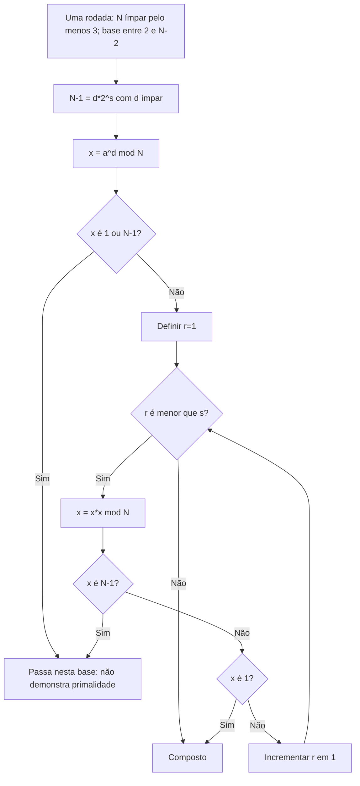
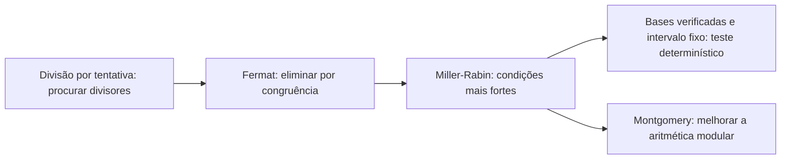

## Introdução: distinguir primalidade de fatoração

O teste de primalidade responde se um inteiro é primo. Encontrar os fatores de um inteiro composto é outro problema. Gerar primos grandes é importante na [criptografia de chave pública, como RSA](https://kenji.blog/pt/p/modern-cryptography-public-key-hash-signature/), mas a multiplicação em si não é a operação difícil. Encontrar primos também não garante, por si só, a segurança de um esquema criptográfico.

Vamos comparar a divisão por tentativa, o teste de Fermat e o de Miller–Rabin, e apresentar uma implementação em C++ para inteiros não negativos de 64 bits. O domínio é $0\le N<2^{64}$, não os inteiros de milhares de bits usados na geração de chaves RSA. O tempo depende da implementação e da entrada, sem garantia universal de duração ou fator de aceleração.

## 1. Primos e divisão por tentativa

Um primo é um inteiro maior ou igual a 2 cujos únicos divisores positivos são 1 e ele mesmo. Um composto é um inteiro maior ou igual a 2 que não é primo. Zero, um e inteiros negativos não são primos nem compostos.

Se um composto $N=ab$ tem fatores com $2\le a\le b$, então $a\le\sqrt N$. Basta procurar divisores até a raiz quadrada. Primeiro verificamos o 2 e depois apenas candidatos ímpares.

```cpp
#include <cstdint>

bool is_prime_trial_division(std::int64_t n) {
    if (n < 2) return false;
    if (n == 2) return true;
    if (n % 2 == 0) return false;
    for (std::int64_t i = 3; i <= n / i; i += 2) {
        if (n % i == 0) return false;
    }
    return true;
}
```

A multiplicação com sinal em `i*i <= n` pode causar overflow. Para valores positivos, a condição equivalente `i <= n/i` evita esse produto. A função aceita o intervalo de `std::int64_t` e também retorna `false` para entradas negativas.

O número de divisões no pior caso é $\mathcal{O}(\sqrt N)$. Testar apenas ímpares dá aproximadamente $\sqrt N/2$ candidatos, mas muitos testes com entradas grandes ainda podem custar caro. Não existe um limite universal de quantidade de dígitos para a viabilidade prática.

## 2. Fermat e a exponenciação modular

O pequeno teorema de Fermat afirma que, para um primo $p$ e um inteiro $a$ com $\gcd(a,p)=1$:

$$
a^{p-1}\equiv1\pmod p.
$$

Portanto, para $N>2$, se uma base $1<a<N-1$ não satisfizer a congruência, $N$ é composto. Passar no teste não demonstra primalidade. O número de Carmichael $561=3\cdot11\cdot17$ passa em todas as bases coprimas com 561. Já a base 3 não é coprima, e $3^{560}\bmod561=375$, portanto falha. Não é correto dizer que qualquer base necessariamente engana o teste.

Não precisamos construir a potência inteira completa. A exponenciação binária faz a redução modular após cada multiplicação. As funções auxiliares abaixo podem ser compiladas separadamente. A base, o expoente e os operandos da multiplicação são inteiros não negativos de 64 bits; o módulo `m` é um inteiro positivo de 64 bits. Módulo zero lança uma exceção.

```cpp
#include <cstdint>
#include <stdexcept>

#if !defined(__SIZEOF_INT128__)
#error "This example requires unsigned __int128 support"
#endif

using u64 = std::uint64_t;
using u128 = unsigned __int128;

u64 mod_mul(u64 a, u64 b, u64 m) {
    if (m == 0) throw std::invalid_argument("Modulus must be positive");
    return static_cast<u64>(static_cast<u128>(a) * b % m);
}

u64 mod_pow(u64 base, u64 exp, u64 m) {
    if (m == 0) throw std::invalid_argument("Modulus must be positive");
    u64 result = 1 % m;
    base %= m;
    while (exp > 0) {
        if (exp & 1) result = mod_mul(result, base, m);
        base = mod_mul(base, base, m);
        exp >>= 1;
    }
    return result;
}
```

O resultado é o menor resíduo não negativo. Expoente zero retorna $1\bmod m$, que vale zero quando o módulo é um. Aqui, $0^0$ também segue essa convenção computacional. Passar diretamente uma base negativa para um parâmetro sem sinal está fora do uso previsto.

`unsigned __int128` é uma extensão, não um tipo do padrão ISO C++. O GCC a oferece em plataformas de destino adequadas, e o código detecta sua ausência durante a compilação. Não se presume que funcione sem alterações em qualquer ambiente MSVC; consulte a [documentação do GCC](https://gcc.gnu.org/onlinedocs/gcc/_005f_005fint128.html). Para armazenar todos os produtos possíveis de dois valores sem sinal de 64 bits, são necessários 128 bits sem sinal; o tipo de 128 bits com sinal não representa todos esses produtos.

## 3. Condições de Miller–Rabin e significado da probabilidade

Módulo um primo ímpar, as únicas raízes quadradas de 1 são 1 e −1. Miller–Rabin combina esse fato com o pequeno teorema de Fermat. Para um ímpar $N\ge3$, escrevemos:

$$
N-1=d\,2^s,\qquad d\text{ is odd},\quad s\ge1.
$$

Ou seja, d é ímpar. Uma base $a$ com $1<a<N-1$ passa no teste se uma das condições for satisfeita:

$$
a^d\equiv1\pmod N
\quad\text{or}\quad
\exists r\ (0\le r<s):\ a^{d2^r}\equiv-1\pmod N.
$$

Um primo sempre passa; uma falha demonstra que o número é composto. Se os quadrados sucessivos produzirem 1 quando o valor anterior não era 1 nem −1, isso também demonstra que é composto. O menor resíduo não negativo de −1 é $N-1$, mas a expressão com sinal de C++ `-1 % N` não retorna esse valor. Por exemplo, `-1 % 7` resulta em −1. Devemos distinguir o resíduo matemático das [regras de divisão e resto de C++](https://eel.is/c++draft/expr.mul).

Para um composto ímpar fixo $N$, cada base escolhida de forma independente e uniforme em $2\le a\le N-2$ passa com probabilidade no máximo $1/4$. Assim, a probabilidade de passar incorretamente em todas as $k$ rodadas satisfaz:

$$
\Pr[\text{all }k\text{ rounds pass}\mid N\text{ is composite}]\le4^{-k}.
$$

Essa é uma probabilidade de erro sobre a escolha aleatória das bases. Não pode ser simplesmente reformulada como a probabilidade de $4^{-k}$ de o inteiro ser composto depois de passar. O argumento também não se aplica a um conjunto fixo arbitrário de bases. Para N=3 o intervalo de bases está vazio, por isso a implementação o trata primeiro. O [artigo original de Rabin](https://math.nyu.edu/~goodman/teaching/Algebra_2_2021/MillerRabinTest.pdf) também distingue a aceitação probabilística de uma demonstração de primalidade.

O diagrama mostra uma rodada com uma base usual. N=3 já foi tratado; o ímpar de entrada precisa admitir uma base no intervalo indicado.



## 4. Teste determinístico em um intervalo fixo

Em um intervalo limitado de inteiros, um conjunto suficiente de bases respaldado por resultados de verificação conhecidos permite testar sem aleatoriedade. Os [registros de bases SPRP](https://miller-rabin.appspot.com/) apresentam as condições utilizadas aqui. Todos os limites superiores são estritos.

| Intervalo de entrada | Bases testadas |
| --- | --- |
| $N<4759123141$ | 2, 7, 61 |
| $N<1122004669633$ | 2, 13, 23, 1662803 |
| $N<2^{64}$ | 2, 325, 9375, 28178, 450775, 9780504, 1795265022 |

O último conjunto contém sete bases inteiras, não sete primos: 325, por exemplo, é composto. O registro atribui esse resultado de sete bases a Jim Sinclair, em 2011. Este artigo não repete de forma independente toda a busca no intervalo de 64 bits.

Outra opção são os doze primeiros primos `2, 3, 5, 7, 11, 13, 17, 19, 23, 29, 31, 37`, que também bastam para esse intervalo de 64 bits. O [resultado de Sorenson–Webster](https://arxiv.org/abs/1509.00864) identifica 318665857834031151167461 como o primeiro composto que é pseudoprimo forte para todas as doze bases; ele supera $2^{64}$. A implementação abaixo usa as ramificações de 3, 4 e 7 bases da tabela, não a alternativa de doze bases.

## 5. Exemplo completo em C++

O tipo de entrada `u64` abrange $0\le N\le2^{64}-1$. Zero e um retornam `false`, mas não são compostos, então a saída diz `Not prime`. A multiplicação modular converte o tipo antes de formar o produto. Cada base é reduzida módulo N; se virar zero, apenas essa base é ignorada e as demais continuam sendo testadas. Uma base zero, sozinha, não determina se o inteiro é primo ou composto.

O próximo bloco é um programa completo com suas funções auxiliares. Não é preciso concatenar os blocos anteriores. Em um destino GCC compatível, compile com um comando como `g++ -std=c++17 -O2 primality.cpp -o primality`.

```cpp
#include <cstdint>
#include <stdexcept>

#if !defined(__SIZEOF_INT128__)
#error "This example requires unsigned __int128 support"
#endif

using u64 = std::uint64_t;
using u128 = unsigned __int128;

u64 mod_mul(u64 a, u64 b, u64 m) {
    if (m == 0) throw std::invalid_argument("Modulus must be positive");
    return static_cast<u64>(static_cast<u128>(a) * b % m);
}

u64 mod_pow(u64 base, u64 exp, u64 m) {
    if (m == 0) throw std::invalid_argument("Modulus must be positive");
    u64 result = 1 % m;
    base %= m;
    while (exp > 0) {
        if (exp & 1) result = mod_mul(result, base, m);
        base = mod_mul(base, base, m);
        exp >>= 1;
    }
    return result;
}

#include <iostream>
#include <initializer_list>
#include <vector>

bool is_prime_miller_rabin(u64 n) {
    if (n < 2) return false;
    for (u64 p : {2ULL, 3ULL, 5ULL, 7ULL}) {
        if (n == p) return true;
        if (n % p == 0) return false;
    }

    u64 d = n - 1;
    unsigned s = 0;
    while ((d & 1) == 0) {
        d >>= 1;
        ++s;
    }

    std::vector<u64> bases;
    if (n < 4759123141ULL) {
        bases = {2, 7, 61};
    } else if (n < 1122004669633ULL) {
        bases = {2, 13, 23, 1662803};
    } else {
        bases = {2, 325, 9375, 28178, 450775, 9780504, 1795265022};
    }

    for (u64 a : bases) {
        a %= n;
        if (a == 0) continue; // No witness from this base; keep testing the others.
        u64 x = mod_pow(a, d, n);
        if (x == 1 || x == n - 1) continue;

        bool passed = false;
        for (unsigned r = 1; r < s; ++r) {
            x = mod_mul(x, x, n);
            if (x == n - 1) {
                passed = true;
                break;
            }
            if (x == 1) return false;
        }
        if (!passed) return false;
    }
    return true;
}

int main() {
    const std::vector<u64> cases = {
        0, 1, 2, 73, 561, 1000000007, 998244353,
        1000000000000000003ULL, 1000000000000000007ULL,
        18446744073709551557ULL, 18446744073709551615ULL
    };
    for (u64 n : cases) {
        std::cout << n << " is "
                  << (is_prime_miller_rabin(n) ? "Prime" : "Not prime") << '\n';
    }
}
```

A saída classifica 0 e 1 como `Not prime`; 2 e 73 como `Prime`; 561 como `Not prime`; 1000000007, 998244353 e 1000000000000000003 como `Prime`; 1000000000000000007 como `Not prime`; 18446744073709551557 como `Prime`; e 18446744073709551615 como `Not prime`. O último composto é $2^{64}-1$. Este é um exemplo didático e de teste de inteiros no intervalo indicado, não um gerador criptográfico de primos, uma implementação de tempo constante nem uma biblioteca que valide strings de entrada.

## 6. Complexidade e multiplicação de Montgomery

Contando uma multiplicação modular como uma operação, a exponenciação binária e uma rodada de Miller–Rabin usam $\mathcal{O}(\log N)$ operações; testar k bases usa $\mathcal{O}(k\log N)$. A divisão por tentativa faz $\mathcal{O}(\sqrt N)$ divisões. Em função do comprimento de entrada $b=\lfloor\log_2 N\rfloor+1$, Miller–Rabin usa $\mathcal{O}(kb)$ multiplicações modulares. Para inteiros de precisão arbitrária, a complexidade em bits também inclui o custo da multiplicação e da redução modular.

Este intervalo fixo exige no máximo sete bases. Porém, um bit pode exigir uma multiplicação condicional além de um quadrado, e a sequência posterior de quadrados acrescenta operações. Logo, $7\times64=448$ não limita todas as operações elementares. Uma comparação de tempos deve informar CPU, compilador, opções de otimização, conjunto de entradas e método de medição.

A multiplicação de Montgomery altera a representação para evitar a divisão pelo módulo ao repetir operações com o mesmo módulo. Na construção usual com uma base de numeração (radix) que é potência de dois, o módulo precisa ser ímpar e coprimo com essa base de numeração. Além de multiplicações e deslocamentos, são usadas adições, tratamento de carry (vai-um) e subtrações condicionais; conversões e preparação também têm custo. Não há garantia de aceleração de duas ou três vezes. Consulte os procedimentos e condições no [capítulo 14 do HAC, algoritmos 14.32, 14.36 e 14.94](https://cacr.uwaterloo.ca/hac/about/chap14.pdf). Essa técnica não está implementada no código acima.

## 7. Conclusão

A divisão por tentativa procura divisores diretamente, enquanto Fermat elimina candidatos por uma congruência. Miller–Rabin usa condições mais fortes. Sua forma probabilística geral deve ser distinguida do teste determinístico com um conjunto de bases verificado e um intervalo restrito.



A correção depende dos limites de entrada, tipos inteiros, overflow, condições do módulo e tratamento das bases, além da matemática. As garantias do código de 64 bits não se estendem a inteiros de comprimento arbitrário nem a um sistema criptográfico completo.

### Referências

- [HAC, capítulo 4: Fermat, Miller–Rabin e condições da probabilidade de erro](https://cacr.uwaterloo.ca/hac/about/chap4.pdf) (fonte de 1996; distinguir resultados posteriores de primalidade e normas atuais de geração de chaves)
- [Rabin (1980): Probabilistic Algorithm for Testing Primality](https://math.nyu.edu/~goodman/teaching/Algebra_2_2021/MillerRabinTest.pdf)
- [Registros de bases SPRP para Miller–Rabin determinístico](https://miller-rabin.appspot.com/)
- [Sorenson–Webster: Strong Pseudoprimes to Twelve Prime Bases](https://arxiv.org/abs/1509.00864) (preprint de 2015, publicação em revista em 2017)
- [GCC: extensão de inteiros de 128 bits](https://gcc.gnu.org/onlinedocs/gcc/_005f_005fint128.html)
- [Rascunho de C++: divisão e resto](https://eel.is/c++draft/expr.mul)
- [HAC, capítulo 14: aritmética de Montgomery](https://cacr.uwaterloo.ca/hac/about/chap14.pdf)
