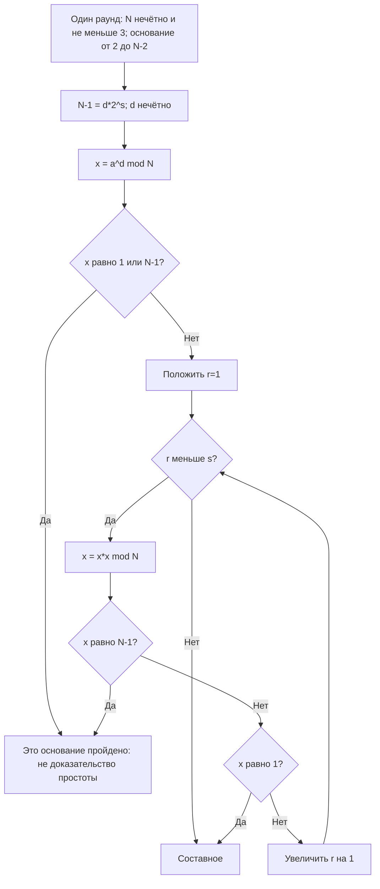
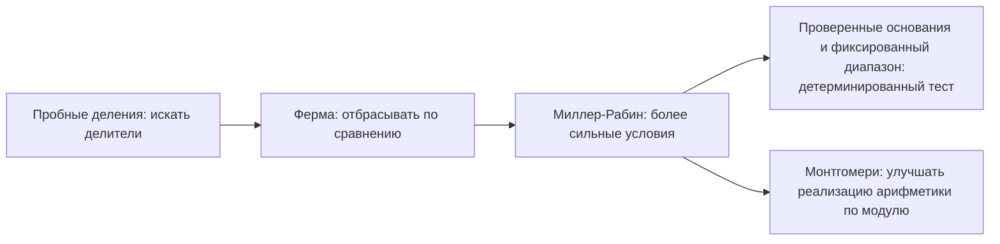

## Введение: проверка простоты и факторизация — разные задачи

Проверка простоты отвечает, является ли целое число простым. Поиск самих множителей составного числа — другая задача. Генерация больших простых чисел важна для [криптографии с открытым ключом, включая RSA](https://kenji.blog/ru/p/modern-cryptography-public-key-hash-signature/), однако само умножение не является трудной операцией. Наличие простых чисел также не гарантирует безопасность всей криптографической схемы.

Мы сравним пробные деления, тест Ферма и тест Миллера–Рабина, затем приведём реализацию на C++ для неотрицательных 64-битных целых чисел. Её область — $0\le N<2^{64}$, а не числа длиной в тысячи бит, используемые при генерации ключей RSA. Время зависит от реализации и входных данных; универсальных гарантий секунд или кратности ускорения нет.

## 1. Простые числа и пробные деления

Простое число — целое число не меньше 2, положительные делители которого только 1 и оно само. Составное число — целое число не меньше 2, которое не является простым. Ноль, единица и отрицательные целые числа не являются ни простыми, ни составными.

Если составное $N=ab$ имеет множители с $2\le a\le b$, то $a\le\sqrt N$. Поэтому достаточно искать делители до квадратного корня. Сначала проверяется 2, затем только нечётные кандидаты.

```cpp
#include <cstdint>

bool is_prime_trial_division(std::int64_t n) {
    if (n < 2) return false;
    if (n == 2) return true;
    if (n % 2 == 0) return false;
    for (std::int64_t i = 3; i <= n / i; i += 2) {
        if (n % i == 0) return false;
    }
    return true;
}
```

Знаковое умножение в `i*i <= n` может переполниться. Для положительных значений эквивалентное условие `i <= n/i` позволяет не вычислять это произведение. Функция принимает значения диапазона `std::int64_t` и возвращает `false` также для отрицательных входов.

Число делений в худшем случае составляет $\mathcal{O}(\sqrt N)$. Проверка только нечётных значений даёт примерно $\sqrt N/2$ кандидатов, но многократные тесты больших чисел всё равно могут быть затратны. Универсальной границы практичности по числу десятичных цифр нет.

## 2. Тест Ферма и возведение в степень по модулю

Малая теорема Ферма утверждает, что для простого $p$ и целого $a$ с $\gcd(a,p)=1$:

$$
a^{p-1}\equiv1\pmod p.
$$

Поэтому для $N>2$ основание $1<a<N-1$, нарушающее это сравнение, доказывает составность $N$. Успешная проверка не доказывает простоту. Число Кармайкла $561=3\cdot11\cdot17$ проходит тест для всех оснований, взаимно простых с 561. Но основание 3 не взаимно просто с 561, и $3^{560}\bmod561=375$, поэтому проверка завершается неуспехом. Неверно говорить, что любое основание обязательно обманывает тест.

Не нужно сначала строить полную целочисленную степень. Бинарное возведение в степень берёт остаток после каждого умножения. Следующие вспомогательные функции можно компилировать отдельно. Основание, показатель и операнды умножения — неотрицательные 64-битные целые числа; модуль `m` — положительное 64-битное целое. При нулевом модуле выбрасывается исключение.

```cpp
#include <cstdint>
#include <stdexcept>

#if !defined(__SIZEOF_INT128__)
#error "This example requires unsigned __int128 support"
#endif

using u64 = std::uint64_t;
using u128 = unsigned __int128;

u64 mod_mul(u64 a, u64 b, u64 m) {
    if (m == 0) throw std::invalid_argument("Modulus must be positive");
    return static_cast<u64>(static_cast<u128>(a) * b % m);
}

u64 mod_pow(u64 base, u64 exp, u64 m) {
    if (m == 0) throw std::invalid_argument("Modulus must be positive");
    u64 result = 1 % m;
    base %= m;
    while (exp > 0) {
        if (exp & 1) result = mod_mul(result, base, m);
        base = mod_mul(base, base, m);
        exp >>= 1;
    }
    return result;
}
```

Результат — наименьший неотрицательный остаток. При нулевом показателе возвращается $1\bmod m$, то есть ноль для модуля 1. Здесь $0^0$ также обрабатывается по этому вычислительному соглашению. Передача отрицательного основания непосредственно в беззнаковый параметр не входит в предполагаемый интерфейс.

`unsigned __int128` — расширение, а не тип стандарта ISO C++. GCC поддерживает его на подходящих целевых платформах; отсутствие поддержки обнаруживается при компиляции. Не предполагается, что код без изменений работает в любой среде MSVC; см. [документацию GCC](https://gcc.gnu.org/onlinedocs/gcc/_005f_005fint128.html). Для представления всех произведений двух беззнаковых 64-битных значений нужно беззнаковое 128-битное хранение: знаковый 128-битный тип не охватывает все такие произведения.

## 3. Условия Миллера–Рабина и смысл вероятности

По модулю нечётного простого числа квадратными корнями из 1 являются только 1 и −1. Тест Миллера–Рабина сочетает это свойство с малой теоремой Ферма. Для нечётного $N\ge3$ запишем:

$$
N-1=d\,2^s,\qquad d\text{ is odd},\quad s\ge1.
$$

Здесь d нечётно. Основание $a$ с $1<a<N-1$ проходит раунд, если выполняется одно из условий:

$$
a^d\equiv1\pmod N
\quad\text{or}\quad
\exists r\ (0\le r<s):\ a^{d2^r}\equiv-1\pmod N.
$$

Простое число всегда проходит; неудача доказывает составность. Если последовательное возведение в квадрат даёт 1, хотя предыдущее значение не было ни 1, ни −1, это тоже доказывает составность. Наименьший неотрицательный остаток для −1 равен $N-1$, но знаковое выражение C++ `-1 % N` не возвращает это значение. Например, `-1 % 7` равно −1. Нужно различать математический остаток и [правила деления и остатка в C++](https://eel.is/c++draft/expr.mul).

Для фиксированного нечётного составного числа $N$ каждое основание, выбранное независимо и равномерно из $2\le a\le N-2$, проходит с вероятностью не более $1/4$. Поэтому вероятность ошибочного прохождения всех $k$ раундов ограничена так:

$$
\Pr[\text{all }k\text{ rounds pass}\mid N\text{ is composite}]\le4^{-k}.
$$

Это вероятность ошибки относительно случайного выбора оснований. Её нельзя непосредственно переформулировать как вероятность $4^{-k}$ того, что число составное после успешного теста. Аргумент также не применим к произвольному фиксированному набору оснований. Для N=3 интервал оснований пуст, поэтому реализация обрабатывает этот случай заранее. [Оригинальная работа Рабина](https://math.nyu.edu/~goodman/teaching/Algebra_2_2021/MillerRabinTest.pdf) также различает вероятностное принятие и доказательство простоты.

Схема показывает один раунд для обычного основания. N=3 уже обработано; для нечётного входа должно существовать основание в указанном интервале.



## 4. Детерминированная проверка в фиксированном диапазоне

В ограниченном диапазоне целых чисел достаточный набор оснований, подкреплённый известными результатами проверки, позволяет обходиться без случайности. [Записи оснований SPRP](https://miller-rabin.appspot.com/) приводят используемые здесь условия. Все верхние границы строгие.

| Входной диапазон | Проверяемые основания |
| --- | --- |
| $N<4759123141$ | 2, 7, 61 |
| $N<1122004669633$ | 2, 13, 23, 1662803 |
| $N<2^{64}$ | 2, 325, 9375, 28178, 450775, 9780504, 1795265022 |

Последний набор содержит семь целых оснований, а не семь простых чисел: например,325 составное. В записи результат с семью основаниями приписан Jim Sinclair в 2011 году. Эта статья не воспроизводит независимо весь поиск на 64-битном диапазоне.

Альтернатива — первые двенадцать простых чисел `2, 3, 5, 7, 11, 13, 17, 19, 23, 29, 31, 37`, которых также достаточно для этого 64-битного диапазона. [Результат Sorenson–Webster](https://arxiv.org/abs/1509.00864) даёт 318665857834031151167461 как наименьшее составное число, которое является сильным псевдопростым по всем двенадцати основаниям; оно больше $2^{64}$. Следующая реализация использует ветви с 3, 4 и 7 основаниями из таблицы, а не вариант с двенадцатью.

## 5. Полный пример на C++

Входной тип `u64` охватывает $0\le N\le2^{64}-1$. Ноль и единица дают `false`, но не являются составными, поэтому вывод использует `Not prime`. При умножении по модулю преобразование типа происходит до вычисления произведения. Каждое основание заменяется остатком по модулю N; если получается ноль, пропускается только это основание, а остальные проверяются дальше. Нулевое основание само по себе не определяет простоту или составность всего числа.

Следующий блок — полная программа со вспомогательными функциями. Предыдущие блоки не нужно дополнительно присоединять к ней. На подходящей целевой платформе GCC можно скомпилировать командой вроде `g++ -std=c++17 -O2 primality.cpp -o primality`.

```cpp
#include <cstdint>
#include <stdexcept>

#if !defined(__SIZEOF_INT128__)
#error "This example requires unsigned __int128 support"
#endif

using u64 = std::uint64_t;
using u128 = unsigned __int128;

u64 mod_mul(u64 a, u64 b, u64 m) {
    if (m == 0) throw std::invalid_argument("Modulus must be positive");
    return static_cast<u64>(static_cast<u128>(a) * b % m);
}

u64 mod_pow(u64 base, u64 exp, u64 m) {
    if (m == 0) throw std::invalid_argument("Modulus must be positive");
    u64 result = 1 % m;
    base %= m;
    while (exp > 0) {
        if (exp & 1) result = mod_mul(result, base, m);
        base = mod_mul(base, base, m);
        exp >>= 1;
    }
    return result;
}

#include <iostream>
#include <initializer_list>
#include <vector>

bool is_prime_miller_rabin(u64 n) {
    if (n < 2) return false;
    for (u64 p : {2ULL, 3ULL, 5ULL, 7ULL}) {
        if (n == p) return true;
        if (n % p == 0) return false;
    }

    u64 d = n - 1;
    unsigned s = 0;
    while ((d & 1) == 0) {
        d >>= 1;
        ++s;
    }

    std::vector<u64> bases;
    if (n < 4759123141ULL) {
        bases = {2, 7, 61};
    } else if (n < 1122004669633ULL) {
        bases = {2, 13, 23, 1662803};
    } else {
        bases = {2, 325, 9375, 28178, 450775, 9780504, 1795265022};
    }

    for (u64 a : bases) {
        a %= n;
        if (a == 0) continue; // No witness from this base; keep testing the others.
        u64 x = mod_pow(a, d, n);
        if (x == 1 || x == n - 1) continue;

        bool passed = false;
        for (unsigned r = 1; r < s; ++r) {
            x = mod_mul(x, x, n);
            if (x == n - 1) {
                passed = true;
                break;
            }
            if (x == 1) return false;
        }
        if (!passed) return false;
    }
    return true;
}

int main() {
    const std::vector<u64> cases = {
        0, 1, 2, 73, 561, 1000000007, 998244353,
        1000000000000000003ULL, 1000000000000000007ULL,
        18446744073709551557ULL, 18446744073709551615ULL
    };
    for (u64 n : cases) {
        std::cout << n << " is "
                  << (is_prime_miller_rabin(n) ? "Prime" : "Not prime") << '\n';
    }
}
```

Вывод классифицирует 0 и 1 как `Not prime`, 2 и 73 как `Prime`, 561 как `Not prime`, 1000000007,998244353 и 1000000000000000003 как `Prime`, 1000000000000000007 как `Not prime`, 18446744073709551557 как `Prime`, а 18446744073709551615 как `Not prime`. Последнее составное число равно $2^{64}-1$. Это учебный пример и проверка обычных целых в указанном диапазоне, а не криптографический генератор простых чисел, реализация с постоянным временем выполнения или библиотека проверки входных строк.

## 6. Сложность и умножение Монтгомери

Если считать одно умножение по модулю одной операцией, бинарное возведение в степень и раунд Миллера–Рабина требуют $\mathcal{O}(\log N)$ операций; для k оснований требуется $\mathcal{O}(k\log N)$. Метод пробных делений выполняет $\mathcal{O}(\sqrt N)$ делений. Через длину входа $b=\lfloor\log_2 N\rfloor+1$ число умножений по модулю равно $\mathcal{O}(kb)$. Для целых произвольной точности в битовую сложность нужно включать также стоимость умножения и вычисления остатка.

В этом фиксированном диапазоне нужно не более семи оснований. Однако на один бит, помимо квадрата, может приходиться условное умножение, а последующая цепочка квадратов добавляет операции. Поэтому $7\times64=448$ не ограничивает все элементарные операции. При сравнении времени следует указывать CPU, компилятор, параметры оптимизации, набор входов и метод измерения.

Умножение Монтгомери меняет представление, чтобы избегать деления на модуль при повторных операциях с одним модулем. В обычной конструкции основание системы счисления является степенью двойки; тогда модуль должен быть нечётным и взаимно простым с этим основанием. Помимо умножений и сдвигов, нужны сложения, обработка переносов и условные вычитания; преобразование и предварительные вычисления тоже имеют стоимость. Ускорение вдвое или втрое не гарантируется. Процедуры и условия см. в [HAC, глава 14, алгоритмы 14.32, 14.36 и 14.94](https://cacr.uwaterloo.ca/hac/about/chap14.pdf). В приведённом коде этот метод не реализован.

## 7. Заключение

Пробные деления непосредственно ищут делители, а тест Ферма отбрасывает кандидатов с помощью сравнения по модулю. Миллер–Рабин использует более сильные условия. Общую вероятностную форму следует отличать от детерминированного теста с проверенным набором оснований и ограниченным диапазоном входов.



Корректность зависит не только от математики, но и от диапазона входов, целых типов, переполнения, условий на модуль и обработки оснований. Гарантии 64-битного кода не распространяются на целые произвольной длины или на криптографическую систему целиком.

### Источники

- [HAC, глава 4: Ферма, Миллер–Рабин и условия вероятности ошибки](https://cacr.uwaterloo.ca/hac/about/chap4.pdf) (источник 1996 года; отличать последующие результаты и современные требования к генерации ключей)
- [Rabin (1980): Probabilistic Algorithm for Testing Primality](https://math.nyu.edu/~goodman/teaching/Algebra_2_2021/MillerRabinTest.pdf)
- [Записи оснований SPRP для детерминированного Миллера–Рабина](https://miller-rabin.appspot.com/)
- [Sorenson–Webster: Strong Pseudoprimes to Twelve Prime Bases](https://arxiv.org/abs/1509.00864) (препринт 2015 года, журнальная публикация 2017 года)
- [GCC: расширение 128-битных целых](https://gcc.gnu.org/onlinedocs/gcc/_005f_005fint128.html)
- [Рабочий проект C++: деление и остаток](https://eel.is/c++draft/expr.mul)
- [HAC, глава 14: арифметика Монтгомери](https://cacr.uwaterloo.ca/hac/about/chap14.pdf)
