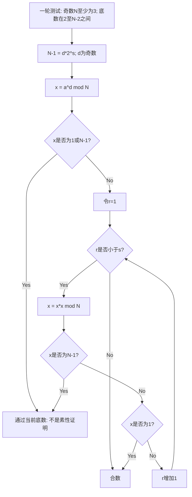
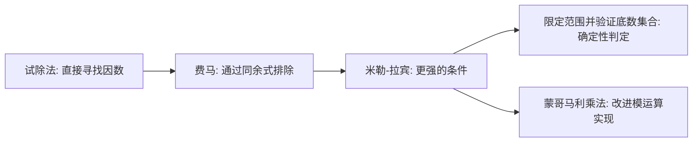

## 引言：区分素数判定与整数分解

素数判定回答的是“这个整数是不是素数”。寻找合数的实际因数则是另一项任务。在[RSA等公钥密码](https://kenji.blog/zh-cn/p/modern-cryptography-public-key-hash-signature/)中，生成大素数很重要，但困难的并不是乘法本身。仅仅找到素数，也不能保证整个密码方案的安全性。

本文比较试除法、费马测试和米勒–拉宾测试，并给出针对非负64位整数的C++实现。实现范围是 $0\le N<2^{64}$，不包括RSA密钥生成所使用的数千位整数。运行时间取决于实现和输入，因此不作统一的秒数或加速倍数保证。

## 1. 素数定义与试除法

素数是大于等于2、正因数只有1和自身的整数。合数是大于等于2且不是素数的整数。0、1和负整数既不是素数，也不是合数。

若合数 $N=ab$ 的因数满足 $2\le a\le b$，则有 $a\le\sqrt N$。因此只需寻找不超过平方根的因数。先检查2，再只试奇数。

```cpp
#include <cstdint>

bool is_prime_trial_division(std::int64_t n) {
    if (n < 2) return false;
    if (n == 2) return true;
    if (n % 2 == 0) return false;
    for (std::int64_t i = 3; i <= n / i; i += 2) {
        if (n % i == 0) return false;
    }
    return true;
}
```

循环条件 `i*i <= n` 中的有符号乘法可能溢出。对于正数，等价条件 `i <= n/i` 避免了这个乘积。该函数接受 `std::int64_t` 范围内的整数，负输入也返回 `false`。

最坏情况下的除法次数为 $\mathcal{O}(\sqrt N)$。只试奇数时，候选数约为 $\sqrt N/2$ 个，但对大输入反复判定仍可能很耗时。实用与否没有统一的十进制位数分界。

## 2. 费马测试与模幂运算

对于素数 $p$ 和满足 $\gcd(a,p)=1$ 的整数 $a$，费马小定理给出：

$$
a^{p-1}\equiv1\pmod p.
$$

因此，对于 $N>2$，选择 $1<a<N-1$，若同余式不成立，就能确定 $N$ 是合数。但通过测试并不能证明素性。卡迈克尔数 $561=3\cdot11\cdot17$ 会通过所有与561互质的底数；底数3则不与561互质，且 $3^{560}\bmod561=375$，因此会失败。说它“无论选什么底数都能蒙混过关”并不准确。

无需先构造完整的整数幂。二进制快速幂（平方乘法）在每次乘法后取模。以下辅助函数可以独立编译。底数、指数和乘法操作数是非负64位整数，模数 `m` 是正的64位整数；模数为0时抛出异常。

```cpp
#include <cstdint>
#include <stdexcept>

#if !defined(__SIZEOF_INT128__)
#error "This example requires unsigned __int128 support"
#endif

using u64 = std::uint64_t;
using u128 = unsigned __int128;

u64 mod_mul(u64 a, u64 b, u64 m) {
    if (m == 0) throw std::invalid_argument("Modulus must be positive");
    return static_cast<u64>(static_cast<u128>(a) * b % m);
}

u64 mod_pow(u64 base, u64 exp, u64 m) {
    if (m == 0) throw std::invalid_argument("Modulus must be positive");
    u64 result = 1 % m;
    base %= m;
    while (exp > 0) {
        if (exp & 1) result = mod_mul(result, base, m);
        base = mod_mul(base, base, m);
        exp >>= 1;
    }
    return result;
}
```

返回值是最小非负剩余。指数为0时返回 $1\bmod m$，因此模数为1时结果是0。这里也按这一计算约定处理 $0^0$。接口不支持把负底数直接传给无符号参数的用法。

`unsigned __int128` 不是ISO C++标准类型，而是GCC等在适当目标平台上提供的扩展。代码会在编译时检测不支持该扩展的环境，不能假定所有MSVC环境都能原样编译。参见[GCC文档](https://gcc.gnu.org/onlinedocs/gcc/_005f_005fint128.html)。两个全范围无符号64位整数的乘积需要无符号128位存储；有符号128位无法容纳所有这样的乘积。

## 3. 米勒–拉宾条件与概率的含义

以奇素数为模时，1的平方根只有1和−1。米勒–拉宾测试结合这一性质与费马小定理。对于奇数 $N\ge3$，写成：

$$
N-1=d\,2^s,\qquad d\text{ is odd},\quad s\ge1.
$$

其中d是奇数。满足 $1<a<N-1$ 的底数a，通过测试的条件是以下任一项成立：

$$
a^d\equiv1\pmod N
\quad\text{or}\quad
\exists r\ (0\le r<s):\ a^{d2^r}\equiv-1\pmod N.
$$

素数必定通过，失败就能证明是合数。若连续平方得到1，而前一个值既不是1也不是−1，同样能证明是合数。数学中−1的最小非负剩余是 $N-1$，但C++有符号表达式 `-1 % N` 不会返回这个值。例如 `-1 % 7` 的结果是−1。需要区分数学中的剩余与[C++除法、余数规则](https://eel.is/c++draft/expr.mul)。

对于固定的奇合数 $N$，从 $2\le a\le N-2$ 中独立、均匀地选择底数时，每轮通过的概率至多为 $1/4$。错误地通过全部 $k$ 轮的概率因此满足：

$$
\Pr[\text{all }k\text{ rounds pass}\mid N\text{ is composite}]\le4^{-k}.
$$

这是针对随机选择底数的错误概率，不能直接改述为“通过测试后，这个整数是合数的概率为 $4^{-k}$”。独立均匀随机底数的论证也不适用于任意固定底数集合。N=3时底数区间为空，所以实现先处理这个数。[Rabin原论文](https://math.nyu.edu/~goodman/teaching/Algebra_2_2021/MillerRabinTest.pdf)也明确区分了概率性通过与素性证明。

下图表示普通底数的一轮测试。假定已预先处理N=3，奇数输入确实存在满足区间要求的底数。



## 4. 限定范围内的确定性判定

对于有限范围内的整数，可以依据已知验证结果选取充分的底数集合，不使用随机数进行判定。[SPRP底数记录](https://miller-rabin.appspot.com/)列出了这里采用的条件。所有上界都是严格小于。

| 输入范围 | 需要测试的底数 |
| --- | --- |
| $N<4759123141$ | 2, 7, 61 |
| $N<1122004669633$ | 2, 13, 23, 1662803 |
| $N<2^{64}$ | 2, 325, 9375, 28178, 450775, 9780504, 1795265022 |

最后一组是7个整数底数，不是7个素数；例如325就是合数。记录将这组7底数结果归于Jim Sinclair在2011年的工作。本文并未独立重复整个64位范围的搜索。

另一种选择是前12个素数 `2, 3, 5, 7, 11, 13, 17, 19, 23, 29, 31, 37`，它们也足以覆盖该64位范围。[Sorenson–Webster的结果](https://arxiv.org/abs/1509.00864)给出同时通过这12个底数的最小强伪素数为318665857834031151167461，大于 $2^{64}$。下面的实现采用表中按范围选择的3、4、7个底数，而不是12底数方案。

## 5. 完整的C++示例

输入类型 `u64` 覆盖 $0\le N\le2^{64}-1$。0和1返回 `false`，但它们不是合数，所以输出使用 `Not prime`。模乘必须在形成乘积之前进行类型转换。底数先对N取模；若结果为0，只跳过当前底数，继续检查其他底数。底数为0本身不能决定整个整数是素数还是合数。

以下代码块包括辅助函数，是完整程序，无需再拼接前面的代码块。在支持该扩展的GCC目标平台上，可以用 `g++ -std=c++17 -O2 primality.cpp -o primality` 这样的命令编译。

```cpp
#include <cstdint>
#include <stdexcept>

#if !defined(__SIZEOF_INT128__)
#error "This example requires unsigned __int128 support"
#endif

using u64 = std::uint64_t;
using u128 = unsigned __int128;

u64 mod_mul(u64 a, u64 b, u64 m) {
    if (m == 0) throw std::invalid_argument("Modulus must be positive");
    return static_cast<u64>(static_cast<u128>(a) * b % m);
}

u64 mod_pow(u64 base, u64 exp, u64 m) {
    if (m == 0) throw std::invalid_argument("Modulus must be positive");
    u64 result = 1 % m;
    base %= m;
    while (exp > 0) {
        if (exp & 1) result = mod_mul(result, base, m);
        base = mod_mul(base, base, m);
        exp >>= 1;
    }
    return result;
}

#include <iostream>
#include <initializer_list>
#include <vector>

bool is_prime_miller_rabin(u64 n) {
    if (n < 2) return false;
    for (u64 p : {2ULL, 3ULL, 5ULL, 7ULL}) {
        if (n == p) return true;
        if (n % p == 0) return false;
    }

    u64 d = n - 1;
    unsigned s = 0;
    while ((d & 1) == 0) {
        d >>= 1;
        ++s;
    }

    std::vector<u64> bases;
    if (n < 4759123141ULL) {
        bases = {2, 7, 61};
    } else if (n < 1122004669633ULL) {
        bases = {2, 13, 23, 1662803};
    } else {
        bases = {2, 325, 9375, 28178, 450775, 9780504, 1795265022};
    }

    for (u64 a : bases) {
        a %= n;
        if (a == 0) continue; // No witness from this base; keep testing the others.
        u64 x = mod_pow(a, d, n);
        if (x == 1 || x == n - 1) continue;

        bool passed = false;
        for (unsigned r = 1; r < s; ++r) {
            x = mod_mul(x, x, n);
            if (x == n - 1) {
                passed = true;
                break;
            }
            if (x == 1) return false;
        }
        if (!passed) return false;
    }
    return true;
}

int main() {
    const std::vector<u64> cases = {
        0, 1, 2, 73, 561, 1000000007, 998244353,
        1000000000000000003ULL, 1000000000000000007ULL,
        18446744073709551557ULL, 18446744073709551615ULL
    };
    for (u64 n : cases) {
        std::cout << n << " is "
                  << (is_prime_miller_rabin(n) ? "Prime" : "Not prime") << '\n';
    }
}
```

输出依次为：0和1是 `Not prime`；2和73是 `Prime`；561是 `Not prime`；1000000007、998244353、1000000000000000003是 `Prime`；1000000000000000007是 `Not prime`；18446744073709551557是 `Prime`；18446744073709551615是 `Not prime`。最后一个合数是 $2^{64}-1$。这是限定范围的教学与一般整数判定示例，不是密码学素数生成器、常数时间实现，也不是包含输入字符串校验的库。

## 6. 复杂度与蒙哥马利乘法

把一次模乘计为一个操作时，二进制快速幂和一轮米勒–拉宾测试的操作次数为 $\mathcal{O}(\log N)$，测试k个底数为 $\mathcal{O}(k\log N)$。试除法需要 $\mathcal{O}(\sqrt N)$ 次除法。以输入长度 $b=\lfloor\log_2 N\rfloor+1$ 表示，米勒–拉宾的模乘次数为 $\mathcal{O}(kb)$。对于任意精度整数，位复杂度还要计入乘法与模约减的成本。

本实现的固定范围至多需要7个底数，但每一位除了平方，还可能需要条件乘法，随后还有平方序列。因此不能把全部基本操作数限定为 $7\times64=448$。比较运行时间时，应说明CPU、编译器、优化选项、输入集合和测量方法。

蒙哥马利乘法在相同模数下反复运算时，通过改变表示来避免除以模数。通常以2的幂为基数，此时模数必须是奇数，并与基数互质。除乘法、移位外，还需要加法、进位处理和条件减法等操作；表示转换与预计算也有成本。不能保证总能加速2至3倍。步骤与条件可参见[HAC第14章的算法14.32、14.36、14.94](https://cacr.uwaterloo.ca/hac/about/chap14.pdf)。上面的代码没有实现蒙哥马利乘法。

## 7. 总结

试除法直接寻找因数，费马测试利用同余式排除候选，米勒–拉宾采用更强的条件。一般的随机判定与限定输入范围、使用已验证底数集合的确定性判定，必须加以区分。



正确性不仅依赖数学，还依赖输入范围、整数类型、溢出、模数条件和底数处理。不能把64位代码的保证扩展到任意长度整数或整个密码系统。

### 参考资料

- [HAC第4章：费马、米勒–拉宾及错误概率条件](https://cacr.uwaterloo.ca/hac/about/chap4.pdf)（1996年资料；应与后来的素数判定成果和现行密钥生成标准区分）
- [Rabin (1980): Probabilistic Algorithm for Testing Primality](https://math.nyu.edu/~goodman/teaching/Algebra_2_2021/MillerRabinTest.pdf)
- [确定性米勒–拉宾的SPRP底数记录](https://miller-rabin.appspot.com/)
- [Sorenson–Webster: Strong Pseudoprimes to Twelve Prime Bases](https://arxiv.org/abs/1509.00864)（2015年预印本，2017年期刊发表）
- [GCC：128位整数扩展](https://gcc.gnu.org/onlinedocs/gcc/_005f_005fint128.html)
- [C++ working draft：除法与余数](https://eel.is/c++draft/expr.mul)
- [HAC第14章：蒙哥马利运算](https://cacr.uwaterloo.ca/hac/about/chap14.pdf)
