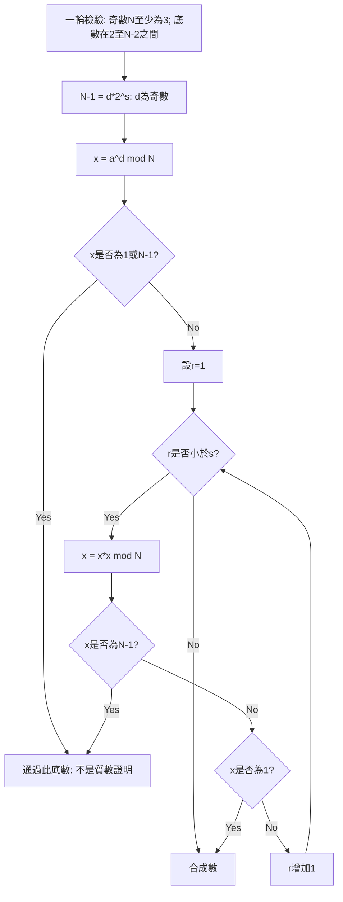
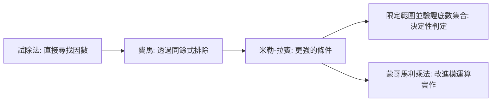

## 前言：區分質數判定與整數分解

質數判定回答的是「這個整數是不是質數」。找出合成數的實際因數則是另一項工作。在[RSA等公開金鑰密碼](https://kenji.blog/zh-tw/p/modern-cryptography-public-key-hash-signature/)中，產生大質數很重要，但困難的並不是乘法本身。只找到質數，也不能保證整個密碼方案的安全性。

本文比較試除法、費馬檢驗與米勒–拉賓檢驗，並提供非負64位元整數的C++實作。實作範圍為 $0\le N<2^{64}$，不涵蓋RSA金鑰產生所使用的數千位元整數。執行時間會隨實作與輸入改變，因此不保證統一的秒數或加速倍數。

## 1. 質數定義與試除法

質數是大於等於2、正因數只有1與自身的整數。合成數是大於等於2且不是質數的整數。0、1與負整數既不是質數，也不是合成數。

若合成數 $N=ab$ 的因數滿足 $2\le a\le b$，則有 $a\le\sqrt N$。因此只需尋找不超過平方根的因數。先檢查2，之後只試奇數。

```cpp
#include <cstdint>

bool is_prime_trial_division(std::int64_t n) {
    if (n < 2) return false;
    if (n == 2) return true;
    if (n % 2 == 0) return false;
    for (std::int64_t i = 3; i <= n / i; i += 2) {
        if (n % i == 0) return false;
    }
    return true;
}
```

迴圈條件 `i*i <= n` 中的帶號乘法可能溢位。對正數而言，等價條件 `i <= n/i` 可避免形成這個乘積。此函式接受 `std::int64_t` 範圍內的整數，對負數也回傳 `false`。

最壞情況的除法次數為 $\mathcal{O}(\sqrt N)$。只試奇數時，候選數約有 $\sqrt N/2$ 個，但對大輸入反覆判定仍可能耗時。是否實用，沒有統一的十進位位數分界。

## 2. 費馬檢驗與模冪運算

對質數 $p$ 以及滿足 $\gcd(a,p)=1$ 的整數 $a$，費馬小定理給出：

$$
a^{p-1}\equiv1\pmod p.
$$

因此，對 $N>2$ 選取 $1<a<N-1$，若同餘式不成立，就能確定 $N$ 是合成數。但通過檢驗不等於證明是質數。卡邁克爾數 $561=3\cdot11\cdot17$ 會通過所有與561互質的底數；底數3則不與561互質，且 $3^{560}\bmod561=375$，所以會失敗。說它「無論選什麼底數都能矇混過關」並不正確。

不必先建構完整的整數冪。二進位快速冪（平方乘法）在每次乘法後取模。以下輔助函式可獨立編譯。底數、指數與乘法運算元是非負64位元整數，模數 `m` 是正的64位元整數；模數為0時擲出例外。

```cpp
#include <cstdint>
#include <stdexcept>

#if !defined(__SIZEOF_INT128__)
#error "This example requires unsigned __int128 support"
#endif

using u64 = std::uint64_t;
using u128 = unsigned __int128;

u64 mod_mul(u64 a, u64 b, u64 m) {
    if (m == 0) throw std::invalid_argument("Modulus must be positive");
    return static_cast<u64>(static_cast<u128>(a) * b % m);
}

u64 mod_pow(u64 base, u64 exp, u64 m) {
    if (m == 0) throw std::invalid_argument("Modulus must be positive");
    u64 result = 1 % m;
    base %= m;
    while (exp > 0) {
        if (exp & 1) result = mod_mul(result, base, m);
        base = mod_mul(base, base, m);
        exp >>= 1;
    }
    return result;
}
```

回傳值是最小非負剩餘。指數為0時回傳 $1\bmod m$，所以模數為1時結果為0。這裡也按此計算慣例處理 $0^0$。介面不處理將負底數直接傳給不帶號參數的用法。

`unsigned __int128` 不是ISO C++標準型別，而是GCC等在適合的目標平台上提供的擴充。程式會在編譯時檢查是否支援，不能假定所有MSVC環境都能原樣編譯。請參閱[GCC文件](https://gcc.gnu.org/onlinedocs/gcc/_005f_005fint128.html)。兩個全範圍不帶號64位元整數的乘積需要不帶號128位元儲存；帶號128位元無法表示所有這類乘積。

## 3. 米勒–拉賓條件與機率的意義

以奇質數為模時，1的平方根只有1與−1。米勒–拉賓檢驗結合這項性質與費馬小定理。對奇數 $N\ge3$，分解成：

$$
N-1=d\,2^s,\qquad d\text{ is odd},\quad s\ge1.
$$

其中d為奇數。底數 $a$ 滿足 $1<a<N-1$ 時，通過檢驗的條件是以下任一項成立：

$$
a^d\equiv1\pmod N
\quad\text{or}\quad
\exists r\ (0\le r<s):\ a^{d2^r}\equiv-1\pmod N.
$$

質數一定通過，失敗則能證明是合成數。若反覆平方得到1，而前一個值既不是1也不是−1，同樣能證明是合成數。數學中−1的最小非負剩餘是 $N-1$，但C++帶號運算式 `-1 % N` 不會回傳這個值。例如 `-1 % 7` 的結果是−1。應區分數學上的剩餘與[C++的除法、餘數規則](https://eel.is/c++draft/expr.mul)。

對固定的奇合成數 $N$，從 $2\le a\le N-2$ 中獨立、均勻地選取底數時，每輪通過的機率至多為 $1/4$。錯誤地通過全部 $k$ 輪的機率因而滿足：

$$
\Pr[\text{all }k\text{ rounds pass}\mid N\text{ is composite}]\le4^{-k}.
$$

這是針對隨機選取底數的錯誤機率，不能直接改稱「通過檢驗後，這個整數是合成數的機率為 $4^{-k}$」。獨立均勻隨機底數的論證也不適用於任意固定底數集合。N=3時底數區間為空，因此實作會先處理它。[Rabin原論文](https://math.nyu.edu/~goodman/teaching/Algebra_2_2021/MillerRabinTest.pdf)也區分了機率性通過與質數證明。

下圖表示一般底數的一輪檢驗。假定已事先處理N=3，奇數輸入確實有符合區間條件的底數。



## 4. 限定範圍內的決定性判定

對有限範圍內的整數，可依據已知驗證結果選取足夠的底數集合，不用亂數進行判定。[SPRP底數紀錄](https://miller-rabin.appspot.com/)列出本文採用的條件。所有上界都是嚴格小於。

| 輸入範圍 | 需要檢驗的底數 |
| --- | --- |
| $N<4759123141$ | 2, 7, 61 |
| $N<1122004669633$ | 2, 13, 23, 1662803 |
| $N<2^{64}$ | 2, 325, 9375, 28178, 450775, 9780504, 1795265022 |

最後一組是7個整數底數，不是7個質數；例如325就是合成數。紀錄將這組7底數結果歸於Jim Sinclair在2011年的工作。本文沒有獨立重做整個64位元範圍的搜尋。

另一種選擇是前12個質數 `2, 3, 5, 7, 11, 13, 17, 19, 23, 29, 31, 37`，它們也足以涵蓋這個64位元範圍。[Sorenson–Webster的結果](https://arxiv.org/abs/1509.00864)給出同時通過這12個底數的最小強偽質數為318665857834031151167461，大於 $2^{64}$。下面的實作採用表中依範圍選擇的3、4、7個底數，而不是12底數方案。

## 5. 完整的C++範例

輸入型別 `u64` 涵蓋 $0\le N\le2^{64}-1$。0與1回傳 `false`，但它們不是合成數，因此輸出使用 `Not prime`。模乘必須先轉型再形成乘積。底數先對N取模；若結果為0，只略過此底數，繼續檢查其他底數。底數為0本身不能決定整個整數是質數或合成數。

以下程式碼區塊包含輔助函式，是完整程式，不必再串接前面的區塊。在支援此擴充的GCC目標平台上，可用 `g++ -std=c++17 -O2 primality.cpp -o primality` 這類命令編譯。

```cpp
#include <cstdint>
#include <stdexcept>

#if !defined(__SIZEOF_INT128__)
#error "This example requires unsigned __int128 support"
#endif

using u64 = std::uint64_t;
using u128 = unsigned __int128;

u64 mod_mul(u64 a, u64 b, u64 m) {
    if (m == 0) throw std::invalid_argument("Modulus must be positive");
    return static_cast<u64>(static_cast<u128>(a) * b % m);
}

u64 mod_pow(u64 base, u64 exp, u64 m) {
    if (m == 0) throw std::invalid_argument("Modulus must be positive");
    u64 result = 1 % m;
    base %= m;
    while (exp > 0) {
        if (exp & 1) result = mod_mul(result, base, m);
        base = mod_mul(base, base, m);
        exp >>= 1;
    }
    return result;
}

#include <iostream>
#include <initializer_list>
#include <vector>

bool is_prime_miller_rabin(u64 n) {
    if (n < 2) return false;
    for (u64 p : {2ULL, 3ULL, 5ULL, 7ULL}) {
        if (n == p) return true;
        if (n % p == 0) return false;
    }

    u64 d = n - 1;
    unsigned s = 0;
    while ((d & 1) == 0) {
        d >>= 1;
        ++s;
    }

    std::vector<u64> bases;
    if (n < 4759123141ULL) {
        bases = {2, 7, 61};
    } else if (n < 1122004669633ULL) {
        bases = {2, 13, 23, 1662803};
    } else {
        bases = {2, 325, 9375, 28178, 450775, 9780504, 1795265022};
    }

    for (u64 a : bases) {
        a %= n;
        if (a == 0) continue; // No witness from this base; keep testing the others.
        u64 x = mod_pow(a, d, n);
        if (x == 1 || x == n - 1) continue;

        bool passed = false;
        for (unsigned r = 1; r < s; ++r) {
            x = mod_mul(x, x, n);
            if (x == n - 1) {
                passed = true;
                break;
            }
            if (x == 1) return false;
        }
        if (!passed) return false;
    }
    return true;
}

int main() {
    const std::vector<u64> cases = {
        0, 1, 2, 73, 561, 1000000007, 998244353,
        1000000000000000003ULL, 1000000000000000007ULL,
        18446744073709551557ULL, 18446744073709551615ULL
    };
    for (u64 n : cases) {
        std::cout << n << " is "
                  << (is_prime_miller_rabin(n) ? "Prime" : "Not prime") << '\n';
    }
}
```

輸出依序為：0與1是 `Not prime`；2與73是 `Prime`；561是 `Not prime`；1000000007、998244353、1000000000000000003是 `Prime`；1000000000000000007是 `Not prime`；18446744073709551557是 `Prime`；18446744073709551615是 `Not prime`。最後的合成數是 $2^{64}-1$。這是限定範圍內的教學與一般整數判定範例，不是密碼用的質數產生器、常數時間實作，也不是含有輸入字串驗證的函式庫。

## 6. 複雜度與蒙哥馬利乘法

將一次模乘算作一個操作時，二進位快速冪與一輪米勒–拉賓檢驗的操作次數為 $\mathcal{O}(\log N)$，檢驗k個底數則為 $\mathcal{O}(k\log N)$。試除法的除法次數為 $\mathcal{O}(\sqrt N)$。以輸入長度 $b=\lfloor\log_2 N\rfloor+1$ 表示，米勒–拉賓的模乘次數為 $\mathcal{O}(kb)$。對任意精度整數，位元複雜度還須納入乘法與模約減的成本。

此實作的固定範圍最多需要7個底數，但每一位除了平方，還可能需要條件乘法，之後也有平方序列。因此不能把所有基本操作數限定為 $7\times64=448$。比較執行時間時，應列明CPU、編譯器、最佳化選項、輸入集合與量測方法。

蒙哥馬利乘法在同一模數下反覆運算時，藉由改變表示法避免除以模數。通常以2的冪為基底，此時模數必須是奇數，並與基底互質。除了乘法與位移，還須使用加法、進位處理及條件減法等；表示轉換與預先計算也有成本。不能保證總是加速2至3倍。步驟與條件請見[HAC第14章的演算法14.32、14.36、14.94](https://cacr.uwaterloo.ca/hac/about/chap14.pdf)。上面的程式並未實作蒙哥馬利乘法。

## 7. 總結

試除法直接尋找因數，費馬檢驗透過同餘式排除候選，米勒–拉賓使用更強的條件。一般的隨機判定，與限定輸入範圍、使用已驗證底數集合的決定性判定，必須加以區分。



正確性不只取決於數學，也取決於輸入範圍、整數型別、溢位、模數條件及底數處理。不能將64位元程式的保證延伸至任意長度的整數或整個密碼系統。

### 參考資料

- [HAC第4章：費馬、米勒–拉賓與錯誤機率的條件](https://cacr.uwaterloo.ca/hac/about/chap4.pdf)（1996年資料；應與後續的質數判定成果及現行金鑰產生標準區分）
- [Rabin (1980): Probabilistic Algorithm for Testing Primality](https://math.nyu.edu/~goodman/teaching/Algebra_2_2021/MillerRabinTest.pdf)
- [決定性米勒–拉賓的SPRP底數紀錄](https://miller-rabin.appspot.com/)
- [Sorenson–Webster: Strong Pseudoprimes to Twelve Prime Bases](https://arxiv.org/abs/1509.00864)（2015年預印本，2017年期刊刊行）
- [GCC：128位元整數擴充](https://gcc.gnu.org/onlinedocs/gcc/_005f_005fint128.html)
- [C++ working draft：除法與餘數](https://eel.is/c++draft/expr.mul)
- [HAC第14章：蒙哥馬利運算](https://cacr.uwaterloo.ca/hac/about/chap14.pdf)
