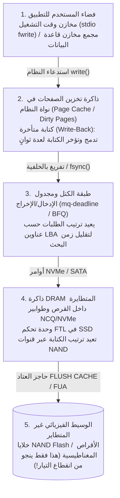
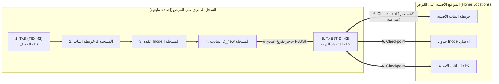

## 1. مقدمة: حقل الألغام المخفي وراء إضافة كتلة واحدة بحجم 4 كيلوبايت إلى ملف

عندما تضغط على `Ctrl+S` في محرر نصوص أو تؤكد تحويلاً مصرفياً، يصدر تطبيقك استدعاء النظام `write()`. من منظور مبرمج التطبيقات، يبدو حفظ البيانات وكأنه خطوة واحدة فورية وغير قابلة للتجزئة (عملية ذرية Atomic Operation).

ولكن تحت غطاء نواة نظام التشغيل (OS Kernel) ونظام الملفات ومحرك تخزين قواعد البيانات ووحدة تحكم أقراص الحالة الصلبة (SSD)، تكمن واحدة من أصعب المشكلات في هندسة نظم الحاسوب: <strong>مشكلة الاتساق عند الانهيار (Crash Consistency Problem)</strong>.

لنأخذ أبسط عملية ممكنة في نظام ملفات UNIX تقليدي (مثل UFS أو ext2): <strong>إلحاق كتلة بيانات جديدة واحدة بحجم $4\,\text{KB}$ ($D_{\text{new}}$) بنهاية ملف موجود</strong>. حتى هذه العملية البسيطة تتطلب تحديث <strong>ثلاث هياكل منفصلة فيزيائياً على الأقل على قرص التخزين</strong>:

1. <strong>خريطة بتات البيانات (Data Bitmap $B$)</strong>: قلب بت التخصيص للكتلة الفيزيائية رقم $k$ من $0$ (متاح) إلى $1$ (مخصص).
2. <strong>عقدة الفهرس (Inode $I$)</strong>: تحديث البيانات الوصفية للملف — زيادة حجم الملف `size`، وتحديث وقت التعديل `mtime`، وكتابة عنوان الكتلة الفيزيائية $k$ في مصفوفة مؤشرات الكتل.
3. <strong>كتلة البيانات نفسها ($D_{\text{new}}$)</strong>: كتابة بيانات المستخدم الفعلية البالغة $4\,\text{KB}$ في القطاع الفيزيائي للكتلة $k$.

هنا نصطدم بعدم تماثل فيزيائي جوهري في العتاد: الذاكرة الرئيسية (DRAM) سريعة لكنها <strong>متطايرة (Volatile)</strong> تفقد محتواها فور انقطاع التيار، بينما الأقراص المغناطيسية وذواكر الفلاش (NAND SSD) <strong>غير متطايرة (Non-Volatile)</strong> لكنها عاجزة فيزيائياً عن تحديث ثلاثة مواقع متباعدة $(B, I, D_{\text{new}})$ في آنٍ واحد ضمن عملية ذرية واحدة. فإذا انقطعت الكهرباء في منتصف عمليات الكتابة الثلاث ($2^3 - 2 = 6$ حالات كتابة جزئية)، يستيقظ نظام الملفات عند إعادة التشغيل في حالة فساد كارثي:

| كُتب على القرص | فُقد في ذاكرة RAM | حالة عدم الاتساق الناتجة وخطورتها |
| :--- | :--- | :--- |
| <strong>$D_{\text{new}}$ فقط</strong> | $B,\; I$ | <strong>فقدان بيانات حميد</strong>: البيانات مكتوبة على القرص لكن لا يشير إليها أي Inode أو خريطة بتات. تظل بنية نظام الملفات سليمة. |
| <strong>$B$ فقط</strong> | $I,\; D_{\text{new}}$ | <strong>تسرب المساحة (Space Leak / كتلة يتيمة)</strong>: الكتلة $k$ مسجلة كمستخدمة ($1$) في الخريطة $B$ دون أن يشير إليها أي ملف، فتضيع سعتها للأبد. |
| <strong>$I$ فقط</strong> (أو $I + D_{\text{new}}$) | $B$ | <strong>تخصيص مزدوج (Double Allocation — تلف كارثي للميتاداتا)</strong>: يشير Inode $I$ إلى الكتلة $k$، لكن الخريطة $B$ تعتبرها فارغة ($0$). لاحقاً يحجز ملف آخر نفس الكتلة $k$ فيدمر الملفان بيانات بعضهما! |
| <strong>$I$ و$B$</strong> | $D_{\text{new}}$ | <strong>كشف بيانات قديمة محذوفة (Stale Data Exposure — ثغرة أمنية خطيرة)</strong>: تم تحديث Inode والخريطة دون كتابة $D_{\text{new}}$. قراءة الملف الآن تُرجع <strong>بيانات محذوفة سابقة لمستخدم آخر</strong> (كلمات مرور أو مفاتيح خاصة) كانت في القطاع $k$! |

---

## 2. لماذا لا تصل عمليات الكتابة إلى القرص بالترتيب الذي كتبته؟

في المعمارية الحديثة، نادراً ما يتطابق الترتيب الزمني لاستدعاءات `write()` مع ترتيب الكتابة الفيزيائية على الوسيط غير المتطاير بسبب أربع طبقات من التخزين المؤقت المتطاير وإعادة الترتيب (<strong>Reordering</strong>):

ولضمان الترتيب والبقاء، يجب على النظام إصدار حواجز عتادية صريحة (<strong>`NVMe Flush`</strong> أو <strong>`SATA FLUSH CACHE EXT`</strong> أو بت <strong>`FUA: Force Unit Access`</strong>) لإجبار القرص على تفريغ ذاكرته المتطايرة في خلايا الفلاش غير المتطايرة.

---

## 3. الجيل الأول: التحديث في المكان، وأداة `fsck`، والتحديثات اللينة (Soft Updates)

1. <strong>أداة `fsck` (فحص اتساق نظام الملفات) وجدار قابلية التوسع</strong>:
   اعتمدت أنظمة UNIX المبكرة (FFS وext2) على فحص القرص بالكامل بعد أي انقطاع للتيار قبل تركيب النظام (`fsck`). ولأن زمن تشغيل `fsck` يتناسب طردياً مع <strong>السعة الإجمالية للقرص $O(N_{\text{disk}})$</strong>، فإن فحص مصفوفات التخزين الحديثة ذات السعات بالتيرابايت يستغرق ساعات أو أياماً من التوقف — حتى لو كان ملف واحد فقط بحجم $4\,\text{KB}$ قيد الكتابة لحظة انقطاع الكهرباء!
2. <strong>التحديثات اللينة (Soft Updates، Ganger & McKusick 1994)</strong>:
   استُخدمت في FreeBSD UFS لتفادي السجلات عبر تتبع تبعيات المؤشرات في الذاكرة بدقة، وكسر التبعيات الدائرية عبر عمليات تراجع (<strong>Roll-back</strong>) وتقدم (<strong>Roll-forward</strong>) مؤقتة داخل ذاكرة RAM قبل كتابة الكتلة.

---

## 4. العمود الفقري للتخزين الحديث: التسجيل المسبق (WAL) والـ Journaling

لتقليص زمن الاسترداد من $O(N_{\text{disk}})$ إلى حجم المعاملات النشطة فقط لحظة الانهيار $O(N_{\text{active}})$ (بضع ملي ثانية!)، تستخدم أنظمة الملفات الحديثة (<strong>ext3/ext4</strong> و<strong>XFS</strong> و<strong>NTFS</strong>) وقواعد البيانات <strong>التسجيل المسبق للكتابة (Write-Ahead Logging, WAL / Journaling)</strong>:

1. <strong>كتابة السجل (Journal Write)</strong>: قبل لمس المواقع الأصلية على القرص (*Home Locations*)، يضيف النظام تتابعياً إلى <strong>السجل الدائري (Journal)</strong> كتلة وصف بداية المعاملة `TxB` (مع رقم `TID`) متبوعة بصور الكتل المحدثة $(I, B, D_{\text{new}})$.
2. <strong>اعتماد السجل (Journal Commit — نقطة الاعتماد الذرية)</strong>: بعد حاجز تفريغ عتادي، تُكتب كتلة نهاية واحدة <strong>`TxE` (Transaction End)</strong>. <strong>إن كتابة هذا القطاع الواحد `TxE` هي المفتاح الذري الذي يعتمد المعاملة بأكملها!</strong>
3. <strong>نقطة التفتيش (Checkpoint)</strong>: بعد استقرار `TxE` على القرص، تُنسخ $(I, B, D_{\text{new}})$ بشكل غير متزامن إلى مواقعها الأصلية.

- <strong>انقطاع الكهرباء قبل `TxE`</strong>: المواقع الأصلية لم تُلمس؛ وعند إعادة التشغيل يتم تجاهل المعاملة غير المكتملة.
- <strong>انقطاع الكهرباء بعد `TxE`</strong>: عند إعادة التشغيل، يعيد النظام تطبيق (<strong>Redo replay</strong>) الكتل من السجل إلى مواقعها الأصلية في ملي ثانية. بل إن <strong>ext4</strong> الحديث يلغي الحاجز الأوسط عبر تضمين <strong>مجموع تحقق (CRC32C Checksum)</strong> داخل `TxE`.

ولتجنب مضاعفة حجم الكتابة ($2\times$ Write Amplification)، يقوم الوضع الافتراضي <strong>`data=ordered`</strong> في ext4 بتسجيل البيانات الوصفية $(I, B)$ فقط في السجل، لكنه <strong>يشترط اكتمال كتابة كتلة البيانات $D_{\text{new}}$ في موقعها الأصلي أولاً قبل السماح بكتابة كتلة اعتماد الميتاداتا `TxE` في السجل</strong>. وفي قواعد البيانات العلائقية، يدير بروتوكول <strong>ARIES</strong> (Mohan et al., 1992) سياسة `Steal / No-Force` عبر أرقام `pageLSN` وثلاث مراحل: <strong>Analysis</strong> و<strong>Redo (إعادة التاريخ)</strong> و<strong>Undo (مع سجلات التعويض CLR)</strong>.

---

## 5. الجيل الثالث: النسخ عند الكتابة (Copy-on-Write, CoW) وأشجار ميركل (ZFS / Btrfs)

تمنع أنظمة الملفات الحديثة مثل <strong>ZFS</strong> و<strong>Btrfs</strong> و<strong>APFS</strong> الكتابة فوق البيانات الموجودة (*In-Place Overwrite*) نهائياً، وتعتمد <strong>النسخ عند الكتابة (Copy-on-Write, CoW / Shadow Paging)</strong>:

1. تُكتب أي كتلة بيانات معدلة $D_{2,\text{new}}$ وعقدة Inode الأب $I_{v2}$ دائماً في مساحة فارغة جديدة، مع إبقاء الكتل القديمة $D_{2,\text{old}}$ سليمة تماماً.
2. بعد استقرار جميع الكتل الفرعية الجديدة على القرص، تقوم عملية كتابة ذرية واحدة بتحديث كتلة الجذر العليا (<strong>Uberblock</strong> في ZFS) من $U_1$ إلى $U_2$.
3. <strong>المزايا</strong>: استرداد فوري في $0$ ثانية دون إعادة تشغيل سجلات، <strong>ولقطات فورية (Snapshots) بتعقيد $O(1)$</strong> دون تكلفة نسخ، وإصلاح ذاتي (*Self-Healing*) ضد تلف البتات الصامت (*Bit Rot*) بفضل <strong>أشجار ميركل (Merkle Trees)</strong> التي تخزن بصمات تشفيرية بطول 256 بت في كل مؤشر أب.

---

## 6. فخاخ `fsync()` للمبرمجين واختبارات حقن الأعطال

حتى على نظام يدعم Journaling أو CoW، فإن استبدال ملف عبر `rename("config.json.tmp", "config.json")` دون استدعاء `fsync()` مسبقاً يؤدي إلى <strong>ملفات فارغة بحجم $0$ بايت</strong> بعد انقطاع التيار في ظل التخصيص المؤجل (*Delayed Allocation* في ext4)، لأن إعادة تسمية الميتاداتا تُعتمد قبل تفريغ صفحات البيانات من ذاكرة التخزين المؤقت!

<strong>البروتوكول الكامل المكون من 6 خطوات للحفظ الذري الآمن ضد الانهيار</strong>:
(1) `write()` في الملف المؤقت $\to$ (2) <strong>`fsync(fd)`</strong> للملف المؤقت $\to$ (3) `close(fd)` $\to$ (4) استدعاء `rename()` الذري $\to$ (5) فتح المجلد الأب واستدعاء <strong>`fsync(dir_fd)`</strong> لتثبيت مدخل المجلد $\to$ (6) `close(dir_fd)`.

وكما كشفت فضيحة <strong>`fsyncgate`</strong> في PostgreSQL عام 2018 (حيث كانت نواة لينكس تضع علامة `Clean` على الصفحة المتسخة بعد فشل `fsync()` بخطأ `EIO`، وهو ما أُصلح لاحقاً عبر `errseq_t`)، تعتمد هندسة التخزين الحديثة على أطر <strong>حقن الأعطال المنهجي (Systematic Fault Injection)</strong> مثل <strong>ALICE</strong> و<strong>CrashMonkey</strong> لاختبار جميع تباديل إعادة الترتيب العتادي عند انقطاع الكهرباء.
