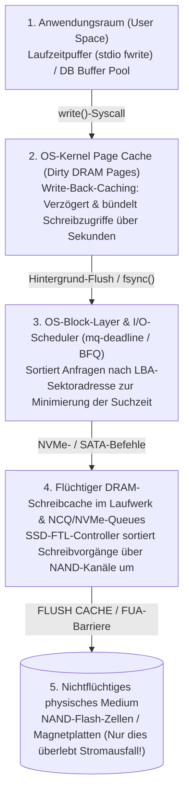
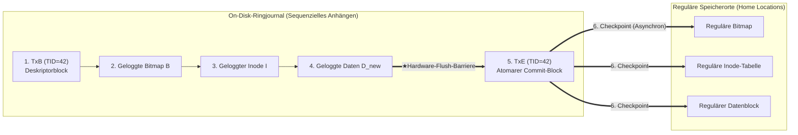

## 1. Einleitung: Das Minenfeld hinter dem Anhängen eines einzigen 4-KB-Blocks

Wenn wir in einem Texteditor `Strg+S` drücken oder eine Banküberweisung bestätigen, führt das Anwendungsprogramm einen `write()`-Systemaufruf aus. Aus Sicht des Anwendungsprogrammierers wirkt das Speichern wie ein einziger, unteilbarer (atomarer) Schritt.

Blickt man jedoch in die Tiefen des Betriebssystemkerns, des Dateisystems, der Datenbank-Engine und der physischen SSD- oder HDD-Hardware, offenbart sich eines der schwierigsten Probleme der Systeminformatik: das <strong>Crash-Konsistenz-Problem (Crash Consistency Problem)</strong>.

Betrachten wir die einfachste denkbare Operation in einem klassischen UNIX-Dateisystem (wie UFS oder ext2): <strong>das Anhängen eines einzigen neuen $4\,\text{KB}$-Datenblocks $D_{\text{new}}$ an eine bestehende Datei</strong>. Selbst für diesen trivialen Vorgang müssen mindestens <strong>drei räumlich getrennte Bereiche auf dem Speichermedium</strong> aktualisiert werden:

1. <strong>Die Daten-Bitmap ($B$)</strong>: Das Zuordnungsbit für den physischen Block $k$ wird von $0$ (frei) auf $1$ (belegt) gesetzt.
2. <strong>Der Inode ($I$)</strong>: Die Metadatenstruktur der Datei wird aktualisiert (Dateigröße `size`, Zeitstempel `mtime` sowie der Zeiger auf die physische Blockadresse $k$).
3. <strong>Der Datenblock ($D_{\text{new}}$)</strong>: Die eigentlichen $4\,\text{KB}$ Nutzdaten des Benutzers werden in den Sektor von Block $k$ geschrieben.

Hier prallen zwei fundamentale Eigenschaften der Hardware aufeinander: Der Hauptspeicher (DRAM) ist schnell, aber <strong>flüchtig (volatile)</strong>; Festplatten und NAND-Flash-SSDs sind <strong>nichtflüchtig (non-volatile)</strong>, können aber räumlich getrennte Blöcke $(B, I, D_{\text{new}})$ niemals gleichzeitig in einer einzigen atomaren physikalischen Aktion überschreiben.

Was passiert, wenn mitten während dieser drei Schreibvorgänge der Strom ausfällt (Power Loss) oder der Kernel abstürzt? Je nachdem, welche Teilmenge der drei Blöcke vor dem Stromausfall die physische Platte erreicht hat ($2^3 - 2 = 6$ mögliche Zwischenzustände), erwacht das Dateisystem beim Neustart in einem Zustand schwerer Inkonsistenz:

| Auf Platte gespeichert | Im RAM verloren | Resultierende Crash-Inkonsistenz & Schweregrad |
| :--- | :--- | :--- |
| <strong>Nur $D_{\text{new}}$</strong> | $B,\; I$ | <strong>Gutartiger Datenverlust</strong>: Die Nutzdaten liegen auf der Platte, aber weder Inode noch Bitmap verweisen darauf. Die Dateisystemstruktur bleibt intakt. |
| <strong>Nur $B$</strong> | $I,\; D_{\text{new}}$ | <strong>Speicherleck (Space Leak / verwaister Block)</strong>: Block $k$ ist in der Bitmap als belegt ($1$) markiert, wird aber von keinem Inode referenziert – die Kapazität geht dauerhaft verloren. |
| <strong>Nur $I$</strong> (oder $I + D_{\text{new}}$) | $B$ | <strong>Doppelbelegung (Double Allocation – Katastrophale Korruption)</strong>: Inode $I$ zeigt auf Block $k$, aber die Bitmap $B$ meldet ihn als frei ($0$). Später belegt eine zweite Datei denselben Block $k$ und beide Dateien zerstören sich gegenseitig! |
| <strong>$I$ und $B$</strong> | $D_{\text{new}}$ | <strong>Offenlegung veralteter Daten (Stale Data Exposure – Sicherheitslücke)</strong>: Inode und Bitmap sind aktualisiert, aber $D_{\text{new}}$ fehlt. Beim Lesen der Datei werden <strong>fremde, zuvor gelöschte Daten</strong> (z. B. Passwörter oder private Schlüssel) aus Sektor $k$ zurückgegeben! |

---

## 2. Warum Schreibvorgänge nicht in Programmreihenfolge auf der Platte landen

In modernen Rechnersystemen stimmt die Reihenfolge von `write()`-Aufrufen fast nie mit der physischen Schreibreihenfolge auf dem Speichermedium überein, da vier flüchtige Pufferschichten die Aufträge umsortieren (<strong>Reordering</strong>):

Erst durch explizite Hardware-Speicherbarrieren (<strong>`NVMe Flush`</strong>, <strong>`SATA FLUSH CACHE EXT`</strong> oder <strong>`FUA: Force Unit Access`</strong>) lässt sich erzwingen, dass auch der flüchtige DRAM-Puffer auf der SSD-Platine in die nichtflüchtigen NAND-Zellen geleert wird.

---

## 3. Generation 1: Optimistisches Überschreiben mit `fsck` und Soft Updates

1. <strong>`fsck` (File System Consistency Check) und die Skalierungsmauer</strong>:
   Frühe Dateisysteme (FFS, ext2) führten nach einem Absturz vor dem Mounten einen vollständigen Scan aller Inodes, Bitmaps und Verzeichnisse durch (`fsck`). Da die Laufzeit von `fsck` proportional zur <strong>Gesamtkapazität der Festplatte $O(N_{\text{disk}})$</strong> wächst, dauert die Prüfung auf modernen Multi-Terabyte-Systemen Stunden oder Tage – selbst wenn beim Stromausfall nur eine einzige $4\,\text{KB}$-Datei geschrieben wurde!
2. <strong>Soft Updates (Ganger & McKusick 1994)</strong>:
   FreeBSD UFS vermied ein Journal durch strikte Abhängigkeitsregeln beim Zurückschreiben aus dem RAM und löste zyklische Abhängigkeiten innerhalb desselben Blocks durch temporäres <strong>Roll-back</strong> und <strong>Roll-forward</strong> einzelner Zeiger im Hauptspeicher.

---

## 4. Das Rückgrat moderner Speicher: Write-Ahead Logging (WAL) und Journaling

Um die Wiederherstellungszeit von $O(N_{\text{disk}})$ auf die Menge der im Absturzmoment aktiven Transaktionen $O(N_{\text{active}})$ (wenige Millisekunden!) zu reduzieren, nutzen moderne Dateisysteme (<strong>ext3/ext4</strong>, <strong>XFS</strong>, <strong>NTFS</strong>) und Datenbanken <strong>Write-Ahead Logging (WAL) / Journaling</strong>:

1. <strong>Journal Write</strong>: Vor dem Ändern der eigentlichen Speicherorte (*Home Locations*) schreibt das Dateisystem einen Transaktions-Startblock `TxB` (mit `TID`) sowie die neuen Blöcke $(I, B, D_{\text{new}})$ sequenziell in einen reservierten Ringpuffer auf der Platte (das <strong>Journal</strong>).
2. <strong>Journal Commit (Atomarer Schaltpunkt)</strong>: Nach einer Hardware-Flush-Barriere wird ein einzelner <strong>Commit-Block `TxE`</strong> geschrieben. <strong>Mit dem Schreiben dieses einzigen Sektors `TxE` gilt die gesamte Transaktion atomar als abgeschlossen!</strong>
3. <strong>Checkpoint</strong>: Anschließend werden $(I, B, D_{\text{new}})$ asynchron an ihre regulären Speicherorte (*Home Locations*) kopiert.

- <strong>Stromausfall VOR `TxE`</strong>: Die *Home Locations* sind unberührt; beim Neustart wird der unvollständige Log-Eintrag einfach verworfen.
- <strong>Stromausfall NACH `TxE`</strong>: Beim Neustart werden die Blöcke aus dem Journal idempotent in die *Home Locations* zurückkopiert (<strong>Redo-Replay</strong>). Modernes <strong>ext4</strong> nutzt zudem <strong>Journal-Prüfsummen (CRC32C)</strong> in `TxE`, um sich die erste Flush-Barriere vor `TxE` zu sparen.

Um eine Verdoppelung der Schreibdatenmenge ($2\times$ Write Amplification) zu vermeiden, nutzt ext4 standardmäßig den Modus <strong>`data=ordered`</strong>: Datenblöcke $D_{\text{new}}$ werden *nicht* ins Journal geschrieben, sondern direkt an ihren Zielort, aber <strong>das Dateisystem garantiert, dass $D_{\text{new}}$ vollständig auf der Platte liegt, bevor das Metadaten-Commit `TxE` ins Journal geschrieben wird</strong>! In relationalen Datenbanken kombiniert das <strong>ARIES-Protokoll</strong> (Mohan et al., 1992) unter einer `Steal/No-Force`-Strategie `pageLSN`-Zeitstempel mit den drei Phasen <strong>Analysis</strong>, <strong>Redo (Repeating History)</strong> und <strong>Undo (mit Compensation Log Records, CLRs)</strong>.

---

## 5. Generation 3: Copy-on-Write (CoW) und Merkle-Bäume (ZFS / Btrfs)

Dateisysteme wie <strong>ZFS</strong>, <strong>Btrfs</strong> und <strong>APFS</strong> verbieten das Überschreiben bestehender Blöcke (*In-Place Update*) vollständig und setzen auf <strong>Copy-on-Write (CoW / Shadow Paging)</strong>:

1. Geänderte Datenblöcke $D_{2,\text{new}}$ und ihre übergeordneten Inodes $I_{v2}$ werden stets in neuen freien Speicherbereichen angelegt, während die alten Blöcke $D_{2,\text{old}}$ unangetastet bleiben.
2. Erst wenn alle neuen Kindknoten sicher auf dem Medium liegen, schaltet ein einziger atomarer Schreibvorgang den Wurzelblock (<strong>Uberblock</strong> in ZFS) von $U_1$ auf $U_2$ um.
3. <strong>Vorteile</strong>: $0$ Sekunden Recovery-Zeit ohne Journal-Replay, verzögerungsfreie <strong>$O(1)$-Snapshots</strong> sowie vollständige Selbstheilung gegen *Bit Rot* durch kryptografische <strong>Merkle-Bäume</strong> (256-Bit-Prüfsummen im Elternzeiger).

---

## 6. Die `fsync()`-Fallen in der Anwendungsentwicklung und Fault-Injection-Tests

Selbst auf einem Journaling- oder CoW-Dateisystem führt ein bloßes `rename("config.json.tmp", "config.json")` ohne vorheriges `fsync()` unter *Delayed Allocation* (ext4) nach einem Stromausfall zu <strong>leeren $0$-Byte-Dateien</strong>, weil die Metadaten-Umbenennung vor den gepufferten Dateidaten auf die Platte geschrieben wird!

Das <strong>vollständige 6-Schritte-Protokoll für absturzsicheres Speichern</strong> lautet:
(1) `write()` in temporäre Datei $\to$ (2) <strong>`fsync(fd)`</strong> auf die temporäre Datei $\to$ (3) `close(fd)` $\to$ (4) Atomares `rename()` $\to$ (5) Öffnen des Elternverzeichnisses und <strong>`fsync(dir_fd)`</strong>, um den Verzeichniseintrag selbst dauerhaft zu sichern $\to$ (6) `close(dir_fd)`.

Wie das berüchtigte PostgreSQL-<strong>`fsyncgate`</strong> (2018) zeigte – bei dem der Linux-Kernel nach einem fehlgeschlagenen `fsync()` (`EIO`) die fehlerhafte RAM-Seite fälschlich als `Clean` markierte (behoben durch `errseq_t` ab Linux 4.17) –, lassen sich subtile Crash-Konsistenz-Fehler nur durch systematische <strong>Fault-Injection-Frameworks</strong> wie <strong>ALICE</strong> und <strong>CrashMonkey</strong> aufdecken, die alle erlaubten Hardware-Umsortierungen bei Stromausfall systematisch simulieren.
