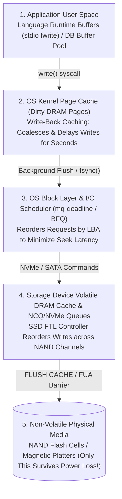
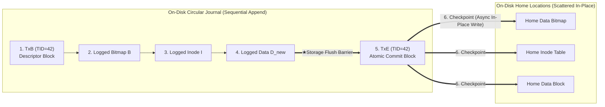
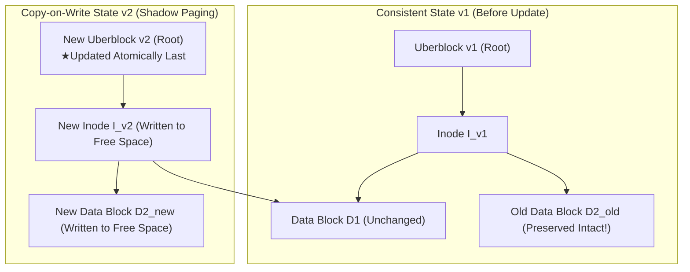

## 1. Introduction: The Minefield Inside a Single 4 KB File Append

When you press `Ctrl+S` in a text editor, snap a photo on your smartphone, or confirm a bank transfer, your application issues a `write()` system call to the operating system. From the application programmer's vantage point, saving data looks like a single, instantaneous, indivisible step.

Beneath the surface of the OS kernel, file system, database storage engine, and solid-state drive (SSD), however, lies one of the hardest problems in computer systems engineering: <strong>the Crash Consistency Problem</strong>.

To understand why, consider the simplest possible file-system operation on a classical UNIX file system (such as UFS or ext2): <strong>appending a single new $4\,\text{KB}$ data block $D_{\text{new}}$ to an existing file</strong>. Even this trivial operation cannot be accomplished by writing a single disk sector. Instead, the file system must update <strong>three physically separated structures on the storage device</strong>:

1. <strong>The Data Bitmap ($B$)</strong>: Flip the allocation bit for physical block number $k$ from $0$ (free) to $1$ (allocated) so no other file claims it.
2. <strong>The Inode ($I$)</strong>: Update the file's metadata record—incrementing the file `size`, updating the modification timestamp `mtime`, and writing the physical block address $k$ into the inode's block pointer array.
3. <strong>The Data Block ($D_{\text{new}}$)</strong>: Write the user's actual $4\,\text{KB}$ payload into physical block number $k$.

Here we hit a fundamental physical asymmetry of computer hardware. Main memory (DRAM) is fast and byte-addressable, but <strong>volatile</strong>—its contents vanish within milliseconds when power is lost. Disks and NAND flash SSDs are <strong>non-volatile</strong>, but because $B$, $I$, and $D_{\text{new}}$ reside at distant logical block addresses (LBAs), <strong>no storage device can update all three locations simultaneously in a single atomic physical action</strong>.

What happens if the power cord is yanked, the battery dies, or the OS kernel panics halfway through writing $(B, I, D_{\text{new}})$? Depending on which subset of the three blocks actually reached non-volatile media before power failed ($2^3 - 2 = 6$ partial-write states), the file system wakes up on reboot in a state of catastrophic corruption:

| Persisted to Disk | Lost in Volatile RAM | Resulting Crash Inconsistency & Severity |
| :--- | :--- | :--- |
| <strong>$D_{\text{new}}$ only</strong> | $B,\; I$ | <strong>Benign Data Loss</strong>: The new data block sits on disk, but neither the inode nor the bitmap knows about it. File-system invariants remain intact, though the user's append is lost. |
| <strong>$B$ only</strong> | $I,\; D_{\text{new}}$ | <strong>Space Leak (Orphaned Block)</strong>: Block $k$ is marked allocated ($1$) in bitmap $B$, but no inode in the entire file system points to it. That storage capacity is permanently leaked. |
| <strong>$I$ only</strong> (or $I + D_{\text{new}}$) | $B$ | <strong>Double Allocation (Catastrophic Metadata Corruption)</strong>: Inode $I$ points to block $k$, but bitmap $B$ still marks block $k$ as free ($0$). Later, another file allocates block $k$ and overwrites it—causing two distinct files to alias and silently corrupt each other's data! |
| <strong>$I$ and $B$</strong> | $D_{\text{new}}$ | <strong>Stale Data Exposure (Critical Security Vulnerability)</strong>: The inode points to block $k$ and increases `size`, but the user's new data $D_{\text{new}}$ never arrived. Reading the file now returns <strong>whatever deleted data previously occupied physical sector $k$</strong>—potentially exposing another user's private keys or passwords! |

How can a computer system guarantee <strong>All-or-Nothing Atomicity</strong> and <strong>Durability</strong> across multi-block updates when the underlying hardware only guarantees atomicity at the granularity of a single sector or flash page—and actively reorders writes behind the OS's back? That is the art and science of <strong>Crash Consistency</strong>.

---

## 2. Why Writes Don't Reach Disk in the Order You Wrote Them: The Multi-Layer Cache Hierarchy

A natural first thought is: *"Why not simply write the blocks in a safe order—first the data block $D_{\text{new}}$, then the bitmap $B$, and finally the inode $I$?"* If power fails after $D_{\text{new}}$, nothing is corrupted; if power fails after $B$, at worst we have a minor space leak, never stale data exposure or double allocation.

In modern computer architecture, however, <strong>the chronological order in which an application invokes `write()` bears almost no relation to the chronological order in which bits are physically committed to non-volatile magnetic platters or NAND flash cells</strong>. Between your code and the physical media sit four layers of volatile buffering and out-of-order scheduling:



1. <strong>OS Page Cache (Write-Back Caching)</strong>: When a process calls `write()`, the kernel merely copies the bytes into volatile DRAM pages in the <strong>Page Cache</strong>, marks those pages `Dirty`, and returns immediately to user space in microseconds. The actual writeback to storage happens tens of seconds later via background kernel threads (`pdflush` / `flush`), ordered by memory pressure and page addresses rather than program order.
2. <strong>OS Block Layer I/O Schedulers</strong>: To minimize mechanical seek times on HDDs or optimize queue depths on SSDs, the block layer sorts pending I/O requests by Logical Block Address (elevator scheduling), freely reordering a write to sector $500$ ahead of an earlier write to sector $90,000$.
3. <strong>Storage Device Volatile Write Cache & FTL Reordering</strong>: Even after the OS dispatches a write command over the PCIe/NVMe or SATA bus and the drive replies `"Write Complete"`, the data has usually only entered the <strong>drive's onboard volatile DRAM buffer</strong>! Inside an SSD, the <strong>Flash Translation Layer (FTL)</strong> dynamically remaps logical blocks to physical NAND pages across multiple parallel flash channels, reordering writes until an explicit hardware <strong>Cache Flush (`NVMe Flush` / `SATA FLUSH CACHE EXT`)</strong> or <strong>Force Unit Access (`FUA`)</strong> barrier command forces the drive to drain its volatile buffer to non-volatile NAND cells.

Without explicit <strong>durability barriers (storage fences)</strong>, any ordering assumption made by software is shattered by hardware reordering.

---

## 3. Generation 1 of Crash Consistency: Optimistic In-Place Updates, `fsck`, and Soft Updates

### 3.1 `fsck` (File System Consistency Check) and the Scalability Wall

Early UNIX file systems (such as the BSD Fast File System and Linux ext2) took an optimistic approach: during normal operation, they buffered updates in memory and wrote them in-place without logging. If an unclean shutdown occurred, the system refused to mount the volume on reboot until <strong>`fsck`</strong> scanned the entire disk across multiple passes:

- <strong>Pass 1 & 2 (Inodes & Allocation Bitmaps)</strong>: Read every single inode on the disk, compute the true set of referenced data blocks, and overwrite the on-disk bitmaps $B$ to reclaim leaked blocks (`B=1, I=0`) or resolve double allocations (`B=0, I=1`).
- <strong>Pass 3 & 4 (Directory Tree Connectivity & Reference Counts)</strong>: Traverse the entire directory hierarchy from the root `/`, verify that every inode's `nlink` reference count matches the number of directory entries pointing to it, and attach orphaned inodes (`nlink > 0` but unreachable from `/`) to `/lost+found`.

While conceptually simple, `fsck` suffers from a fatal algorithmic flaw: <strong>its runtime complexity is proportional to the total capacity of the disk $O(N_{\text{disk}})$, not the amount of data being written when the crash occurred $O(N_{\text{active}})$!</strong> On a $100\,\text{MB}$ disk in 1985, `fsck` took 30 seconds. On a modern $20\,\text{TB}$ storage array, scanning billions of inodes and block pointers after a power blip takes <strong>hours or days of downtime</strong>—even if only a single $4\,\text{KB}$ file was being modified when power failed!

### 3.2 Soft Updates: Dependency Tracking Without a Log

In 1994, Gregory Ganger and Kirk McKusick introduced <strong>Soft Updates</strong> (adopted in FreeBSD UFS), a brilliant mechanism that avoided both on-disk logging and pre-mount `fsck` by enforcing <strong>strict fine-grained dependency ordering rules</strong> when flushing dirty blocks from the OS page cache to disk:

1. *Never point to a structure before it has been initialized on disk* (eliminates stale data exposure and double allocations).
2. *Never reuse a resource before nullifying all previous on-disk pointers to it*.
3. *Never reset an old pointer to a live resource before the new pointer has been set on disk*.

What if Block A and Block B contain multiple inodes or directory entries that create a <strong>cyclic dependency</strong> (Block A must be written before Block B because of File 1, but Block B must be written before Block A because of File 2)? Soft Updates breaks the cycle at flush time by <strong>temporarily rolling back</strong> the dependent field inside Block A in memory to its old consistent value, writing Block A to disk, waiting for completion, and then <strong>rolling forward</strong> the field in memory for a subsequent write! While Soft Updates kept the on-disk image perpetually consistent (reducing crash consequences to benign space leaks reclaimed by a background `fsck`), its intricate in-memory pointer rollback logic proved notoriously difficult to implement and maintain.

---

## 4. The Workhorse of Modern Storage: Write-Ahead Logging (WAL) and Journaling

To make crash recovery proportional only to the work in flight at the moment of the crash—$O(N_{\text{active}})$, completing in milliseconds—file systems borrowed a foundational invention from relational database systems (Jim Gray's System R and Mohan's ARIES): <strong>Write-Ahead Logging (WAL)</strong>, known in file systems as <strong>Journaling</strong> (used in Linux <strong>ext3/ext4</strong>, <strong>XFS</strong>, Windows <strong>NTFS</strong>, and Apple <strong>HFS+</strong>).

### 4.1 The Core Principle of WAL: "Write Your Intent to a Sequential Log Before Touching the Home Locations"

Why did updating $(B, I, D_{\text{new}})$ in-place fail? Because they sit at scattered disk locations that cannot be updated atomically.

Journaling solves this via a two-phase protocol using a dedicated, contiguous circular buffer on disk called the <strong>Journal (or Log)</strong>:

1. <strong>Journal Write</strong>: Before modifying the actual on-disk bitmap, inode table, or data blocks (their *home locations*), the file system appends a transaction to the journal containing a <strong>Transaction Begin descriptor block (`TxB`</strong>, with a unique transaction ID `TID` and the target block addresses) followed by the exact updated block images ($I, B, D_{\text{new}}$).
2. <strong>Journal Commit (The Atomic Commit Point)</strong>: After issuing a <strong>storage cache flush barrier</strong> to guarantee that `TxB` and all logged blocks have physically reached non-volatile media, the file system writes a single small <strong>Transaction End / Commit block (`TxE`)</strong> containing `TID`.
   - <strong>The single sector write of `TxE` is the atomic switch</strong>: the instant `TxE` hits the disk platter or NAND cell, the entire multi-block transaction is officially committed!
3. <strong>Checkpoint (Writeback to Home Locations)</strong>: Once `TxE` is safely on disk, the file system can lazily copy $I$, $B$, and $D_{\text{new}}$ to their scattered in-place home locations in the background.
4. <strong>Journal Space Reclamation</strong>: Once checkpointing finishes, the transaction's slot in the circular journal is marked free.



#### Why Recovery Now Takes Milliseconds:
- <strong>Crash BEFORE `TxE` is written</strong>: The home locations on disk have not been touched at all! On reboot, the recovery manager scans the journal, sees `TxB(42)` without a matching `TxE(42)`, and simply <strong>discards (aborts)</strong> the incomplete log entry.
- <strong>Crash AFTER `TxE` is written (mid-checkpoint)</strong>: The home locations may be half-written, but a complete, self-contained copy of $(B, I, D_{\text{new}})$ sits safely inside the committed journal entry `TID=42`. On reboot, the recovery manager simply <strong>replays (redoes)</strong> those blocks from the journal into their home locations. Because physical block overwrite is <strong>idempotent</strong> ($f(f(x)) = f(x)$), even if a second power outage occurs during recovery replay, repeating the replay again on the next boot yields the exact same consistent state!

Furthermore, modern <strong>ext4</strong> eliminates the extra disk barrier wait between Step 1 (`TxB` + payload) and Step 2 (`TxE`) via <strong>Journal Checksums</strong>: it writes `TxB`, the logged blocks, and `TxE` in a single batch, embedding a <strong>CRC32C cryptographic checksum</strong> of the entire transaction inside `TxE`. If power fails while the drive reorders the batch, the checksum inside `TxE` will fail to match the partially written payload on reboot, allowing recovery to safely detect the torn transaction and abort it!

### 4.2 The Three Journaling Modes of ext3/ext4: Balancing Safety vs. Write Amplification

Logging every $4\,\text{KB}$ data block $D_{\text{new}}$ to the journal and then writing it a second time to its home location doubles the total bytes written to disk (<strong>$2\times$ Write Amplification</strong>), cutting sequential write bandwidth in half. To solve this, ext3 and ext4 (via the Linux `JBD2` layer) offer three journaling modes:

1. <strong>`data=journal` (Full Data + Metadata Journaling)</strong>: Logs both metadata $(I, B)$ and data $(D_{\text{new}})$ into the journal before checkpointing. Provides ironclad consistency but suffers a $2\times$ write penalty.
2. <strong>`data=writeback` (Unordered Metadata-Only Journaling)</strong>: Logs only metadata $(I, B)$ in the journal while writing $D_{\text{new}}$ directly to its home location with no ordering constraint. Fast, but if the metadata transaction commits (`TxE`) before $D_{\text{new}}$ reaches disk and power fails, rebooting exposes <strong>stale deleted data</strong> inside the file!
3. <strong>`data=ordered` (Ordered Metadata Journaling — The Default)</strong>: Logs only metadata $(I, B)$ in the journal (avoiding double-writing data), *but* enforces a strict causal ordering rule: <strong>the file system flushes the data block $D_{\text{new}}$ directly to its home location FIRST, and waits for $D_{\text{new}}$ to complete before allowing the metadata transaction's `TxB`–`TxE` to commit to the journal!</strong> If power fails before $D_{\text{new}}$ finishes, the metadata transaction is never committed; if power fails after, $D_{\text{new}}$ is already safely in place when the metadata journal replays.

### 4.3 Database Crash Recovery: The ARIES Protocol (`Steal / No-Force`)

In relational databases (PostgreSQL, MySQL InnoDB, Oracle, SQL Server), transactions modify records at sub-block (tuple) granularity and may span gigabytes. Databases use a <strong>`Steal / No-Force`</strong> buffer-pool policy:
- <strong>`Steal`</strong>: The buffer manager is allowed to flush dirty pages belonging to an *uncommitted* transaction to disk if DRAM runs low (requiring <strong>Undo logging</strong> to roll them back if the transaction aborts).
- <strong>`No-Force`</strong>: When a transaction commits, the database does *not* force all random dirty data pages to disk; it only flushes the sequential WAL records up to the commit record (requiring <strong>Redo logging</strong> on crash).

Formulated by C. Mohan et al. at IBM in 1992, the <strong>ARIES (Algorithms for Recovery and Isolation Exploiting Semantics)</strong> algorithm stamps every database page with a monotonically increasing <strong>Log Sequence Number (`pageLSN`)</strong> and enforces the <strong>WAL Invariant</strong>: *a dirty page cannot be written to disk until the log record describing its latest change (`LSN` $\ge$ `pageLSN`) has been flushed to non-volatile storage*. Upon crash recovery, ARIES executes three phases: <strong>Analysis</strong> (identifying active loser transactions and dirty pages), <strong>Redo ("Repeating History")</strong> (replaying all logged actions forward from the minimum `recLSN` to reconstruct the exact state at the moment of the crash), and <strong>Undo</strong> (walking backward through the log to reverse all uncommitted loser transactions while writing <strong>Compensation Log Records (CLRs)</strong> so recovery never repeats undone work).

---

## 5. Generation 3 of Crash Consistency: Copy-on-Write (CoW) and Merkle Trees (ZFS / Btrfs)

Both in-place updates (`fsck`) and journaling (`WAL`) assume that modifying a file means overwriting existing blocks at their home locations. What if we adopt a functional, immutable paradigm on disk: <strong>never overwrite live data or metadata in place, and always write every modification to newly allocated free space</strong>?

Pioneered by John Ousterhout and Mendel Rosenblum's <strong>Log-Structured File System (LFS, 1991)</strong>, <strong>Shadow Paging</strong>, and NetApp's <strong>WAFL</strong>, this <strong>Copy-on-Write (CoW)</strong> architecture forms the foundation of modern next-generation file systems: <strong>ZFS</strong>, <strong>Btrfs</strong>, <strong>Apple APFS</strong>, and the internal Flash Translation Layers of all modern SSDs.



1. When modifying data block $D_2$, the file system leaves $D_{2,\text{old}}$ completely untouched and writes $D_{2,\text{new}}$ to a fresh free block.
2. Because the block address changed, the parent inode cannot be updated in place either; a new inode $I_{v2}$ pointing to untouched $D_1$ and new $D_{2,\text{new}}$ is written to a fresh free location.
3. This bottom-up pointer propagation continues up the tree until all new child blocks are safely flushed to non-volatile disk. At the very end, a single atomic write updates the <strong>Root Pointer Block</strong> (called the <strong>Uberblock</strong> ring in ZFS) from $U_1$ to $U_2$!

<strong>Why CoW Revolutionizes Storage Reliability:</strong>
- <strong>Zero-Time Atomic Recovery</strong>: If power fails anywhere before the new Uberblock $U_2$ is written, the entire old tree rooted at $U_1$ is $100\%$ intact on disk. There is no journal to replay and no `fsck` to run!
- <strong>Instant $O(1)$ Snapshots and Clones</strong>: Retaining $U_1$ instead of freeing its old blocks gives an instantaneous, read-only point-in-time snapshot of the entire multi-terabyte file system at zero copy cost.
- <strong>End-to-End Cryptographic Integrity (Merkle Trees)</strong>: In ZFS, every parent block pointer stores the $256$-bit cryptographic checksum (SHA-256 / Fletcher4 / Blake3) of its target child block. Every read verifies the checksum up to the Uberblock, detecting silent bit rot, phantom writes, and misdirected writes on the fly and automatically self-healing corrupted blocks from RAID-Z parity!

---

## 6. The Application Programmer's Nightmare: `fsync()` Traps and Fault-Injection Testing

Even the most sophisticated journaling or CoW file system only protects its *own* internal metadata invariants by default unless the application explicitly requests durability via `fsync()`.

### 6.1 The `rename()` Atomicity Myth and the Complete 6-Step Crash-Safe Save Protocol

Many developers assume that writing a temporary file `config.json.tmp` and calling `rename("config.json.tmp", "config.json")` guarantees crash-safe atomic file replacement. In 2009, when Linux distributions upgraded from ext3 to <strong>ext4</strong> (which introduced <strong>Delayed Allocation</strong>), thousands of users experienced a shocking bug: after a system crash, recently saved configuration files and desktop states turned into <strong>zero-length ($0$-byte) files</strong>!

Why? Because POSIX `rename()` only guarantees that the directory entry switch is atomic relative to other processes; <strong>it does NOT guarantee that the data bytes buffered inside the OS Page Cache for `config.json.tmp` have been flushed to disk before the metadata rename transaction commits!</strong> Under delayed allocation, the metadata rename committed to the journal seconds before the dirty data pages were flushed, leaving a valid filename pointing to an empty inode upon power loss.

Furthermore, even calling `fsync(fd)` on the temporary file before `rename()` is insufficient on its own: if power fails immediately after `rename()`, the modified <strong>parent directory</strong> entry itself may still sit only in volatile cache!

To atomically and durably update a file on POSIX file systems, an application must execute the <strong>six-step durability protocol</strong>:

```c
// The Complete 6-Step Crash-Safe Atomic File Replacement Protocol
int fd = open("config.json.tmp", O_WRONLY | O_CREAT | O_TRUNC, 0644);
write_all(fd, buf, len);                  // 1. Write full payload to temporary file
fsync(fd);                                // 2. ★Flush temp file data & inode to physical media!
close(fd);                                // 3. Close temporary file descriptor

rename("config.json.tmp", "config.json"); // 4. Atomically swap directory entry

int dir_fd = open(".", O_RDONLY | O_DIRECTORY);
fsync(dir_fd);                            // 5. ★Flush parent directory to persist the rename!
close(dir_fd);                            // 6. Done: safe to report success to the user
```

### 6.2 PostgreSQL's 2018 "`fsyncgate`" and Systematic Crash Testing

In 2018, database engineers discovered an even deeper horror—dubbed <strong>"`fsyncgate`"</strong>—in the Linux kernel page cache. When `fsync(fd)` encountered a hardware I/O error (such as a bad sector or transient SAN disconnect), the Linux kernel returned `-1 (EIO)` to the database, <strong>but marked the failed dirty page in RAM as `Clean`!</strong> When PostgreSQL retried `fsync(fd)`, the kernel saw no dirty pages and returned `0 (Success)`, causing silent database corruption (prompting a complete rewrite of Linux kernel writeback error tracking via `errseq_t` in Linux 4.17).

Because crash-consistency bugs only manifest when power fails during a specific microsecond window of reordered I/O, normal unit tests never catch them. Modern storage engineering relies on <strong>Systematic Crash & Fault-Injection Frameworks</strong>—such as <strong>ALICE</strong> (Application-Level Intelligent Crash Explorer) and <strong>CrashMonkey</strong> developed by Remzi and Andrea Arpaci-Dusseau's group at the University of Wisconsin–Madison—which intercept every `write()`, `fsync()`, and block bio request, systematically enumerate all valid hardware reordering permutations of disk states ("crash states"), and verify that recovery restores full application invariants across every single one.

---

## 7. Conclusion: Building Immortal Logic Atop Mortal Physics

Every time a database survives a sudden power blackout without losing a single committed cent, or a laptop boots cleanly in one second after its battery dies, we are witnessing a triumph of systems engineering over physical entropy. Hardware storage is inherently asynchronous, out-of-order, and vulnerable to abrupt power failure. By layering <strong>hardware flush barriers</strong>, <strong>Write-Ahead Logging (WAL / ARIES)</strong>, <strong>ordered journaling</strong>, and <strong>Copy-on-Write Merkle trees</strong> atop raw sectors, computer scientists have constructed the illusion of immortal, atomic transactions out of fragile, mortal silicon.
