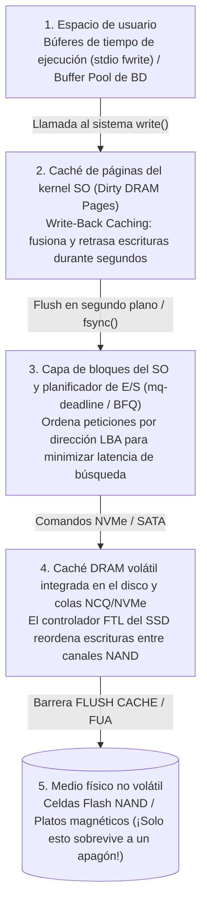
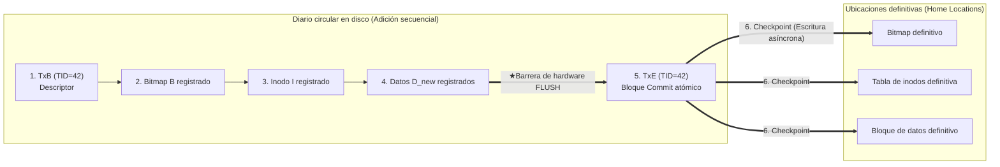

## 1. Introducción: el campo minado oculto tras añadir un solo bloque de 4 KB

Cuando pulsas `Ctrl+S` en un editor de texto o confirmas una transferencia bancaria, tu aplicación emite una llamada al sistema `write()`. Desde la perspectiva del programador de aplicaciones, guardar datos parece una operación única, instantánea e indivisible.

Sin embargo, bajo el capó del kernel del sistema operativo, el sistema de archivos, el motor de almacenamiento de la base de datos y el controlador SSD se esconde uno de los problemas más difíciles de la ingeniería de sistemas: <strong>el problema de la consistencia ante fallos (Crash Consistency Problem)</strong>.

Consideremos la operación más simple posible en un sistema de archivos UNIX clásico (como UFS o ext2): <strong>añadir un único bloque de datos nuevo de $4\,\text{KB}$ ($D_{\text{new}}$) al final de un archivo existente</strong>. Incluso esta operación trivial requiere actualizar al menos <strong>tres estructuras físicamente separadas en el dispositivo de almacenamiento</strong>:

1. <strong>El mapa de bits de datos (Data Bitmap $B$)</strong>: cambiar el bit del bloque físico $k$ de $0$ (libre) a $1$ (asignado).
2. <strong>El inodo ($I$)</strong>: actualizar los metadatos del archivo (tamaño `size`, marca de tiempo `mtime` y el puntero a la dirección física del bloque $k$).
3. <strong>El bloque de datos ($D_{\text{new}}$)</strong>: escribir los $4\,\text{KB}$ reales del usuario en el sector físico $k$.

Aquí chocamos con una asimetría física fundamental del hardware: la memoria principal (DRAM) es rápida pero <strong>volátil</strong>, mientras que los discos y los SSD NAND son <strong>no volátiles</strong> pero incapaces de actualizar simultáneamente tres bloques distantes $(B, I, D_{\text{new}})$ en una sola acción física atómica. Si se corta la electricidad a mitad de estas tres escrituras ($2^3 - 2 = 6$ estados de escritura parcial), el sistema de archivos despierta al reiniciar en un estado de corrupción crítica:

| Persistido en disco | Perdido en RAM | Inconsistencia resultante y gravedad |
| :--- | :--- | :--- |
| <strong>Solo $D_{\text{new}}$</strong> | $B,\; I$ | <strong>Pérdida de datos benigna</strong>: los datos están en el disco, pero ningún inodo ni bitmap apunta a ellos. La estructura del sistema de archivos permanece intacta. |
| <strong>Solo $B$</strong> | $I,\; D_{\text{new}}$ | <strong>Fuga de espacio (Space Leak / bloque huérfano)</strong>: el bloque $k$ figura como ocupado ($1$) en $B$, pero ningún archivo lo referencia; esa capacidad se pierde permanentemente. |
| <strong>Solo $I$</strong> (o $I + D_{\text{new}}$) | $B$ | <strong>Doble asignación (Corrupción catastrófica)</strong>: el inodo $I$ apunta al bloque $k$, pero $B$ lo marca como libre ($0$). Más tarde, otro archivo tomará el bloque $k$ y ambos archivos se destruirán mutuamente. |
| <strong>$I$ y $B$</strong> | $D_{\text{new}}$ | <strong>Exposición de datos obsoletos (Stale Data Exposure — Vulnerabilidad crítica)</strong>: el inodo y el bitmap se actualizaron, pero $D_{\text{new}}$ nunca se escribió. ¡Leer el archivo devuelve <strong>datos antiguos eliminados de otro usuario</strong> (contraseñas o claves privadas) que ocupaban el sector $k$! |

---

## 2. Por qué las escrituras no llegan al disco en el orden en que las escribiste

En la arquitectura moderna, el orden cronológico de las llamadas `write()` casi nunca coincide con el orden físico de escritura en el medio no volátil debido a cuatro capas de almacenamiento en búfer volátil y reordenamiento (<strong>Reordering</strong>):

Para garantizar el orden y la durabilidad, el sistema debe emitir barreras de hardware explícitas (<strong>`NVMe Flush`</strong>, <strong>`SATA FLUSH CACHE EXT`</strong> o el bit <strong>`FUA: Force Unit Access`</strong>) que obliguen a la unidad a vaciar su propio búfer DRAM volátil hacia las celdas NAND.

---

## 3. Generación 1: Actualizaciones en el lugar, `fsck` y Soft Updates

1. <strong>`fsck` (File System Consistency Check) y el muro de escalabilidad</strong>:
   Los primeros sistemas UNIX (FFS, ext2) reparaban las inconsistencias tras un fallo escaneando todos los inodos, bitmaps y directorios del disco antes de montar (`fsck`). Como su tiempo de ejecución es proporcional a la <strong>capacidad total del disco $O(N_{\text{disk}})$</strong>, verificar un volumen moderno de varios terabytes lleva horas o días de inactividad, ¡incluso si solo se estaba modificando un archivo de $4\,\text{KB}$ cuando falló la corriente!
2. <strong>Soft Updates (Ganger & McKusick 1994)</strong>:
   Adoptado en FreeBSD UFS, evitaba el registro en diario rastreando las dependencias de punteros en memoria y rompiendo dependencias cíclicas mediante operaciones temporales de <strong>roll-back</strong> y <strong>roll-forward</strong> en RAM antes de escribir el bloque en disco.

---

## 4. El pilar del almacenamiento moderno: Write-Ahead Logging (WAL) y Journaling

Para reducir el tiempo de recuperación de $O(N_{\text{disk}})$ al trabajo en vuelo en el instante del fallo $O(N_{\text{active}})$ (¡milisegundos!), los sistemas de archivos (<strong>ext3/ext4</strong>, <strong>XFS</strong>, <strong>NTFS</strong>) y las bases de datos emplean <strong>Write-Ahead Logging (WAL) / Journaling</strong>:

1. <strong>Journal Write</strong>: antes de tocar las ubicaciones definitivas (*Home Locations*), el sistema añade secuencialmente al <strong>Journal</strong> un bloque descriptor de inicio `TxB` (con `TID`) seguido de las imágenes actualizadas $(I, B, D_{\text{new}})$.
2. <strong>Journal Commit (Punto de confirmación atómica)</strong>: tras una barrera de vaciado de caché de hardware, se escribe un único bloque de confirmación <strong>`TxE` (Transaction End)</strong>. <strong>¡La escritura de ese único sector `TxE` es el interruptor atómico que valida toda la transacción!</strong>
3. <strong>Checkpoint</strong>: una vez que `TxE` está en el disco, $(I, B, D_{\text{new}})$ se copian de forma asíncrona a sus ubicaciones definitivas.

- <strong>Apagón ANTES de `TxE`</strong>: las ubicaciones definitivas están intactas; al reiniciar, la entrada incompleta simplemente se descarta.
- <strong>Apagón DESPUÉS de `TxE`</strong>: al reiniciar, el gestor de recuperación reproduce (<strong>Redo replay</strong>, operación idempotente) los bloques del diario hacia sus ubicaciones definitivas en milisegundos. <strong>ext4</strong> elimina incluso la barrera intermedia mediante <strong>sumas de comprobación del diario (CRC32C)</strong> dentro de `TxE`.

Para evitar duplicar los bytes escritos ($2\times$ Write Amplification), el modo predeterminado <strong>`data=ordered`</strong> de ext4 solo registra metadatos $(I, B)$ en el diario, pero <strong>obliga a que el bloque de datos $D_{\text{new}}$ se escriba por completo en su ubicación definitiva ANTES de permitir que el bloque `TxE` de los metadatos se confirme en el diario</strong>. En bases de datos relacionales, el protocolo <strong>ARIES</strong> (Mohan et al., 1992) gestiona la política `Steal / No-Force` mediante marcas `pageLSN` y tres fases: <strong>Analysis</strong>, <strong>Redo (Repeating History)</strong> y <strong>Undo (con Compensation Log Records, CLRs)</strong>.

---

## 5. Generación 3: Copy-on-Write (CoW) y árboles de Merkle (ZFS / Btrfs)

Sistemas de archivos como <strong>ZFS</strong>, <strong>Btrfs</strong> y <strong>APFS</strong> prohíben sobrescribir bloques existentes (*In-Place Overwrite*) y adoptan <strong>Copy-on-Write (CoW / Shadow Paging)</strong>:

1. Todo bloque modificado $D_{2,\text{new}}$ y su inodo padre $I_{v2}$ se escriben siempre en espacio libre nuevo, manteniendo intactos los bloques antiguos $D_{2,\text{old}}$.
2. Cuando todos los bloques hijos nuevos están seguros en disco, una única escritura atómica actualiza el bloque raíz (<strong>Uberblock</strong> en ZFS) de $U_1$ a $U_2$.
3. <strong>Ventajas</strong>: recuperación instantánea en $0$ segundos sin reproducir diarios, <strong>instantáneas (Snapshots) en $O(1)$</strong> sin costo de copia y autorreparación (*Self-Healing*) contra la degradación silenciosa de bits (*Bit Rot*) mediante <strong>árboles de Merkle</strong> con sumas criptográficas de 256 bits en cada puntero padre.

---

## 6. Las trampas de `fsync()` para desarrolladores y las pruebas de inyección de fallos

Incluso sobre un sistema con journaling o CoW, reemplazar un archivo mediante `rename("config.json.tmp", "config.json")` sin llamar antes a `fsync()` produce <strong>archivos vacíos de $0$ bytes</strong> tras un apagón bajo *Delayed Allocation* (ext4), porque el cambio de nombre de los metadatos se confirma antes de que se vacíen las páginas de datos en caché.

El <strong>protocolo completo de 6 pasos para un guardado atómico a prueba de fallos</strong> es:
(1) `write()` en el archivo temporal $\to$ (2) <strong>`fsync(fd)`</strong> sobre el archivo temporal $\to$ (3) `close(fd)` $\to$ (4) `rename()` atómico $\to$ (5) abrir el directorio padre y ejecutar <strong>`fsync(dir_fd)`</strong> para persistir la entrada del directorio $\to$ (6) `close(dir_fd)`.

Como demostró el escándalo <strong>`fsyncgate`</strong> de PostgreSQL en 2018 (donde el kernel de Linux marcaba una página sucia como `Clean` tras un error de E/S `EIO` durante `fsync()`, corregido mediante `errseq_t`), la ingeniería de almacenamiento moderna depende de marcos de <strong>inyección sistemática de fallos</strong> como <strong>ALICE</strong> y <strong>CrashMonkey</strong>, que exploran exhaustivamente todas las permutaciones de reordenamiento de hardware ante cortes de energía.
