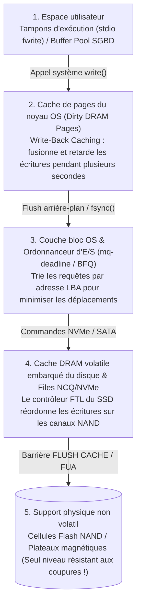
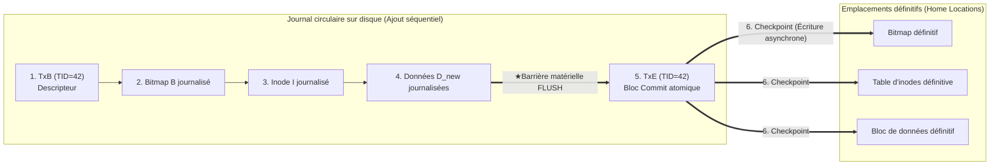

## 1. Introduction : le champ de mines caché derrière l'ajout d'un seul bloc de 4 Ko

Lorsque vous appuyez sur `Ctrl+S` dans un éditeur de texte ou validez un virement bancaire, votre application émet un appel système `write()`. Du point de vue du développeur, la sauvegarde semble être une opération unique, instantanée et indivisible.

Mais sous le capot du noyau du système d'exploitation, du système de fichiers, du moteur de base de données et du contrôleur SSD se cache l'un des problèmes les plus redoutables de l'informatique : <strong>le problème de la cohérence après crash (Crash Consistency Problem)</strong>.

Prenons l'opération la plus élémentaire possible dans un système de fichiers UNIX classique (tel que UFS ou ext2) : <strong>ajouter un nouveau bloc de données de $4\,\text{Ko}$ ($D_{\text{new}}$) à la fin d'un fichier existant</strong>. Même cette opération triviale nécessite la mise à jour d'au moins <strong>trois structures physiquement séparées sur le disque</strong> :

1. <strong>La table de bits des données (Data Bitmap $B$)</strong> : basculer le bit du bloc physique $k$ de $0$ (libre) à $1$ (alloué).
2. <strong>L'inode ($I$)</strong> : mettre à jour les métadonnées du fichier (taille `size`, horodatage `mtime` et pointeur vers l'adresse physique du bloc $k$).
3. <strong>Le bloc de données ($D_{\text{new}}$)</strong> : écrire les $4\,\text{Ko}$ effectifs de l'utilisateur dans le secteur physique $k$.

Or, la mémoire vive (DRAM) est rapide mais <strong>volatile</strong>, tandis que les disques et SSD NAND sont <strong>non volatils</strong> mais incapables de mettre à jour simultanément trois blocs distants $(B, I, D_{\text{new}})$ en une seule opération physique atomique. Si une coupure de courant survient au milieu de ces trois écritures ($2^3 - 2 = 6$ états d'écriture partielle), le système de fichiers se réveille dans un état d'incohérence critique :

| Écrit sur disque | Perdu en RAM | Incohérence résultante et gravité |
| :--- | :--- | :--- |
| <strong>$D_{\text{new}}$ seul</strong> | $B,\; I$ | <strong>Perte de données bénigne</strong> : les données sont sur le disque mais aucun inode ni bitmap n'y fait référence. La structure du système de fichiers reste saine. |
| <strong>$B$ seul</strong> | $I,\; D_{\text{new}}$ | <strong>Fuite d'espace (Space Leak / bloc orphelin)</strong> : le bloc $k$ est marqué occupé ($1$) dans $B$ mais aucun fichier ne le pointe ; cet espace est définitivement perdu. |
| <strong>$I$ seul</strong> (ou $I + D_{\text{new}}$) | $B$ | <strong>Double allocation (Corruption catastrophique)</strong> : l'inode $I$ pointe vers le bloc $k$, mais $B$ l'indique libre ($0$). Un autre fichier allouera plus tard le bloc $k$, détruisant mutuellement les deux fichiers ! |
| <strong>$I$ et $B$</strong> | $D_{\text{new}}$ | <strong>Fuite de données obsolètes (Stale Data Exposure — Faille de sécurité critique)</strong> : l'inode et le bitmap sont à jour, mais $D_{\text{new}}$ n'a jamais été écrit. La lecture du fichier renvoie <strong>les anciennes données supprimées d'un autre utilisateur</strong> (mots de passe, clés privées) qui occupaient le secteur $k$ ! |

---

## 2. Pourquoi les écritures n'arrivent pas sur le disque dans l'ordre du programme

Dans une architecture moderne, l'ordre chronologique des appels `write()` ne correspond presque jamais à l'ordre d'écriture physique sur le support non volatil en raison de quatre couches de mise en mémoire tampon et de réordonnancement (<strong>Reordering</strong>) :

Pour garantir l'ordre et la persistance, le système doit émettre des barrières matérielles explicites (<strong>`NVMe Flush`</strong>, <strong>`SATA FLUSH CACHE EXT`</strong> ou bit <strong>`FUA: Force Unit Access`</strong>) forçant le disque à vider son propre tampon DRAM volatile vers les cellules NAND.

---

## 3. Génération 1 : Mises à jour sur place, `fsck` et Soft Updates

1. <strong>`fsck` (File System Consistency Check) et le mur de passage à l'échelle</strong> :
   Les premiers systèmes UNIX (FFS, ext2) réparaient les incohérences après un crash en parcourant l'intégralité des inodes, bitmaps et répertoires avant le montage (`fsck`). Comme sa complexité dépend de la <strong>capacité totale du disque $O(N_{\text{disk}})$</strong>, vérifier un volume moderne de plusieurs téraoctets prend des heures ou des jours, même si un seul bloc de $4\,\text{Ko}$ était en cours d'écriture !
2. <strong>Soft Updates (Ganger & McKusick 1994)</strong> :
   Adopté par FreeBSD UFS, ce mécanisme évitait la journalisation en suivant finement les dépendances entre pointeurs en mémoire et en brisant les dépendances cycliques par des opérations temporaires de <strong>roll-back</strong> et <strong>roll-forward</strong> en RAM avant l'écriture disque.

---

## 4. Le pilier du stockage moderne : Write-Ahead Logging (WAL) et Journalisation

Pour réduire le temps de récupération de $O(N_{\text{disk}})$ au seul volume des transactions actives au moment du crash $O(N_{\text{active}})$ (quelques millisecondes !), les systèmes de fichiers (<strong>ext3/ext4</strong>, <strong>XFS</strong>, <strong>NTFS</strong>) et les bases de données utilisent la <strong>journalisation (Write-Ahead Logging, WAL / Journaling)</strong> :

1. <strong>Journal Write</strong> : avant de toucher aux emplacements définitifs (*Home Locations*), le système ajoute séquentiellement dans le <strong>Journal</strong> un bloc descripteur de début `TxB` (avec l'identifiant `TID`) suivi des blocs modifiés $(I, B, D_{\text{new}})$.
2. <strong>Journal Commit (Point de validation atomique)</strong> : après une barrière matérielle de vidage cache, le système écrit un unique bloc de fin <strong>`TxE` (Transaction End)</strong>. <strong>L'écriture de cet unique secteur `TxE` bascule atomiquement toute la transaction dans l'état validé !</strong>
3. <strong>Checkpoint</strong> : une fois `TxE` sur disque, les blocs $(I, B, D_{\text{new}})$ sont copiés de manière asynchrone vers leurs emplacements définitifs.

- <strong>Coupure AVANT `TxE`</strong> : les emplacements définitifs sont intacts ; au redémarrage, la transaction incomplète est simplement ignorée.
- <strong>Coupure APRÈS `TxE`</strong> : au redémarrage, le gestionnaire de reprise rejoue (<strong>Redo replay</strong>, opération idempotente) les blocs du journal vers leurs emplacements définitifs en quelques millisecondes. <strong>ext4</strong> optimise encore ce processus grâce aux <strong>sommes de contrôle du journal (CRC32C)</strong> intégrées dans `TxE`.

Pour éviter de doubler le volume d'écriture ($2\times$ Write Amplification), le mode par défaut <strong>`data=ordered`</strong> d'ext4 ne journalise que les métadonnées $(I, B)$, mais <strong>impose que le bloc de données $D_{\text{new}}$ soit intégralement écrit à son emplacement définitif AVANT que le bloc de validation `TxE` des métadonnées ne soit écrit dans le journal</strong>. Dans les SGBD relationnels, l'algorithme <strong>ARIES</strong> (Mohan et al., 1992) gère la politique `Steal / No-Force` via les numéros `pageLSN` et trois phases : <strong>Analysis</strong>, <strong>Redo (Repeating History)</strong> et <strong>Undo (avec Compensation Log Records, CLRs)</strong>.

---

## 5. Génération 3 : Copy-on-Write (CoW) et arbres de Merkle (ZFS / Btrfs)

Les systèmes de fichiers de nouvelle génération (<strong>ZFS</strong>, <strong>Btrfs</strong>, <strong>APFS</strong>) interdisent toute réécriture sur place (*In-Place Overwrite*) grâce au <strong>Copy-on-Write (CoW / Shadow Paging)</strong> :

1. Tout bloc de données modifié $D_{2,\text{new}}$ et son inode parent $I_{v2}$ sont écrits dans de nouveaux blocs libres, laissant les anciens blocs $D_{2,\text{old}}$ totalement intacts.
2. Une fois toute la nouvelle branche persistée sur disque, une seule écriture atomique met à jour le bloc racine (<strong>Uberblock</strong> dans ZFS) de $U_1$ vers $U_2$.
3. <strong>Avantages</strong> : récupération instantanée en $0$ seconde sans rejeu de journal, <strong>instantanés (Snapshots) en $O(1)$</strong> sans copie, et auto-guérison (*Self-Healing*) contre la corruption silencieuse (*Bit Rot*) grâce aux <strong>arbres de Merkle</strong> intégrant des empreintes cryptographiques de 256 bits dans chaque pointeur parent.

---

## 6. Les pièges de `fsync()` pour les développeurs et les tests par injection de fautes

Même sur un système journalisé ou CoW, remplacer un fichier par `rename("config.json.tmp", "config.json")` sans appeler `fsync()` au préalable produit des <strong>fichiers vides de $0$ octet</strong> après une coupure de courant sous *Delayed Allocation* (ext4), car le renommage des métadonnées est validé avant l'écriture des pages de données !

Le <strong>protocole complet en 6 étapes pour une sauvegarde atomique résistante aux crashs</strong> est :
(1) `write()` dans le fichier temporaire $\to$ (2) <strong>`fsync(fd)`</strong> sur le fichier temporaire $\to$ (3) `close(fd)` $\to$ (4) `rename()` atomique $\to$ (5) ouverture du répertoire parent et <strong>`fsync(dir_fd)`</strong> pour persister l'entrée de répertoire $\to$ (6) `close(dir_fd)`.

Comme l'a révélé le scandale PostgreSQL <strong>`fsyncgate`</strong> en 2018 (où le noyau Linux marquait une page sale comme `Clean` après une erreur d'E/S `EIO` lors d'un `fsync()`, corrigé depuis par `errseq_t`), la validation des systèmes de stockage modernes repose désormais sur des outils d'<strong>injection systématique de fautes</strong> tels qu'<strong>ALICE</strong> et <strong>CrashMonkey</strong>, qui explorent toutes les permutations de réordonnancement matériel face aux coupures de courant.
