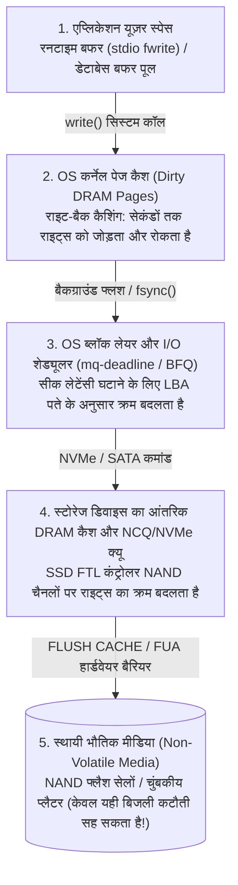
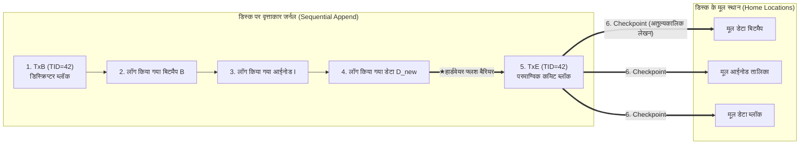

## 1. प्रस्तावना: एक 4 KB फ़ाइल ब्लॉक जोड़ने के पीछे छिपा बारूदी सुरंग का मैदान

जब आप किसी टेक्स्ट एडिटर में `Ctrl+S` दबाते हैं या बैंक ट्रांसफर की पुष्टि करते हैं, तो आपका एप्लिकेशन ऑपरेटिंग सिस्टम को `write()` सिस्टम कॉल भेजता है। एप्लिकेशन प्रोग्रामर के दृष्टिकोण से, डेटा सेव करना एक एकल, तात्कालिक और अविभाज्य (Atomic) कदम जैसा दिखता है।

किंतु OS कर्नेल, फ़ाइल सिस्टम, डेटाबेस स्टोरेज इंजन और सॉलिड-स्टेट ड्राइव (SSD) की आंतरिक परतों के नीचे कंप्यूटर सिस्टम इंजीनियरिंग की सबसे कठिन समस्याओं में से एक छिपी है: <strong>क्रैश कंसिस्टेंसी समस्या (Crash Consistency Problem)</strong>।

क्लासिक UNIX फ़ाइल सिस्टम (जैसे UFS या ext2) में सबसे सरल संभावित ऑपरेशन पर विचार करें: <strong>किसी मौजूदा फ़ाइल के अंत में एक नया $4\,\text{KB}$ डेटा ब्लॉक ($D_{\text{new}}$) जोड़ना (Append)</strong>। इस साधारण से कार्य के लिए भी स्टोरेज डिवाइस पर <strong>भौतिक रूप से अलग-अलग स्थित कम से कम तीन संरचनाओं को अपडेट करना पड़ता है</strong>:

1. <strong>डेटा बिटमैप (Data Bitmap $B$)</strong>: भौतिक ब्लॉक संख्या $k$ के लिए आवंटन बिट को $0$ (खाली) से बदलकर $1$ (आवंटित) करना।
2. <strong>आईनोड (Inode $I$)</strong>: फ़ाइल के मेटाडेटा रिकॉर्ड को अपडेट करना—फ़ाइल का आकार `size` बढ़ाना, समय `mtime` बदलना और आईनोड की ब्लॉक पॉइंटर सरणी में भौतिक ब्लॉक पता $k$ लिखना।
3. <strong>डेटा ब्लॉक ($D_{\text{new}}$)</strong>: भौतिक ब्लॉक संख्या $k$ के सेक्टर में उपयोगकर्ता का वास्तविक $4\,\text{KB}$ डेटा लिखना।

यहाँ हम कंप्यूटर हार्डवेयर की एक मूलभूत भौतिक असममिति से टकराते हैं: मुख्य मेमोरी (DRAM) तेज़ है लेकिन <strong>अस्थायी (Volatile)</strong> है—बिजली जाते ही डेटा नष्ट हो जाता है; जबकि डिस्क और NAND फ्लैश SSD <strong>स्थायी (Non-Volatile)</strong> हैं, परंतु वे दूर-दूर स्थित तीन ब्लॉकों $(B, I, D_{\text{new}})$ को एक ही भौतिक परमाण्विक क्रिया में एक साथ अपडेट नहीं कर सकते। यदि इन तीन राइट्स के बीच में बिजली चली जाए ($2^3 - 2 = 6$ आंशिक लेखन अवस्थाएँ), तो रीबूट होने पर फ़ाइल सिस्टम गंभीर भ्रष्टाचार (Corruption) का शिकार हो जाता है:

| डिस्क पर लिखा गया | RAM में नष्ट हुआ | उत्पन्न क्रैश असंगति (Inconsistency) और गंभीरता |
| :--- | :--- | :--- |
| <strong>केवल $D_{\text{new}}$</strong> | $B,\; I$ | <strong>सामान्य डेटा हानि</strong>: नया डेटा डिस्क पर है, पर कोई आईनोड या बिटमैप उसे नहीं जानता। फ़ाइल सिस्टम की संरचना सुरक्षित रहती है। |
| <strong>केवल $B$</strong> | $I,\; D_{\text{new}}$ | <strong>स्पेस लीक (Space Leak / अनाथ ब्लॉक)</strong>: ब्लॉक $k$ बिटमैप $B$ में 'भरा हुआ ($1$)' चिह्नित है, लेकिन कोई फ़ाइल उसे इंगित नहीं करती—वह स्टोरेज क्षमता हमेशा के लिए बेकार हो जाती है। |
| <strong>केवल $I$</strong> (या $I + D_{\text{new}}$) | $B$ | <strong>दोहरा आवंटन (Double Allocation — विनाशकारी मेटाडेटा भ्रष्टाचार)</strong>: आईनोड $I$ ब्लॉक $k$ को इंगित करता है, पर बिटमैप $B$ उसे खाली ($0$) दिखाता है। बाद में दूसरी फ़ाइल ब्लॉक $k$ को ले लेगी और दोनों फ़ाइलें एक-दूसरे का डेटा नष्ट कर देंगी! |
| <strong>$I$ और $B$</strong> | $D_{\text{new}}$ | <strong>पुराने डेटा का रिसाव (Stale Data Exposure — गंभीर सुरक्षा चूक)</strong>: आईनोड और बिटमैप अपडेट हो गए, पर $D_{\text{new}}$ नहीं लिखा गया। फ़ाइल पढ़ने पर सेक्टर $k$ में पहले से पड़ा <strong>किसी अन्य उपयोगकर्ता का डिलीट किया गया डेटा</strong> (पासवर्ड या प्राइवेट की) दिखने लगेगा! |

---

## 2. आपके लिखे गए क्रम में डेटा डिस्क तक क्यों नहीं पहुँचता? : बहु-स्तरीय कैश और रीऑर्डरिंग

आधुनिक कंप्यूटर आर्किटेक्चर में, जिस क्रम में एप्लिकेशन `write()` कॉल करता है, वह भौतिक मीडिया पर बिट्स लिखे जाने के क्रम से बिल्कुल मेल नहीं खाता, क्योंकि बीच में चार अस्थायी बफरिंग और रीऑर्डरिंग (<strong>Reordering</strong>) परतें मौजूद हैं:

क्रम और स्थायित्व सुनिश्चित करने के लिए OS को स्पष्ट हार्डवेयर कैश फ्लश बैरियर (<strong>`NVMe Flush`</strong>, <strong>`SATA FLUSH CACHE EXT`</strong> या <strong>`FUA: Force Unit Access`</strong>) भेजना पड़ता है ताकि ड्राइव अपना आंतरिक DRAM बफर NAND सेलों में खाली करे।

---

## 3. पीढ़ी 1: इन-प्लेस अपडेट्स, `fsck` और सॉफ्ट अपडेट्स (Soft Updates)

1. <strong>`fsck` (File System Consistency Check) और स्केलेबिलिटी की दीवार</strong>:
   प्रारंभिक UNIX फ़ाइल सिस्टम (FFS, ext2) क्रैश के बाद माउंट करने से पहले पूरे डिस्क के सभी आईनोड, बिटमैप और डायरेक्टरी ट्री को स्कैन करते थे (`fsck`)। चूँकि `fsck` का समय <strong>डिस्क की कुल क्षमता $O(N_{\text{disk}})$</strong> के समानुपाती होता है, इसलिए आधुनिक मल्टी-टेराबाइट स्टोरेज पर मात्र $4\,\text{KB}$ फ़ाइल लिखते समय बिजली जाने पर भी `fsck` में घंटों या दिनों का डाउनटाइम लग जाता है!
2. <strong>सॉफ्ट अपडेट्स (Soft Updates, Ganger & McKusick 1994)</strong>:
   FreeBSD UFS में अपनाई गई इस तकनीक ने बिना लॉग के मेमोरी में पॉइंटर निर्भरता ग्राफ को ट्रैक किया और डिस्क पर लिखने से पहले RAM में अस्थायी <strong>रोल-बैक (roll-back)</strong> और <strong>रोल-फॉरवर्ड (roll-forward)</strong> द्वारा चक्रीय निर्भरता को तोड़ा।

---

## 4. आधुनिक स्टोरेज की रीढ़: Write-Ahead Logging (WAL) और जर्नलिंग (Journaling)

रिकवरी समय को $O(N_{\text{disk}})$ से घटाकर क्रैश के समय सक्रिय ट्रांजैक्शन $O(N_{\text{active}})$ (कुछ मिलीसेकंड!) तक लाने के लिए आधुनिक फ़ाइल सिस्टम (<strong>ext3/ext4</strong>, <strong>XFS</strong>, <strong>NTFS</strong>) और डेटाबेस <strong>Write-Ahead Logging (WAL) / जर्नलिंग</strong> का उपयोग करते हैं:

1. <strong>Journal Write</strong>: डिस्क के मूल स्थानों (*Home Locations*) को छूने से पहले, सिस्टम डिस्क के समर्पित <strong>जर्नल (Journal)</strong> बफर में ट्रांजैक्शन प्रारंभ ब्लॉक `TxB` (`TID` सहित) और अपडेटेड ब्लॉक $(I, B, D_{\text{new}})$ को क्रमिक रूप से लिखता है।
2. <strong>Journal Commit (परमाण्विक कमिट बिंदु)</strong>: हार्डवेयर फ्लश बैरियर के बाद एक एकल सेक्टर का <strong>कमिट ब्लॉक `TxE` (Transaction End)</strong> लिखा जाता है। <strong>`TxE` के डिस्क पर लिखते ही पूरा मल्टी-ब्लॉक ट्रांजैक्शन परमाण्विक रूप से कमिट हो जाता है!</strong>
3. <strong>Checkpoint</strong>: `TxE` के सुरक्षित होने के बाद, $(I, B, D_{\text{new}})$ को बैकग्राउंड में उनके मूल स्थानों पर कॉपी किया जाता है।

- <strong>`TxE` से पहले बिजली कटौती</strong>: मूल स्थान अछूते हैं; रीबूट पर अधूरे जर्नल रिकॉर्ड को छोड़ दिया जाता है।
- <strong>`TxE` के बाद बिजली कटौती</strong>: रीबूट पर रिकवरी मैनेजर जर्नल से ब्लॉकों को मूल स्थानों पर दोबारा कॉपी (<strong>Redo replay</strong>) कर देता है। आधुनिक <strong>ext4</strong> में `TxE` के भीतर <strong>जर्नल चेकसम (CRC32C)</strong> जोड़कर बीच के बैरियर इंतजार को भी खत्म कर दिया गया है।

डेटा को दो बार लिखने ($2\times$ Write Amplification) से बचने के लिए ext4 का डिफ़ॉल्ट <strong>`data=ordered`</strong> मोड केवल मेटाडेटा $(I, B)$ को जर्नल में लिखता है, किंतु <strong>यह नियम लागू करता है कि मेटाडेटा कमिट `TxE` जर्नल में लिखे जाने से पहले डेटा ब्लॉक $D_{\text{new}}$ अपने मूल स्थान पर पूरी तरह लिखा जा चुका हो</strong>। डेटाबेस में सी. मोहन का <strong>ARIES प्रोटोकॉल</strong> `Steal / No-Force` नीति के तहत `pageLSN` और तीन चरणों (<strong>Analysis</strong>, <strong>Redo</strong>, और <strong>Undo + CLR</strong>) से पूर्ण रिकवरी सुनिश्चित करता है।

---

## 5. पीढ़ी 3: Copy-on-Write (CoW) और मर्कल ट्री (ZFS / Btrfs)

<strong>ZFS</strong>, <strong>Btrfs</strong> और <strong>APFS</strong> जैसे आधुनिक फ़ाइल सिस्टम मौजूदा ब्लॉकों को ओवरराइट करना (*In-Place Overwrite*) पूरी तरह प्रतिबंधित करते हैं और <strong>Copy-on-Write (CoW / Shadow Paging)</strong> अपनाते हैं:

1. प्रत्येक संशोधित डेटा ब्लॉक $D_{2,\text{new}}$ और उसका पैरेंट आईनोड $I_{v2}$ हमेशा नए खाली स्थान पर लिखे जाते हैं, जबकि पुराने ब्लॉक $D_{2,\text{old}}$ सुरक्षित रहते हैं।
2. जब सभी नए चाइल्ड ब्लॉक डिस्क पर सुरक्षित हो जाते हैं, तो अंत में एक एकल परमाण्विक राइट द्वारा शीर्ष रूट ब्लॉक (<strong>Uberblock</strong>) को $U_1$ से $U_2$ पर स्विच किया जाता है।
3. <strong>लाभ</strong>: बिना जर्नल रीप्ले के $0$ सेकंड में रिकवरी, बिना कॉपी लागत के <strong>$O(1)$ स्नैपशॉट</strong>, और प्रत्येक पैरेंट पॉइंटर में 256-बिट क्रिप्टोग्राफ़िक चेकसम वाले <strong>मर्कल ट्री (Merkle Tree)</strong> के माध्यम से *Bit Rot* का स्वतः सुधार (*Self-Healing*)।

---

## 6. डेवलपर्स के लिए `fsync()` के जाल और फॉल्ट-इंजेक्शन परीक्षण

जर्नलिंग या CoW फ़ाइल सिस्टम पर भी, बिना `fsync()` कॉल किए सीधे `rename("config.json.tmp", "config.json")` करने पर *Delayed Allocation* (ext4) के कारण बिजली जाने के बाद <strong>$0$-बाइट की खाली फ़ाइलें</strong> मिलती हैं, क्योंकि डेटा कैश से फ्लश होने से पहले ही मेटाडेटा रीनेम कमिट हो जाता है!

<strong>क्रैश-सुरक्षित परमाण्विक फ़ाइल सेव करने का पूर्ण 6-चरणीय प्रोटोकॉल</strong>:
(1) अस्थायी फ़ाइल में `write()` करें $\to$ (2) अस्थायी फ़ाइल पर <strong>`fsync(fd)`</strong> चलाएँ $\to$ (3) `close(fd)` $\to$ (4) परमाण्विक `rename()` करें $\to$ (5) पैरेंट डायरेक्टरी खोलकर <strong>`fsync(dir_fd)`</strong> चलाएँ $\to$ (6) `close(dir_fd)`।

जैसा कि 2018 के PostgreSQL <strong>`fsyncgate`</strong> कांड ने दिखाया (जहाँ Linux कर्नेल ने `fsync()` में `EIO` त्रुटि के बाद भी गंदे पेज को `Clean` चिह्नित कर दिया था, जिसे `errseq_t` से सुधारा गया), आधुनिक स्टोरेज इंजीनियरिंग <strong>ALICE</strong> और <strong>CrashMonkey</strong> जैसे <strong>सिस्टमैटिक फॉल्ट-इंजेक्शन (Fault Injection)</strong> फ्रेमवर्क पर निर्भर करती है जो बिजली कटौती और I/O रीऑर्डरिंग के हर संभावित क्रम का परीक्षण करते हैं।
