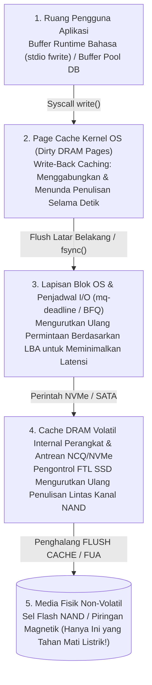
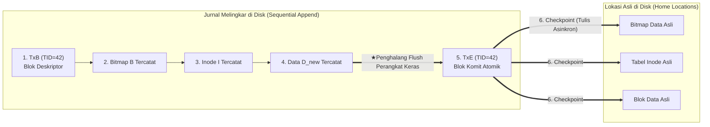

## 1. Pendahuluan: Ladang Ranjau di Balik Penambahan Satu Blok File 4 KB

Saat Anda menekan `Ctrl+S` di editor teks atau mengonfirmasi transfer bank, aplikasi Anda mengeluarkan panggilan sistem `write()`. Dari sudut pandang pemrogram aplikasi, menyimpan data tampak seperti satu langkah tunggal yang instan dan tak terpisahkan (*atomic*).

Namun, di balik layar kernel sistem operasi, sistem berkas (*file system*), mesin penyimpanan basis data, dan pengontrol SSD, tersembunyi salah satu masalah paling rumit dalam rekayasa sistem komputer: <strong>Masalah Konsistensi Crash (Crash Consistency Problem)</strong>.

Mari kita tinjau operasi paling sederhana dalam sistem berkas UNIX klasik (seperti UFS atau ext2): <strong>menambahkan (*append*) satu blok data baru berukuran $4\,\text{KB}$ ($D_{\text{new}}$) ke akhir file yang sudah ada</strong>. Bahkan operasi sepele ini memerlukan pembaruan setidaknya <strong>tiga struktur yang terpisah secara fisik pada media penyimpanan</strong>:

1. <strong>Bitmap Data (Data Bitmap $B$)</strong>: mengubah bit alokasi untuk nomor blok fisik $k$ dari $0$ (bebas) menjadi $1$ (terpakai).
2. <strong>Inode ($I$)</strong>: memperbarui catatan metadata file—menambah ukuran file `size`, memperbarui waktu modifikasi `mtime`, dan menulis alamat blok fisik $k$ ke dalam larik penunjuk blok inode.
3. <strong>Blok Data ($D_{\text{new}}$)</strong>: menulis muatan aktual $4\,\text{KB}$ milik pengguna ke sektor fisik blok $k$.

Di sinilah kita menghadapi asimetri fisik mendasar perangkat keras: memori utama (DRAM) sangat cepat tetapi <strong>volatil</strong> (hilang saat listrik mati), sedangkan disk dan SSD NAND bersifat <strong>non-volatil</strong> tetapi tidak mampu memperbarui tiga lokasi yang berjauhan $(B, I, D_{\text{new}})$ secara bersamaan dalam satu tindakan fisik atomik. Jika listrik tiba-tiba padam di tengah ketiga penulisan ini ($2^3 - 2 = 6$ kemungkinan status penulisan parsial), sistem berkas akan bangun saat *reboot* dalam kondisi kerusakan parah:

| Tersimpan di Disk | Hilang di RAM | Inkonsistensi Crash yang Terjadi & Tingkat Keparahan |
| :--- | :--- | :--- |
| <strong>Hanya $D_{\text{new}}$</strong> | $B,\; I$ | <strong>Kehilangan Data Jinak</strong>: blok data baru ada di disk, tetapi baik inode maupun bitmap tidak mengetahuinya. Struktur sistem berkas tetap utuh. |
| <strong>Hanya $B$</strong> | $I,\; D_{\text{new}}$ | <strong>Kebocoran Ruang (Space Leak / Blok Yatim)</strong>: blok $k$ ditandai terpakai ($1$) di bitmap $B$, tetapi tidak ada inode yang menunjuk ke sana. Kapasitas tersebut bocor secara permanen. |
| <strong>Hanya $I$</strong> (atau $I + D_{\text{new}}$) | $B$ | <strong>Alokasi Ganda (Double Allocation — Kerusakan Metadata Katastrofik)</strong>: inode $I$ menunjuk ke blok $k$, tetapi bitmap $B$ masih menandainya bebas ($0$). Kelak file kedua akan mengalokasikan blok $k$ dan kedua file saling menghancurkan data! |
| <strong>$I$ dan $B$</strong> | $D_{\text{new}}$ | <strong>Kebocoran Data Usang (Stale Data Exposure — Kerentanan Keamanan Kritis)</strong>: inode dan bitmap telah diperbarui, tetapi $D_{\text{new}}$ belum tertulis. Membaca file tersebut akan mengembalikan <strong>data lama milik pengguna lain yang sudah dihapus</strong> (seperti kata sandi atau kunci privat) yang sebelumnya menempati sektor $k$! |

---

## 2. Mengapa Penulisan Tidak Mencapai Disk Sesuai Urutan Program Anda

Dalam arsitektur modern, urutan kronologis pemanggilan `write()` hampir tidak pernah sama dengan urutan fisik penulisan bit ke piringan magnetik atau sel flash NAND karena adanya empat lapisan *buffer* volatil dan pengurutan ulang (<strong>Reordering</strong>):

Untuk menjamin urutan dan durabilitas, sistem harus mengeluarkan perintah penghalang perangkat keras eksplisit (<strong>`NVMe Flush`</strong>, <strong>`SATA FLUSH CACHE EXT`</strong>, atau bit <strong>`FUA: Force Unit Access`</strong>) yang memaksa SSD menguras *buffer* DRAM volatil internalnya ke sel NAND non-volatil.

---

## 3. Generasi 1: Pembaruan di Tempat, `fsck`, dan Soft Updates

1. <strong>`fsck` (File System Consistency Check) dan Tembok Skalabilitas</strong>:
   Sistem berkas UNIX awal (FFS, ext2) memperbaiki inkonsistensi pasca-crash dengan memindai seluruh inode, bitmap, dan pohon direktori di disk sebelum *mount* (`fsck`). Karena waktu eksekusi `fsck` sebanding dengan <strong>total kapasitas disk $O(N_{\text{disk}})$</strong>, memindai penyimpanan multi-terabyte modern memakan waktu berjam-jam atau berhari-hari—meskipun hanya satu file $4\,\text{KB}$ yang sedang ditulis saat listrik mati!
2. <strong>Soft Updates (Ganger & McKusick 1994)</strong>:
   Digunakan di FreeBSD UFS, teknik ini menghindari jurnal dengan melacak grafik ketergantungan penunjuk secara ketat di memori dan memutus ketergantungan siklik melalui operasi <strong>roll-back</strong> dan <strong>roll-forward</strong> sementara di RAM sebelum menulis blok ke disk.

---

## 4. Tulang Punggung Penyimpanan Modern: Write-Ahead Logging (WAL) dan Journaling

Untuk memangkas waktu pemulihan dari $O(N_{\text{disk}})$ menjadi sebanding केवल dengan transaksi aktif saat crash $O(N_{\text{active}})$ (hanya birkaç milidetik!), sistem berkas modern (<strong>ext3/ext4</strong>, <strong>XFS</strong>, <strong>NTFS</strong>) dan basis data menggunakan <strong>Write-Ahead Logging (WAL) / Journaling</strong>:

1. <strong>Journal Write</strong>: Sebelum menyentuh lokasi asli di disk (*Home Locations*), sistem menambahkan secara berurutan ke <strong>Journal</strong> sebuah blok deskriptor awal `TxB` (dengan `TID`) diikuti salinan blok yang diperbarui $(I, B, D_{\text{new}})$.
2. <strong>Journal Commit (Titik Komit Atomik)</strong>: Setelah penghalang *flush* perangkat keras memastikan langkah 1 mencapai media fisik, sistem menulis satu blok komit <strong>`TxE` (Transaction End)</strong>. <strong>Penulisan satu sektor `TxE` ini adalah sakelar atomik yang mengesahkan seluruh transaksi!</strong>
3. <strong>Checkpoint</strong>: Setelah `TxE` aman di disk, $(I, B, D_{\text{new}})$ disalin secara asinkron ke lokasi asli (*Home Locations*) di latar belakang.

- <strong>Listrik Padam SEBELUM `TxE`</strong>: Lokasi asli belum tersentuh; saat *reboot*, catatan jurnal yang belum selesai cukup dibuang.
- <strong>Listrik Padam SETELAH `TxE`</strong>: Saat *reboot*, manajer pemulihan cukup memutar ulang (<strong>Redo replay</strong>, bersifat idempoten) blok dari jurnal ke lokasi asli dalam hitungan milidetik. <strong>ext4</strong> modern bahkan menghilangkan jeda penghalang pertama menggunakan <strong>Checksum Jurnal (CRC32C)</strong> di dalam `TxE`.

Untuk menghindari penulisan ganda setiap blok data ($2\times$ Write Amplification), mode bawaan <strong>`data=ordered`</strong> pada ext4 hanya mencatat metadata $(I, B)$ di jurnal, tetapi <strong>mewajibkan blok data $D_{\text{new}}$ selesai ditulis ke lokasi aslinya terlebih dahulu SEBELUM mengizinkan blok komit metadata `TxE` ditulis ke jurnal</strong>. Dalam basis data relasional, protokol <strong>ARIES</strong> (Mohan et al., 1992) mengelola kebijakan `Steal / No-Force` melalui `pageLSN` dan tiga fase: <strong>Analysis</strong>, <strong>Redo (Repeating History)</strong>, serta <strong>Undo (dengan Compensation Log Records, CLRs)</strong>.

---

## 5. Generasi 3: Copy-on-Write (CoW) dan Pohon Merkle (ZFS / Btrfs)

Sistem berkas generasi baru (<strong>ZFS</strong>, <strong>Btrfs</strong>, <strong>APFS</strong>) melarang penimpaan blok di tempat (*In-Place Overwrite*) dan mengadopsi <strong>Copy-on-Write (CoW / Shadow Paging)</strong>:

1. Setiap blok data yang diubah $D_{2,\text{new}}$ dan inode induknya $I_{v2}$ selalu ditulis ke ruang bebas baru, membiarkan blok lama $D_{2,\text{old}}$ tetap utuh.
2. Setelah seluruh cabang baru aman di disk, satu penulisan atomik memperbarui blok akar (<strong>Uberblock</strong> di ZFS) dari $U_1$ ke $U_2$.
3. <strong>Keunggulan</strong>: Pemulihan instan $0$ detik tanpa pemutaran ulang jurnal, <strong>Snapshot $O(1)$</strong> tanpa biaya salin, dan penyembuhan mandiri (*Self-Healing*) terhadap kerusakan bit (*Bit Rot*) melalui <strong>Pohon Merkle</strong> dengan *checksum* kriptografi 256-bit di setiap penunjuk induk.

---

## 6. Jebakan `fsync()` bagi Pengembang dan Pengujian Injeksi Kesalahan

Bahkan pada sistem berkas berjurnal atau CoW, mengganti file lewat `rename("config.json.tmp", "config.json")` tanpa memanggil `fsync()` terlebih dahulu akan menghasilkan <strong>file kosong berukuran $0$ byte</strong> pasca-mati listrik di bawah *Delayed Allocation* (ext4), karena perubahan nama metadata dikomit sebelum halaman data di *cache* ditulis ke disk!

<strong>Protokol 6 Langkah Lengkap untuk Penyimpanan File Atomik Tahan-Crash</strong>:
(1) `write()` ke file sementara $\to$ (2) <strong>`fsync(fd)`</strong> pada file sementara $\to$ (3) `close(fd)` $\to$ (4) `rename()` atomik $\to$ (5) buka direktori induk dan panggil <strong>`fsync(dir_fd)`</strong> untuk menyimpan entri direktori $\to$ (6) `close(dir_fd)`.

Sebagaimana dibuktikan oleh insiden <strong>`fsyncgate`</strong> PostgreSQL pada tahun 2018 (ketika kernel Linux menandai halaman kotor sebagai `Clean` setelah kegagalan I/O `EIO` saat `fsync()`, yang затем diperbaiki dengan `errseq_t`), rekayasa penyimpanan modern mengandalkan kerangka kerja <strong>injeksi kesalahan sistematis (Fault Injection)</strong> seperti <strong>ALICE</strong> dan <strong>CrashMonkey</strong> untuk menguji seluruh permutasi pengurutan ulang perangkat keras terhadap pemadaman listrik.
