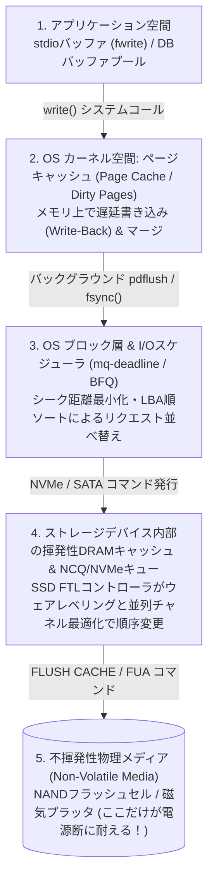
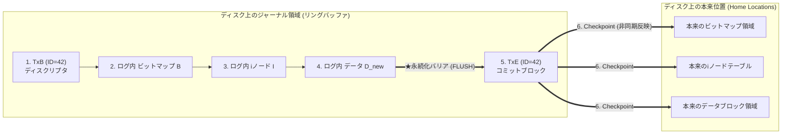
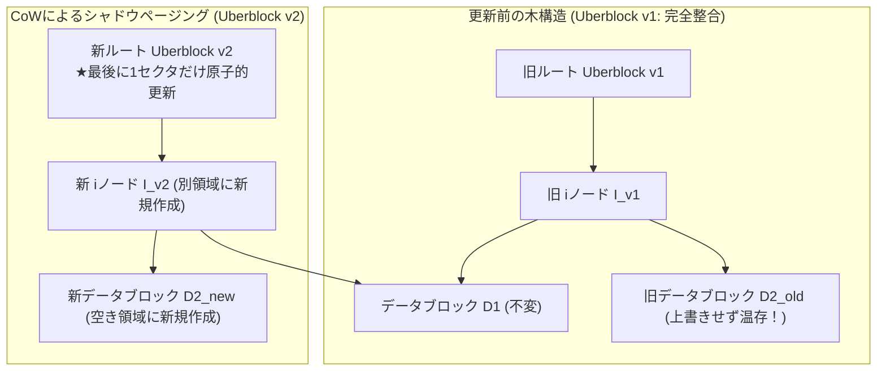

## 1. 序論：「ファイルに1ブロック追記する」という操作に潜む不整合の地雷原

私たちがテキストエディタでファイルを保存するとき、あるいはスマートフォンで写真を撮影し、銀行のATMで送金ボタンを押すとき、プログラムはオペレーティングシステム（OS）に対して `write()` システムコールを発行する。プログラマの目線からは、この操作はあたかも「一瞬で完了する不可分な1つのステップ（Atomic Operation）」であるかのように見える。

しかし、OSのファイルシステムやデータベース管理システム（DBMS）、そして物理的なSSD（NANDフラッシュメモリ）やHDD（磁気ディスク）の階層を覗き込むと、恐るべき現実が浮かび上がる。<strong>「既存のファイルにたった1ブロック（$4\,\text{KB}$）のデータを追記する」という最も単純な操作でさえ、実はディスク上の互いに離れた少なくとも3つの独立した領域を更新しなければならない</strong>のである。

古典的なUNIX系ファイルシステム（UFS / ext2など）を例にとろう。ファイルに新しいデータブロック $D_{\text{new}}$ を1つ追加するとき、ファイルシステムは以下の3種類の構造体を書き換える必要がある。

1. <strong>データビットマップ（Data Bitmap $B$）</strong>: 空きブロック管理表の中で、「ブロック番号 $k$ が使用中になった」ことを示すビットを $0 \to 1$ に反転させる。
2. <strong>iノード（Inode $I$）</strong>: ファイルのメタデータ構造体であり、ファイルサイズ `size` を更新し、データブロックポインタ配列に新しいブロック番号 $k$ のアドレスを書き込む。
3. <strong>データブロック本体（Data Block $D_{\text{new}}$）</strong>: ブロック番号 $k$ の物理セクタに、ユーザーが保存しようとした実際のデータ内容を書き込む。

ここで、計算機科学における最も根源的な物理的制約が立ちはだかる。メモリ（DRAM）は高速だが電源が切れれば一瞬で消える<strong>揮発性記憶装置（Volatile Memory）</strong>であり、SSDやHDDは電源が切れてもデータを保持する<strong>不揮発性記憶装置（Non-Volatile Storage）</strong>だが、離れた場所にある3つのブロック $(B, I, D_{\text{new}})$ を「同時に・一瞬で」書き換える物理的手段は存在しない。

もし、この3つの書き込みの途中で<strong>コンセントが抜ける（Power Loss）</strong>、<strong>OSがカーネルパニックを起こす（Kernel Crash）</strong>、あるいは<strong>SSDのコントローラが応答を停止する</strong>といった事態が起きたらどうなるだろうか？どの書き込みがディスクに到達し、どの書き込みがDRAMキャッシュ上で消滅したかの組み合わせ（$2^3 - 2 = 6$ 通りの部分書き込み状態）によって、ファイルシステムは致命的な<strong>クラッシュ不整合（Crash Inconsistency）</strong>に陥る。

| 永続化されたブロック | 失われたブロック | 発生するクラッシュ不整合の症状と深刻度 |
| :--- | :--- | :--- |
| <strong>$D_{\text{new}}$ のみ</strong> | $B,\; I$ | <strong>データ喪失（軽症）</strong>: データは書かれたが、それを指すiノードもビットマップ更新もないため、単なる空き領域のゴミとして無視される。ファイル構造自体は壊れない。 |
| <strong>$B$ のみ</strong> | $I,\; D_{\text{new}}$ | <strong>スペースリーク（Space Leak / 孤児ブロック）</strong>: ビットマップ上では「使用中（$1$）」なのに、どのiノードからも参照されていない幽霊ブロックが発生し、その容量が永久に回収不能になる。 |
| <strong>$I$ のみ</strong>（または $I$ と $D_{\text{new}}$） | $B$ | <strong>二重割り当て（Double Allocation：最悪のメタデータ破壊）</strong>: iノード $I$ はブロック $k$ を指しているが、ビットマップ $B$ は「空き（$0$）」のまま。後日別のファイルがブロック $k$ を新規取得して上書きし、2つのファイルが同じ物理ブロックを奪い合って相互破壊する。 |
| <strong>$I$ と $B$</strong> | $D_{\text{new}}$ | <strong>未初期化データ漏洩（Stale Data Exposure：重大なセキュリティ脆弱性）</strong>: iノードとビットマップは更新されたが、肝心のデータ $D_{\text{new}}$ が書かれていない。結果として、以前そのセクタに書かれていた他人の削除済みファイル（パスワードや秘密鍵など）がファイル末尾から読み出せてしまう！ |

この「物理デバイスは1セクタ（または1ページ）単位でしか原子的書き込みを保証しないにもかかわらず、いかにして複数ブロックにまたがる複雑な論理データ構造の<strong>原子性（Atomicity）</strong>と<strong>永続性（Durability）</strong>を電源断から守り抜くか？」という設計理論こそが、<strong>クラッシュ整合性（Crash Consistency）</strong>である。

本稿では、OSキャッシュとデバイスキューの並べ替え問題から、修復に数時間を要した `fsck`、データベースとジャーナリングファイルシステムを支える<strong>WAL（Write-Ahead Logging）とARIESアルゴリズム</strong>、ZFSやBtrfsが採用する<strong>Copy-on-Write（CoW）木構造</strong>、そして多くのプログラマを絶望させてきた<strong>`fsync()` の罠と障害注入テスト（Fault Injection）</strong>までを一気通貫で解き明かす。

---

## 2. なぜ「書いた順番」にディスクへ届かないのか：多層キャッシュとリオーダリング

初心者のプログラマはしばしばこう考える。「ならば、まずデータブロック $D_{\text{new}}$ を書き、次にビットマップ $B$ を書き、最後にiノード $I$ を書くという順番でプログラムを書けば、少なくとも他人の古いデータが漏洩したり二重割り当てが起きたりしないのではないか？」と。

残念ながら、現代のコンピュータシステムにおいて<strong>「アプリケーションが `write()` を呼んだ順番」と「不揮発性メディア（磁気プラッタやNANDフラッシュセル）に物理的に書き込まれる順番」は全く一致しない</strong>。アプリケーションから物理メディアに至るまでの間には、性能を最大化するために書き込み順序を勝手に並べ替える（Reordering）3つの巨大な揮発性バッファ層が存在するからである。



1. <strong>OSのページキャッシュ（Page Cache）による遅延書き込み（Write-Back Caching）</strong>:
   プログラムが `write(fd, buf, 4096)` を呼び出したとき、OSカーネルはディスクには一切アクセスしない。DRAM上のページキャッシュにデータをコピーし、そのページに `Dirty`（未反映）フラグを立てただけで、わずか数マイクロ秒でプログラムに「成功」を返してしまう。実際にディスクへ書き出されるのは数秒〜数十秒後、カーネルのフラッシュスレッドが動いたときであり、その際の書き出し順序はメモリ管理の都合で決まる。
2. <strong>OSのI/Oスケジューラによるエレベータ・ソート</strong>:
   HDDでは磁気ヘッドの物理的な移動時間（シーク時間、数ミリ秒）が最大のボトルネックであったため、OSのブロック層（I/Oスケジューラ）は、たとえ上位層が「セクタ $10000 \to$ セクタ $50 \to$ セクタ $10005$」の順で書き込みを要求しても、ヘッドの往復を防ぐために「セクタ $50 \to$ セクタ $10000 \to$ セクタ $10005$」へとリクエスト順序を自動的に並べ替える。
3. <strong>ストレージデバイス内部の揮発性書き込みキャッシュ（Device Write Cache & NCQ/NVMe Queues）</strong>:
   さらに厄介なことに、OSがディスクに対して書き込みコマンドを送出し、ディスクから「書き込み完了」の割り込みを受け取ったとしても、そのデータはまだ<strong>SSDやHDDの基板上に搭載された揮発性DRAMキャッシュ（Write Buffer）</strong>に入っただけであることが多い。デバイス内部のファームウェア（HDDのNative Command QueuingやSSDのFlash Translation Layer: FTL）は、NANDフラッシュの消去ブロック境界やチャネル並列性を最適化するために、自身のDRAMキャッシュ内でさらに書き込み順序を並べ替えてから物理セルへ書き込む。

したがって、整合性を守るためには、単にデータを送るだけでなく、OSのページキャッシュをフラッシュし、さらにストレージデバイスに対してハードウェアレベルの<strong>キャッシュフラッシュ命令（SATAの `FLUSH CACHE EXT`、NVMeの `Flush` コマンド、または `FUA: Force Unit Access` ビット）</strong>を発行して、「先行する書き込みが物理的な不揮発性セルに完全に定着するまで次の書き込みをブロックする」という<strong>永続化バリア（Durability Barrier / Storage Fence）</strong>を明示的に制御しなければならないのである。

---

## 3. クラッシュ整合性の第1世代：楽観的更新と `fsck`、そしてソフトアップデート

歴史的に、ファイルシステムがこの問題に立ち向かった最初の手法は、「普段の書き込み時には特別な対策をとらず、クラッシュした後の再起動時にディスク全体を検査して辻褄を合わせる」という事後修復アプローチであった。

### 3.1 `fsck`（File System Consistency Check）の仕組みとスケーラビリティ崩壊

マckusickらが設計したBSD Fast File System (FFS) やLinuxのext2で使われた <strong>`fsck`</strong> は、電源断からの再起動時にマウント前のディスクを全走査（Full Scan）する。

- <strong>Pass 1 & 2</strong>: すべてのiノードを走査し、有効なiノードが参照しているすべてのデータブロック番号を集計して「真の使用中ビットマップ」を再構築する。もしディスク上のビットマップ $B$ と食い違いがあれば、再構築したビットマップで上書きする（これによりスペースリークが解消される）。もし2つのiノードが同じブロックを指していれば（二重割り当て）、ブロックを複製するか片方のiノードをクリアする。
- <strong>Pass 3 & 4</strong>: すべてのディレクトリエントリを辿って木構造の連結性を確認し、どこからも名前で参照されていない孤児iノード（`link_count > 0` なのに親ディレクトリがないファイル）を `/lost+found` ディレクトリへと救出する。

`fsck` の致命的な欠陥は<strong>計算量がデータ変更量ではなく「ディスクの総容量 $O(N_{\text{disk}})$」に比例すること</strong>であった。1980年代の数十メガバイトのHDDなら数十秒で終わった走査が、数テラバイト〜ペタバイトの現代のストレージでは、<strong>たった数キロバイトの書き込み中に電源が落ちただけなのに、再起動後の `fsck` に数時間〜数日間かかり、その間サーバーが完全に停止する</strong>という破滅的な事態を招いた。しかも、`fsck` は「ファイルシステムという入れ物のメタデータ構造」の矛盾を解消するだけであり、データブロックの中身がゴミ（Stale Data）に化けている問題は直せない。

### 3.2 ソフトアップデート（Soft Updates）と循環依存の解消

1994年にグレゴリー・ガンガー（Gregory R. Ganger）とカーク・マキュージック（Marshall Kirk McKusick）が考案した<strong>ソフトアップデート（Soft Updates、FreeBSDのUFSで採用）</strong>は、ログを使わずに<strong>「メモリ上のページキャッシュからディスクへ書き出す順序（依存関係グラフ）だけを厳密に制御することで、ディスク上が一瞬たりとも致命的な不整合状態にならないようにする」</strong>という極めて精巧な手法である。

ソフトアップデートは以下の3大黄金律を守る：
1. どの構造体も、それが指し示す先の構造体（データブロックやiノード）がディスク上で初期化されるより前に、そこへのポインタをディスクに書き出してはならない（未初期化データ漏洩と二重割り当ての完全防止）。
2. 古いポインタがディスク上から消去されるより前に、それが指していたリソース（ブロックやiノード）を再割り当てしてはならない。
3. 新しい名前（ディレクトリエントリ）がディスクに書き込まれるより前に、古い名前へのリンクを消してはならない。

しかし、同じディスクブロックの中に複数のファイルのiノードやディレクトリエントリが同居している場合、「ブロックAを先に書くべきだが、ブロックAの中の別エントリはブロックBの後でなければならない」という<strong>循環依存（Cyclic Dependency）</strong>が発生する。ソフトアップデートは、ディスクへ書き出す直前にメモリ上で該当箇所だけを一時的に変更前の古い値に戻し（Roll-back in memory）、ディスク書き込み完了後にまた新しい値に戻す（Roll-forward）という曲芸的なポインタ操作を行うことで循環を断ち切った。これによりバックグラウンドでの稼働が可能になったが、実装の複雑性が極限に達し（数万行のポインタ依存追跡コード）、万が一クラッシュすればスペースリークの回収のために結局バックグラウンド `fsck` が必要になるという限界があった。

---

## 4. データベースとファイルシステムの王道：WAL（Write-Ahead Logging）とジャーナリング

「ディスク全体の走査 $O(N_{\text{disk}})$」を「クラッシュ直前に進行中だったトランザクション量 $O(N_{\text{active}})$（数ミリ秒で完了！）」へと劇的に短縮した革命的アーキテクチャが、データベース理論で誕生した<strong>WAL（Write-Ahead Logging：ログ先行書き込み）</strong>であり、ファイルシステムにおいては<strong>ジャーナリング（Journaling）</strong>と呼ばれる手法である。

### 4.1 WALの基本原理：「本体を書き換える前に、まず『何をするか』をノートに書く」

なぜビットマップ $B$、iノード $I$、データ $D_{\text{new}}$ を直接それぞれの場所（In-Place）に書きに行くと失敗するのか？それは3箇所が物理的に離れているため、途中で電源が切れたときに「どこまで終わったか」が分からなくなるからである。

WAL（ジャーナリング）の発想は明快である。<strong>本来の場所（ホームロケーション）にある構造体を直接書き換える前に、ディスク上の専用の連続領域（ジャーナル／ログ領域）に対して、「これからどのブロックをどう書き換えるか」という更新内容一式を1つのトランザクションとして順番に追記（Sequential Append）してしまう</strong>のである！

Linuxの標準ファイルシステムである <strong>ext3 / ext4（JBD2: Journaling Block Device）</strong> における1つのトランザクション $Tx_k$ の構成を見てみよう。

1. <strong>Journal Write（ログ本体への書き込み）</strong>:
   ジャーナル領域に、トランザクション開始を示す<strong>ディスクリプタブロック（`TxB`: Transaction Begin、トランザクションIDと対象ブロック番号リストを記録）</strong>、および更新後のメタデータ・データのイメージ（$I, B, D_{\text{new}}$）を書き込む。
2. <strong>Journal Commit（コミットレコードの書き込みと永続化バリア）</strong>:
   ステップ1のブロック群がすべて物理ディスクに到達したことをキャッシュフラッシュ（バリア）で確認した上で、トランザクション完了を示す<strong>コミットブロック（`TxE`: Transaction End）</strong>をただ1ブロック（1セクタ）だけジャーナル末尾に書き込む。
3. <strong>Checkpoint（チェックポイント：本来の場所への反映）</strong>:
   `TxE` がディスクに書き込まれた瞬間、そのトランザクションは<strong>「論理的にコミット完了（永続化確定）」</strong>となる。その後、バックグラウンドでゆっくりと本来のディスク上の位置へ $I, B, D_{\text{new}}$ を書き写す（これをチェックポイントと呼ぶ）。
4. <strong>Journal Free</strong>: チェックポイントが完了したら、ジャーナル上の該当トランザクション領域を空きとして解放する。



#### なぜこれで電源断から100%データを守れるのか？（原子的スイッチとしての `TxE`）

クラッシュが起きるタイミングを2つに分けて考えよう。

- <strong>ケースA：`TxE`（コミットブロック）がディスクに書き込まれる「前」に電源が切れた場合</strong>
  まだ本来の場所（Home Locations）には1バイトも手を付けていない！再起動時のリカバリ処理（Journal Replay）は、ジャーナルを走査して「`TxB` はあるが末尾の `TxE` が存在しない中途半端なトランザクション」を見つけたら、<strong>単にそれを無視して破棄（Abort）する</strong>だけでよい。ディスク本体は無傷のまま変更前の整合状態に保たれている。
- <strong>ケースB：`TxE` がディスクに書き込まれた「後」（チェックポイントの途中）に電源が切れた場合</strong>
  本来の場所には $I, B, D_{\text{new}}$ の一部しか書かれていないかもしれないが、<strong>ジャーナル領域の中には `TxB` から `TxE` までの完全なコピーが100%残っている</strong>！再起動時のリカバリ処理は、ジャーナル内のデータをもう一度本来の場所へ上書きコピー（<strong>Redo Logging / べき等な再実行</strong>）するだけで、わずか数ミリ秒で完全な更新完了状態へと復旧できるのである。

さらに最新のext4では、ステップ1とステップ2の間のバリア待ち（ディスク1回転分またはフラッシュ待機時間）すら削減するため、<strong>ジャーナル・チェックサム（Journal Checksums）</strong>を導入している。`TxB`〜`TxE` の全ブロックを一度にまとめて書き込み、`TxE` の中に全ブロックの暗号学的ハッシュ（CRC32Cチェックサム）を埋め込んでおく。もし一部のブロックが順序逆転で書き込まれないまま電源が切れても、再起動時にチェックサムを計算すれば不一致が検出されるため、安全に未完了トランザクションとして破棄できる！

### 4.2 ext3 / ext4 におけるジャーナリングの3つのモードとトレードオフ

すべてのデータブロック $D_{\text{new}}$ までジャーナルに書いてから本来の場所にもう一度書くと、ディスクへの書き込み量が2倍（<strong>Write Amplification = $2\times$</strong>）になり、スループットが半減してしまう。そこでext3/ext4は3つのモードを用意している。

1. <strong>`data=journal`（全データ・ジャーナリングモード）</strong>:
   メタデータ（$I, B$）だけでなくデータ本体（$D_{\text{new}}$）もすべてジャーナルに書き込む。最も安全だが、すべてのデータを2回ディスクに書くため最も遅い。
2. <strong>`data=writeback`（メタデータのみジャーナリング・順序制約なし）</strong>:
   ジャーナルにはメタデータ（$I, B$）だけを記録し、データ本体 $D_{\text{new}}$ は本来の場所へ直接書き込むが、その順序を制御しない。高速だが、メタデータのトランザクションが先にコミットされて直後に電源が切れると、<strong>序論で述べた「未初期化データ漏洩（他人の削除済みデータがファイルに出現する）」が発生する危険</strong>がある。
3. <strong>`data=ordered`（順序付きメタデータ・ジャーナリング：ext3/ext4のデフォルト）</strong>:
   データ本体 $D_{\text{new}}$ はジャーナルには書かず本来の場所へ1回だけ直接書き込むが、<strong>「必ずデータ本体 $D_{\text{new}}$ のディスク書き込みが完了してからでなければ、それを指すメタデータ（$I, B$）のジャーナルコミット（`TxE`）をディスクに書き出してはならない」</strong>という厳格な順序制約（Ordering）を課す！これにより、データを2回書くオーバーヘッドを完全に回避しつつ、未初期化データ漏洩も二重割り当て・スペースリークもすべて防ぐという理想的なバランスを実現している。

### 4.3 データベースにおける ARIES アルゴリズム（Steal / No-Force と Undo/Redo）

PostgreSQL、MySQL (InnoDB)、Oracle、SQL Serverなどのリレーショナルデータベースでは、トランザクションが数ギガバイトに及ぶこともあり、コミット前にメモリから溢れた変更ページをディスクへ書き出す必要がある（<strong>Steal ポリシー</strong>）と同時に、コミット時に毎回ランダムなデータページをすべてディスクへ書き戻すのを避けたい（<strong>No-Force ポリシー</strong>）。

これを解決したのが、1992年にIBMアルマデン研究所の<strong>C. Mohan</strong>らが発表したデータベース復旧の金字塔 <strong>ARIES（Algorithms for Recovery and Isolation Exploiting Semantics）</strong>である。ARIESでは、各データページに最後にそのページを更新したログレコードの通し番号 <strong>LSN（Log Sequence Number）</strong>を刻印し、ログには変更前の値（<strong>Undo情報</strong>）と変更後の値（<strong>Redo情報</strong>）の両方を記録する。クラッシュからの再起動時には以下の3フェーズを実行する：

1. <strong>Analysis（分析フェーズ）</strong>: 最後のチェックポイントからログを末尾まで読み、クラッシュ時点で進行中だった未コミットトランザクション集合（Loser Transactions）と、メモリ上で変更されていたDirty Page Tableを特定する。
2. <strong>Redo（再実行フェーズ — Repeating History）</strong>: コミット済みか未コミットかを問わず、すべての変更ログを順番に再適用し、「クラッシュした瞬間のデータベース状態」を完全に再現する（ページの $\text{pageLSN} \ge \text{Log LSN}$ なら既に反映済みなのでスキップ）。
3. <strong>Undo（取り消しフェーズ）</strong>: 未コミットのままクラッシュしたLoserトランザクションの変更を、ログの末尾から逆順に辿って変更前の値に戻し、その取り消し操作自体も<strong>補償ログレコード（CLR: Compensation Log Record）</strong>として記録する（これにより、リカバリの最中に2度目の電源断が起きても無限ループにならず確実に復旧が終わる！）。

---

## 5. クラッシュ整合性の第3世代：Copy-on-Write（CoW）とマークル木（ZFS / Btrfs）

WAL／ジャーナリングは「同じ場所を上書きする（In-Place Update）からクラッシュ時に中途半端になる」という問題を、別領域のログで補っていた。ならば逆転の発想として、<strong>「ディスク上の既存のデータを上書きすることを永久に禁止し、更新は常に『新しい空き領域への書き込み（Out-of-Place Write）』として行えば、そもそもログすら不要になるのではないか？」</strong>

この思想を徹底したのが、ジョン・オースタハウトとメンデル・ローゼンブルムが1991年に提唱した<strong>ログ構造化ファイルシステム（LFS）</strong>であり、現代において<strong>ZFS（Sun Microsystems）</strong>、<strong>Btrfs（Linux）</strong>、<strong>APFS（Apple）</strong>、そしてSSD内部のFTL（Flash Translation Layer）が採用する<strong>Copy-on-Write（CoW：書き込み時コピー）木構造</strong>である。



### 5.1 シャドウページングと「ウーバーブロック（Uberblock）」の原子的切り替え

CoWファイルシステムでは、ファイルシステム全体が巨大な木構造（B+木やマークル木）として構成されている。データブロック $D_2$ を書き換えるときの手順は以下の通りである。

1. 既存のブロック $D_{2,\text{old}}$ は絶対に上書きせずそのまま残し、全く別の空きブロックに新しいデータ $D_{2,\text{new}}$ を書き込む。
2. すると親であるiノードが指すブロック番号が変わるため、既存のiノード $I_{v1}$ も上書きせず、新しい空き領域に新しいiノード $I_{v2}$（変更されていない $D_1$ と新しい $D_{2,\text{new}}$ を指す）を書き込む。
3. このポインタの差し替え（Wandering Trees問題）を木の根（Root）に向かって伝播させ、すべての新しい枝葉が物理ディスクに完全に書き込まれたことを永続化バリアで確認した<strong>最後の瞬間</strong>に、ファイルシステム全体の頂点である<strong>ルートブロック（ZFSでは「ウーバーブロック：Uberblock」と呼ばれる128個のリングバッファ配列）</strong>の最新スロットに、新しい根 $U_2$ を1ブロックだけ原子的に書き込む！

この設計の美しさは圧倒的である：
- もしウーバーブロック $U_2$ を書き込む前に電源が切れたら？古い木構造（$U_1 \to I_{v1} \to D_{2,\text{old}}$）は1ビットたりとも書き換えられていないため、再起動時には単に1つ前のウーバーブロック $U_1$ をルートとして選ぶだけで、<strong>ジャーナルのリプレイすら一切不要で $0$ 秒で完全な整合状態が立ち上がる</strong>。
- さらに、古い木構造を解放せずに残しておけば、<strong>容量オーバーヘッドもコピー時間もゼロ（$O(1)$）で任意の過去時点の「スナップショット（Snapshot）」が瞬時に取得できる</strong>。
- ZFSではさらに、親ブロックのポインタの中に<strong>子ブロックの256ビット暗号学的チェックサム（SHA-256 / Fletcher4）</strong>を埋め込む<strong>マークル木（Merkle Tree）</strong>構造をとっている。これにより、電源断による部分書き込み（Torn Write）だけでなく、磁気劣化や宇宙線によるビット反転（Bit Rot）、さらにはファームウェアのバグによる誤ったセクタへの書き込み（Misdirected Write / Phantom Write）までも数学的に100%検出し、ミラー／RAID-Zから自動修復（Self-Healing）することができる。

---

## 6. アプリケーション開発者を襲う「`fsync()` の罠」と障害注入検証

ファイルシステムやOSがいかに精巧なジャーナリングやCoWを実装していても、アプリケーションプログラマが永続化APIの契約（Contract）を誤解していれば、データは簡単に消滅する。

### 6.1 「ファイルを書き換えるなら `write()` ではなく ` rename()` を使え」の真実と罠

設定ファイル `config.json` を安全に更新したいとき、既存の `config.json` を直接開いて上書き（Truncate & Write）するのは自殺行為である。書き込み途中に電源が切れれば、中身が0バイトまたは半分で切れた壊れたファイルが残るからだ。
そのため、UNIXプログラミングの定石では次の手順が推奨されてきた：
1. 一時ファイル `config.json.tmp` を新規作成して全データを書き込む。
2. `rename("config.json.tmp", "config.json")` を呼んで原子的に名前をすげ替える。

しかし2009年、Linuxがext3から<strong>ext4（遅延割り当て Delayed Allocation 導入）</strong>へ移行した際、世界中のデスクトップ環境やアプリケーションで「電源断の後に設定ファイルが軒並み0バイトになって消滅する」という大惨事が発生した。なぜか？

`POSIX` 規格において `rename()` は「ディレクトリエントリのすげ替えが原子的であること」は約束しているが、<strong>「その前に `write()` したデータ本体がディスクに書かれていること」は一切約束していない</strong>からである！ext4の遅延割り当てでは、`config.json.tmp` のデータは数十秒間メモリ上のページキャッシュに留め置かれる。その間に `rename()` だけが先にメタデータトランザクションとしてジャーナルにコミットされて電源が切れると、再起動後には「名前は `config.json` になったが、データブロックがまだ1つも割り当てられていない0バイトのファイル」が出現するのである。

さらに、たとえファイルに対して `fsync(fd)` を呼んでから `rename()` したとしても、<strong>親ディレクトリ自体に対して `fsync(dir_fd)` を呼ばなければ、新しく作られたファイル名（ディレクトリエントリ）自体の永続化が保証されない</strong>。

したがって、アプリケーションが1つのファイルを100%クラッシュ安全（Crash-Safe）に原子的更新するための<strong>完全な6ステップのプロトコル</strong>は以下の通りとなる。

```c
// クラッシュ安全なファイル原子的更新の完全プロトコル (POSIX / Linux)
int fd = open("config.json.tmp", O_WRONLY | O_CREAT | O_TRUNC, 0644);
write_all(fd, buf, len);       // 1. 一時ファイルへデータを書き込む
fsync(fd);                     // 2. ★一時ファイルのデータとiノードを物理メディアへ強制フラッシュ！
close(fd);                     // 3. 一時ファイルを閉じる

rename("config.json.tmp", "config.json"); // 4. ディレクトリエントリを原子的にすげ替える

int dir_fd = open(".", O_RDONLY | O_DIRECTORY);
fsync(dir_fd);                 // 5. ★親ディレクトリ自体をフラッシュしてファイル名変更を永続化！
close(dir_fd);                 // 6. 完了（ここで初めて「保存完了」をユーザーに返してよい）
```

### 6.2 PostgreSQLを震撼させた「`fsyncgate`（2018年）」と障害注入テスト

2018年には、データベース界を揺るがすさらに衝撃的な事件——通称<strong>「PostgreSQL `fsyncgate`」</strong>——が発覚した。もし `fsync(fd)` の最中にディスクエラー（I/Oエラー、たとえば不良セクタやNASの瞬断）が発生して `fsync()` が `-1 (EIO)` を返したとき、Linuxカーネルはページキャッシュ上の該当ページの `Dirty` ビットをクリアして「Clean（反映済み）」とマークしてしまっていたのである！その結果、アプリケーションが「失敗したからもう一度 `fsync(fd)` をリトライしよう」と呼び出しても、カーネルは「Dirtyなページはない」と判断して即座に `0（成功！）` を返し、実際にはディスクに書かれていないデータが静かに闇へ葬り去られていた（この発見によりLinuxカーネル4.17以降で `errseq_t` によるエラー報告機構が抜本的に書き直された）。

このように、クラッシュ整合性のバグは「通常のテストでは100万回実行しても絶対に再現しないが、特定のマイクロ秒のタイミングで電源が切れたときだけデータが破壊される」という悪魔的な性質を持つ。そのため現代のOS・データベース開発では、ウィスコンシン大学のRemzi Arpaci-Dusseau教授らの研究グループが開発した <strong>ALICE</strong> や <strong>CrashMonkey</strong>、あるいは商用SSDに対する物理リレー電源遮断装置のように、<strong>書き込み命令のあらゆる順列組み合わせの途中で仮想的・物理的に電源を遮断し、再起動後の全ファイル状態を検査する「網羅的障害注入テスト（Systematic Fault Injection / Crash Testing）」</strong>が不可欠の検証技術となっている。

---

## 7. 結論：不確実な物理世界の上に「不滅の論理」を築く技術

私たちがデジタル社会で当たり前のように享受している「保存ボタンを押せばデータは消えない」「送金途中で停電してもお金は 증発しない」という信頼は、決してハードウェアが完璧だから成り立っているのではない。むしろハードウェアは常にキャッシュを持ち、順序を勝手に並べ替え、いつ電源が途絶えるか分からないという<strong>不確実な物理的現実</strong>の上にある。

その不確実な物理層の上に、<strong>永続化バリア（Storage Fence）</strong>、<strong>ログ先行書き込み（WAL / Journaling）</strong>、そして<strong>Copy-on-Write（CoW）木構造と暗号学的チェックサム</strong>という精緻な数学的プロトコルを積み重ねることで、「すべてが完了するか、何もしなかったことになるか（All-or-Nothing Atomicity）」という不滅の論理的抽象化を創り出したこと——それこそが、クラッシュ整合性設計という計算機科学の最も美しく、かつ最も実用的な勝利なのである。
