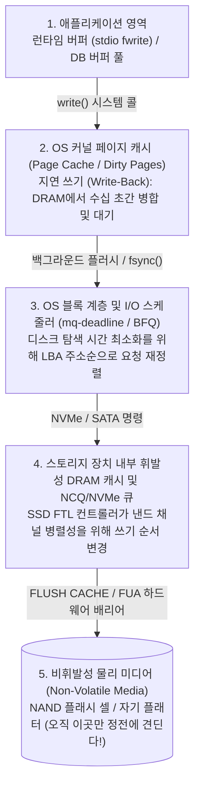
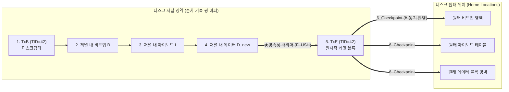

## 1. 서론: "파일에 4 KB 블록 하나를 추가하는 작업" 속에 숨겨진 지뢰밭

우리가 텍스트 편집기에서 `Ctrl+S`를 눌러 파일을 저장하거나 은행 앱에서 송금 버튼을 누를 때, 응용 프로그램은 운영체제(OS)에 `write()` 시스템 콜을 호출한다. 프로그래머의 시선에서 이 작업은 순식간에 끝나는 불가분의 단일 단계(Atomic Operation)처럼 보인다.

그러나 OS 커널의 파일 시스템, 데이터베이스 스토리지 엔진, 그리고 물리적인 SSD(NAND 플래시)와 HDD의 내부 계층을 들여다보면 충격적인 현실이 드러난다. <strong>"기존 파일 끝에 단 하나의 $4\,\text{KB}$ 데이터 블록 $D_{\text{new}}$를 추가(Append)하는 가장 단순한 작업"조차도 실제로는 디스크상의 서로 떨어진 최소 3개의 독립된 영역을 갱신해야 한다</strong>는 사실이다.

고전적인 UNIX 파일 시스템(UFS, ext2 등)을 예로 들어보자:

1. <strong>데이터 비트맵(Data Bitmap $B$)</strong>: 빈 블록 관리 표에서 물리 블록 번호 $k$에 해당하는 비트를 $0$(빈 공간)에서 $1$(사용 중)로 뒤집는다.
2. <strong>아이노드(Inode $I$)</strong>: 파일의 메타데이터 구조체에서 파일 크기 `size`와 수정 시각 `mtime`을 갱신하고, 블록 포인터 배열에 새 블록 번호 $k$의 주소를 기록한다.
3. <strong>데이터 블록 본체(Data Block $D_{\text{new}}$)</strong>: 물리 블록 번호 $k$의 섹터에 사용자가 저장하려는 실제 $4\,\text{KB}$ 데이터를 기록한다.

여기서 컴퓨터 하드웨어의 가장 근본적인 물리적 제약이 등장한다. 메인 메모리(DRAM)는 빠르지만 전원이 꺼지면 즉시 증발하는 <strong>휘발성 메모리(Volatile Memory)</strong>이고, 디스크와 SSD는 전원이 꺼져도 데이터가 유지되는 <strong>비휘발성 스토리지(Non-Volatile Storage)</strong>이지만 물리적으로 떨어진 세 블록 $(B, I, D_{\text{new}})$을 '동시에 원자적으로' 갱신할 수 있는 물리적 수단은 존재하지 않는다.

만약 이 세 번의 쓰기 도중에 <strong>전원 플러그가 뽑히거나(Power Loss)</strong> <strong>커널 패닉(Kernel Crash)</strong>이 발생하면 어떻게 될까? 어느 블록만 디스크에 도달했는가의 조합($2^3 - 2 = 6$가지 부분 쓰기 상태)에 따라 파일 시스템은 치명적인 <strong>크래시 불일치(Crash Inconsistency)</strong>에 빠진다.

| 디스크에 기록된 블록 | 증발한 블록 | 발생하는 크래시 불일치 증상 및 위험도 |
| :--- | :--- | :--- |
| <strong>$D_{\text{new}}$만 기록</strong> | $B,\; I$ | <strong>데이터 유실(경미함)</strong>: 데이터는 빈 섹터에 쓰였으나 이를 가리키는 아이노드와 비트맵이 없어 무시된다. 파일 시스템 구조 자체는 깨지지 않는다. |
| <strong>$B$만 기록</strong> | $I,\; D_{\text{new}}$ | <strong>공간 누수(Space Leak / 고아 블록)</strong>: 비트맵 $B$에는 '사용 중($1$)'으로 표시되었으나 어떤 아이노드도 가리키지 않는 유령 블록이 되어 용량이 영구 누수된다. |
| <strong>$I$만 기록</strong> (또는 $I + D_{\text{new}}$) | $B$ | <strong>이중 할당(Double Allocation: 치명적 메타데이터 파괴)</strong>: 아이노드 $I$는 블록 $k$를 가리키는데 비트맵 $B$는 여전히 '빈 공간($0$)'이다. 추후 다른 파일이 블록 $k$를 할당받아 덮어쓰면서 두 파일이 서로의 데이터를 파괴한다! |
| <strong>$I$와 $B$ 기록</strong> | $D_{\text{new}}$ | <strong>초기화되지 않은 구 데이터 노출(Stale Data Exposure: 심각한 보안 취약점)</strong>: 아이노드와 비트맵은 갱신되었으나 정작 새 데이터 $D_{\text{new}}$가 쓰이지 않았다. 파일을 읽으면 과거 그 섹터에 있던 타인의 삭제된 파일(비밀번호, 개인키 등)이 그대로 노출된다! |

하드웨어가 단일 섹터/페이지 단위의 원자성만 보장하는 환경에서 어떻게 다중 블록 자료구조의 <strong>원자성(Atomicity)</strong>과 <strong>영속성(Durability)</strong>을 지켜낼 것인가? 이것이 바로 <strong>크래시 일관성(Crash Consistency)</strong> 설계의 핵심이다.

---

## 2. 왜 '쓴 순서대로' 디스크에 도달하지 않는가? : 다계층 캐시와 리오더링(Reordering)

"그렇다면 항상 데이터 블록 $D_{\text{new}}$를 먼저 쓰고, 그다음 비트맵 $B$, 마지막으로 아이노드 $I$를 쓰는 순서로 코딩하면 안전하지 않을까?"라고 생각하기 쉽다. 하지만 현대 컴퓨터 시스템에서 <strong>응용 프로그램이 `write()`를 호출한 순서와 물리적 비휘발성 미디어에 기록되는 순서는 전혀 일치하지 않는다</strong>. 그 사이에는 성능을 위해 쓰기 순서를 마음대로 뒤바꾸는(Reordering) 4단계의 휘발성 버퍼 계층이 존재하기 때문이다:

OS가 디스크에 쓰기 명령을 내리고 '쓰기 완료' 인터럽트를 받았더라도, 데이터는 디스크 기판 위의 <strong>휘발성 DRAM 쓰기 버퍼</strong>에 들어갔을 뿐이다. 순서를 강제하려면 OS 페이지 캐시를 비울 뿐 아니라 스토리지 컨트롤러에 하드웨어 <strong>캐시 플러시 배리어(`NVMe Flush`, `SATA FLUSH CACHE EXT`, `FUA`)</strong> 명령을 내려야 한다.

---

## 3. 제1세대 기법: 낙관적 제자리 갱신과 `fsck`, 그리고 소프트 업데이트

1. <strong>`fsck`(File System Consistency Check)의 확장성 붕괴</strong>:
   초기 UNIX(FFS, ext2)는 평상시에는 로그 없이 제자리 덮어쓰기(In-Place Update)를 수행하고, 정전 후 재부팅할 때 마운트 전에 `fsck`로 디스크 전체의 아이노드와 비트맵을 전수 조사하여 불일치를 고쳤다. 그러나 <strong>`fsck`의 실행 시간은 디스크 전체 용량 $O(N_{\text{disk}})$에 비례</strong>한다! 수십 TB에 달하는 현대 스토리지에서는 단 $4\,\text{KB}$를 쓰다 정전이 나도 재부팅 후 `fsck`에 수 시간~수 일이 걸려 서버가 마비된다.
2. <strong>소프트 업데이트(Soft Updates, Ganger & McKusick 1994)</strong>:
   FreeBSD UFS에서 도입된 소프트 업데이트는 로그를 쓰지 않는 대신 메모리 내 블록 간의 포인터 의존성 그래프를 엄밀히 추적하고, 순환 의존성이 발생하면 메모리상에서 해당 필드만 일시적으로 이전 값으로 <strong>롤백(Roll-back)</strong>하여 디스크에 쓴 뒤 다시 <strong>롤포워드(Roll-forward)</strong>하는 정교한 기법이다.

---

## 4. 현대 스토리지의 왕도: WAL(Write-Ahead Logging)과 저널링(Journaling)

복구 시간을 디스크 용량 $O(N_{\text{disk}})$에서 크래시 순간 진행 중이던 트랜잭션 크기 $O(N_{\text{active}})$(수 밀리초!)로 단축한 혁명적 아키텍처가 바로 데이터베이스의 <strong>WAL(Write-Ahead Logging, 선행 로깅)</strong>이자 파일 시스템의 <strong>저널링(Journaling: ext3/ext4, XFS, NTFS)</strong>이다.

### 4.1 WAL의 2단계 원자적 커밋 프로토콜

WAL의 핵심 원리는 간단하다. <strong>디스크 곳곳에 흩어진 원래 위치(Home Locations)를 직접 덮어쓰기 전에, 디스크상의 연속된 전용 링 버퍼 영역(저널/로그 영역)에 '어떤 블록을 어떻게 바꿀 것인가'를 먼저 순차적으로 기록(Sequential Append)하는 것</strong>이다:

1. <strong>Journal Write</strong>: 저널 영역에 트랜잭션 시작 디스크립터 `TxB`(트랜잭션 ID 포함)와 갱신될 블록 이미지 $(I, B, D_{\text{new}})$를 기록한다.
2. <strong>Journal Commit (원자적 커밋 포인트)</strong>: 스토리지 플러시 배리어로 1단계 블록들이 물리 미디어에 도달했음을 확인한 직후, 단일 섹터 크기의 <strong>커밋 블록 `TxE`(Transaction End)</strong>를 저널 끝에 기록한다. <strong>`TxE`가 기록되는 바로 그 순간이 다중 블록 트랜잭션 전체의 원자적 스위치다!</strong>
3. <strong>Checkpoint</strong>: `TxE`가 기록된 후 백그라운드에서 $(I, B, D_{\text{new}})$를 원래 위치(Home Locations)에 반영하고 저널 공간을 해제한다.

- <strong>`TxE` 기록 전에 정전이 난 경우</strong>: 원래 위치는 전혀 건드리지 않았으므로, 재부팅 시 `TxE`가 없는 미완성 로그를 단순 폐기(Abort)하면 된다.
- <strong>`TxE` 기록 후에 정전이 난 경우</strong>: 저널에 완전한 사본이 남아 있으므로, 재부팅 시 저널의 블록들을 원래 위치에 다시 덮어쓰기(<strong>Redo 리플레이</strong>)만 하면 몇 밀리초 만에 복구가 끝난다! 최신 ext4는 `TxE` 내부에 전체 트랜잭션의 <strong>CRC32C 체크섬(Journal Checksums)</strong>을 포함시켜 중간 배리어 대기 시간마저 제거했다.

### 4.2 ext4의 3가지 저널링 모드와 데이터베이스 ARIES 알고리즘

데이터 블록까지 두 번 쓰는 $2\times$ 쓰기 증폭(Write Amplification)을 피하기 위해 ext3/ext4는 3가지 모드를 제공한다:
- <strong>`data=journal`</strong>: 메타데이터 $(I, B)$와 데이터 $D_{\text{new}}$를 모두 저널에 기록한다(가장 안전하지만 쓰기량 2배).
- <strong>`data=writeback`</strong>: 메타데이터만 저널링하고 데이터는 순서 제약 없이 직접 기록한다(빠르지만 정전 시 타인의 구 데이터 노출 위험).
- <strong>`data=ordered` (기본값)</strong>: 메타데이터만 저널에 기록하되, <strong>반드시 데이터 블록 $D_{\text{new}}$를 원래 위치에 먼저 기록 완료한 뒤에만 메타데이터의 `TxE` 커밋을 허용</strong>한다! 이중 쓰기 없이 구 데이터 노출을 완벽히 차단한다.

관계형 데이터베이스에서는 C. Mohan이 설계한 <strong>ARIES 복구 프로토콜</strong>이 `Steal / No-Force` 버퍼 정책하에서 각 페이지의 `pageLSN`을 추적하며 <strong>Analysis $\to$ Redo(역사 반복) $\to$ Undo(보상 로그 레코드 CLR 기록)</strong>의 3단계로 완벽한 트랜잭션 복구를 수행한다.

---

## 5. 제3세대 기법: Copy-on-Write(CoW)와 머클 트리(ZFS / Btrfs)

<strong>ZFS</strong>, <strong>Btrfs</strong>, <strong>APFS</strong> 및 현대 SSD의 FTL이 채택한 <strong>Copy-on-Write(CoW, 쓰기 시 복사 / 섀도 페이징)</strong>는 아예 "디스크상의 기존 데이터를 제자리에 덮어쓰는 것(In-Place Overwrite)을 영구히 금지"한다:

1. 데이터 블록 $D_2$를 수정할 때 기존 $D_{2,\text{old}}$는 그대로 두고, 새로운 빈 공간에 $D_{2,\text{new}}$를 쓴다.
2. 블록 주소가 바뀌었으므로 부모 아이노드 역시 새로운 빈 공간에 $I_{v2}$로 작성하며, 이 포인터 갱신을 트리의 루트까지 상향 전파한다.
3. 모든 새 자식 블록이 디스크에 완전히 기록된 후, 마지막 순간에 최상위 루트 포인터인 <strong>우버블록(Uberblock)</strong> 하나만 $U_1$에서 $U_2$로 원자적으로 갱신한다!

우버블록 갱신 전에 정전이 나도 이전 트리 $U_1$이 100% 온전하므로 복구 시간이 $0$초이며, $O(1)$ 무비용 스냅샷과 256비트 암호화 해시 기반 <strong>머클 트리(Merkle Tree)</strong>를 통한 비트 부패(Bit Rot) 자가 치유(Self-Healing)까지 달성한다.

---

## 6. 애플리케이션 개발자를 덮치는 '`fsync()`의 함정'과 결함 주입 검증

1. <strong>`rename()`의 원자성 신화와 0바이트 파일 참사</strong>:
   임시 파일 `config.json.tmp`에 데이터를 쓴 뒤 `rename("config.json.tmp", "config.json")`만 호출하면 안전하다고 믿는 개발자가 많다. 그러나 ext4의 지연 할당(Delayed Allocation) 환경에서는 `fsync(fd)` 없이 `rename()`을 호출하면 메타데이터 이름 변경만 먼저 커밋되고 데이터는 RAM에서 증발하여 정전 후 <strong>0바이트짜리 빈 파일</strong>만 남게 된다!
   완벽한 <strong>6단계 크래시 안전 저장 프로토콜</strong>은 다음과 같다: (1) 임시 파일 `write()` $\to$ (2) 임시 파일 <strong>`fsync(fd)`</strong> $\to$ (3) `close(fd)` $\to$ (4) `rename()` 호출 $\to$ (5) 부모 디렉터리 디스크립터를 열어 <strong>`fsync(dir_fd)`</strong> 호출 $\to$ (6) `close(dir_fd)`.
2. <strong>PostgreSQL `fsyncgate`(2018)와 결함 주입 테스트(Fault Injection)</strong>:
   2018년 리눅스 커널에서 `fsync()` 실패(`EIO`) 시 더티 페이지를 `Clean`으로 표시해버리는 치명적 버그(`fsyncgate`)가 발견되어 `errseq_t` 도입으로 이어졌다. 오늘날 파일 시스템과 DB 검증에는 위스콘신 대학교 연구진이 개발한 <strong>ALICE</strong>와 <strong>CrashMonkey</strong>처럼 모든 가능한 I/O 재정렬 및 전원 차단 시점을 시뮬레이션하는 체계적 결함 주입(Systematic Fault Injection) 프레임워크가 필수적으로 사용된다.
