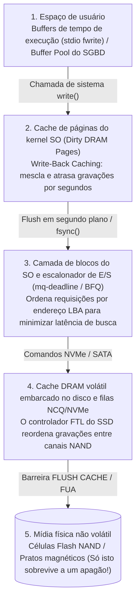
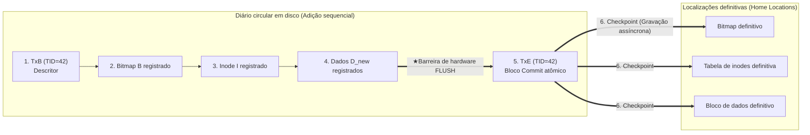

## 1. Introdução: o campo minado oculto por trás da adição de um único bloco de 4 KB

Quando você pressiona `Ctrl+S` em um editor de texto ou confirma uma transferência bancária, sua aplicação emite uma chamada de sistema `write()`. Do ponto de vista do programador de aplicações, salvar dados parece uma operação única, instantânea e indivisível.

Entretanto, sob o capô do kernel do sistema operacional, do sistema de arquivos, do mecanismo de armazenamento do banco de dados e do controlador SSD esconde-se um dos problemas mais difíceis da engenharia de sistemas: <strong>o problema da consistência contra falhas (Crash Consistency Problem)</strong>.

Considere a operação mais simples possível em um sistema de arquivos UNIX clássico (como UFS ou ext2): <strong>anexar um único novo bloco de dados de $4\,\text{KB}$ ($D_{\text{new}}$) ao final de um arquivo existente</strong>. Mesmo essa operação trivial exige atualizar pelo menos <strong>três estruturas fisicamente separadas no dispositivo de armazenamento</strong>:

1. <strong>O mapa de bits de dados (Data Bitmap $B$)</strong>: alterar o bit do bloco físico $k$ de $0$ (livre) para $1$ (alocado).
2. <strong>O inode ($I$)</strong>: atualizar os metadados do arquivo (tamanho `size`, carimbo de tempo `mtime` e o ponteiro para o endereço físico do bloco $k$).
3. <strong>O bloco de dados ($D_{\text{new}}$)</strong>: gravar os $4\,\text{KB}$ reais do usuário no setor físico $k$.

Aqui esbarramos em uma assimetria física fundamental do hardware: a memória principal (DRAM) é rápida, mas <strong>volátil</strong>, enquanto discos e SSDs NAND são <strong>não voláteis</strong>, porém incapazes de atualizar simultaneamente três blocos distantes $(B, I, D_{\text{new}})$ em uma única ação física atômica. Se a energia cair no meio dessas três gravações ($2^3 - 2 = 6$ estados de gravação parcial), o sistema de arquivos acorda ao reiniciar em um estado de corrupção crítica:

| Persistido no disco | Perdido na RAM | Inconsistência resultante e gravidade |
| :--- | :--- | :--- |
| <strong>Apenas $D_{\text{new}}$</strong> | $B,\; I$ | <strong>Perda de dados benigna</strong>: os dados estão no disco, mas nenhum inode ou bitmap aponta para eles. A estrutura do sistema de arquivos permanece intacta. |
| <strong>Apenas $B$</strong> | $I,\; D_{\text{new}}$ | <strong>Vazamento de espaço (Space Leak / bloco órfão)</strong>: o bloco $k$ consta como ocupado ($1$) em $B$, mas nenhum arquivo o referencia; essa capacidade é perdida permanentemente. |
| <strong>Apenas $I$</strong> (ou $I + D_{\text{new}}$) | $B$ | <strong>Dupla alocação (Corrupção catastrófica)</strong>: o inode $I$ aponta para o bloco $k$, mas $B$ o marca como livre ($0$). Mais tarde, outro arquivo alocará o bloco $k$ e ambos os arquivos se destruirão mutuamente! |
| <strong>$I$ e $B$</strong> | $D_{\text{new}}$ | <strong>Exposição de dados obsoletos (Stale Data Exposure — Vulnerabilidade crítica)</strong>: o inode e o bitmap foram atualizados, mas $D_{\text{new}}$ nunca foi gravado. Ler o arquivo retorna <strong>dados antigos excluídos de outro usuário</strong> (senhas ou chaves privadas) que ocupavam o setor $k$! |

---

## 2. Por que as gravações não chegam ao disco na ordem em que você as escreveu

Na arquitetura moderna, a ordem cronológica das chamadas `write()` quase nunca coincide com a ordem física de gravação na mídia não volátil devido a quatro camadas de bufferização volátil e reordenação (<strong>Reordering</strong>):

Para garantir a ordem e a durabilidade, o sistema deve emitir barreiras de hardware explícitas (<strong>`NVMe Flush`</strong>, <strong>`SATA FLUSH CACHE EXT`</strong> ou o bit <strong>`FUA: Force Unit Access`</strong>) que forcem a unidade a esvaziar seu próprio buffer DRAM volátil para as células NAND.

---

## 3. Geração 1: Atualizações no local, `fsck` e Soft Updates

1. <strong>`fsck` (File System Consistency Check) e a barreira de escalabilidade</strong>:
   Os primeiros sistemas UNIX (FFS, ext2) reparavam inconsistências após uma falha varrendo todos os inodes, bitmaps e diretórios do disco antes da montagem (`fsck`). Como seu tempo de execução é proporcional à <strong>capacidade total do disco $O(N_{\text{disk}})$</strong>, verificar um volume moderno de vários terabytes leva horas ou dias de inatividade — mesmo que apenas um arquivo de $4\,\text{KB}$ estivesse sendo modificado quando a energia caiu!
2. <strong>Soft Updates (Ganger & McKusick 1994)</strong>:
   Adotado no FreeBSD UFS, evitava o registro em diário rastreando dependências de ponteiros na memória e quebrando dependências cíclicas por meio de operações temporárias de <strong>roll-back</strong> e <strong>roll-forward</strong> na RAM antes de gravar o bloco no disco.

---

## 4. O pilar do armazenamento moderno: Write-Ahead Logging (WAL) e Journaling

Para reduzir o tempo de recuperação de $O(N_{\text{disk}})$ apenas ao trabalho em andamento no instante da falha $O(N_{\text{active}})$ (milissegundos!), os sistemas de arquivos (<strong>ext3/ext4</strong>, <strong>XFS</strong>, <strong>NTFS</strong>) e bancos de dados empregam <strong>Write-Ahead Logging (WAL) / Journaling</strong>:

1. <strong>Journal Write</strong>: antes de tocar nas localizações definitivas (*Home Locations*), o sistema anexa sequencialmente ao <strong>Journal</strong> um bloco descritor de início `TxB` (com `TID`) seguido das imagens atualizadas $(I, B, D_{\text{new}})$.
2. <strong>Journal Commit (Ponto de confirmação atômica)</strong>: após uma barreira de esvaziamento de cache de hardware, grava-se um único bloco de confirmação <strong>`TxE` (Transaction End)</strong>. <strong>A gravação desse único setor `TxE` é a chave atômica que valida toda a transação!</strong>
3. <strong>Checkpoint</strong>: uma vez que `TxE` está no disco, $(I, B, D_{\text{new}})$ são copiados de forma assíncrona para suas localizações definitivas.

- <strong>Apagão ANTES de `TxE`</strong>: as localizações definitivas estão intactas; ao reiniciar, a entrada incompleta é simplesmente descartada.
- <strong>Apagão DEPOIS de `TxE`</strong>: ao reiniciar, o gerenciador de recuperação reproduz (<strong>Redo replay</strong>, operação idempotente) os blocos do diário para suas localizações definitivas em milissegundos. O <strong>ext4</strong> elimina até a barreira intermediária usando <strong>somas de verificação do diário (CRC32C)</strong> dentro de `TxE`.

Para evitar duplicar os bytes gravados ($2\times$ Write Amplification), o modo padrão <strong>`data=ordered`</strong> do ext4 registra apenas metadados $(I, B)$ no diário, mas <strong>obriga que o bloco de dados $D_{\text{new}}$ seja gravado integralmente em sua localização definitiva ANTES de permitir que o bloco `TxE` dos metadados seja confirmado no diário</strong>. Em bancos de dados relacionais, o protocolo <strong>ARIES</strong> (Mohan et al., 1992) gerencia a política `Steal / No-Force` via marcas `pageLSN` e três fases: <strong>Analysis</strong>, <strong>Redo (Repeating History)</strong> e <strong>Undo (com Compensation Log Records, CLRs)</strong>.

---

## 5. Geração 3: Copy-on-Write (CoW) e árvores de Merkle (ZFS / Btrfs)

Sistemas de arquivos como <strong>ZFS</strong>, <strong>Btrfs</strong> e <strong>APFS</strong> proíbem sobrescrever blocos existentes (*In-Place Overwrite*) e adotam <strong>Copy-on-Write (CoW / Shadow Paging)</strong>:

1. Todo bloco modificado $D_{2,\text{new}}$ e seu inode pai $I_{v2}$ são sempre gravados em espaço livre novo, mantendo intactos os blocos antigos $D_{2,\text{old}}$.
2. Quando todos os novos blocos filhos estão seguros no disco, uma única gravação atômica atualiza o bloco raiz (<strong>Uberblock</strong> no ZFS) de $U_1$ para $U_2$.
3. <strong>Vantagens</strong>: recuperação instantânea em $0$ segundos sem reproduzir diários, <strong>instantâneos (Snapshots) em $O(1)$</strong> sem custo de cópia e autorreparação (*Self-Healing*) contra degradação silenciosa de bits (*Bit Rot*) por meio de <strong>árvores de Merkle</strong> com hashes criptográficos de 256 bits em cada ponteiro pai.

---

## 6. As armadilhas do `fsync()` para desenvolvedores e os testes de injeção de falhas

Mesmo sobre um sistema com journaling ou CoW, substituir um arquivo via `rename("config.json.tmp", "config.json")` sem chamar antes `fsync()` produz <strong>arquivos vazios de $0$ bytes</strong> após um apagão sob *Delayed Allocation* (ext4), porque a renomeação dos metadados é confirmada antes que as páginas de dados em cache sejam descarregadas.

O <strong>protocolo completo de 6 passos para um salvamento atômico à prova de falhas</strong> é:
(1) `write()` no arquivo temporário $\to$ (2) <strong>`fsync(fd)`</strong> no arquivo temporário $\to$ (3) `close(fd)` $\to$ (4) `rename()` atômico $\to$ (5) abrir o diretório pai e executar <strong>`fsync(dir_fd)`</strong> para persistir a entrada do diretório $\to$ (6) `close(dir_fd)`.

Como demonstrou o escândalo <strong>`fsyncgate`</strong> do PostgreSQL em 2018 (onde o kernel Linux marcava uma página suja como `Clean` após um erro de E/S `EIO` durante `fsync()`, corrigido via `errseq_t`), a engenharia de armazenamento moderna depende de frameworks de <strong>injeção sistemática de falhas</strong> como <strong>ALICE</strong> e <strong>CrashMonkey</strong>, que exploram exaustivamente todas as permutações de reordenação de hardware diante de quedas de energia.
