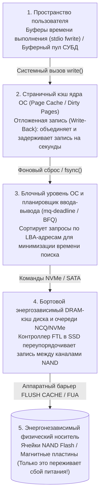
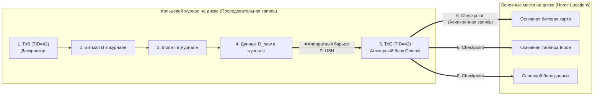

## 1. Введение: минное поле внутри добавления одного блока данных в 4 КБ

Когда вы нажимаете `Ctrl+S` в текстовом редакторе или подтверждаете банковский перевод, ваше приложение вызывает системный вызов `write()`. С точки зрения прикладного программиста сохранение файла выглядит как одно мгновенное, неделимое (атомарное) действие.

Однако внутри ядра операционной системы, файловой системы, движка базы данных и контроллера SSD скрывается одна из сложнейших проблем системного программирования — <strong>проблема согласованности при сбоях (Crash Consistency Problem)</strong>.

Рассмотрим простейшую операцию в классической файловой системе UNIX (например, UFS или ext2): <strong>добавление одного нового блока данных размером $4\,\text{КБ}$ ($D_{\text{new}}$) в конец существующего файла</strong>. Даже эта тривиальная операция требует обновления как минимум <strong>трёх физически разнесённых структур на носителе</strong>:

1. <strong>Битовая карта данных (Data Bitmap $B$)</strong>: изменить бит для физического блока $k$ с $0$ (свободен) на $1$ (занят).
2. <strong>Индексный дескриптор (Inode $I$)</strong>: обновить метаданные файла — увеличить размер `size`, обновить время модификации `mtime` и записать физический адрес блока $k$ в массив указателей inode.
3. <strong>Сам блок данных ($D_{\text{new}}$)</strong>: записать реальные $4\,\text{КБ}$ пользовательских данных в физический сектор блока $k$.

Здесь мы сталкиваемся с фундаментальной физической асимметрией оборудования: оперативная память (DRAM) быстра, но <strong>энергозависима (volatile)</strong>, тогда как диски и NAND-флеш SSD <strong>энергонезависимы (non-volatile)</strong>, но физически не способны обновить три разнесённых блока $(B, I, D_{\text{new}})$ одновременно в рамках одной атомарной операции. Если питание пропадёт посередине этих трёх записей ($2^3 - 2 = 6$ состояний частичной записи), после перезагрузки файловая система окажется в состоянии критического разрушения:

| Записано на диск | Потеряно в RAM | Возникающая несогласованность и степень опасности |
| :--- | :--- | :--- |
| <strong>Только $D_{\text{new}}$</strong> | $B,\; I$ | <strong>Безопасная потеря данных</strong>: данные лежат на диске, но ни inode, ни битовая карта на них не указывают. Целостность файловой системы не нарушена. |
| <strong>Только $B$</strong> | $I,\; D_{\text{new}}$ | <strong>Утечка пространства (Space Leak / блок-сирота)</strong>: блок $k$ помечен занятым ($1$) в $B$, но ни один файл на него не ссылается; ёмкость потеряна навсегда. |
| <strong>Только $I$</strong> (или $I + D_{\text{new}}$) | $B$ | <strong>Двойное выделение (Double Allocation — катастрофическое разрушение)</strong>: inode $I$ указывает на блок $k$, но битовая карта $B$ считает его свободным ($0$). Позже другой файл займёт блок $k$, и оба файла уничтожат данные друг друга! |
| <strong>$I$ и $B$</strong> | $D_{\text{new}}$ | <strong>Утечка чужих старых данных (Stale Data Exposure — критическая уязвимость)</strong>: inode и битовая карта обновлены, но $D_{\text{new}}$ не записан. Чтение файла вернёт <strong>чужие удалённые данные</strong> (пароли, приватные ключи), ранее лежавшие в секторе $k$! |

---

## 2. Почему записи попадают на диск не в том порядке, в котором их отправила программа

В современной компьютерной архитектуре хронологический порядок вызовов `write()` почти никогда не совпадает с порядком физической записи битов на магнитные пластины или ячейки NAND из-за четырёх уровней энергозависимой буферизации и переупорядочивания (<strong>Reordering</strong>):

Чтобы гарантировать порядок и долговечность, ОС должна явно отправлять аппаратные барьеры сброса кэша (<strong>`NVMe Flush`</strong>, <strong>`SATA FLUSH CACHE EXT`</strong> или бит <strong>`FUA: Force Unit Access`</strong>), заставляющие накопитель сбросить свой бортовой DRAM-буфер в энергонезависимые ячейки NAND.

---

## 3. Поколение 1: Оптимистичное обновление на месте, `fsck` и Soft Updates

1. <strong>`fsck` (File System Consistency Check) и предел масштабируемости</strong>:
   Ранние файловые системы UNIX (FFS, ext2) устраняли несогласованность после сбоя путём полного сканирования всех inode, битовых карт и каталогов перед монтированием (`fsck`). Поскольку время работы `fsck` пропорционально <strong>общей ёмкости диска $O(N_{\text{disk}})$</strong>, проверка современного многотерабайтного массива занимает часы или дни простоя — даже если в момент отключения питания изменялся один-единственный файл размером $4\,\text{КБ}$!
2. <strong>Soft Updates (Ganger & McKusick, 1994)</strong>:
   Применявшийся во FreeBSD UFS механизм обходился без журнала за счёт строгого отслеживания графа зависимостей указателей в памяти и разрыва циклических зависимостей внутри одного блока с помощью временного <strong>отката (roll-back)</strong> и <strong>наката (roll-forward)</strong> отдельных полей в ОЗУ перед записью на диск.

---

## 4. Основа современных хранилищ: упреждающее протоколирование (WAL) и журналирование

Чтобы сократить время восстановления с $O(N_{\text{disk}})$ до объёма активных транзакций в момент сбоя $O(N_{\text{active}})$ (считанные миллисекунды!), файловые системы (<strong>ext3/ext4</strong>, <strong>XFS</strong>, <strong>NTFS</strong>) и СУБД используют <strong>упреждающую запись в журнал (Write-Ahead Logging, WAL / Journaling)</strong>:

1. <strong>Journal Write</strong>: перед изменением основных областей диска (*Home Locations*) система последовательно добавляет в кольцевой <strong>Журнал (Journal)</strong> дескриптор начала транзакции `TxB` (с номером `TID`) и обновлённые копии блоков $(I, B, D_{\text{new}})$.
2. <strong>Journal Commit (Точка атомарной фиксации)</strong>: после аппаратного барьера сброса кэша записывается единственный сектор — блок фиксации <strong>`TxE` (Transaction End)</strong>. <strong>Запись этого единственного сектора `TxE` является атомарным переключателем, фиксирующим всю транзакцию!</strong>
3. <strong>Checkpoint</strong>: после записи `TxE` блоки $(I, B, D_{\text{new}})$ асинхронно копируются в свои основные места на диске.

- <strong>Сбой ДО записи `TxE`</strong>: основные области диска не затронуты; при перезагрузке незавершённая запись в журнале просто отбрасывается.
- <strong>Сбой ПОСЛЕ записи `TxE`</strong>: при перезагрузке система идемпотентно повторно копирует (<strong>Redo replay</strong>) блоки из журнала в основные места за несколько миллисекунд. Современная <strong>ext4</strong> устраняет даже промежуточный барьер за счёт <strong>контрольных сумм журнала (CRC32C)</strong> внутри `TxE`.

Чтобы избежать двукратной записи всех данных ($2\times$ Write Amplification), режим по умолчанию <strong>`data=ordered`</strong> в ext4 журналирует только метаданные $(I, B)$, но <strong>требует, чтобы блок данных $D_{\text{new}}$ был полностью записан на своё основное место ДО того, как блок фиксации метаданных `TxE` попадёт в журнал</strong>. В реляционных СУБД протокол <strong>ARIES</strong> (Mohan et al., 1992) реализует политику `Steal / No-Force` с метками `pageLSN` и тремя фазами: <strong>Analysis</strong>, <strong>Redo (Repeating History)</strong> и <strong>Undo (с компенсационными записями CLR)</strong>.

---

## 5. Поколение 3: Копирование при записи (Copy-on-Write, CoW) и деревья Меркла (ZFS / Btrfs)

Файловые системы нового поколения (<strong>ZFS</strong>, <strong>Btrfs</strong>, <strong>APFS</strong>) полностью запрещают перезапись блоков на месте (*In-Place Overwrite*) и используют <strong>Copy-on-Write (CoW / Теневая страничная организация)</strong>:

1. Любой изменённый блок данных $D_{2,\text{new}}$ и его родительский inode $I_{v2}$ всегда записываются в новые свободные блоки, оставляя старые блоки $D_{2,\text{old}}$ нетронутыми.
2. Когда все новые дочерние блоки записаны на диск, одна атомарная запись переключает корневой блок (<strong>Uberblock</strong> в ZFS) с $U_1$ на $U_2$.
3. <strong>Преимущества</strong>: мгновенное восстановление за $0$ секунд без проигрывания журнала, <strong>мгновенные снимки (Snapshots) за $O(1)$</strong> без копирования и автоматическое самовосстановление (*Self-Healing*) от тихого повреждения битов (*Bit Rot*) благодаря <strong>деревьям Меркла</strong> с 256-битными криптографическими контрольными суммами в каждом родительском указателе.

---

## 6. Ловушки `fsync()` для разработчиков и тестирование методом внесения неисправностей

Даже на журналируемой или CoW-файловой системе замена файла через `rename("config.json.tmp", "config.json")` без предварительного вызова `fsync()` приводит к появлению <strong>пустых файлов размером $0$ байт</strong> после сбоя питания при отложенном выделении (*Delayed Allocation* в ext4), так как переименование метаданных фиксируется раньше сброса страниц данных из кэша!

<strong>Полный 6-шаговый протокол безопасного атомарного сохранения файла</strong>:
(1) `write()` во временный файл $\to$ (2) <strong>`fsync(fd)`</strong> временного файла $\to$ (3) `close(fd)` $\to$ (4) атомарный `rename()` $\to$ (5) открытие родительского каталога и <strong>`fsync(dir_fd)`</strong> для сохранения записи каталога $\to$ (6) `close(dir_fd)`.

Как показал скандал <strong>`fsyncgate`</strong> в PostgreSQL в 2018 году (когда ядро Linux помечало грязную страницу в ОЗУ как `Clean` после ошибки ввода-вывода `EIO` во время `fsync()`, что было исправлено механизмом `errseq_t`), современная разработка систем хранения невозможна без фреймворков <strong>систематического внесения сбоев (Fault Injection)</strong>, таких как <strong>ALICE</strong> и <strong>CrashMonkey</strong>, проверяющих все допустимые перестановки команд при внезапном отключении питания.
