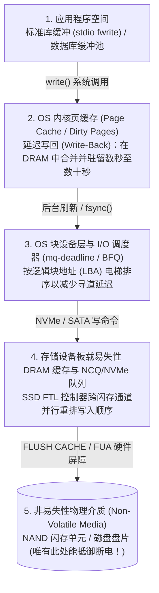
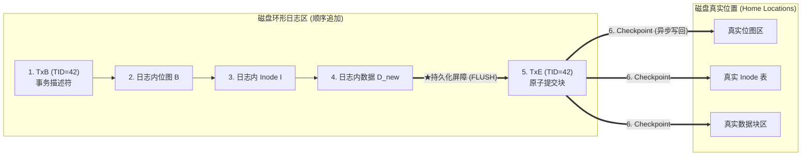

## 1. 引言：向文件追加一个 4 KB 数据块背后的雷区

当我们在文本编辑器中按下 `Ctrl+S` 保存文件，或者在银行系统中点击转账确认时，应用程序会向操作系统发起 `write()` 系统调用。在程序员看来，这似乎是一个瞬间完成的不可分割动作（原子操作）。

然而，如果深入操作系统内核、文件系统、数据库存储引擎以及固态硬盘（SSD）与机械硬盘（HDD）的底层物理结构，就会发现一个严峻的事实：<strong>哪怕是“向已有文件末尾追加一个 $4\,\text{KB}$ 数据块 $D_{\text{new}}$”这样最简单的操作，也必须在磁盘上物理分离的至少三个不同位置进行写入</strong>：

1. <strong>数据位图（Data Bitmap $B$）</strong>：在空闲块管理表中，将物理块号 $k$ 对应的比特从 $0$（空闲）翻转为 $1$（已分配）。
2. <strong>索引节点（Inode $I$）</strong>：更新文件的元数据结构体——增加文件大小 `size`，更新修改时间 `mtime`，并将新分配的物理块号 $k$ 写入数据块指针数组。
3. <strong>数据块本身（Data Block $D_{\text{new}}$）</strong>：将用户真正要保存的 $4\,\text{KB}$ 内容写入物理块号 $k$ 所在的扇区。

这里存在着计算机硬件最根本的物理矛盾：内存（DRAM）速度极快但属于<strong>易失性存储（Volatile Memory）</strong>，断电瞬间数据归零；而磁盘与 NAND 闪存虽然属于<strong>非易失性存储（Non-Volatile Storage）</strong>，但没有任何物理机制能够“同时且原子地”更新相距遥远的三个磁盘块 $(B, I, D_{\text{new}})$。

如果在这三次写入的中途发生<strong>拔掉电源（Power Loss）</strong>或<strong>内核崩溃（Kernel Panic）</strong>，会发生什么？根据断电前哪几个块真正落盘（共有 $2^3 - 2 = 6$ 种部分写入状态），文件系统将陷入灾难性的<strong>崩溃不一致（Crash Inconsistency）</strong>：

| 已落盘的块 | 断电丢失的块 | 引发的崩溃不一致症状与严重程度 |
| :--- | :--- | :--- |
| <strong>仅 $D_{\text{new}}$</strong> | $B,\; I$ | <strong>数据丢失（轻微）</strong>：数据虽已写入空闲扇区，但没有任何 Inode 指向它，位图也未标记，文件系统结构本身未受损。 |
| <strong>仅 $B$</strong> | $I,\; D_{\text{new}}$ | <strong>空间泄漏（Space Leak / 孤儿块）</strong>：位图 $B$ 标记块 $k$ 为“已占用（$1$）”，但没有任何文件引用它，该存储块容量永久泄漏。 |
| <strong>仅 $I$</strong>（或 $I + D_{\text{new}}$） | $B$ | <strong>双重分配（Double Allocation：灾难性元数据损坏）</strong>：Inode $I$ 指向了块 $k$，但位图 $B$ 仍显示为“空闲（$0$）”。随后另一个文件会再次申请到块 $k$ 并覆写，导致两个文件互相篡改破坏！ |
| <strong>$I$ 与 $B$</strong> | $D_{\text{new}}$ | <strong>陈旧数据泄露（Stale Data Exposure：高危安全漏洞）</strong>：Inode 和位图均已更新，但新数据 $D_{\text{new}}$ 未写入。此时读取文件末尾会读出该物理扇区上残留的他人已删除文件（如密码或私钥）！ |

如何在底层硬件仅保证单扇区/单页原子性的前提下，构建出跨越多块数据结构的<strong>全有或全无原子性（All-or-Nothing Atomicity）</strong>与<strong>持久性（Durability）</strong>？这就是<strong>崩溃一致性（Crash Consistency）</strong>的核心使命。

---

## 2. 为什么写入顺序会被打乱？：多层易失性缓存与 I/O 重排

有人会问：“既然如此，只要按安全顺序——先写数据块 $D_{\text{new}}$，再写位图 $B$，最后写 Inode $I$——不就能避免双重分配和敏感数据泄露吗？”

遗憾的是，在现代计算机体系结构中，<strong>应用程序调用 `write()` 的时间顺序，与比特真正写入非易失性物理介质（磁道或 NAND 闪存单元）的顺序完全不同</strong>！从用户空间到物理介质之间隔着四层会主动打乱写入顺序（Reordering）的易失性缓冲层：

即使操作系统向磁盘发送了写入指令并收到了“完成”中断，数据往往也只是进入了<strong>硬盘板载的易失性 DRAM 写缓存</strong>。为了确保严格的写入先后顺序，文件系统必须向硬件显式发送<strong>缓存刷新屏障指令（SATA 的 `FLUSH CACHE EXT`、NVMe 的 `Flush` 或 `FUA: Force Unit Access` 标志）</strong>，强制将易失性缓存排空至物理闪存颗粒。

---

## 3. 第一代方案：乐观就地更新、`fsck` 与软更新（Soft Updates）

1. <strong>`fsck`（文件系统一致性检查）的可扩展性崩溃</strong>：
   早期的 BSD FFS 和 Linux ext2 在正常运行时直接就地修改（In-Place Update），一旦断电重启，必须在挂载前运行 `fsck` 扫描整块磁盘的所有 Inode、位图与目录树，修复空间泄漏和双重分配。然而，<strong>`fsck` 的时间复杂度与磁盘总容量 $O(N_{\text{disk}})$ 成正比</strong>！在现代数十 TB 的存储阵列上，哪怕断电时只写了一个 $4\,\text{KB}$ 文件，重启后的 `fsck` 也要扫描数小时甚至数天，导致生产服务器长时间瘫痪。
2. <strong>软更新（Soft Updates, Ganger & McKusick 1994）</strong>：
   FreeBSD UFS 引入的软更新不写日志，而是通过在内存中严密追踪块与块之间的指针依赖关系图（遵循“未初始化绝不指向、未解除旧指针绝不重用、新指针未落盘绝不删除旧指针”三大法则），并在遇到循环依赖时在内存中执行临时的<strong>回滚（Roll-back）与前滚（Roll-forward）</strong>，保证磁盘在任何时刻都处于一致状态。但其内存状态机实现极其复杂。

---

## 4. 现代存储的中流砥柱：预写式日志（WAL）与文件系统日志（Journaling）

为了将崩溃恢复时间从“扫描全盘 $O(N_{\text{disk}})$”缩短到“仅重放断电瞬间的活跃事务 $O(N_{\text{active}})$（仅需几毫秒！）”，现代文件系统（ext3/ext4、XFS、NTFS）和关系型数据库普遍采用了<strong>预写式日志（Write-Ahead Logging, WAL / Journaling）</strong>。

### 4.1 WAL 的两阶段原子提交协议

WAL 的核心思想是：<strong>在修改磁盘上分散的真实位置（Home Locations）之前，先将所有要修改的内容顺序追加（Sequential Append）到磁盘上一块专门的连续环形缓冲区——日志区（Journal）中</strong>：

1. <strong>Journal Write（写入日志体）</strong>：向日志区写入事务开始描述符 `TxB`（含事务 ID）以及更新后的块镜像 $(I, B, D_{\text{new}})$。
2. <strong>Journal Commit（原子提交点）</strong>：发出硬件刷新屏障（Barrier）确保步骤 1 全部落盘后，向日志末尾写入仅占单个扇区的<strong>提交块 `TxE`（Transaction End）</strong>。<strong>`TxE` 落盘的那一瞬间，就是整个多块事务的唯一原子切换开关！</strong>
3. <strong>Checkpoint（检查点写回）</strong>：`TxE` 落盘后，后台异步将 $(I, B, D_{\text{new}})$ 写回它们在磁盘上的真实位置，随后释放日志空间。

- <strong>若在 `TxE` 写入前断电</strong>：真实位置毫发无损，重启恢复时发现缺少 `TxE`，直接丢弃该未完成日志即可。
- <strong>若在 `TxE` 写入后（Checkpoint 中途）断电</strong>：日志区已保存完整副本，重启时只需将日志内容幂等地重新复制到真实位置（<strong>Redo 重做</strong>），几毫秒内即可完成恢复！现代 ext4 更进一步引入了<strong>日志校验和（Journal Checksums，CRC32C）</strong>，将 `TxB` 到 `TxE` 一次性合并写入，若部分扇区因乱序未写入，重启时校验和不匹配即可安全丢弃，省去了中间的一次屏障等待延迟。

### 4.2 ext4 的三种日志模式与数据库 ARIES 协议

为了避免把每个数据块 $D_{\text{new}}$ 都写两遍（$2\times$ 写放大），ext3/ext4 提供了三种模式：
- <strong>`data=journal`</strong>：元数据 $(I, B)$ 与数据 $D_{\text{new}}$ 全部记入日志，最安全但有 $2\times$ 写入惩罚。
- <strong>`data=writeback`</strong>：仅将元数据 $(I, B)$ 记入日志，数据块直接写回且不保序，崩溃后存在泄露陈旧删除数据的风险。
- <strong>`data=ordered`（默认模式）</strong>：仅将元数据 $(I, B)$ 记入日志，但强制规定<strong>必须先将数据块 $D_{\text{new}}$ 直接刷入真实磁盘位置并完成后，才允许将元数据的提交块 `TxE` 写入日志</strong>！既消除了数据的双写开销，又彻底杜绝了陈旧数据泄露。

在数据库系统中，C. Mohan 提出的 <strong>ARIES 恢复算法</strong>支持 `Steal / No-Force` 缓冲池策略，为每个数据页记录 `pageLSN`，通过<strong>分析（Analysis）、重做历史（Redo — Repeating History）和逆向撤销（Undo + 补偿日志记录 CLR）</strong>三个阶段，实现精确到行级的事务原子恢复。

---

## 5. 第三代方案：写时复制（Copy-on-Write, CoW）与默克尔树（ZFS / Btrfs）

无论是 `fsck` 还是日志（WAL），本质上都是为了挽救“就地覆写（In-Place Overwrite）”带来的破坏。而以 <strong>ZFS</strong>、<strong>Btrfs</strong>、<strong>APFS</strong> 为代表的现代文件系统则采取了彻底的函数式不可变思想——<strong>写时复制（Copy-on-Write, CoW / Shadow Paging）</strong>：

1. <strong>永远不覆写磁盘上的已有数据</strong>：当修改数据块 $D_2$ 时，旧块 $D_{2,\text{old}}$ 原封不动保留，新数据 $D_{2,\text{new}}$ 被写入全新的空闲块。
2. <strong>自底向上更新指针树</strong>：指向该数据块的父节点 Inode 也写入新的空闲位置 $I_{v2}$，依此类推向上传播，直到所有新分支落盘后，最后一步通过单次原子写入更新文件系统顶层的根块——<strong>超级块（ZFS 称为 Uberblock）</strong>从 $U_1$ 切换到 $U_2$！
3. <strong>零恢复时间、$O(1)$ 快照与端到端自愈</strong>：如果在更新 Uberblock 前断电，旧树 $U_1$ 完好无损，无需重放任何日志即可瞬间挂载；保留旧根即可实现零拷贝开销的<strong>瞬间快照（Snapshot）</strong>；而 ZFS 在父指针中嵌入子块的 256 位密码学校验和构成<strong>默克尔树（Merkle Tree）</strong>，能实时检测并自动修复静默比特翻转（Bit Rot）与固件写错位置故障。

---

## 6. 程序员的噩梦：`fsync()` 的陷阱与系统化故障注入验证

即便底层文件系统再可靠，如果应用程序错误使用 POSIX 接口，数据依然会在断电时化为乌有。

1. <strong>`rename()` 的原子性迷思与 0 字节文件灾难</strong>：
   许多程序员以为先写临时文件 `config.json.tmp` 再调用 `rename("config.json.tmp", "config.json")` 就是安全的。然而在 ext4 延迟分配（Delayed Allocation）下，`rename()` 仅保证目录项替换是原子的，却不保证 `config.json.tmp` 在页缓存中的数据已经落盘！如果不先调用 `fsync(fd)` 就直接 `rename()`，断电重启后会留下一个<strong>长度为 0 字节的空文件</strong>。
   真正的<strong>六步崩溃安全保存协议</strong>必须依次执行：(1) `write()` 写入临时文件 $\to$ (2) 对临时文件执行 <strong>`fsync(fd)`</strong> $\to$ (3) `close(fd)` $\to$ (4) `rename()` 原子替换文件名 $\to$ (5) 打开父目录并执行 <strong>`fsync(dir_fd)`</strong> 将目录项变更持久化 $\to$ (6) `close(dir_fd)`。
2. <strong>PostgreSQL `fsyncgate`（2018）与故障注入测试（Fault Injection）</strong>：
   2018 年曝光的 Linux 内核漏洞显示，当 `fsync()` 遭遇底层 I/O 错误返回 `EIO` 时，内核竟将该脏页标记为 `Clean`，导致数据库重试 `fsync()` 时误以为成功而静默损坏数据（Linux 4.17 随后引入 `errseq_t` 修复）。为了捕获这类只在微秒级断电窗口触发的缺陷，现代存储工程广泛采用威斯康星大学开发的 <strong>ALICE</strong> 与 <strong>CrashMonkey</strong> 等<strong>系统化故障注入测试工具</strong>，遍历所有合法的 I/O 乱序与断电组合来形式化验证崩溃一致性。
