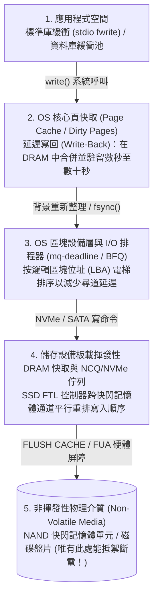
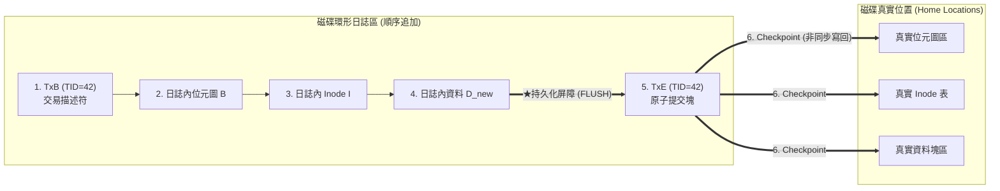

## 1. 引言：向檔案追加一個 4 KB 資料塊背後的雷區

當我們在文字編輯器中按下 `Ctrl+S` 儲存檔案，或者在銀行系統中點擊轉帳確認時，應用程式會向作業系統發起 `write()` 系統呼叫。在程式設計師看來，這似乎是一個瞬間完成的不可分割動作（原子操作）。

然而，如果深入作業系統核心、檔案系統、資料庫儲存引擎以及固態硬碟（SSD）與傳統硬碟（HDD）的底層物理結構，就會發現一個嚴峻的事實：<strong>哪怕是「向已有檔案末尾追加一個 $4\,\text{KB}$ 資料塊 $D_{\text{new}}$」這樣最簡單的操作，也必須在磁碟上物理分離的至少三個不同位置進行寫入</strong>：

1. <strong>資料位元圖（Data Bitmap $B$）</strong>：在空閒塊管理表中，將物理塊號 $k$ 對應的位元從 $0$（空閒）翻轉為 $1$（已分配）。
2. <strong>索引節點（Inode $I$）</strong>：更新檔案的元資料結構體——增加檔案大小 `size`，更新修改時間 `mtime`，並將新分配的物理塊號 $k$ 寫入資料塊指標陣列。
3. <strong>資料塊本身（Data Block $D_{\text{new}}$）</strong>：將使用者真正要儲存的 $4\,\text{KB}$ 內容寫入物理塊號 $k$ 所在的磁區。

這裡存在著電腦硬體最根本的物理矛盾：記憶體（DRAM）速度極快但屬於<strong>揮發性記憶體（Volatile Memory）</strong>，斷電瞬間資料歸零；而磁碟與 NAND 快閃記憶體雖然屬於<strong>非揮發性儲存（Non-Volatile Storage）</strong>，但沒有任何物理機制能夠「同時且原子地」更新相距遙遠的三個磁碟塊 $(B, I, D_{\text{new}})$。

如果在這三次寫入的中途發生<strong>拔掉電源（Power Loss）</strong>或<strong>核心崩潰（Kernel Panic）</strong>，會發生什麼？根據斷電前哪幾個塊真正寫入磁碟（共有 $2^3 - 2 = 6$ 種部分寫入狀態），檔案系統將陷入災難性的<strong>崩潰不一致（Crash Inconsistency）</strong>：

| 已寫入磁碟的塊 | 斷電遺失的塊 | 引發的崩潰不一致症狀與嚴重程度 |
| :--- | :--- | :--- |
| <strong>僅 $D_{\text{new}}$</strong> | $B,\; I$ | <strong>資料遺失（輕微）</strong>：資料雖已寫入空閒磁區，但沒有任何 Inode 指向它，位元圖也未標記，檔案系統結構本身未受損。 |
| <strong>僅 $B$</strong> | $I,\; D_{\text{new}}$ | <strong>空間洩漏（Space Leak / 孤兒塊）</strong>：位元圖 $B$ 標記塊 $k$ 為「已佔用（$1$）」，但沒有任何檔案引用它，該儲存塊容量永久洩漏。 |
| <strong>僅 $I$</strong>（或 $I + D_{\text{new}}$） | $B$ | <strong>雙重分配（Double Allocation：災難性元資料損壞）</strong>：Inode $I$ 指向了塊 $k$，但位元圖 $B$ 仍顯示為「空閒（$0$）」。隨後另一個檔案會再次申請到塊 $k$ 並覆寫，導致兩個檔案互相竄改破壞！ |
| <strong>$I$ 與 $B$</strong> | $D_{\text{new}}$ | <strong>陳舊資料洩露（Stale Data Exposure：高危安全漏洞）</strong>：Inode 和位元圖均已更新，但新資料 $D_{\text{new}}$ 未寫入。此時讀取檔案末尾會讀出該物理磁區上殘留的他人已刪除檔案（如密碼或私鑰）！ |

如何在底層硬體僅保證單磁區/單頁原子性的前提下，建構出跨越多塊資料結構的<strong>全有或全無原子性（All-or-Nothing Atomicity）</strong>與<strong>持久性（Durability）</strong>？這就是<strong>崩潰一致性（Crash Consistency）</strong>的核心使命。

---

## 2. 為什麼寫入順序會被打亂？：多層揮發性快取與 I/O 重排

有人會問：「既然如此，只要按安全順序——先寫資料塊 $D_{\text{new}}$，再寫位元圖 $B$，最後寫 Inode $I$——不就能避免雙重分配和敏感資料洩露嗎？」

遺憾的是，在現代電腦體系結構中，<strong>應用程式呼叫 `write()` 的時間順序，與位元真正寫入非揮發性物理介質（磁軌或 NAND 快閃記憶體單元）的順序完全不同</strong>！從使用者空間到物理介質之間隔著四層會主動打亂寫入順序（Reordering）的揮發性緩衝層：

即使作業系統向磁碟發送了寫入指令並收到了「完成」中斷，資料往往也只是進入了<strong>硬碟板載的揮發性 DRAM 寫入快取</strong>。為了確保嚴格的寫入先後順序，檔案系統必須向硬體顯式發送<strong>快取重新整理屏障指令（SATA 的 `FLUSH CACHE EXT`、NVMe 的 `Flush` 或 `FUA: Force Unit Access` 標誌）</strong>，強制將揮發性快取排空至物理快閃記憶體顆粒。

---

## 3. 第一代方案：樂觀就地更新、`fsck` 與軟更新（Soft Updates）

1. <strong>`fsck`（檔案系統一致性檢查）的可擴展性崩潰</strong>：
   早期的 BSD FFS 和 Linux ext2 在正常運作時直接就地修改（In-Place Update），一旦斷電重啟，必須在掛載前執行 `fsck` 掃描整塊磁碟的所有 Inode、位元圖與目錄樹，修復空間洩漏和雙重分配。然而，<strong>`fsck` 的時間複雜度與磁碟總容量 $O(N_{\text{disk}})$ 成正比</strong>！在現代數十 TB 的儲存陣列上，哪怕斷電時只寫了一個 $4\,\text{KB}$ 檔案，重啟後的 `fsck` 也要掃描數小時甚至數天，導致生產伺服器長時間癱瘓。
2. <strong>軟更新（Soft Updates, Ganger & McKusick 1994）</strong>：
   FreeBSD UFS 引入的軟更新不寫日誌，而是透過在記憶體中嚴密追蹤塊與塊之間的指標依賴關係圖（遵循「未初始化絕不指向、未解除舊指標絕不重用、新指標未落盤絕不刪除舊指標」三大法則），並在遇到循環依賴時在記憶體中執行臨時的<strong>回滾（Roll-back）與前滾（Roll-forward）</strong>，保證磁碟在任何時刻都處於一致狀態。但其記憶體狀態機實作極其複雜。

---

## 4. 現代儲存的中流砥柱：預寫式日誌（WAL）與檔案系統日誌（Journaling）

為了將崩潰復原時間從「掃描全盤 $O(N_{\text{disk}})$」縮短到「僅重放斷電瞬間的活躍交易 $O(N_{\text{active}})$（僅需幾毫秒！）」，現代檔案系統（ext3/ext4、XFS、NTFS）和關聯式資料庫普遍採用了<strong>預寫式日誌（Write-Ahead Logging, WAL / Journaling）</strong>。

### 4.1 WAL 的兩階段原子提交協定

WAL 的核心思想是：<strong>在修改磁碟上分散的真實位置（Home Locations）之前，先將所有要修改的內容順序追加（Sequential Append）到磁碟上一塊專門的連續環形緩衝區——日誌區（Journal）中</strong>：

1. <strong>Journal Write（寫入日誌體）</strong>：向日誌區寫入交易開始描述符 `TxB`（含交易 ID）以及更新後的塊鏡像 $(I, B, D_{\text{new}})$。
2. <strong>Journal Commit（原子提交點）</strong>：發出硬體重新整理屏障（Barrier）確保步驟 1 全部落盤後，向日誌末尾寫入僅佔單個磁區的<strong>提交塊 `TxE`（Transaction End）</strong>。<strong>`TxE` 落盤的那一瞬間，就是整個多塊交易的唯一原子切換開關！</strong>
3. <strong>Checkpoint（檢查點寫回）</strong>：`TxE` 落盤後，背景非同步將 $(I, B, D_{\text{new}})$ 寫回它們在磁碟上的真實位置，隨後釋放日誌空間。

- <strong>若在 `TxE` 寫入前斷電</strong>：真實位置毫髮無損，重啟復原時發現缺少 `TxE`，直接丟棄該未完成日誌即可。
- <strong>若在 `TxE` 寫入後（Checkpoint 中途）斷電</strong>：日誌區已保存完整副本，重啟時只需將日誌內容冪等地重新複製到真實位置（<strong>Redo 重做</strong>），幾毫秒內即可完成復原！現代 ext4 更進一步引入了<strong>日誌校驗和（Journal Checksums，CRC32C）</strong>，將 `TxB` 到 `TxE` 一次性合併寫入，若部分磁區因亂序未寫入，重啟時校驗和不匹配即可安全丟棄，省去了中間的一次屏障等待延遲。

### 4.2 ext4 的三種日誌模式與資料庫 ARIES 協定

為了避免把每個資料塊 $D_{\text{new}}$ 都寫兩遍（$2\times$ 寫入放大），ext3/ext4 提供了三種模式：
- <strong>`data=journal`</strong>：元資料 $(I, B)$ 與資料 $D_{\text{new}}$ 全部記入日誌，最安全但有 $2\times$ 寫入懲罰。
- <strong>`data=writeback`</strong>：僅將元資料 $(I, B)$ 記入日誌，資料塊直接寫回且不保序，崩潰後存在洩露陳舊刪除資料的風險。
- <strong>`data=ordered`（預設模式）</strong>：僅將元資料 $(I, B)$ 記入日誌，但強制規定<strong>必須先將資料塊 $D_{\text{new}}$ 直接刷入真實磁碟位置並完成後，才允許將元資料的提交塊 `TxE` 寫入日誌</strong>！既消除了資料的雙寫開銷，又徹底杜絕了陳舊資料洩露。

在資料庫系統中，C. Mohan 提出的 <strong>ARIES 復原演算法</strong>支援 `Steal / No-Force` 緩衝池策略，為每個資料頁記錄 `pageLSN`，透過<strong>分析（Analysis）、重做歷史（Redo — Repeating History）和逆向撤銷（Undo + 補償日誌記錄 CLR）</strong>三個階段，實現精確到列級的交易原子復原。

---

## 5. 第三代方案：寫時複製（Copy-on-Write, CoW）與默克爾樹（ZFS / Btrfs）

無論是 `fsck` 還是日誌（WAL），本質上都是為了挽救「就地覆寫（In-Place Overwrite）」帶來的破壞。而以 <strong>ZFS</strong>、<strong>Btrfs</strong>、<strong>APFS</strong> 為代表的現代檔案系統則採取了徹底的函數式不可變思想——<strong>寫時複製（Copy-on-Write, CoW / Shadow Paging）</strong>：

1. <strong>永遠不覆寫磁碟上的已有資料</strong>：當修改資料塊 $D_2$ 時，舊塊 $D_{2,\text{old}}$ 原封不動保留，新資料 $D_{2,\text{new}}$ 被寫入全新的空閒塊。
2. <strong>自底向上更新指標樹</strong>：指向該資料塊的父節點 Inode 也寫入新的空閒位置 $I_{v2}$，依此類推向上傳播，直到所有新分支落盤後，最後一步透過單次原子寫入更新檔案系統頂層的根塊——<strong>超級塊（ZFS 稱為 Uberblock）</strong>從 $U_1$ 切換到 $U_2$！
3. <strong>零復原時間、$O(1)$ 快照與端到端自癒</strong>：如果在更新 Uberblock 前斷電，舊樹 $U_1$ 完好無損，無需重放任何日誌即可瞬間掛載；保留舊根即可實現零拷貝開銷的<strong>瞬間快照（Snapshot）</strong>；而 ZFS 在父指標中嵌入子塊的 256 位元密碼學校驗和構成<strong>默克爾樹（Merkle Tree）</strong>，能即時檢測並自動修復靜默位元翻轉（Bit Rot）與韌體寫錯位置故障。

---

## 6. 程式設計師的噩夢：`fsync()` 的陷阱與系統化故障注入驗證

即便底層檔案系統再可靠，如果應用程式錯誤使用 POSIX 介面，資料依然會在斷電時化為烏有。

1. <strong>`rename()` 的原子性迷思與 0 位元組檔案災難</strong>：
   許多程式設計師以為先寫臨時檔案 `config.json.tmp` 再呼叫 `rename("config.json.tmp", "config.json")` 就是安全的。然而在 ext4 延遲分配（Delayed Allocation）下，`rename()` 僅保證目錄項替換是原子的，卻不保證 `config.json.tmp` 在頁快取中的資料已經落盤！如果不先呼叫 `fsync(fd)` 就直接 `rename()`，斷電重啟後會留下一個<strong>長度為 0 位元組的空檔案</strong>。
   真正的<strong>六步崩潰安全儲存協定</strong>必須依序執行：(1) `write()` 寫入臨時檔案 $\to$ (2) 對臨時檔案執行 <strong>`fsync(fd)`</strong> $\to$ (3) `close(fd)` $\to$ (4) `rename()` 原子替換檔名 $\to$ (5) 開啟父目錄並執行 <strong>`fsync(dir_fd)`</strong> 將目錄項變更持久化 $\to$ (6) `close(dir_fd)`。
2. <strong>PostgreSQL `fsyncgate`（2018）與故障注入測試（Fault Injection）</strong>：
   2018 年曝光的 Linux 核心漏洞顯示，當 `fsync()` 遭遇底層 I/O 錯誤回傳 `EIO` 時，核心竟將該髒頁標記為 `Clean`，導致資料庫重試 `fsync()` 時誤以為成功而靜默損壞資料（Linux 4.17 隨後引入 `errseq_t` 修復）。為了捕獲這類只在微秒級斷電視窗觸發的缺陷，現代儲存工程廣泛採用威斯康辛大學開發的 <strong>ALICE</strong> 與 <strong>CrashMonkey</strong> 等<strong>系統化故障注入測試工具</strong>，遍歷所有合法的 I/O 亂序與斷電組合來形式化驗證崩潰一致性。
