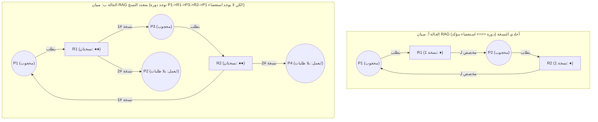
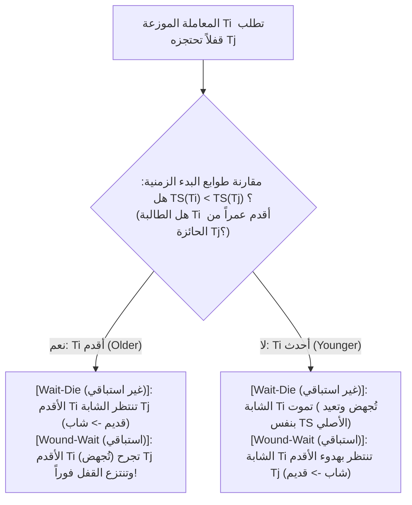

## 1. مقدمة: مسألة الفلاسفة المتناولين للعشاء وشروط كوفمان الأربعة (1971)

في عام 1965، صاغ عالم الحاسوب الهولندي <strong>إدسخر ديكسترا (Edsger W. Dijkstra)</strong> <strong>«مسألة الفلاسفة المتناولين للعشاء» (Dining Philosophers Problem)</strong> الشهيرة: يجلس خمسة فلاسفة $P_0 \dots P_4$ حول طاولة مستديرة، وبين كل طبقين من المعكرونة توجد شوكة واحدة فقط ($F_0 \dots F_4$). لكي يأكل الفيلسوف، يجب أن يمسك بشوكته اليسرى $F_i$ وشوكته اليمنى $F_{(i+1)\bmod 5}$ في آنٍ واحد. فإذا شعر الفلاسفة الخمسة بالجوع في نفس الميكروثانية تماماً والتقط كل منهم شوكته اليسرى $F_i$، فسينتظر كل واحد منهم إلى الأبد أن يترك جاره الأيمن الشوكة الثانية — فيتجمد النظام بأكمله إلى ما لا نهاية. يُعرف هذا الشلل التام باسم <strong>الاستعصاء أو التوقف التام (Deadlock)</strong>.

رياضياً، تكون مجموعة العمليات غير الخالية $D \subseteq \mathcal{P}$ في حالة استعصاء إذا وفقط إذا كانت كل عملية $P_i \in D$ محجوبة تنتظر حدثاً (مثل تحرير مورد) <strong>لا يمكن إحداثه إلا بواسطة عملية أخرى $P_j \in D$ تنتمي إلى نفس مجموعة الانتظار</strong>.

في عام 1971، أثبت <strong>إدوارد كوفمان (Edward G. Coffman Jr.)</strong> وزملاؤه أن استعصاء الموارد لا يمكن أن يقع إلا إذا <strong>تحققت أربعة شروط لازمة في وقت واحد</strong>:
1. <strong>الاستبعاد المتبادل (Mutual Exclusion)</strong>: يجب أن يُحتجز مورد واحد على الأقل في وضع حصري غير قابل للمشاركة.
2. <strong>الاحتجاز والانتظار (Hold and Wait)</strong>: تحتجز العملية مورداً واحداً على الأقل بينما تنتظر محجوبةً الحصول على موارد إضافية تحتجزها عمليات أخرى.
3. <strong>عدم الاستباق (No Preemption)</strong>: لا يمكن انتزاع الموارد المخصصة قسراً من العملية؛ بل تُحرر طوعاً فقط بعد انتهاء مهمتها.
4. <strong>الانتظار الدائري (Circular Wait)</strong>: توجد سلسلة مغلقة من العمليات $\{P_0, P_1, \dots, P_{k-1}\}$ بحيث تنتظر كل عملية $P_i$ مورداً تحتجزه العملية $P_{(i+1)\bmod k}$.

وبما أن هذه الشروط الأربعة لازمة فردياً، فإن <strong>نفي أي شرط واحد منها منطقياً في تصميم النظام يجعل حدوث الاستعصاء مستحيلاً رياضياً بنسبة $100\%$</strong>.

---

## 2. مبيان تخصيص الموارد (RAG) ومبرهنات الدورات (Holt, 1972)

في عام 1972، نمذج ريتشارد هولت حالة الموارد كمبيان ثنائي التجزئة موجه يُسمى <strong>مبيان تخصيص الموارد (RAG)</strong> $G = (V, E)$، حيث $V = \mathcal{P} \cup \mathcal{R}$ (رؤوس العمليات $P_i$ وأنواع الموارد $R_j$ التي يمتلك كل منها $W_j \ge 1$ من النسخ المتطابقة)، مع <strong>حواف الطلب $P_i \to R_j$</strong> و<strong>حواف التخصيص $R_j \to P_i$</strong>.

تربط ثلاث مبرهنات أساسية بين الدورات الموجهة في $G$ وبين الاستعصاء:
* <strong>المبرهنة 1 (خلو المبيان من الدورات $\implies$ خلو النظام من الاستعصاء)</strong>: إذا لم يحتوِ $G$ على أي دورة موجهة (DAG)، فلا توجد أي عملية في حالة استعصاء.
* <strong>المبرهنة 2 (الشرط اللازم والكافي للنسخة الواحدة)</strong>: إذا كان لكل نوع مورد <strong>نسخة واحدة فقط ($\forall j, W_j = 1$)</strong>، فإن <strong>وجود دورة موجهة في $G \iff$ حدوث استعصاء</strong>.
* <strong>المبرهنة 3 (عدم الكفاية عند تعدد النسخ)</strong>: إذا امتلك مورد واحد على الأقل <strong>عدة نسخ ($\exists j, W_j > 1$)</strong>، فإن وجود دورة موجهة هو <strong>شرط لازم ولكنه ليس كافياً</strong> لحدوث الاستعصاء!

في الحالة ب، رغم وجود الدورة $P_1 \to R_1 \to P_3 \to R_2 \to P_1$، فإن العمليتين $P_2$ و $P_4$ لا تطلبان أي مورد (درجة الخروج $0$) وتعملان بحرية؛ فبمجرد انتهائهما وتحرير نسخ $R_1$ و $R_2$، تنحل الدورة تلقائياً!

---

## 3. الاستراتيجية 1 (الوقاية): البرهان بالتناقض لقاعدة الترتيب الكلي للأقفال

في نوى أنظمة التشغيل (مثل مدقق `lockdep` في نواة لينكس) والبرمجة متعددة الخيوط، يُقضى على الشرط الرابع (الانتظار الدائري) عبر <strong>الترتيب الكلي للأقفال (Total Lock Ordering)</strong>: يُمنح كل قفل $L \in \mathcal{L}$ رتبة رقمية شاملة فريدة $\phi(L) \in \mathbb{N}$، ولا يُسمح لأي خيط يحتجز مجموعة الأقفال $\mathcal{H}$ بطلب قفل جديد $L_{\text{new}}$ إلا إذا كانت رتبته أكبر قطعا:

$$\forall L_{\text{held}} \in \mathcal{H}: \quad \phi(L_{\text{held}}) < \phi(L_{\text{new}})$$

<strong>【البرهان بالتناقض】</strong>: لنفترض تكون دورة انتظار $\{P_0, P_1, \dots, P_{k-1}\}$ ($k \ge 2$)، حيث تحتجز $P_i$ القفل $L_i$ وتنتظر القفل $L_{(i+1)\bmod k}$. وبما أن جميع الخيوط تلتزم بقاعدة الترتيب المتزايد قطعا، نحصل عبر التعدي على طول الدورة على:

$$\phi(L_0) < \phi(L_1) < \phi(L_2) < \cdots < \phi(L_{k-1}) < \phi(L_0) \implies \phi(L_0) < \phi(L_0)$$

وبما أنه يستحيل أن يكون أي عدد طبيعي أصغر قطعا من نفسه، فهذا تناقض منطقي ($\bot$)! سواء في التحويلات المصرفية (قفل الحساب ذي المعرف الأصغر أولاً دائماً) أو في مسألة الفلاسفة (جعل الفيلسوف الأخير $P_4$ يلتقط شوكته اليمنى $F_0$ قبل اليسرى $F_4$ لأن $0 < 4$)، يصبح الانتظار الدائري مستحيلاً. $\blacksquare$

---

## 4. الاستراتيجية 2 (التجنب): خوارزمية المصرفي لديكسترا (تتبع مصفوفة 5×3)

عندما يتعذر تثبيت ترتيب الأقفال مسبقاً، تطلب <strong>خوارزمية المصرفي لديكسترا (Banker's Algorithm, 1965 / Habermann, 1969)</strong> التصريح المسبق بالحد الأقصى للطلب $\mathbf{Max}$، وتتحقق بتعقيد <strong>$O(m \cdot n^2)$</strong> قبل كل تخصيص مما إذا كانت الحالة الناتجة تظل <strong>حالة آمنة (Safe State)</strong> تمتلك <strong>متتالية آمنة (Safe Sequence)</strong> واحدة على الأقل ($\text{حالة الاستعصاء} \subsetneq \text{الحالة غير الآمنة}$).

لنظام يضم $n=5$ عمليات $\{P_0 \dots P_4\}$ و $m=3$ موارد بإجمالي $\mathbf{Total} = (A=10, B=5, C=7)$ ومجموع مخصص $(7,2,5)$، يكون المتجه المتاح الابتدائي $\mathbf{Available} = (10,5,7) - (7,2,5) = \mathbf{(3, 3, 2)}$:

| العملية | المخصص $\mathbf{Allocation}$ $(A,B,C)$ | الأقصى $\mathbf{Max}$ $(A,B,C)$ | المتبقي $\mathbf{Need} = \mathbf{Max} - \mathbf{Allocation}$ | تتبع المتتالية الآمنة ($\mathbf{Work}_0 = (3,3,2)$) |
| :--- | :---: | :---: | :---: | :--- |
| <strong>$P_0$</strong> | $(0, 1, 0)$ | $(7, 5, 3)$ | $(7, 4, 3)$ | الخطوة 4 تتحقق: $(7,4,3) \le (7,4,5) \to \mathbf{Work}=(7,5,5)$ |
| <strong>$P_1$</strong> | $(2, 0, 0)$ | $(3, 2, 2)$ | $(1, 2, 2)$ | <strong>الخطوة 1 تتحقق</strong>: $(1,2,2) \le (3,3,2) \to \mathbf{Work}=(5,3,2)$ |
| <strong>$P_2$</strong> | $(3, 0, 2)$ | $(9, 0, 2)$ | $(6, 0, 0)$ | الخطوة 5 تتحقق: $(6,0,0) \le (7,5,5) \to \mathbf{Work}=(10,5,7)$ |
| <strong>$P_3$</strong> | $(2, 1, 1)$ | $(2, 2, 2)$ | $(0, 1, 1)$ | <strong>الخطوة 2 تتحقق</strong>: $(0,1,1) \le (5,3,2) \to \mathbf{Work}=(7,4,3)$ |
| <strong>$P_4$</strong> | $(0, 0, 2)$ | $(4, 3, 3)$ | $(4, 3, 1)$ | <strong>الخطوة 3 تتحقق</strong>: $(4,3,1) \le (7,4,3) \to \mathbf{Work}=(7,4,5)$ |

تثبت المتتالية الآمنة $\langle P_1, P_3, P_4, P_0, P_2 \rangle$ أن الحالة $t_0$ <strong>آمنة</strong>. فإذا طلبت $P_1$ المتجه $(1,0,2)$، يترك التخصيص التجريبي $\mathbf{Available}=(2,3,0) \ge \mathbf{Need}_1=(0,2,0)$ (<strong>يُقبل فوراً</strong>). لكن إذا طلبت $P_0$ بعده مباشرةً $(0,2,0)$، يهبط المتاح إلى $(2,1,0)$ وهو لا يكفي لتلبية $\mathbf{Need}$ لأي عملية (<strong>حالة غير آمنة</strong>): فيرفض المصرفي الطلب ويحجب $P_0$!

---

## 5. الاستراتيجيتان 3 و4 (الكشف عبر WFG، بروتوكولا Wait-Die/Wound-Wait، النعامة) وLivelock مقابل المجاعة

تبني قواعد البيانات العلائقية (PostgreSQL، MySQL InnoDB) <strong>مبيان الانتظار (Wait-For Graph, WFG)</strong> وتكتشف الدورات عبر البحث في العمق (DFS) بزمن $O(|V|+|E|)$، فتُجهض (*Rollback*) المعاملة الضحية ذات سجل التراجع (Undo Log) الأصغر (كشف فوري في MySQL؛ وبعد `deadlock_timeout = 1s` في PostgreSQL). أما قواعد البيانات الموزعة (Google Spanner) فتستخدم بروتوكولي الطوابع الزمنية $\text{TS}(T_i)$ لروزنكرانتز وآخرين (1978): <strong>Wait-Die (غير استباقي)</strong> و<strong>Wound-Wait (استباقي، أقل إجهاضاً متكرراً)</strong>، مع <strong>الاحتفاظ الإلزامي بالطابع الزمني الأصلي $\text{TS}(T_i)$ عند إعادة المحاولة</strong> لمنع المجاعة. ولحالات استنفاد جداول النظام النادرة جداً، تطبق أنظمة UNIX وWindows <strong>خوارزمية النعامة (Ostrich Algorithm)</strong> بتجاهل المشكلة تفادياً لإبطاء نداءات النظام اليومية.

وأخيراً، نقارن بين إخفاقات <strong>الحيوية (Liveness Failures)</strong> الثلاثة:

| بُعد التشخيص | الاستعصاء (Deadlock) | الانغلاق الحي (Livelock) | المجاعة (Starvation) |
| :--- | :--- | :--- | :--- |
| <strong>الآلية الجوهرية</strong> | انتظار دائري بين خيوط نائمة تحتجز موارد غير قابلة للاستباق | حلقات متناظرة من فشل `trylock` وتحرير القفل فوراً دون أي تقدم (رقصة المجاملة في ممر ضيق) | النظام الكلي يتقدم، لكن خيطاً منخفض الأولوية يُتخطى إلى الأبد |
| <strong>حالة النظام واستهلاك CPU</strong> | <strong>`SLEEPING` / `BLOCKED` ($0\%$ من المعالج)</strong> | <strong>`RUNNING` ($\approx 100\%$ من المعالج مع تقدم فعلي يساوي صفراً!)</strong> | انتظار في الطابور ($0\%$ للمعالج للخيط الضحية) |
| <strong>العلاج الهندسي الجذري</strong> | الترتيب الكلي للأقفال ($\phi(L_1)<\phi(L_2)$)، المصرفي، التراجع عبر WFG | <strong>التراجع الأسي العشوائي مع التذبذب (Randomized Exponential Backoff + Jitter)</strong> | <strong>تقادم الأولوية (Aging)</strong>، حفظ TS الأصلي، أقفال طوابير FIFO العادلة (MCS lock) |
