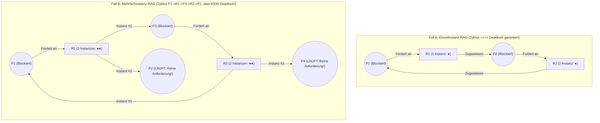
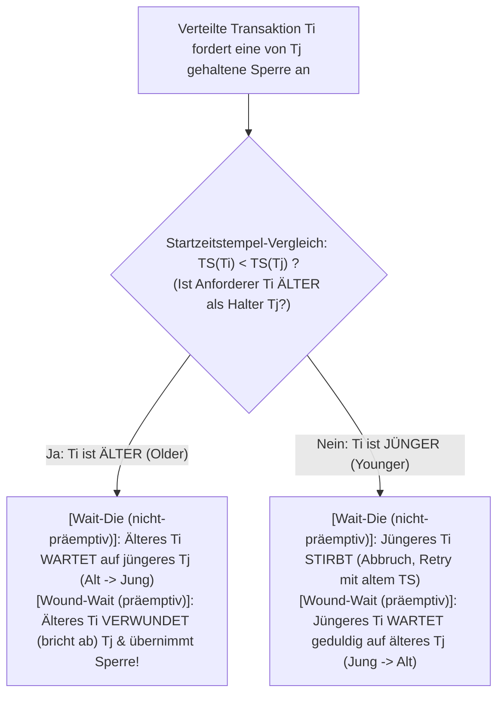

## 1. Einführung: Das Philosophenproblem und Coffmans vier Bedingungen (1971)

1965 formulierte der niederländische Informatiker <strong>Edsger W. Dijkstra</strong> das berühmte <strong>Problem der speisenden Philosophen (Dining Philosophers Problem)</strong>: Fünf Philosophen $P_0 \dots P_4$ sitzen an einem runden Tisch; zwischen je zwei Tellern liegt eine einzelne Gabel ($F_0 \dots F_4$). Zum Essen benötigt jeder Philosoph gleichzeitig seine linke Gabel $F_i$ und seine rechte Gabel $F_{(i+1)\bmod 5}$. Greifen alle fünf Philosophen im exakt selben Moment nach ihrer linken Gabel $F_i$, hält jeder eine Gabel fest und wartet bis in alle Ewigkeit darauf, dass sein rechter Nachbar die zweite Gabel freigibt – das gesamte System steht still. Dieser Zustand heißt <strong>Deadlock (Verklemmung)</strong>.

Formal befindet sich eine nichtleere Prozessmenge $D \subseteq \mathcal{P}$ im Deadlock, wenn jeder Prozess $P_i \in D$ dauerhaft auf ein Ereignis (wie die Freigabe einer Ressource) wartet, das <strong>ausschließlich von einem anderen Prozess $P_j \in D$ derselben Wartemenge</strong> ausgelöst werden kann.

1971 bewiesen <strong>Edward G. Coffman Jr.</strong>, M. J. Elphick und Arie Shoshani, dass ein Ressourcen-Deadlock nur eintreten kann, wenn <strong>vier notwendige Bedingungen gleichzeitig erfüllt sind</strong>:
1. <strong>Wechselseitiger Ausschluss (Mutual Exclusion)</strong>: Mindestens eine Ressource wird exklusiv (nicht teilbar) von einem Prozess belegt.
2. <strong>Halten und Warten (Hold and Wait)</strong>: Ein Prozess hält bereits mindestens eine Ressource, während er blockiert auf weitere, von anderen Prozessen gehaltene Ressourcen wartet.
3. <strong>Keine Präemption (No Preemption)</strong>: Zugeteilte Ressourcen können einem Prozess nicht gewaltsam entzogen werden, sondern werden nur freiwillig freigegeben.
4. <strong>Zyklisches Warten (Circular Wait)</strong>: Es existiert eine geschlossene Kette wartender Prozesse $\{P_0, P_1, \dots, P_{k-1}\}$, sodass jeder $P_i$ auf eine von $P_{(i+1)\bmod k}$ gehaltene Ressource wartet.

Da alle vier Bedingungen einzeln notwendig sind, gilt: <strong>Wird auch nur eine einzige dieser vier Bedingungen durch das Systemdesign logisch ausgeschlossen, ist ein Deadlock mathematisch zu $100\,\%$ unmöglich.</strong>

---

## 2. Ressourcenallokationsgraph (RAG) und die Zyklensätze (Holt, 1972)

1972 modellierte Richard C. Holt Ressourcenanforderungen als gerichteten bipartiten <strong>Ressourcenallokationsgraphen (RAG)</strong> $G = (V, E)$ mit Knotenmenge $V = \mathcal{P} \cup \mathcal{R}$ (Prozessknoten $P_i$ und Ressourcentypknoten $R_j$ mit je $W_j \ge 1$ identischen Instanzen) sowie <strong>Anforderungskanten $P_i \to R_j$</strong> und <strong>Zuweisungskanten $R_j \to P_i$</strong>.

Zwischen gerichteten Zyklen in $G$ und Deadlocks gelten drei fundamentale Sätze:
* <strong>Satz 1 (Zyklenfreiheit impliziert Deadlock-Freiheit)</strong>: Enthält $G$ keinen gerichteten Zyklus (ist $G$ ein DAG), befindet sich kein Prozess im Deadlock.
* <strong>Satz 2 (Notwendige und hinreichende Bedingung bei Einzelinstanzen)</strong>: Besitzt jeder Ressourcentyp <strong>genau eine Instanz ($\forall j, W_j = 1$)</strong>, so gilt: <strong>Gerichteter Zyklus in $G \iff$ Deadlock</strong>.
* <strong>Satz 3 (Nicht-Hinreichendheit bei Mehrfachinstanzen)</strong>: Besitzt mindestens ein Ressourcentyp <strong>mehrere Instanzen ($\exists j, W_j > 1$)</strong>, ist ein gerichteter Zyklus zwar eine <strong>notwendige, aber KEINE hinreichende Bedingung</strong> für einen Deadlock!

In Fall B existiert zwar der Zyklus $P_1 \to R_1 \to P_3 \to R_2 \to P_1$, doch die Prozesse $P_2$ und $P_4$ haben Ausgangsgrad $0$ (Senken), laufen ungehindert weiter und lösen den Zyklus durch Freigabe ihrer Instanzen von $R_1$ bzw. $R_2$ auf!

---

## 3. Strategie 1 (Deadlock-Prävention): Widerspruchsbeweis der totalen Sperrordnung

In Betriebssystemkernen (z. B. Linux `lockdep`) und Multithreading-Anwendungen wird Bedingung 4 (Zyklisches Warten) durch eine <strong>totale Sperrordnung (Total Lock Ordering)</strong> eliminiert: Jedem Mutex $L \in \mathcal{L}$ wird ein eindeutiger globaler Rang $\phi(L) \in \mathbb{N}$ zugewiesen. Ein Thread, der bereits die Sperrmenge $\mathcal{H}$ hält, darf eine neue Sperre $L_{\text{new}}$ nur anfordern, wenn ihr Rang strikt größer ist:

$$\forall L_{\text{held}} \in \mathcal{H}: \quad \phi(L_{\text{held}}) < \phi(L_{\text{new}})$$

<strong>【Widerspruchsbeweis】</strong>: Angenommen, es entsteht ein zyklischer Wartekreis $\{P_0, P_1, \dots, P_{k-1}\}$ ($k \ge 2$), wobei $P_i$ die Sperre $L_i$ hält und auf die von $P_{(i+1)\bmod k}$ gehaltene Sperre $L_{(i+1)\bmod k}$ wartet. Da jeder Thread die Sperrordnung befolgt, gilt entlang des gesamten Zyklus:

$$\phi(L_0) < \phi(L_1) < \phi(L_2) < \cdots < \phi(L_{k-1}) < \phi(L_0) \implies \phi(L_0) < \phi(L_0)$$

Da keine natürliche Zahl strikt kleiner als sie selbst sein kann, liegt ein Widerspruch ($\bot$) vor! Ob beim Banktransfer (immer das Konto mit der kleineren ID zuerst sperren) oder bei den speisenden Philosophen ($P_4$ greift zuerst zur rechten Gabel $F_0$ statt $F_4$, da $0 < 4$) – zyklisches Warten ist damit mathematisch ausgeschlossen. $\blacksquare$

---

## 4. Strategie 2 (Deadlock-Vermeidung): Dijkstras Bankieralgorithmus (5×3-Matrix-Trace)

Lässt sich die Sperrreihenfolge nicht statisch festlegen, fordert <strong>Dijkstras Bankieralgorithmus (1965 / Habermann, 1969)</strong> vorab die Deklaration des Maximalbedarfs $\mathbf{Max}$ und prüft vor jeder Zuteilung in <strong>$O(m \cdot n^2)$</strong> Schritten, ob der Zielzustand ein <strong>sicherer Zustand (Safe State)</strong> mit mindestens einer <strong>sicheren Ausführungsfolge (Safe Sequence)</strong> bleibt (wobei gilt: $\text{Deadlock} \subsetneq \text{Unsicherer Zustand}$).

Für $n=5$ Prozesse $\{P_0 \dots P_4\}$ und $m=3$ Ressourcentypen mit $\mathbf{Total} = (A=10, B=5, C=7)$ ergibt sich zum Zeitpunkt $t_0$ bei belegten Ressourcen $(7,2,5)$ der freie Vektor $\mathbf{Available} = (10,5,7) - (7,2,5) = \mathbf{(3, 3, 2)}$:

| Prozess | Belegt $\mathbf{Allocation}$ $(A,B,C)$ | Maximal $\mathbf{Max}$ $(A,B,C)$ | Restbedarf $\mathbf{Need} = \mathbf{Max} - \mathbf{Allocation}$ | Sicherheitsprüfung (Start $\mathbf{Work} = (3,3,2)$) |
| :--- | :---: | :---: | :---: | :--- |
| <strong>$P_0$</strong> | $(0, 1, 0)$ | $(7, 5, 3)$ | $(7, 4, 3)$ | Schritt 4 erfüllt: $(7,4,3) \le (7,4,5) \to \mathbf{Work}=(7,5,5)$ |
| <strong>$P_1$</strong> | $(2, 0, 0)$ | $(3, 2, 2)$ | $(1, 2, 2)$ | <strong>Schritt 1 erfüllt</strong>: $(1,2,2) \le (3,3,2) \to \mathbf{Work}=(5,3,2)$ |
| <strong>$P_2$</strong> | $(3, 0, 2)$ | $(9, 0, 2)$ | $(6, 0, 0)$ | Schritt 5 erfüllt: $(6,0,0) \le (7,5,5) \to \mathbf{Work}=(10,5,7)$ |
| <strong>$P_3$</strong> | $(2, 1, 1)$ | $(2, 2, 2)$ | $(0, 1, 1)$ | <strong>Schritt 2 erfüllt</strong>: $(0,1,1) \le (5,3,2) \to \mathbf{Work}=(7,4,3)$ |
| <strong>$P_4$</strong> | $(0, 0, 2)$ | $(4, 3, 3)$ | $(4, 3, 1)$ | <strong>Schritt 3 erfüllt</strong>: $(4,3,1) \le (7,4,3) \to \mathbf{Work}=(7,4,5)$ |

Mit der sicheren Folge $\langle P_1, P_3, P_4, P_0, P_2 \rangle$ ist $t_0$ <strong>sicher</strong>. Fordert $P_1$ nun $(1,0,2)$ an, bleibt $\mathbf{Available}=(2,3,0) \ge \mathbf{Need}_1=(0,2,0)$ sicher (<strong>sofort genehmigt</strong>). Fordert danach jedoch $P_0$ den Vektor $(0,2,0)$ an, sinkt $\mathbf{Available}$ auf $(2,1,0)$, womit <strong>kein einziger Prozess</strong> mehr seinen $\mathbf{Need}$ decken kann (<strong>unsicherer Zustand</strong>): Der Bankieralgorithmus lehnt die Zuteilung ab und blockiert $P_0$!

---

## 5. Strategie 3 & 4 (Erkennung, Wait-Die/Wound-Wait, Vogel-Strauß) & Livelock vs. Starvation

Relationale Datenbanken (PostgreSQL, MySQL InnoDB) nutzen einen <strong>Wait-For-Graphen (WFG)</strong> und suchen mittels $O(|V|+|E|)$-Tiefensuche (DFS) nach Zyklen, um bei einem Deadlock die Transaktion mit dem kleinsten Undo-Log als Opfer (*Victim*) zurückzurollen (MySQL prüft sofort beim Blockieren; PostgreSQL erst nach `deadlock_timeout = 1s`). Verteilte Datenbanken (wie Google Spanner) vermeiden globale WFGs durch die zeitstempelbasierten Protokolle <strong>Wait-Die (nicht-präemptiv)</strong> und <strong>Wound-Wait (präemptiv, weniger Neustarts)</strong> nach Rosenkrantz et al. (1978), wobei abgebrochene Transaktionen ihren <strong>ursprünglichen Startzeitstempel $\text{TS}(T_i)$ behalten</strong>, um Verhungern (*Starvation*) auszuschließen. Für extrem seltene Betriebssystem-Tabellenengpässe nutzen UNIX/Windows den <strong>Vogel-Strauß-Algorithmus (Ostrich Algorithm)</strong> und ignorieren das Problem zugunsten maximaler Alltagsgeschwindigkeit.

Abschließend die präzise Abgrenzung der drei <strong>Liveness-Fehler</strong>:

| Diagnose-Dimension | Deadlock (Verklemmung) | Livelock | Starvation (Verhungern) |
| :--- | :--- | :--- | :--- |
| <strong>Kernmechanismus</strong> | Zyklisches Warten blockierter Threads auf gehaltene Ressourcen | Symmetrische `trylock`-Retry-Schleifen machen sich gegenseitig den Fortschritt zunichte (Flur-Ausweichtanz) | Gesamtsystem schreitet voran, aber ein Thread wird durch Prioritäten dauerhaft übergangen |
| <strong>OS-Status & CPU-Last</strong> | <strong>`SLEEPING` / `BLOCKED` ($0\,\%$ CPU-Last)</strong> | <strong>`RUNNING` ($\approx 100\,\%$ CPU-Last bei $0$ Fortschritt!)</strong> | Wartend in Ready-/Lock-Queue ($0\,\%$ CPU für das Opfer) |
| <strong>Technische Heilung</strong> | Totale Sperrordnung ($\phi(L_1)<\phi(L_2)$), Bankieralgorithmus, WFG-Rollback | <strong>Randomisiertes Exponentielles Backoff mit Jitter</strong> bricht die Zeitsymmetrie | <strong>Priority Aging</strong>, Beibehalten des Start-Zeitstempels, faire FIFO-Locks (MCS-Lock) |
