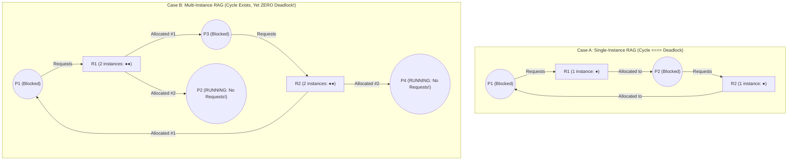
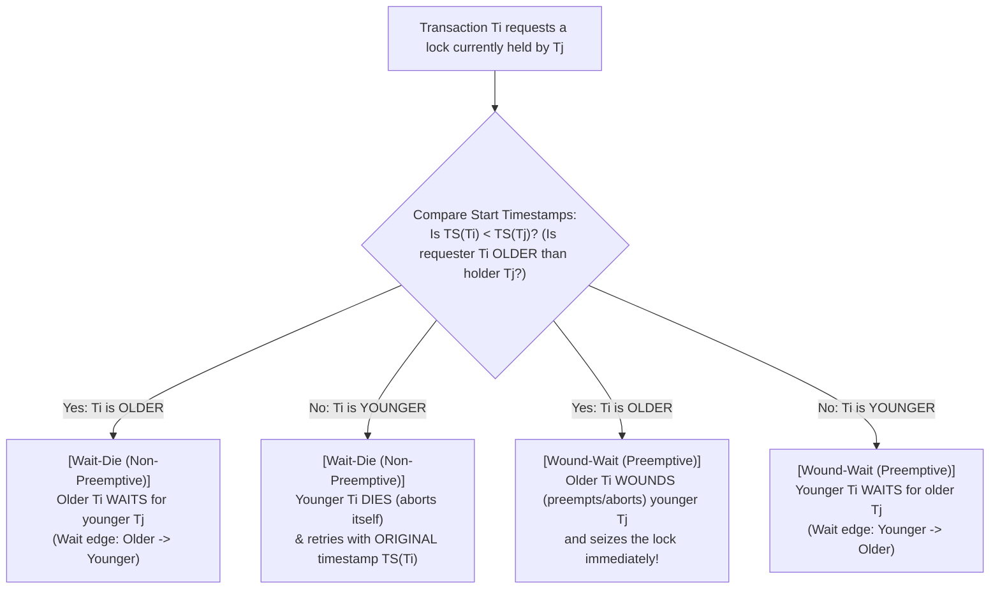

## 1. Introduction: Eternal Paralysis Born from Obedience to Local Rules

An oft-cited piece of early twentieth-century railway lore recalls a bill reportedly introduced in the Kansas State Legislature to prevent collisions at rail-line intersections:

> <strong>"When two trains approach each other at a crossing, both shall come to a full stop, and neither shall start up again until the other has passed."</strong>

If two locomotive engineers faithfully obey this statute upon arriving at an intersection simultaneously, the outcome is immediate and permanent: Train A waits for Train B to clear the crossing, while Train B waits for Train A to clear the crossing. Neither engine suffers a mechanical breakdown, neither engineer is asleep at the throttle, and yet both trains remain frozen on the tracks forever.

In concurrent computing—spanning operating system kernels, multi-threaded C++/Rust/Java applications, relational database management systems (RDBMS), and globally distributed transaction engines—this pathology is known as <strong>Deadlock</strong>. Unlike a segmentation fault or an arithmetic overflow, a deadlock is not caused by an invalid instruction; it emerges when multiple autonomous threads or transactions obey locally sensible resource-acquisition rules whose global interaction forms an inescapable cycle of mutual waiting.

### 1.1 Dijkstra's Dining Philosophers Problem (1965)

In 1965, the Dutch computer scientist <strong>Edsger W. Dijkstra</strong> formulated an examination problem concerning five competing processes sharing five magnetic tape drives, which <strong>C. A. R. Hoare</strong> subsequently cast into its immortal allegorical form: <strong>The Dining Philosophers Problem</strong>.

Five philosophers, $P_0, P_1, P_2, P_3, P_4$, sit around a circular table. In front of each philosopher is a plate of tangled spaghetti, and between each adjacent pair of plates lies a single fork—five forks in total, denoted $F_0, F_1, F_2, F_3, F_4$. Philosopher $P_i$ ($i \in \{0, 1, 2, 3, 4\}$) has fork $F_i$ to their left and fork $F_{(i+1)\bmod 5}$ to their right.

Each philosopher alternates between two states: <strong>Thinking</strong> and <strong>Eating</strong>. Eating requires <strong>simultaneous exclusive possession of both the left fork $F_i$ and the right fork $F_{(i+1)\bmod 5}$</strong>. A fork can be held by only one philosopher at a time, and no philosopher may snatch a fork from a neighbor's hand. Suppose every philosopher executes the following natural, symmetric protocol:

```c
// Symmetric (and fatal) protocol for Philosopher P_i (i = 0, 1, 2, 3, 4)
void philosopher(int i) {
    int left  = i;
    int right = (i + 1) % 5;
    while (true) {
        think();                     // 1. Meditate independently
        acquire_fork(left);          // 2. Pick up left fork F_i (blocks if held)
        acquire_fork(right);         // 3. Pick up right fork F_{(i+1) mod 5} (blocks if held)
        eat();                       // 4. Eat spaghetti using both forks
        release_fork(right);         // 5. Put down right fork
        release_fork(left);          // 6. Put down left fork
    }
}
```

In testing, this program may run flawlessly for days if philosophers become hungry at staggered times. Yet if all five philosophers happen to become hungry at the <strong>exact same microsecond</strong> and each picks up their left fork $F_i$ simultaneously:
- $P_0$ holds $F_0$ and blocks waiting for $F_1$ (held by $P_1$).
- $P_1$ holds $F_1$ and blocks waiting for $F_2$ (held by $P_2$).
- $P_2$ holds $F_2$ and blocks waiting for $F_3$ (held by $P_3$).
- $P_3$ holds $F_3$ and blocks waiting for $F_4$ (held by $P_4$).
- $P_4$ holds $F_4$ and blocks waiting for $F_0$ (held by $P_0$).

All five forks are held; zero forks remain on the table; every philosopher is blocked waiting for a fork that will only be released after its holder finishes eating. Progress stops forever.

### 1.2 Formal Definition of Deadlock

Let $\mathcal{P} = \{P_1, P_2, \dots, P_n\}$ denote the set of all processes (threads or transactions) in a system.

> <strong>Definition (Deadlocked Set)</strong>:  
> A non-empty subset of processes $D \subseteq \mathcal{P}$ ($D \neq \emptyset$) is in a <strong>deadlock state</strong> if and only if every process $P_i \in D$ is permanently blocked waiting for an event (such as the release of a resource or receipt of a signal) that can <strong>only be triggered by another process $P_j \in D$ belonging to the exact same waiting set</strong>.

Because every member of $D$ is asleep, no member of $D$ can ever execute an instruction to trigger the waking event. Without external intervention, the processes in $D$ remain blocked for eternity.

---

## 2. Coffman's Four Conditions (1971): The Anatomy of Resource Deadlock

In their classic 1971 *ACM Computing Surveys* paper, *"System Deadlocks,"* <strong>Edward G. Coffman Jr.</strong>, <strong>M. J. Elphick</strong>, and <strong>Arie Shoshani</strong> proved that a resource deadlock can occur only if <strong>four necessary conditions hold simultaneously</strong> in the system:

1. <strong>Mutual Exclusion</strong>:  
   At least one resource type must be held in a <strong>non-shareable (exclusive) mode</strong>. Only one process may use the resource instance at any given instant; any other process requesting that instance must be delayed until the holder releases it.
2. <strong>Hold and Wait</strong>:  
   A process must be currently <strong>holding at least one resource</strong> while simultaneously <strong>waiting to acquire additional resources</strong> that are currently being held exclusively by other processes.
3. <strong>No Preemption</strong>:  
   Resources cannot be forcibly stripped away from a process by the operating system or by another process; a resource can be <strong>released only voluntarily</strong> by the process holding it, after that process has completed its task.
4. <strong>Circular Wait</strong>:  
   There must exist a closed directed chain of waiting processes $\{P_0, P_1, \dots, P_{k-1}\}$ ($k \ge 2$) such that for every $i \in \{0, 1, \dots, k-1\}$, process $P_i$ is waiting for a resource currently held by process $P_{(i+1)\bmod k}$ (i.e., $P_0$ waits for $P_1$, $P_1$ waits for $P_2$, $\dots$, and $P_{k-1}$ waits for $P_0$).

<strong>Architectural Insight</strong>: The first three conditions (Mutual Exclusion, Hold and Wait, No Preemption) are <strong>static policy rules</strong> governing how resources behave, whereas the fourth condition (Circular Wait) is a <strong>dynamic runtime state</strong> that arises when specific request timings align under those policies. Crucially, because all four conditions are *individually necessary* for deadlock, <strong>logically negating even a single one of the four Coffman conditions makes deadlock mathematically impossible ($0\%$ probability)</strong>.

---

## 3. Holt's Resource Allocation Graph (RAG) and the Cycle Theorems (1972)

In 1972, <strong>Richard C. Holt</strong> formalized the relationship between Coffman's conditions and graph topology by introducing the <strong>Resource Allocation Graph (RAG)</strong>.

### 3.1 Formal Bipartite Directed Graph Definition

At any instant $t$, the state of resource requests and allocations is modeled as a directed bipartite graph $G = (V, E)$:

* <strong>Vertex Set $V = \mathcal{P} \cup \mathcal{R}$</strong> ($\mathcal{P} \cap \mathcal{R} = \emptyset$):
  - $\mathcal{P} = \{P_1, P_2, \dots, P_n\}$ is the set of <strong>Process Vertices</strong> (drawn as circles $\bigcirc$).
  - $\mathcal{R} = \{R_1, R_2, \dots, R_m\}$ is the set of <strong>Resource Type Vertices</strong> (drawn as rectangles $\square$). Each resource type $R_j$ possesses $W_j = |R_j| \ge 1$ identical, interchangeable <strong>instances</strong> (drawn as $W_j$ black dots $\bullet$ inside rectangle $R_j$). A mutex lock has $W_j = 1$ (<strong>single-instance</strong>), whereas a pool of identical database connections or memory frames has $W_j > 1$ (<strong>multi-instance</strong>).
* <strong>Directed Edge Set $E = E_{\text{req}} \cup E_{\text{alloc}}$</strong>:
  - <strong>Request Edge $P_i \to R_j \in E_{\text{req}}$</strong>: Directed from process $P_i$ to resource type $R_j$, indicating that $P_i$ is currently blocked waiting to acquire one instance of $R_j$.
  - <strong>Allocation (Assignment) Edge $R_j \to P_i \in E_{\text{alloc}}$</strong>: Directed from a specific instance dot $\bullet$ inside $R_j$ to process $P_i$, indicating that $P_i$ currently holds one allocated instance of $R_j$. Conservation of instances requires that the out-degree $d^+(R_j)$ never exceed $W_j$:
    $$\forall R_j \in \mathcal{R}: \quad d^+(R_j) = \bigl|\{(R_j \to P_i) \in E_{\text{alloc}}\}\bigr| \le W_j$$

### 3.2 The Three Fundamental RAG Cycle Theorems

How does the presence of a <strong>directed cycle</strong> in $G = (V, E)$ relate to deadlock? Holt proved three theorems that distinguish single-instance systems from multi-instance systems:

> <strong>Theorem 1 (Acyclicity Implies Freedom from Deadlock)</strong>:  
> If a Resource Allocation Graph $G$ contains <strong>no directed cycles</strong> (i.e., $G$ is a Directed Acyclic Graph, DAG), then <strong>no process in the system is deadlocked</strong>. Equivalently (by contraposition), the existence of at least one directed cycle in $G$ is a <strong>necessary condition</strong> for deadlock.

> <strong>Theorem 2 (Single-Instance Necessary and Sufficient Cycle Theorem)</strong>:  
> If every resource type in the system has <strong>exactly one instance</strong> ($\forall j \in \{1, \dots, m\}, \; W_j = 1$), then a directed cycle in $G$ is both a <strong>necessary and sufficient condition</strong> for deadlock. Every process lying on a directed cycle is deadlocked.

> <strong>Theorem 3 (Multi-Instance Cycle Non-Sufficiency Theorem)</strong>:  
> If at least one resource type has <strong>multiple instances</strong> ($\exists j, \; W_j > 1$), then a directed cycle in $G$ is a <strong>necessary condition, but NOT a sufficient condition</strong>, for deadlock. A graph $G$ can contain a directed cycle even when zero processes are deadlocked!

### 3.3 Concrete Counterexample: A Cyclic RAG That Is NOT Deadlocked

To see why Theorem 3 holds, consider a system with two multi-instance resource types $R_1$ ($W_1 = 2$ instances) and $R_2$ ($W_2 = 2$ instances), and four processes $\{P_1, P_2, P_3, P_4\}$:
- $R_1$'s two instances are currently allocated to $P_2$ and $P_3$ ($R_1 \to P_2$ and $R_1 \to P_3$).
- $R_2$'s two instances are currently allocated to $P_1$ and $P_4$ ($R_2 \to P_1$ and $R_2 \to P_4$).
- $P_1$ requests an instance of $R_1$ ($P_1 \to R_1$), and $P_3$ requests an instance of $R_2$ ($P_3 \to R_2$).
- Crucially, $P_2$ and $P_4$ are not requesting any additional resources ($d^+(P_2) = d^+(P_4) = 0$).



Inspect <strong>Case B</strong> carefully. The graph clearly contains the directed cycle:

$$P_1 \to R_1 \to P_3 \to R_2 \to P_1$$

Yet <strong>this system is NOT deadlocked!</strong> Because process $P_4$ has out-degree $d^+(P_4) = 0$ (a <strong>sink vertex</strong>), it is actively running on the CPU and will finish its work in finite time, releasing its instance of $R_2$ (deleting edge $R_2 \to P_4$). That freed instance of $R_2$ is immediately granted to waiting process $P_3$ (converting $P_3 \to R_2$ into $R_2 \to P_3$), which breaks the cycle and allows $P_3$ and then $P_1$ to run to completion! In multi-instance systems, exact deadlock detection requires <strong>Graph Reduction</strong> (iteratively removing unblocked sink processes and their incident edges) or verifying the existence of an inescapable <strong>Knot</strong>.

---

## 4. Strategy 1: Deadlock Prevention and the Mathematical Proof of Total Lock Ordering

The first engineering strategy against deadlock is <strong>Deadlock Prevention</strong>: designing the system's resource acquisition rules so that <strong>at least one of Coffman's four conditions can never hold</strong>.

### 4.1 Attacking Conditions 1, 2, and 3 (and Their Practical Limits)

1. <strong>Negating Mutual Exclusion (Condition 1)</strong>:  
   Using immutable data structures, Read-Copy-Update (<strong>RCU</strong> in the Linux kernel, where readers execute with zero locks), or hardware atomic primitives (`CAS` / `LL-SC` lock-free algorithms) eliminates mutual exclusion altogether. However, resources that inherently require serialized mutation cannot avoid mutual exclusion.
2. <strong>Negating Hold and Wait (Condition 2)</strong>:  
   Require a thread to either acquire <strong>all required locks atomically up front</strong> before entering a computation, or <strong>release all currently held locks</strong> before requesting a new one. In practice, this is rarely viable because a complex function often cannot know which locks it will need until it inspects runtime data, and holding locks for long durations causes severe resource underutilization and starvation.
3. <strong>Negating No Preemption (Condition 3)</strong>:  
   If a thread holding lock $L_1$ attempts to acquire $L_2$ via non-blocking `pthread_mutex_trylock(&L2)` and fails, it immediately <strong>unlocks $L_1$ and backs off</strong>. While useful in specific cases, aborting midway through mutating a data structure leaves shared state corrupted unless full transactional rollback logs are maintained, and naive retry loops trigger <strong>Livelock</strong> (Section 8).

### 4.2 Negating Circular Wait (Condition 4): Total Lock Ordering (Lock Hierarchy)

In production systems programming (OS kernels, storage engines, and multi-threaded runtimes), the universal gold standard for deadlock prevention is negating Condition 4 via <strong>Total Lock Ordering</strong>.

Let $\mathcal{L} = \{L_1, L_2, \dots, L_m\}$ be the universe of all mutex locks in the system. Define a strict global ranking function $\phi: \mathcal{L} \to \mathbb{N}$ that assigns a unique integer rank (or memory address order) to every lock:

> <strong>The Total Lock Ordering Rule</strong>:  
> Whenever a thread holds a non-empty set of locks $\mathcal{H} \subset \mathcal{L}$ and wishes to acquire an additional lock $L_{\text{new}} \in \mathcal{L}$, it is permitted to request $L_{\text{new}}$ <strong>only if the rank of $L_{\text{new}}$ is strictly greater than the rank of every lock currently held by that thread</strong>:
> $$\forall L_{\text{held}} \in \mathcal{H}: \quad \phi(L_{\text{held}}) < \phi(L_{\text{new}})$$

Let us prove by contradiction that this single rule makes Circular Wait mathematically impossible.

> <strong>Theorem 4 (Impossibility of Circular Wait Under Total Lock Ordering)</strong>:  
> If every thread in a system acquires locks strictly in increasing order of $\phi: \mathcal{L} \to \mathbb{N}$, then no circular wait cycle can ever form.

<strong>Proof by Contradiction</strong>:  
Suppose, for the sake of contradiction, that a circular wait cycle of $k \ge 2$ threads $\{P_0, P_1, \dots, P_{k-1}\}$ forms at runtime. By the definition of circular wait, each thread $P_i$ ($i \in \{0, \dots, k-1\}$) currently holds some lock $L_i \in \mathcal{L}$ while blocked waiting to acquire lock $L_{(i+1)\bmod k} \in \mathcal{L}$, which is currently held by thread $P_{(i+1)\bmod k}$.

Because every thread $P_i$ obeys the Total Lock Ordering Rule when requesting $L_{(i+1)\bmod k}$ while holding $L_i$, the rank of the held lock must be strictly less than the rank of the requested lock for every $i \in \{0, 1, \dots, k-1\}$:

$$\phi(L_i) < \phi(L_{(i+1)\bmod k})$$

Chaining these $k$ strict inequalities around the cycle $i = 0, 1, \dots, k-1$ yields:

$$\phi(L_0) < \phi(L_1) < \phi(L_2) < \cdots < \phi(L_{k-1}) < \phi(L_0)$$

By the transitivity of the strict inequality relation $<$ on the natural numbers $\mathbb{N}$, this implies:

$$\phi(L_0) < \phi(L_0)$$

Since no number can be strictly less than itself, we have reached a logical contradiction ($\bot$). Therefore, no circular wait cycle can ever exist. $\blacksquare$

#### Eliminating AB-BA Deadlock in Bank Transfers & Dining Philosophers
Consider a classic concurrent bank transfer `transfer(Account& from, Account& to, long amount)`. If Thread 1 calls `transfer(A, B)` (locking `A` then `B`) at the same instant Thread 2 calls `transfer(B, A)` (locking `B` then `A`), an <strong>AB-BA deadlock</strong> occurs. By ordering lock acquisitions by $\phi(\text{Account}) = \text{Account.id}$ (or via C++17 `std::scoped_lock`), the deadlock vanishes completely:

```cpp
#include <mutex>

struct Account {
    unsigned long id;      // Unique global rank: φ(Account) = id
    long balance;
    std::mutex mtx;
};

void transfer_ordered(Account& from, Account& to, long amount) {
    if (&from == &to) return;

    // Enforce Total Lock Ordering: always lock the smaller ID first!
    Account* first  = (from.id < to.id) ? &from : &to;
    Account* second = (from.id < to.id) ? &to   : &from;

    std::lock_guard<std::mutex> lock1(first->mtx);
    std::lock_guard<std::mutex> lock2(second->mtx);

    from.balance -= amount;
    to.balance   += amount;
}
```

Similarly, in <strong>Dijkstra's Dining Philosophers</strong>, numbering the forks $\phi(F_i) = i$ and requiring every philosopher to pick up their <strong>lower-numbered fork first</strong> means philosophers $P_0, P_1, P_2, P_3$ pick up left ($F_i$) then right ($F_{i+1}$), while <strong>philosopher $P_4$ alone breaks symmetry</strong> by picking up their right fork $F_0$ before their left fork $F_4$ ($0 < 4$). Deadlock becomes impossible.

In massive codebases like the Linux kernel (which contains tens of thousands of locks), humans cannot verify lock ordering by inspection alone. Since 2006, Linux has included <strong>`lockdep`</strong>, a runtime lock-dependency graph validator designed by Ingo Molnar. `lockdep` tracks lock *classes* as vertices and records a directed edge $A \to B$ whenever any thread acquires lock class $B$ while holding class $A$. If any thread ever attempts to acquire $B \to A$—even on a single-core machine where no actual deadlock occurred during the test—`lockdep` immediately detects the cycle in its dependency graph and prints a kernel warning splat with the exact offending stack traces!

---

## 5. Strategy 2: Deadlock Avoidance and Dijkstra's Banker's Algorithm

What if resources have multiple instances and processes acquire them in data-dependent orders that cannot be fixed statically? <strong>Deadlock Avoidance</strong> requires each process to declare upfront its <strong>Maximum Claim ($\mathbf{Max}$)</strong>—the maximum number of instances of each resource type it could ever need simultaneously. Before granting any dynamic request, the OS simulates the allocation and checks whether the resulting state remains a <strong>Safe State</strong>.

### 5.1 Safe States vs. Unsafe States

> <strong>Definition (Safe State and Safe Sequence)</strong>:  
> A system state at time $t$ is <strong>Safe</strong> if and only if there exists at least one permutation of all processes, called a <strong>Safe Sequence</strong> $\langle P_{\pi(1)}, P_{\pi(2)}, \dots, P_{\pi(n)} \rangle$, such that for every $k \in \{1, 2, \dots, n\}$, the remaining maximum potential resource need of process $P_{\pi(k)}$ ($\mathbf{Need}_{\pi(k)}$) can be satisfied by the <strong>currently available resources ($\mathbf{Available}$) plus the sum of all resources currently allocated to earlier processes in the sequence ($P_{\pi(1)}, \dots, P_{\pi(k-1)}$)</strong>:
> $$\forall k \in \{1, \dots, n\}: \quad \mathbf{Need}_{\pi(k)} \le \mathbf{Available} + \sum_{j=1}^{k-1} \mathbf{Allocation}_{\pi(j)}$$
> A state that possesses no safe sequence is called <strong>Unsafe</strong>.

Crucial distinction:

$$\text{Deadlocked States} \subsetneq \text{Unsafe States}$$

<strong>An Unsafe State is NOT necessarily a Deadlocked State!</strong> Rather, an unsafe state is a state in which the OS has lost its guarantee: *if* the processes subsequently choose to request up to their declared maximums $\mathbf{Max}$ simultaneously, a deadlock will occur. Because the OS cannot gamble on processes behaving below their declared maximums, <strong>Dijkstra's Banker's Algorithm</strong> (1965, generalized to multiple resource types by A. N. Habermann in 1969) refuses to grant any request that would transition the system from a Safe State into an Unsafe State.

### 5.2 Data Structures and $O(m \cdot n^2)$ Complexity of the Banker's Algorithm

For $n$ processes and $m$ resource types, the Banker's Algorithm maintains four structures:
1. <strong>$\mathbf{Available} \in \mathbb{N}_0^m$</strong>: Vector of currently unallocated instances of each resource type.
2. <strong>$\mathbf{Max} \in \mathbb{N}_0^{n \times m}$</strong>: Matrix of maximum declared demand of each process $P_i$ for each resource $R_j$.
3. <strong>$\mathbf{Allocation} \in \mathbb{N}_0^{n \times m}$</strong>: Matrix of instances currently allocated to each process $P_i$.
4. <strong>$\mathbf{Need} \in \mathbb{N}_0^{n \times m}$</strong>: Matrix of remaining potential future requests, defined by the invariant:
   $$\mathbf{Need}[i, j] = \mathbf{Max}[i, j] - \mathbf{Allocation}[i, j]$$

When process $P_i$ issues a request vector $\mathbf{Request}_i \in \mathbb{N}_0^m$:
1. Verify $\mathbf{Request}_i \le \mathbf{Need}_i$ (otherwise raise an error for exceeding maximum claim).
2. Check $\mathbf{Request}_i \le \mathbf{Available}$ (if not, $P_i$ must wait until resources are free).
3. <strong>Tentative Allocation (Pretend to grant)</strong>:
   $$\mathbf{Available} \leftarrow \mathbf{Available} - \mathbf{Request}_i, \quad \mathbf{Allocation}_i \leftarrow \mathbf{Allocation}_i + \mathbf{Request}_i, \quad \mathbf{Need}_i \leftarrow \mathbf{Need}_i - \mathbf{Request}_i$$
4. <strong>Run the Safety Algorithm</strong>: Initialize $\mathbf{Work} \leftarrow \mathbf{Available}$ and $\mathbf{Finish}[k] \leftarrow \text{false}$ for $k = 0 \dots n-1$. Repeatedly find an index $k$ such that $\mathbf{Finish}[k] == \text{false}$ and $\mathbf{Need}_k \le \mathbf{Work}$; when found, simulate $P_k$ finishing and returning its resources via $\mathbf{Work} \leftarrow \mathbf{Work} + \mathbf{Allocation}_k$ and $\mathbf{Finish}[k] \leftarrow \text{true}$.
   - If all $\mathbf{Finish}[k] == \text{true}$, the state is <strong>Safe</strong> $\implies$ commit the allocation!
   - Otherwise, the state is <strong>Unsafe</strong> $\implies$ roll back Step 3 and block $P_i$!

Because the outer loop runs at most $n$ times, scanning $n$ processes and comparing $m$-element vectors at each step, the Safety Algorithm runs in <strong>$O(m \cdot n^2)$</strong> time.

### 5.3 Complete Step-by-Step Matrix Walkthrough (5 Processes $\times$ 3 Resources)

Consider a system with $n = 5$ processes $\{P_0, P_1, P_2, P_3, P_4\}$ and $m = 3$ resource types $(A, B, C)$ with total system instances:

$$\mathbf{Total} = (A = 10, \; B = 5, \; C = 7)$$

At snapshot $t_0$, the system state is given by:

| Process | $\mathbf{Allocation}$ $(A, B, C)$ | $\mathbf{Max}$ $(A, B, C)$ | $\mathbf{Need} = \mathbf{Max} - \mathbf{Allocation}$ $(A, B, C)$ |
| :--- | :---: | :---: | :---: |
| <strong>$P_0$</strong> | $(0, 1, 0)$ | $(7, 5, 3)$ | $(7, 4, 3)$ |
| <strong>$P_1$</strong> | $(2, 0, 0)$ | $(3, 2, 2)$ | $(1, 2, 2)$ |
| <strong>$P_2$</strong> | $(3, 0, 2)$ | $(9, 0, 2)$ | $(6, 0, 0)$ |
| <strong>$P_3$</strong> | $(2, 1, 1)$ | $(2, 2, 2)$ | $(0, 1, 1)$ |
| <strong>$P_4$</strong> | $(0, 0, 2)$ | $(4, 3, 3)$ | $(4, 3, 1)$ |
| <strong>Sum Allocated</strong> | <strong>$(7, 2, 5)$</strong> | — | — |

Subtracting the sum of allocated resources from $\mathbf{Total}$ yields the initial available vector:

$$\mathbf{Available} = (10, 5, 7) - (7, 2, 5) = \mathbf{(3, 3, 2)}$$

#### Trace 1: Proving Initial State $t_0$ Is Safe
Initialize $\mathbf{Work} = (3, 3, 2)$ and $\mathbf{Finish} = [\text{F}, \text{F}, \text{F}, \text{F}, \text{F}]$:
1. <strong>Step 1</strong>: $P_0$ needs $(7,4,3) \not\le (3,3,2)$ (Wait). <strong>$P_1$</strong> needs $(1,2,2) \le (3,3,2) \implies$ <strong>Select $P_1$!</strong> $P_1$ finishes and releases $\mathbf{Allocation}_1 = (2,0,0)$:
   $$\mathbf{Work} \leftarrow (3,3,2) + (2,0,0) = \mathbf{(5, 3, 2)}$$
2. <strong>Step 2</strong>: $P_2$ needs $(6,0,0) \not\le (5,3,2)$ (Wait). <strong>$P_3$</strong> needs $(0,1,1) \le (5,3,2) \implies$ <strong>Select $P_3$!</strong> $P_3$ finishes and releases $\mathbf{Allocation}_3 = (2,1,1)$:
   $$\mathbf{Work} \leftarrow (5,3,2) + (2,1,1) = \mathbf{(7, 4, 3)}$$
3. <strong>Step 3</strong>: <strong>$P_4$</strong> needs $(4,3,1) \le (7,4,3) \implies$ <strong>Select $P_4$!</strong> $P_4$ finishes and releases $\mathbf{Allocation}_4 = (0,0,2)$:
   $$\mathbf{Work} \leftarrow (7,4,3) + (0,0,2) = \mathbf{(7, 4, 5)}$$
4. <strong>Step 4</strong>: Re-evaluating <strong>$P_0$</strong>, its need $(7,4,3) \le (7,4,5) \implies$ <strong>Select $P_0$!</strong> $P_0$ finishes and releases $\mathbf{Allocation}_0 = (0,1,0)$:
   $$\mathbf{Work} \leftarrow (7,4,5) + (0,1,0) = \mathbf{(7, 5, 5)}$$
5. <strong>Step 5</strong>: Re-evaluating <strong>$P_2$</strong>, its need $(6,0,0) \le (7,5,5) \implies$ <strong>Select $P_2$!</strong> $P_2$ finishes and releases $\mathbf{Allocation}_2 = (3,0,2)$:
   $$\mathbf{Work} \leftarrow (7,5,5) + (3,0,2) = \mathbf{(10, 5, 7)} = \mathbf{Total}$$

Because the safe sequence $\langle P_1, P_3, P_4, P_0, P_2 \rangle$ exists, state $t_0$ is <strong>SAFE</strong>.

#### Trace 2: Granted Request vs. Rejected Unsafe Request
* <strong>Request A — $P_1$ requests $\mathbf{Request}_1 = (1, 0, 2)$</strong>:  
  Since $(1,0,2) \le \mathbf{Need}_1 = (1,2,2)$ and $(1,0,2) \le \mathbf{Available} = (3,3,2)$, tentative allocation leaves $\mathbf{Available} = (2, 3, 0)$, $\mathbf{Allocation}_1 = (3, 0, 2)$, and $\mathbf{Need}_1 = (0, 2, 0)$. Running the Safety Algorithm from $\mathbf{Work} = (2, 3, 0)$ immediately satisfies $\mathbf{Need}_1 = (0, 2, 0) \le (2, 3, 0)$, yielding the same safe sequence $\langle P_1, P_3, P_4, P_0, P_2 \rangle$. <strong>Request A is GRANTED immediately.</strong>
* <strong>Request B — Immediately afterward (with $\mathbf{Available} = (2, 3, 0)$), $P_0$ requests $\mathbf{Request}_0 = (0, 2, 0)$</strong>:  
  Even though $2$ units of $B$ are currently sitting idle in $\mathbf{Available} = (2, 3, 0)$, tentatively granting $(0, 2, 0)$ to $P_0$ reduces $\mathbf{Available}$ to <strong>$\mathbf{Work} = (2, 1, 0)$</strong>. Now inspect the remaining needs of all five processes against $\mathbf{Work} = (2, 1, 0)$:
  - $\mathbf{Need}_0 = (7, 2, 3) \not\le (2, 1, 0)$
  - $\mathbf{Need}_1 = (0, 2, 0) \not\le (2, 1, 0)$ (needs $2$ of $B$, only $1$ left!)
  - $\mathbf{Need}_2 = (6, 0, 0) \not\le (2, 1, 0)$
  - $\mathbf{Need}_3 = (0, 1, 1) \not\le (2, 1, 0)$ (needs $1$ of $C$, $0$ left!)
  - $\mathbf{Need}_4 = (4, 3, 1) \not\le (2, 1, 0)$
  <strong>Zero processes can satisfy their $\mathbf{Need}$!</strong> The resulting state is <strong>UNSAFE</strong>, so the Banker's Algorithm <strong>rolls back the tentative allocation and blocks $P_0$</strong>, even though $\mathbf{Available}$ physically had enough units of $B$!

---

## 6. Strategy 3: Deadlock Detection & Recovery (Wait-For Graphs, Wait-Die, and Wound-Wait)

Why don't general-purpose OS kernels or relational databases use the Banker's Algorithm? Because in interactive workloads (such as an SQL transaction executing arbitrary `UPDATE` statements based on user input), <strong>it is impossible to know a transaction's maximum resource claim $\mathbf{Max}$ in advance</strong>, nor can row locks be acquired in a static global order. Consequently, RDBMS engines (<strong>PostgreSQL, MySQL InnoDB, Oracle, SQL Server</strong>) allow deadlocks to occur and rely on <strong>Deadlock Detection & Recovery</strong> or distributed <strong>Timestamp-Based Prevention (Wait-Die / Wound-Wait)</strong>.

### 6.1 Wait-For Graphs (WFG) in PostgreSQL and MySQL InnoDB

When every resource (such as an exclusive row lock) is managed by a lock queue, the database collapses the bipartite Resource Allocation Graph into a <strong>Wait-For Graph (WFG)</strong> $G_{\text{WFG}} = (\mathcal{T}, E_{\text{wait}})$, where vertices are active transactions $\mathcal{T} = \{T_1, \dots, T_n\}$ and a directed edge $T_i \to T_j$ exists if and only if transaction $T_i$ is blocked waiting for transaction $T_j$ to release a conflicting lock.

In a WFG, <strong>a directed cycle is a necessary and sufficient condition for deadlock</strong>, detectable in <strong>$O(|V| + |E|)$</strong> linear time using three-color Depth-First Search (DFS) or Tarjan's Strongly Connected Components (SCC) algorithm:
* <strong>Eager Detection (MySQL InnoDB)</strong>: InnoDB triggers a WFG cycle search (or wakes a dedicated background deadlock-checker thread) immediately when a lock request blocks, aborting the transaction with the smallest <strong>Undo Log weight</strong> (fewest modified rows) as the <strong>Deadlock Victim</strong> (`ERROR 1213 (40001): Deadlock found`).
* <strong>Lazy Timeout-Triggered Detection (PostgreSQL `deadlock_timeout = 1s`)</strong>: Because $99.9\%$ of lock waits resolve within a few milliseconds, PostgreSQL avoids running expensive WFG graph traversals on every lock wait; instead, a blocked backend sleeps for `deadlock_timeout` ($1000\,\text{ms}$) before running the WFG detector (which even attempts *Wait Queue Rearrangement* before aborting a victim with `SQLSTATE 40P01`).

### 6.2 Distributed Deadlock Prevention: Wait-Die vs. Wound-Wait (Rosenkrantz et al., 1978)

In distributed databases (such as <strong>Google Spanner</strong> or CockroachDB), building a global Wait-For Graph across network nodes incurs high message latency and risks <strong>Phantom Deadlocks</strong> due to asynchronous network delays. To avoid global WFG construction, <strong>Daniel J. Rosenkrantz, Richard E. Stearns, and Philip M. Lewis</strong> (1978) invented two timestamp-ordered deadlock prevention schemes. Each transaction $T_i$ is assigned a unique start timestamp $\text{TS}(T_i)$:

$$T_i \text{ is OLDER than } T_j \iff \text{TS}(T_i) < \text{TS}(T_j)$$

Suppose transaction $T_i$ requests a lock currently held by transaction $T_j$:



* <strong>Why Neither Protocol Can Ever Deadlock</strong>:  
  In <strong>Wait-Die</strong>, wait-for edges $T_i \to T_j$ only ever point from <strong>Older to Younger</strong> ($\text{TS}(T_i) < \text{TS}(T_j)$). In <strong>Wound-Wait</strong>, wait-for edges $T_i \to T_j$ only ever point from <strong>Younger to Older</strong> ($\text{TS}(T_i) > \text{TS}(T_j)$). Because timestamps are strictly monotonic along every path, a directed cycle is mathematically impossible!
* <strong>Why Retaining the Original Timestamp Prevents Starvation, and Why Wound-Wait Beats Wait-Die</strong>:  
  When a transaction aborts (via Die or Wound) and restarts, it <strong>must retain its original birth timestamp $\text{TS}(T_i)$</strong>. As time passes, a repeatedly aborted transaction eventually becomes the oldest transaction in the system (minimum $\text{TS}$) and can never be aborted again. Moreover, <strong>Wound-Wait causes far fewer wasted restarts than Wait-Die</strong> (which is why Google Spanner uses Wound-Wait): in Wait-Die, a younger transaction $T_{\text{young}}$ that dies and immediately restarts will likely collide with the still-running $T_{\text{old}}$ and die again in a tight loop; whereas in Wound-Wait, once $T_{\text{young}}$ is wounded by $T_{\text{old}}$ and restarts, it is now the *younger requester* asking for a lock held by $T_{\text{old}}$, so it calmly <strong>Waits</strong> instead of aborting again!

---

## 7. Strategy 4: The Ostrich Algorithm — Engineering Economics vs. Mathematical Purity

The fourth strategy, named <strong>The Ostrich Algorithm</strong> by <strong>Andrew S. Tanenbaum</strong>, is to *"stick your head in the sand and pretend the problem does not exist."*

While this sounds like a joke to a pure mathematician, UNIX, Linux, Windows, and macOS deliberately apply the Ostrich Algorithm to user-space resource table exhaustion (such as process table slots or open file descriptors). If a workstation crashes once every 5 years due to a hardware power outage or kernel driver bug, paying a <strong>10% CPU overhead on every single `fork()` and `open()` system call every day</strong> to prevent a theoretical deadlock that occurs once a decade is an irrational engineering trade-off.

| Strategy | Core Mechanism | Canonical Algorithm | Primary Advantage | Primary Limitation | Typical Domain |
| :--- | :--- | :--- | :--- | :--- | :--- |
| <strong>1. Prevention</strong> | Statically falsify $\ge 1$ Coffman condition | <strong>Total Lock Ordering ($\phi(L_1) < \phi(L_2)$)</strong>, `lockdep`, RCU | Zero runtime graph overhead; $100\%$ mathematical freedom from deadlock | Requires static knowledge of lock hierarchy | OS Kernels, C++/Rust/Go multi-threaded engines |
| <strong>2. Avoidance</strong> | Dynamically reject requests leading to Unsafe States | <strong>Dijkstra's Banker's Algorithm</strong> ($O(m \cdot n^2)$) | Higher resource utilization than rigid static ordering; no rollbacks | Requires upfront knowledge of $\mathbf{Max}$ claims and fixed $n$ | Specialized embedded & batch resource controllers |
| <strong>3. Detection & Recovery</strong> | Allow deadlock, detect cycles, abort a victim | <strong>Wait-For Graph (WFG)</strong> DFS/Tarjan + Transaction Rollback | Allows arbitrary dynamic lock acquisition order (`SELECT ... FOR UPDATE`) | Requires transactional undo logs; victim work is wasted | RDBMS (PostgreSQL, MySQL InnoDB, Oracle, SQL Server) |
| <strong>4. Ostrich Algorithm</strong> | Ignore ultra-rare deadlocks; rely on watchdog/reboot | Manual `kill -9`, process timeouts, watchdog timers | Zero daily runtime CPU or memory overhead | Requires human or watchdog intervention if deadlock occurs | General-purpose OS user-space resource limits |

---

## 8. Deadlock vs. Livelock vs. Starvation: The Complete Liveness Taxonomy

In <strong>Leslie Lamport's</strong> formal taxonomy of concurrent systems (1977), correctness consists of <strong>Safety Properties</strong> (*"nothing bad ever happens,"* e.g., no data races) and <strong>Liveness Properties</strong> (*"something good eventually happens,"* e.g., every request eventually completes). Deadlock has two sibling <strong>Liveness Failures</strong> that every systems engineer must distinguish:

### 8.1 Livelock: The Infinite Polite Corridor Dance and Randomized Exponential Backoff

Imagine two polite pedestrians meeting head-on in a narrow hallway. Both step to the north side at the exact same instant to let the other pass; seeing they are still blocked, both step to the south side at the exact same instant. Neither pedestrian is sleeping—both are actively moving and expending energy—yet neither makes any forward progress down the hallway.

In software, <strong>Livelock</strong> occurs when two threads attempt to avoid deadlock by using non-blocking `trylock` and releasing their held lock upon failure, without introducing randomness:

```c
// Symmetric trylock retry loop without backoff -> LIVELOCK (100% CPU usage, 0 progress!)
void thread_1() {
    while (true) {
        mutex_lock(&lock_A);
        if (mutex_trylock(&lock_B) == SUCCESS) {
            critical_section();
            mutex_unlock(&lock_B);
            mutex_unlock(&lock_A);
            break;
        }
        mutex_unlock(&lock_A); // Politely release lock_A and retry immediately!
    }
}
```

* <strong>Diagnostic Contrast (CPU & OS State)</strong>: In a <strong>Deadlock</strong>, threads are in the kernel `BLOCKED` / `SLEEPING` state and consume <strong>$0\%$ CPU</strong>. In a <strong>Livelock</strong>, threads remain in the `RUNNING` / `RUNNABLE` state, spinning furiously and pegging <strong>CPU utilization at $100\%$</strong> while achieving zero application throughput!
* <strong>The Cure — Symmetry Breaking via Randomized Exponential Backoff with Jitter</strong>:  
  Because livelock is driven by <strong>temporal lockstep symmetry</strong>, waiting a fixed delay (`sleep(10ms)`) fails because both threads wake up together $10\,\text{ms}$ later. The solution (used in Ethernet CSMA/CD and distributed lock managers) is to sleep for a random duration drawn uniformly from an exponentially growing window after $c$ collisions:

$$T_{\text{wait}} = \text{UniformRandom}\Bigl(0, \;\min\bigl(T_{\max}, \;T_{\text{base}} \cdot 2^c\bigr)\Bigr)$$

### 8.2 Starvation (Indefinite Postponement) and Aging

In <strong>Starvation</strong>, the system as a whole is making forward progress (not deadlocked or livelocked), but one or more specific threads are perpetually denied resources because higher-priority threads or continuous waves of reader threads (in a naive Reader-Writer lock) keep cutting ahead in line. Starvation is cured by <strong>FIFO Fair Queuing</strong> (such as <strong>MCS / CLH queue spinlocks</strong> or phase-fair RW locks) or <strong>Priority Aging</strong> (gradually increasing a waiting job's priority as a function of its waiting time).

| Diagnostic Dimension | Deadlock | Livelock | Starvation |
| :--- | :--- | :--- | :--- |
| <strong>Core Mechanism</strong> | Circular wait among blocked threads holding non-preemptible resources | Symmetric non-blocking retry loops continuously undoing each other's state | Unfair scheduling or lock policy perpetually bypassing a waiting thread |
| <strong>OS Thread State</strong> | <strong>`BLOCKED` / `SLEEPING`</strong> (in kernel wait queue) | <strong>`RUNNING` / `RUNNABLE`</strong> (actively executing instructions) | `BLOCKED` or waiting in ready/lock queue |
| <strong>CPU Utilization of Victims</strong> | <strong>$0\%$</strong> (completely asleep) | <strong>$\approx 100\%$</strong> (busy-spinning and mutating state) | $0\%$ for the starved thread; high for competing threads |
| <strong>Global System Progress</strong> | Zero progress for all threads in deadlocked set $D$ | Zero forward progress for livelocked threads despite state transitions | <strong>Other threads make normal progress</strong>; only victim stalls |
| <strong>Primary Engineering Cure</strong> | Total Lock Ordering ($\prec$), Banker's Algorithm, WFG cycle abort | <strong>Randomized Exponential Backoff with Jitter</strong>, Wound-Wait priority | <strong>Priority Aging</strong>, Fair FIFO queue locks (MCS / CLH / Ticket locks) |
