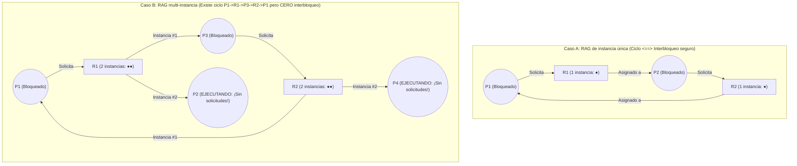
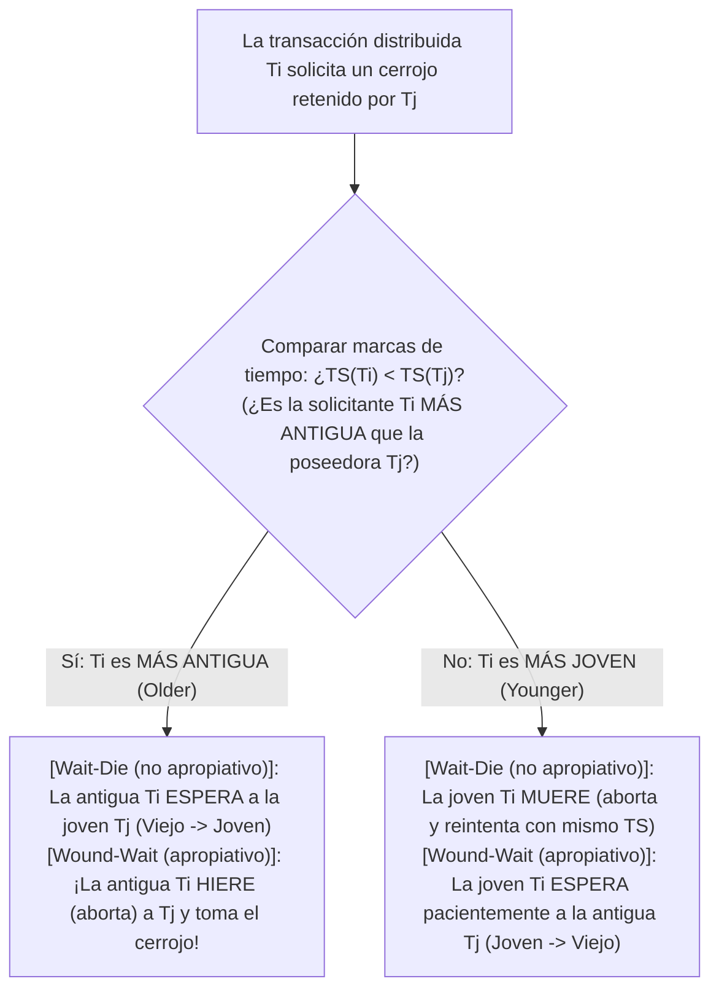

## 1. Introducción: La cena de los filósofos y las cuatro condiciones de Coffman (1971)

En 1965, el científico de la computación neerlandés <strong>Edsger W. Dijkstra</strong> formuló el célebre <strong>problema de la cena de los filósofos (Dining Philosophers Problem)</strong>: cinco filósofos $P_0 \dots P_4$ se sientan alrededor de una mesa circular; entre cada par de platos de espaguetis hay un único tenedor ($F_0 \dots F_4$). Para comer, cada filósofo necesita sostener simultáneamente su tenedor izquierdo $F_i$ y su tenedor derecho $F_{(i+1)\bmod 5}$. Si los cinco filósofos sienten hambre en el mismo microsegundo y todos toman su tenedor izquierdo $F_i$, cada uno esperará eternamente a que su vecino derecho suelte el segundo tenedor: todo el sistema se detiene para siempre. Esto es un <strong>interbloqueo o bloqueo mutuo (Deadlock)</strong>.

Formalmente, un subconjunto no vacío de procesos $D \subseteq \mathcal{P}$ está en interbloqueo si y solo si cada proceso $P_i \in D$ está bloqueado esperando un evento (como la liberación de un recurso) que <strong>solo puede ser provocado por otro proceso $P_j \in D$ perteneciente al mismo conjunto de espera</strong>.

En 1971, <strong>Edward G. Coffman Jr.</strong>, M. J. Elphick y Arie Shoshani demostraron que un interbloqueo de recursos solo puede ocurrir si <strong>se cumplen simultáneamente cuatro condiciones necesarias</strong>:
1. <strong>Exclusión mutua (Mutual Exclusion)</strong>: Al menos un recurso se mantiene en modo exclusivo (no compartible).
2. <strong>Retención y espera (Hold and Wait)</strong>: Un proceso retiene al menos un recurso mientras espera bloqueado para adquirir recursos adicionales retenidos por otros procesos.
3. <strong>Sin expropiación (No Preemption)</strong>: Los recursos asignados no pueden arrebatarse por la fuerza; solo son liberados voluntariamente por su poseedor.
4. <strong>Espera circular (Circular Wait)</strong>: Existe una cadena cerrada de procesos $\{P_0, P_1, \dots, P_{k-1}\}$ tal que cada $P_i$ espera un recurso retenido por $P_{(i+1)\bmod k}$.

Como las cuatro condiciones son individualmente necesarias, <strong>negar lógicamente una sola de ellas hace que el interbloqueo sea matemáticamente imposible ($0\,\%$)</strong>.

---

## 2. Grafo de Asignación de Recursos (RAG) y teoremas de ciclos (Holt, 1972)

En 1972, Richard C. Holt modeló el estado de los recursos mediante un grafo dirigido bipartito llamado <strong>Grafo de Asignación de Recursos (RAG)</strong> $G = (V, E)$, con vértices $V = \mathcal{P} \cup \mathcal{R}$ (procesos $P_i$ y tipos de recursos $R_j$ con $W_j \ge 1$ instancias idénticas), <strong>aristas de solicitud $P_i \to R_j$</strong> y <strong>aristas de asignación $R_j \to P_i$</strong>.

Tres teoremas fundamentales relacionan los ciclos dirigidos de $G$ con el interbloqueo:
* <strong>Teorema 1 (Aciclicidad $\implies$ Ausencia de interbloqueo)</strong>: Si $G$ no contiene ciclos dirigidos (es un DAG), ningún proceso está en interbloqueo.
* <strong>Teorema 2 (Condición necesaria y suficiente con instancia única)</strong>: Si cada tipo de recurso tiene <strong>una sola instancia ($\forall j, W_j = 1$)</strong>, entonces <strong>ciclo dirigido en $G \iff$ interbloqueo</strong>.
* <strong>Teorema 3 (No suficiencia con múltiples instancias)</strong>: Si algún recurso tiene <strong>múltiples instancias ($\exists j, W_j > 1$)</strong>, la existencia de un ciclo dirigido es condición <strong>necesaria pero NO suficiente</strong> para el interbloqueo.

En el Caso B existe el ciclo $P_1 \to R_1 \to P_3 \to R_2 \to P_1$, pero $P_2$ y $P_4$ tienen grado de salida $0$ (sumideros en ejecución): en cuanto terminen y liberen sus instancias de $R_1$ y $R_2$, el ciclo se romperá automáticamente.

---

## 3. Estrategia 1 (Prevención): Demostración por contradicción del orden total de cerrojos

En núcleos de SO (como el validador `lockdep` de Linux) y aplicaciones multihilo, la condición 4 (espera circular) se elimina imponiendo un <strong>orden total de cerrojos (Total Lock Ordering)</strong>: se asigna a cada cerrojo $L \in \mathcal{L}$ un rango global único $\phi(L) \in \mathbb{N}$ y todo hilo que retenga el conjunto $\mathcal{H}$ solo puede solicitar un nuevo cerrojo $L_{\text{new}}$ si su rango es estrictamente mayor:

$$\forall L_{\text{held}} \in \mathcal{H}: \quad \phi(L_{\text{held}}) < \phi(L_{\text{new}})$$

<strong>【Demostración por reducción al absurdo】</strong>: Supongamos que se forma un ciclo de espera $\{P_0, P_1, \dots, P_{k-1}\}$ ($k \ge 2$), donde $P_i$ retiene $L_i$ y espera $L_{(i+1)\bmod k}$. Como todos cumplen la regla de orden estricto, al encadenar las desigualdades alrededor del ciclo resulta:

$$\phi(L_0) < \phi(L_1) < \phi(L_2) < \cdots < \phi(L_{k-1}) < \phi(L_0) \implies \phi(L_0) < \phi(L_0)$$

Ningún número natural puede ser estrictamente menor que sí mismo ($\bot$). Por tanto, ya sea en transferencias bancarias (bloquear siempre primero la cuenta con menor ID) o en la cena de los filósofos (hacer que $P_4$ tome primero su tenedor derecho $F_0$ antes que el izquierdo $F_4$, pues $0 < 4$), la espera circular es imposible. $\blacksquare$

---

## 4. Estrategia 2 (Evitación): Algoritmo del banquero de Dijkstra (Traza matricial 5×3)

Cuando el orden de bloqueo depende de los datos en tiempo de ejecución, el <strong>algoritmo del banquero de Dijkstra (1965 / Habermann, 1969)</strong> exige declarar de antemano la demanda máxima $\mathbf{Max}$ y comprueba en tiempo <strong>$O(m \cdot n^2)$</strong> antes de cada concesión si el estado resultante sigue siendo un <strong>estado seguro (Safe State)</strong> con al menos una <strong>secuencia segura (Safe Sequence)</strong> ($\text{Interbloqueado} \subsetneq \text{Estado inseguro}$).

Para $n=5$ procesos $\{P_0 \dots P_4\}$ y $m=3$ recursos con $\mathbf{Total} = (A=10, B=5, C=7)$ y suma asignada $(7,2,5)$, el vector disponible inicial es $\mathbf{Available} = (10,5,7) - (7,2,5) = \mathbf{(3, 3, 2)}$:

| Proceso | Asignado $\mathbf{Allocation}$ $(A,B,C)$ | Máximo $\mathbf{Max}$ $(A,B,C)$ | Necesidad $\mathbf{Need} = \mathbf{Max} - \mathbf{Allocation}$ | Traza de secuencia segura ($\mathbf{Work}_0 = (3,3,2)$) |
| :--- | :---: | :---: | :---: | :--- |
| <strong>$P_0$</strong> | $(0, 1, 0)$ | $(7, 5, 3)$ | $(7, 4, 3)$ | Paso 4 cumple: $(7,4,3) \le (7,4,5) \to \mathbf{Work}=(7,5,5)$ |
| <strong>$P_1$</strong> | $(2, 0, 0)$ | $(3, 2, 2)$ | $(1, 2, 2)$ | <strong>Paso 1 cumple</strong>: $(1,2,2) \le (3,3,2) \to \mathbf{Work}=(5,3,2)$ |
| <strong>$P_2$</strong> | $(3, 0, 2)$ | $(9, 0, 2)$ | $(6, 0, 0)$ | Paso 5 cumple: $(6,0,0) \le (7,5,5) \to \mathbf{Work}=(10,5,7)$ |
| <strong>$P_3$</strong> | $(2, 1, 1)$ | $(2, 2, 2)$ | $(0, 1, 1)$ | <strong>Paso 2 cumple</strong>: $(0,1,1) \le (5,3,2) \to \mathbf{Work}=(7,4,3)$ |
| <strong>$P_4$</strong> | $(0, 0, 2)$ | $(4, 3, 3)$ | $(4, 3, 1)$ | <strong>Paso 3 cumple</strong>: $(4,3,1) \le (7,4,3) \to \mathbf{Work}=(7,4,5)$ |

La secuencia segura $\langle P_1, P_3, P_4, P_0, P_2 \rangle$ demuestra que $t_0$ es <strong>seguro</strong>. Si $P_1$ solicita $(1,0,2)$, la asignación tentativa deja $\mathbf{Available}=(2,3,0) \ge \mathbf{Need}_1=(0,2,0)$ (<strong>concedida al instante</strong>). Pero si acto seguido $P_0$ solicita $(0,2,0)$, el disponible cae a $(2,1,0)$, que no cubre el $\mathbf{Need}$ de ningún proceso (<strong>estado inseguro</strong>): ¡el banquero <strong>rechaza la solicitud y bloquea a $P_0$</strong>!

---

## 5. Estrategias 3 y 4 (Detección WFG, Wait-Die/Wound-Wait, Avestruz) y Livelock vs. Inanición

Los SGBD relacionales (PostgreSQL, MySQL InnoDB) construyen un <strong>grafo de espera (Wait-For Graph, WFG)</strong> y buscan ciclos mediante DFS en $O(|V|+|E|)$, abortando (*rollback*) la transacción víctima con menor registro Undo (MySQL detecta al instante; PostgreSQL espera `deadlock_timeout = 1s`). Las bases de datos distribuidas (Google Spanner) emplean los protocolos con marcas de tiempo $\text{TS}(T_i)$ de Rosenkrantz et al. (1978): <strong>Wait-Die (no apropiativo)</strong> y <strong>Wound-Wait (apropiativo, con menos reinicios inútiles)</strong>, conservando siempre la <strong>marca de tiempo original $\text{TS}(T_i)$ al reintentar</strong> para evitar la inanición. Para agotamientos rarísimos de tablas en SO de escritorio, UNIX y Windows aplican el <strong>algoritmo del avestruz (Ostrich Algorithm)</strong> ignorando el problema para no penalizar cada llamada al sistema diaria.

Por último, comparemos los tres fallos de <strong>vivacidad (Liveness)</strong>:

| Dimensión de diagnóstico | Interbloqueo (Deadlock) | Bloqueo activo (Livelock) | Inanición (Starvation) |
| :--- | :--- | :--- | :--- |
| <strong>Mecanismo central</strong> | Espera circular entre hilos bloqueados que retienen recursos | Bucles simétricos de `trylock` y liberación inmediata sin avance (baile de cortesía en un pasillo) | El sistema global avanza, pero un hilo de baja prioridad es postergado indefinidamente |
| <strong>Estado SO y uso de CPU</strong> | <strong>`SLEEPING` / `BLOCKED` ($0\,\%$ de CPU)</strong> | <strong>`RUNNING` ($\approx 100\,\%$ de CPU girando sin progreso)</strong> | Esperando en cola ($0\,\%$ de CPU para la víctima) |
| <strong>Solución de ingeniería</strong> | Orden total ($\phi(L_1)<\phi(L_2)$), Banquero, WFG rollback | <strong>Retroceso exponencial aleatorio con fluctuación (Random Exponential Backoff + Jitter)</strong> | <strong>Envejecimiento (Aging)</strong>, conservar TS original, cerrojos FIFO justos (MCS lock) |
