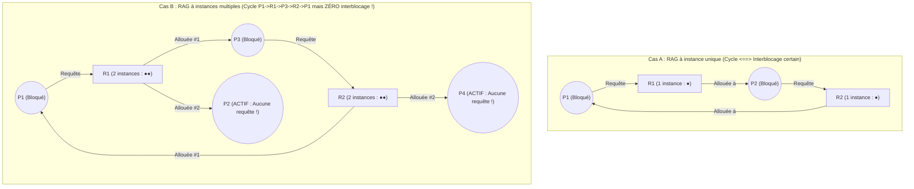
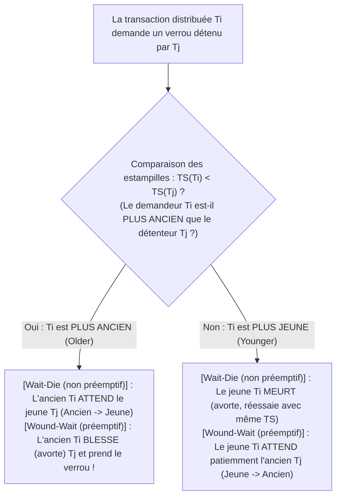

## 1. Introduction : Le dîner des philosophes et les quatre conditions de Coffman (1971)

En 1965, l'informaticien néerlandais <strong>Edsger W. Dijkstra</strong> a formulé le célèbre <strong>problème du dîner des philosophes (Dining Philosophers Problem)</strong> : cinq philosophes $P_0 \dots P_4$ sont assis autour d'une table ronde ; entre chaque assiette de spaghettis se trouve une seule fourchette ($F_0 \dots F_4$). Pour manger, chaque philosophe doit détenir simultanément sa fourchette gauche $F_i$ et sa fourchette droite $F_{(i+1)\bmod 5}$. Si les cinq philosophes ont faim au même instant et saisissent tous leur fourchette gauche $F_i$, chacun attendra éternellement que son voisin de droite libère la seconde fourchette : tout le système se fige définitivement. C'est l'<strong>interblocage (Deadlock)</strong>.

Formellement, un sous-ensemble non vide de processus $D \subseteq \mathcal{P}$ est en état d'interblocage si et seulement si chaque processus $P_i \in D$ est bloqué en attente d'un événement (tel que la libération d'un verrou) qui <strong>ne peut être déclenché que par un autre processus $P_j \in D$ appartenant au même ensemble d'attente</strong>.

En 1971, <strong>Edward G. Coffman Jr.</strong>, M. J. Elphick et Arie Shoshani ont démontré qu'un interblocage ne peut se produire que si <strong>quatre conditions nécessaires sont réunies simultanément</strong> :
1. <strong>Exclusion mutuelle (Mutual Exclusion)</strong> : Au moins une ressource est détenue en mode exclusif (non partageable).
2. <strong>Détention et attente (Hold and Wait)</strong> : Un processus détient déjà au moins une ressource tout en attendant d'acquérir des ressources supplémentaires détenues par d'autres processus.
3. <strong>Non-préemption (No Preemption)</strong> : Une ressource allouée ne peut pas être retirée de force à son détenteur ; elle n'est relâchée que volontairement.
4. <strong>Attente circulaire (Circular Wait)</strong> : Il existe une chaîne fermée de processus $\{P_0, P_1, \dots, P_{k-1}\}$ telle que chaque $P_i$ attend une ressource détenue par $P_{(i+1)\bmod k}$.

Puisque ces quatre conditions sont individuellement nécessaires, <strong>nier logiquement une seule d'entre elles rend l'interblocage mathématiquement impossible ($0\,\%$)</strong>.

---

## 2. Graphe d'allocation des ressources (RAG) et théorèmes des cycles (Holt, 1972)

En 1972, Richard C. Holt a modélisé l'état des ressources par un graphe orienté biparti appelé <strong>graphe d'allocation des ressources (RAG)</strong> $G = (V, E)$, où $V = \mathcal{P} \cup \mathcal{R}$ (sommets processus $P_i$ et types de ressources $R_j$ possédant $W_j \ge 1$ instances identiques), avec des <strong>arcs de requête $P_i \to R_j$</strong> et des <strong>arcs d'allocation $R_j \to P_i$</strong>.

Trois théorèmes fondamentaux relient les cycles orientés de $G$ à l'interblocage :
* <strong>Théorème 1 (Acyclicité $\implies$ Absence d'interblocage)</strong> : Si $G$ ne contient aucun cycle orienté (DAG), aucun processus n'est interbloqué.
* <strong>Théorème 2 (Condition nécessaire et suffisante à instance unique)</strong> : Si chaque ressource possède <strong>une seule instance ($\forall j, W_j = 1$)</strong>, alors <strong>cycle orienté dans $G \iff$ interblocage</strong>.
* <strong>Théorème 3 (Non-suffisance à instances multiples)</strong> : Si au moins une ressource possède <strong>plusieurs instances ($\exists j, W_j > 1$)</strong>, la présence d'un cycle orienté est une condition <strong>nécessaire mais NON suffisante</strong> d'interblocage !

Dans le Cas B, bien que le cycle $P_1 \to R_1 \to P_3 \to R_2 \to P_1$ existe, les processus $P_2$ et $P_4$ ont un demi-degré extérieur nul (puits actifs) : dès qu'ils terminent et relâchent leurs instances de $R_1$ et $R_2$, le cycle se résorbe de lui-même !

---

## 3. Stratégie 1 (Prévention) : Preuve par l'absurde de l'ordonnancement total des verrous

Dans les noyaux d'OS (comme le validateur dynamique `lockdep` de Linux) et les moteurs multithreadés, la condition 4 (attente circulaire) est éliminée par l'<strong>ordonnancement total des verrous (Total Lock Ordering)</strong> : on associe à chaque verrou $L \in \mathcal{L}$ un rang unique $\phi(L) \in \mathbb{N}$ et l'on impose qu'un thread détenant l'ensemble $\mathcal{H}$ ne puisse demander $L_{\text{new}}$ que si son rang est strictement supérieur :

$$\forall L_{\text{held}} \in \mathcal{H}: \quad \phi(L_{\text{held}}) < \phi(L_{\text{new}})$$

<strong>【Preuve par l'absurde】</strong> : Supposons qu'un cycle d'attente $\{P_0, P_1, \dots, P_{k-1}\}$ ($k \ge 2$) se forme, où $P_i$ détient $L_i$ et attend $L_{(i+1)\bmod k}$. Chaque thread respectant la règle de croissance stricte de $\phi$, on obtient par transitivité le long du cycle :

$$\phi(L_0) < \phi(L_1) < \phi(L_2) < \cdots < \phi(L_{k-1}) < \phi(L_0) \implies \phi(L_0) < \phi(L_0)$$

Aucun entier ne pouvant être strictement inférieur à lui-même, c'est une contradiction ($\bot$) ! Qu'il s'agisse d'un virement bancaire (toujours verrouiller le plus petit ID de compte en premier) ou des philosophes ($P_4$ prend d'abord sa fourchette droite $F_0$ avant la gauche $F_4$, car $0 < 4$), l'interblocage devient impossible. $\blacksquare$

---

## 4. Stratégie 2 (Évitement) : Algorithme du banquier de Dijkstra (Trace matricielle 5×3)

Lorsque l'ordre d'acquisition est dynamique, l'<strong>algorithme du banquier de Dijkstra (1965 / Habermann, 1969)</strong> exige que chaque processus déclare sa demande maximale $\mathbf{Max}$ et vérifie en temps <strong>$O(m \cdot n^2)$</strong> avant chaque allocation si l'état résultant reste un <strong>état sûr (Safe State)</strong> possédant au moins une <strong>séquence sûre (Safe Sequence)</strong> ($\text{Interbloqué} \subsetneq \text{État non sûr}$).

Pour $n=5$ processus $\{P_0 \dots P_4\}$ et $m=3$ ressources de total $\mathbf{Total} = (A=10, B=5, C=7)$, avec un cumul alloué de $(7,2,5)$, le vecteur disponible initial vaut $\mathbf{Available} = (10,5,7) - (7,2,5) = \mathbf{(3, 3, 2)}$ :

| Processus | Alloué $\mathbf{Allocation}$ $(A,B,C)$ | Max $\mathbf{Max}$ $(A,B,C)$ | Besoin restant $\mathbf{Need} = \mathbf{Max} - \mathbf{Allocation}$ | Recherche de séquence sûre ($\mathbf{Work}_0 = (3,3,2)$) |
| :--- | :---: | :---: | :---: | :--- |
| <strong>$P_0$</strong> | $(0, 1, 0)$ | $(7, 5, 3)$ | $(7, 4, 3)$ | Étape 4 validée : $(7,4,3) \le (7,4,5) \to \mathbf{Work}=(7,5,5)$ |
| <strong>$P_1$</strong> | $(2, 0, 0)$ | $(3, 2, 2)$ | $(1, 2, 2)$ | <strong>Étape 1 validée</strong> : $(1,2,2) \le (3,3,2) \to \mathbf{Work}=(5,3,2)$ |
| <strong>$P_2$</strong> | $(3, 0, 2)$ | $(9, 0, 2)$ | $(6, 0, 0)$ | Étape 5 validée : $(6,0,0) \le (7,5,5) \to \mathbf{Work}=(10,5,7)$ |
| <strong>$P_3$</strong> | $(2, 1, 1)$ | $(2, 2, 2)$ | $(0, 1, 1)$ | <strong>Étape 2 validée</strong> : $(0,1,1) \le (5,3,2) \to \mathbf{Work}=(7,4,3)$ |
| <strong>$P_4$</strong> | $(0, 0, 2)$ | $(4, 3, 3)$ | $(4, 3, 1)$ | <strong>Étape 3 validée</strong> : $(4,3,1) \le (7,4,3) \to \mathbf{Work}=(7,4,5)$ |

La séquence sûre $\langle P_1, P_3, P_4, P_0, P_2 \rangle$ prouve que l'état $t_0$ est <strong>sûr</strong>. Si $P_1$ demande ensuite $(1,0,2)$, l'allocation provisoire laisse $\mathbf{Available}=(2,3,0) \ge \mathbf{Need}_1=(0,2,0)$ (<strong>accordée immédiatement</strong>). Mais si $P_0$ demande juste après $(0,2,0)$, le reste disponible tombe à $(2,1,0)$, qui ne satisfait le $\mathbf{Need}$ d'aucun processus (<strong>état non sûr</strong>) : le banquier <strong>refuse et bloque $P_0$</strong> !

---

## 5. Stratégies 3 & 4 (Détection WFG, Wait-Die/Wound-Wait, Autruche) et Livelock vs Famine

Les SGBD relationnels (PostgreSQL, MySQL InnoDB) construisent un <strong>graphe d'attente (Wait-For Graph, WFG)</strong> et détectent les cycles par parcours en profondeur (DFS) en $O(|V|+|E|)$, annulant (*rollback*) la transaction victime ayant le plus petit journal Undo (détection immédiate sous MySQL ; différée après `deadlock_timeout = 1s` sous PostgreSQL). Les bases distribuées (Google Spanner) utilisent les protocoles à estampilles temporelles $\text{TS}(T_i)$ de Rosenkrantz et al. (1978) : <strong>Wait-Die (non préemptif)</strong> et <strong>Wound-Wait (préemptif, moins d'abandons répétés)</strong>, en conservant impérativement l'<strong>estampille initiale $\text{TS}(T_i)$ lors des réessais</strong> pour éviter toute famine. Quant aux rares saturations de tables dans les OS généralistes, UNIX et Windows appliquent l'<strong>algorithme de l'autruche (Ostrich Algorithm)</strong> pour ne pas pénaliser chaque appel système quotidien.

Enfin, comparons les trois défaillances de <strong>vivacité (Liveness)</strong> :

| Critère de diagnostic | Interblocage (Deadlock) | Verrouillage actif (Livelock) | Famine (Starvation) |
| :--- | :--- | :--- | :--- |
| <strong>Mécanisme fondamental</strong> | Attente circulaire entre threads bloqués détenant des ressources | Boucles symétriques de `trylock` et relâchement immédiat sans progression (danse de politesse dans un couloir) | Le système global progresse, mais un thread de basse priorité est perpétuellement doublé |
| <strong>État OS & charge CPU</strong> | <strong>`SLEEPING` / `BLOCKED` ($0\,\%$ de CPU)</strong> | <strong>`RUNNING` ($\approx 100\,\%$ de CPU gaspillé, progrès nul !)</strong> | En attente dans la file ($0\,\%$ de CPU pour la victime) |
| <strong>Remède d'ingénierie</strong> | Ordonnancement total ($\phi(L_1)<\phi(L_2)$), Banquier, WFG rollback | <strong>Temporisation exponentielle aléatoire (Random Exponential Backoff + Jitter)</strong> | <strong>Vieillissement (Aging)</strong>, conservation du TS, verrous FIFO équitables (MCS lock) |
