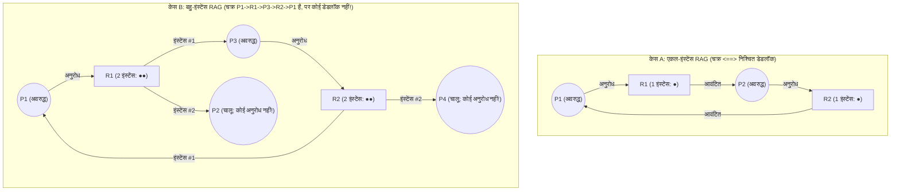
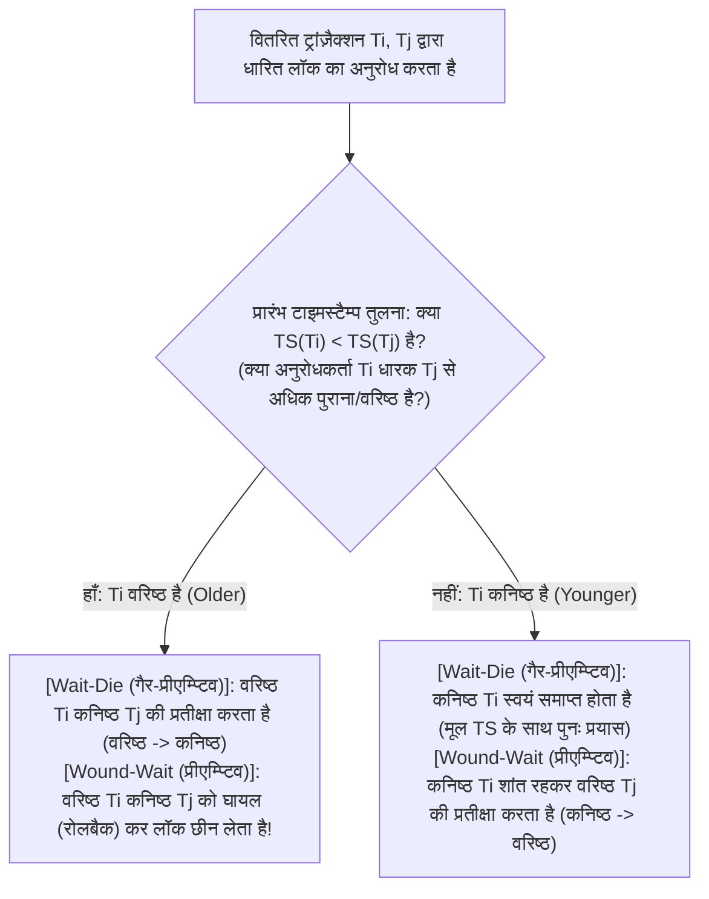

## 1. परिचय: डाइनिंग फिलॉसफर्स समस्या और कॉफ़मैन की चार शर्तें (1971)

1965 में डच कंप्यूटर वैज्ञानिक <strong>एड्सगर डब्ल्यू. डाइक्स्ट्रा (Edsger W. Dijkstra)</strong> ने प्रसिद्ध <strong>'डाइनिंग फिलॉसफर्स समस्या' (Dining Philosophers Problem)</strong> प्रस्तुत की: पाँच दार्शनिक $P_0 \dots P_4$ एक गोल मेज़ के चारों ओर बैठे हैं; प्रत्येक दो प्लेटों के बीच केवल एक काँटा ($F_0 \dots F_4$) रखा है। भोजन करने के लिए प्रत्येक दार्शनिक को अपने बाएँ काँटे $F_i$ और दाएँ काँटे $F_{(i+1)\bmod 5}$ दोनों को एक साथ पकड़ना आवश्यक है। यदि पाँचों दार्शनिकों को एक ही माइक्रोसेकंड में भूख लगे और सभी एक साथ अपना बायाँ काँटा $F_i$ उठा लें, तो प्रत्येक दार्शनिक अनंत काल तक अपने दाएँ पड़ोसी द्वारा दूसरा काँटा छोड़े जाने की प्रतीक्षा करता रहेगा — और संपूर्ण प्रणाली हमेशा के लिए थम जाएगी। इसे <strong>डेडलॉक (Deadlock / गतिरोध)</strong> कहते हैं।

औपचारिक रूप से, प्रक्रियाओं का एक अरिक्त उपसमुच्चय $D \subseteq \mathcal{P}$ डेडलॉक अवस्था में कहलाता है यदि और केवल यदि $D$ की प्रत्येक प्रक्रिया $P_i \in D$ किसी ऐसी घटना (जैसे संसाधन की मुक्ति) की प्रतीक्षा में अवरुद्ध (Blocked) है जिसे <strong>केवल उसी प्रतीक्षा समुच्चय $D$ की किसी अन्य प्रक्रिया $P_j \in D$ द्वारा ही घटित किया जा सकता है</strong>।

1971 में <strong>एडवर्ड जी. कॉफ़मैन (Edward G. Coffman Jr.)</strong>, एम. जे. एल्फ़िक और एरी शोशानी ने सिद्ध किया कि संसाधन डेडलॉक केवल तभी हो सकता है जब <strong>चार आवश्यक शर्तें एक साथ पूरी हों</strong>:
1. <strong>पारस्परिक अपवर्जन (Mutual Exclusion)</strong>: कम से कम एक संसाधन अनन्य (गैर-साझा) मोड में धारित हो।
2. <strong>धारण और प्रतीक्षा (Hold and Wait)</strong>: कोई प्रक्रिया पहले से कम से कम एक संसाधन धारण किए हुए हो और साथ ही अन्य प्रक्रियाओं द्वारा धारित अतिरिक्त संसाधनों को प्राप्त करने के लिए प्रतीक्षा कर रही हो।
3. <strong>अ-प्रीएम्प्शन (No Preemption)</strong>: आवंटित संसाधनों को किसी प्रक्रिया से बलपूर्वक छीना नहीं जा सकता; उन्हें धारक द्वारा कार्य पूर्ण होने पर स्वेच्छा से ही मुक्त किया जाता है।
4. <strong>चक्रीय प्रतीक्षा (Circular Wait)</strong>: प्रतीक्षारत प्रक्रियाओं की एक बंद श्रृंखला $\{P_0, P_1, \dots, P_{k-1}\}$ विद्यमान हो जिसमें प्रत्येक $P_i$ प्रक्रिया $P_{(i+1)\bmod k}$ द्वारा धारित संसाधन की प्रतीक्षा कर रही हो।

चूँकि ये चारों शर्तें व्यक्तिगत रूप से आवश्यक हैं, इसलिए <strong>सिस्टम डिज़ाइन में इनमें से किसी एक भी शर्त को तार्किक रूप से नकार देने पर डेडलॉक गणितीय रूप से $100\%$ असंभव हो जाता है</strong>।

---

## 2. संसाधन आवंटन ग्राफ़ (RAG) और चक्र प्रमेय (Holt, 1972)

1972 में रिचर्ड होल्ट ने संसाधनों की स्थिति को एक द्विभाजित दिष्ट ग्राफ़ — <strong>संसाधन आवंटन ग्राफ़ (RAG)</strong> $G = (V, E)$ के रूप में मॉडल किया, जहाँ $V = \mathcal{P} \cup \mathcal{R}$ (प्रक्रिया शीर्ष $P_i$ तथा $W_j \ge 1$ समरूप इंस्टेंस वाले संसाधन प्रकार शीर्ष $R_j$), <strong>अनुरोध कोरें $P_i \to R_j$</strong> और <strong>आवंटन कोरें $R_j \to P_i$</strong> होती हैं।

ग्राफ़ $G$ में दिष्ट चक्र (Directed Cycle) और डेडलॉक के बीच तीन मूलभूत प्रमेय हैं:
* <strong>प्रमेय 1 (अचक्रीयता $\implies$ डेडलॉक-मुक्ति)</strong>: यदि $G$ में कोई दिष्ट चक्र नहीं है (अर्थात $G$ एक DAG है), तो कोई भी प्रक्रिया डेडलॉक में नहीं है।
* <strong>प्रमेय 2 (एकल-इंस्टेंस आवश्यक और पर्याप्त प्रमेय)</strong>: यदि प्रत्येक संसाधन प्रकार का <strong>केवल एक इंस्टेंस ($\forall j, W_j = 1$)</strong> है, तो <strong>$G$ में दिष्ट चक्र $\iff$ डेडलॉक</strong>।
* <strong>प्रमेय 3 (बहु-इंस्टेंस अपर्याप्तता प्रमेय)</strong>: यदि किसी संसाधन प्रकार के <strong>एक से अधिक इंस्टेंस ($\exists j, W_j > 1$)</strong> हैं, तो दिष्ट चक्र का होना डेडलॉक के लिए <strong>आवश्यक शर्त तो है, किंतु पर्याप्त शर्त नहीं है</strong>!

केस B में यद्यपि चक्र $P_1 \to R_1 \to P_3 \to R_2 \to P_1$ मौजूद है, फिर भी $P_2$ और $P_4$ की बाह्य-डिग्री $0$ है (सक्रिय सिंक): जैसे ही वे अपना कार्य पूरा कर $R_1$ और $R_2$ के इंस्टेंस मुक्त करेंगी, चक्र स्वतः टूट जाएगा!

---

## 3. रणनीति 1 (रोकथाम): संपूर्ण लॉक क्रम (Total Lock Ordering) की विरोधाभास से उत्पत्ति

OS कर्नेल (जैसे Linux का `lockdep`) और मल्टीथ्रेडेड प्रोग्रामिंग में चौथी शर्त (चक्रीय प्रतीक्षा) को <strong>संपूर्ण लॉक क्रम (Total Lock Ordering)</strong> द्वारा समाप्त किया जाता है: प्रत्येक म्यूटेक्स $L \in \mathcal{L}$ को एक अद्वितीय वैश्विक रैंक $\phi(L) \in \mathbb{N}$ दी जाती है, और लॉक समुच्चय $\mathcal{H}$ धारण करने वाला कोई भी थ्रेड नया लॉक $L_{\text{new}}$ केवल तभी माँग सकता है जब उसकी रैंक строго अधिक हो:

$$\forall L_{\text{held}} \in \mathcal{H}: \quad \phi(L_{\text{held}}) < \phi(L_{\text{new}})$$

<strong>【विरोधाभास द्वारा प्रमाण】</strong>: मान लीजिए कि $k \ge 2$ लंबाई का एक चक्रीय प्रतीक्षा चक्र $\{P_0, P_1, \dots, P_{k-1}\}$ बन जाता है, जहाँ $P_i$ लॉक $L_i$ को पकड़े हुए है और $L_{(i+1)\bmod k}$ की प्रतीक्षा कर रहा है। चूँकि प्रत्येक थ्रेड लॉक क्रम नियम का पालन करता है, पूरे चक्र में असमिकाओं को जोड़ने पर:

$$\phi(L_0) < \phi(L_1) < \phi(L_2) < \cdots < \phi(L_{k-1}) < \phi(L_0) \implies \phi(L_0) < \phi(L_0)$$

चूँकि कोई भी प्राकृत संख्या स्वयं से सख्त छोटी नहीं हो सकती, यह एक विरोधाभास ($\bot$) है! अतः चाहे बैंक खाता अंतरण हो (हमेशा छोटे ID वाले खाते को पहले लॉक करना) या डाइनिंग फिलॉसफर्स ($P_4$ द्वारा बाएँ काँटे $F_4$ से पहले दायाँ काँटा $F_0$ उठाना, क्योंकि $0 < 4$), चक्रीय प्रतीक्षा गणितीय रूप से असंभव हो जाती है। $\blacksquare$

---

## 4. रणनीति 2 (परिहार): डाइक्स्ट्रा का बैंकर एल्गोरिदम (5×3 मैट्रिक्स ट्रेस)

जब लॉक क्रम पहले से तय न हो सके, तो <strong>डाइक्स्ट्रा का बैंकर एल्गोरिदम (1965 / Habermann, 1969)</strong> प्रत्येक प्रक्रिया से उसकी अधिकतम माँग $\mathbf{Max}$ की पूर्व घोषणा करवाता है और प्रत्येक आवंटन से पहले <strong>$O(m \cdot n^2)$</strong> समय में जाँचता है कि क्या परिणामी अवस्था कम से कम एक <strong>सुरक्षित अनुक्रम (Safe Sequence)</strong> वाली <strong>सुरक्षित अवस्था (Safe State)</strong> बनी रहती है ($\text{डेडलॉक} \subsetneq \text{असुरक्षित अवस्था}$)।

$n=5$ प्रक्रियाओं $\{P_0 \dots P_4\}$ और $m=3$ संसाधनों $\mathbf{Total} = (A=10, B=5, C=7)$ वाली प्रणाली में कुल आवंटित $(7,2,5)$ होने पर प्रारंभिक उपलब्ध सदिश $\mathbf{Available} = (10,5,7) - (7,2,5) = \mathbf{(3, 3, 2)}$ है:

| प्रक्रिया | आवंटित $\mathbf{Allocation}$ $(A,B,C)$ | अधिकतम $\mathbf{Max}$ $(A,B,C)$ | शेष आवश्यकता $\mathbf{Need} = \mathbf{Max} - \mathbf{Allocation}$ | सुरक्षित अनुक्रम ट्रेस ($\mathbf{Work}_0 = (3,3,2)$) |
| :--- | :---: | :---: | :---: | :--- |
| <strong>$P_0$</strong> | $(0, 1, 0)$ | $(7, 5, 3)$ | $(7, 4, 3)$ | चरण 4 संतुष्ट: $(7,4,3) \le (7,4,5) \to \mathbf{Work}=(7,5,5)$ |
| <strong>$P_1$</strong> | $(2, 0, 0)$ | $(3, 2, 2)$ | $(1, 2, 2)$ | <strong>चरण 1 संतुष्ट</strong>: $(1,2,2) \le (3,3,2) \to \mathbf{Work}=(5,3,2)$ |
| <strong>$P_2$</strong> | $(3, 0, 2)$ | $(9, 0, 2)$ | $(6, 0, 0)$ | चरण 5 संतुष्ट: $(6,0,0) \le (7,5,5) \to \mathbf{Work}=(10,5,7)$ |
| <strong>$P_3$</strong> | $(2, 1, 1)$ | $(2, 2, 2)$ | $(0, 1, 1)$ | <strong>चरण 2 संतुष्ट</strong>: $(0,1,1) \le (5,3,2) \to \mathbf{Work}=(7,4,3)$ |
| <strong>$P_4$</strong> | $(0, 0, 2)$ | $(4, 3, 3)$ | $(4, 3, 1)$ | <strong>चरण 3 संतुष्ट</strong>: $(4,3,1) \le (7,4,3) \to \mathbf{Work}=(7,4,5)$ |

सुरक्षित अनुक्रम $\langle P_1, P_3, P_4, P_0, P_2 \rangle$ सिद्ध करता है कि अवस्था $t_0$ <strong>सुरक्षित</strong> है। यदि $P_1$ अब $(1,0,2)$ माँगता है, तो अस्थायी आवंटन के बाद $\mathbf{Available}=(2,3,0) \ge \mathbf{Need}_1=(0,2,0)$ सुरक्षित रहता है (<strong>तुरंत स्वीकृत</strong>)। किंतु यदि तुरंत बाद $P_0$ सदिश $(0,2,0)$ माँगता है, तो उपलब्ध संसाधन घटकर $(2,1,0)$ रह जाते हैं जिससे किसी भी प्रक्रिया की $\mathbf{Need}$ पूरी नहीं हो सकती (<strong>असुरक्षित अवस्था</strong>): बैंकर एल्गोरिदम इसे <strong>अस्वीकार कर $P_0$ को ब्लॉक कर देता है</strong>!

---

## 5. रणनीति 3 व 4 (WFG पहचान, Wait-Die/Wound-Wait, शुतुरमुर्ग) और Livelock बनाम Starvation

रिलेशनल डेटाबेस (PostgreSQL, MySQL InnoDB) <strong>वेट-फ़ॉर ग्राफ़ (WFG)</strong> बनाते हैं और $O(|V|+|E|)$ DFS द्वारा चक्र ढूँढकर सबसे कम Undo लॉग वाले पीड़ित ट्रांज़ैक्शन को रोलबैक करते हैं (MySQL में तुरंत; PostgreSQL में `deadlock_timeout = 1s` बाद)। वितरित डेटाबेस (Google Spanner) रोज़ेनक्रांत्ज़ आदि (1978) के टाइमस्टैम्प $\text{TS}(T_i)$ आधारित <strong>Wait-Die (गैर-प्रीएम्प्टिव)</strong> और <strong>Wound-Wait (प्रीएम्प्टिव, कम व्यर्थ रीस्टार्ट)</strong> प्रोटोकॉल अपनाते हैं, तथा स्टार्वेशन रोकने के लिए रीस्टार्ट पर <strong>मूल टाइमस्टैम्प $\text{TS}(T_i)$ को सुरक्षित रखते हैं</strong>। अत्यंत दुर्लभ OS टेबल रिक्तीकरण के लिए UNIX/Windows <strong>शुतुरमुर्ग एल्गोरिदम (Ostrich Algorithm)</strong> अपनाकर समस्या को अनदेखा करते हैं ताकि दैनिक सिस्टम कॉल धीमे न हों।

अंत में, तीनों <strong>लाइवनेस विफलताओं (Liveness Failures)</strong> की तुलना:

| निदान आयाम | डेडलॉक (Deadlock) | लाइवलॉक (Livelock) | स्टार्वेशन (Starvation / भुखमरी) |
| :--- | :--- | :--- | :--- |
| <strong>मूल तंत्र</strong> | संसाधन पकड़े हुए सुप्त थ्रेड्स के बीच चक्रीय प्रतीक्षा | बिना प्रगति के `trylock` विफलता और लॉक छोड़ने का सममित अनंत लूप (सँकरे गलियारे में एक साथ रास्ता छोड़ना) | समग्र प्रणाली आगे बढ़ती है, पर कम प्राथमिकता वाला थ्रेड हमेशा पीछे छूट जाता है |
| <strong>OS अवस्था और CPU उपयोग</strong> | <strong>`SLEEPING` / `BLOCKED` ($0\%$ CPU)</strong> | <strong>`RUNNING` ($\approx 100\%$ CPU व्यर्थ घूमता है, प्रगति शून्य!)</strong> | कतार में प्रतीक्षारत (पीड़ित थ्रेड का CPU $0\%$) |
| <strong>इंजीनियरिंग समाधान</strong> | संपूर्ण लॉक क्रम ($\phi(L_1)<\phi(L_2)$), बैंकर एल्गोरिदम, WFG रोलबैक | <strong>जिटर के साथ रैंडमाइज़्ड एक्सपोनेंशियल बैकऑफ़ (समय की सममिति तोड़ना)</strong> | <strong>प्रायोरिटी एजिंग (Aging)</strong>, मूल TS बनाए रखना, निष्पक्ष FIFO क्यू लॉक (MCS lock) |
