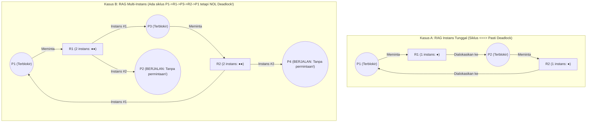
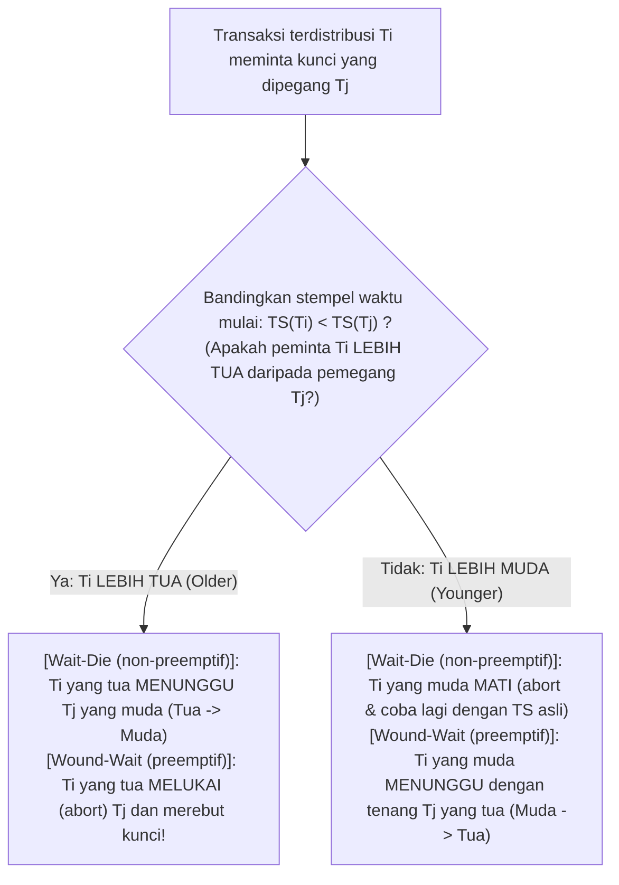

## 1. Pendahuluan: Masalah Filsuf Makan Malam dan Empat Kondisi Coffman (1971)

Pada tahun 1965, ilmuwan komputer Belanda <strong>Edsger W. Dijkstra</strong> merumuskan <strong>Masalah Filsuf Makan Malam (Dining Philosophers Problem)</strong> yang terkenal: lima filsuf $P_0 \dots P_4$ duduk mengelilingi meja bundar; di antara setiap piring spageti terdapat satu garpu ($F_0 \dots F_4$). Untuk makan, setiap filsuf harus memegang garpu kiri $F_i$ dan garpu kanan $F_{(i+1)\bmod 5}$ secara bersamaan. Jika kelima filsuf merasa lapar pada mikrodetik yang persis sama dan serentak mengambil garpu kiri $F_i$, masing-masing akan menunggu selamanya hingga tetangga kanannya melepaskan garpu kedua—seluruh sistem membeku abadi. Kondisi ini disebut <strong>kebuntuan (Deadlock)</strong>.

Secara formal, himpunan bagian proses tak kosong $D \subseteq \mathcal{P}$ berada dalam status deadlock jika dan hanya jika setiap proses $P_i \in D$ terblokir menunggu suatu peristiwa (seperti pelepasan kunci) yang <strong>hanya dapat dipicu oleh proses lain $P_j \in D$ di dalam himpunan tunggu yang sama</strong>.

Pada tahun 1971, <strong>Edward G. Coffman Jr.</strong>, M. J. Elphick, dan Arie Shoshani membuktikan bahwa deadlock sumber daya hanya dapat terjadi jika <strong>empat kondisi perlu terpenuhi secara bersamaan</strong>:
1. <strong>Eksklusi Bersama (Mutual Exclusion)</strong>: Setidaknya satu sumber daya dipegang dalam mode eksklusif (tidak dapat dibagi).
2. <strong>Genggam dan Tunggu (Hold and Wait)</strong>: Sebuah proses sedang memegang setidaknya satu sumber daya sambil menunggu terblokir untuk memperoleh sumber daya tambahan yang dipegang proses lain.
3. <strong>Tanpa Preempsi (No Preemption)</strong>: Sumber daya yang telah dialokasikan tidak dapat direbut paksa; hanya dilepaskan secara sukarela oleh pemegangnya.
4. <strong>Tunggu Melingkar (Circular Wait)</strong>: Terdapat rantai tertutup proses $\{P_0, P_1, \dots, P_{k-1}\}$ di mana setiap $P_i$ menunggu sumber daya yang dipegang oleh $P_{(i+1)\bmod k}$.

Karena keempat kondisi tersebut masing-masing merupakan syarat perlu, <strong>menegasikan secara logis satu saja dari empat kondisi Coffman membuat deadlock mustahil terjadi secara matematis ($0\,\%$)</strong>.

---

## 2. Graf Alokasi Sumber Daya (RAG) dan Teorema Siklus (Holt, 1972)

Pada tahun 1972, Richard C. Holt memodelkan status sumber daya sebagai graf berarah bipartit yang disebut <strong>Graf Alokasi Sumber Daya (RAG)</strong> $G = (V, E)$, dengan himpunan simpul $V = \mathcal{P} \cup \mathcal{R}$ (proses $P_i$ dan tipe sumber daya $R_j$ yang memiliki $W_j \ge 1$ instans identik), <strong>sisi permintaan $P_i \to R_j$</strong>, serta <strong>sisi alokasi $R_j \to P_i$</strong>.

Tiga teorema fundamental menghubungkan siklus berarah pada $G$ dengan deadlock:
* <strong>Teorema 1 (Asiklisitas $\implies$ Bebas Deadlock)</strong>: Jika $G$ tidak mengandung siklus berarah (berupa DAG), tidak ada proses yang mengalami deadlock.
* <strong>Teorema 2 (Syarat Perlu dan Cukup pada Instans Tunggal)</strong>: Jika setiap tipe sumber daya hanya memiliki <strong>satu instans ($\forall j, W_j = 1$)</strong>, maka <strong>siklus berarah pada $G \iff$ deadlock</strong>.
* <strong>Teorema 3 (Ketidakcukupan pada Multi-Instans)</strong>: Jika suatu sumber daya memiliki <strong>banyak instans ($\exists j, W_j > 1$)</strong>, keberadaan siklus berarah adalah <strong>syarat perlu, tetapi BUKAN syarat cukup</strong> untuk deadlock!

Pada Kasus B terdapat siklus $P_1 \to R_1 \to P_3 \to R_2 \to P_1$, namun $P_2$ dan $P_4$ memiliki derajat keluar $0$ (simpul muara aktif): begitu keduanya selesai dan melepas instans $R_1$ serta $R_2$, siklus tersebut langsung terurai!

---

## 3. Strategi 1 (Pencegahan): Bukti Kontradiksi Pengurutan Kunci Total

Di dalam kernel OS (seperti validator `lockdep` Linux) dan sistem multithread, kondisi 4 (tunggu melingkar) dihapuskan melalui <strong>Pengurutan Kunci Total (Total Lock Ordering)</strong>: setiap mutex $L \in \mathcal{L}$ diberi peringkat global unik $\phi(L) \in \mathbb{N}$, dan setiap thread yang memegang himpunan kunci $\mathcal{H}$ hanya boleh meminta kunci baru $L_{\text{new}}$ jika peringkatnya строго lebih besar:

$$\forall L_{\text{held}} \in \mathcal{H}: \quad \phi(L_{\text{held}}) < \phi(L_{\text{new}})$$

<strong>【Bukti dengan Kontradiksi】</strong>: Andaikan terbentuk siklus tunggu $\{P_0, P_1, \dots, P_{k-1}\}$ ($k \ge 2$), di mana $P_i$ memegang $L_i$ dan menunggu $L_{(i+1)\bmod k}$. Karena semua thread mematuhi aturan urutan naik ketat, perantaian pertidaksamaan sepanjang siklus menghasilkan:

$$\phi(L_0) < \phi(L_1) < \phi(L_2) < \cdots < \phi(L_{k-1}) < \phi(L_0) \implies \phi(L_0) < \phi(L_0)$$

Karena tidak ada bilangan asli yang lebih kecil dari dirinya sendiri, terjadi kontradiksi ($\bot$)! Baik pada transfer bank (selalu kunci rekening ber-ID lebih kecil dulu) maupun filsuf makan malam (membuat $P_4$ mengambil garpu kanan $F_0$ sebelum garpu kiri $F_4$, karena $0 < 4$), tunggu melingkar menjadi mustahil. $\blacksquare$

---

## 4. Strategi 2 (Penghindaran): Algoritma Bankir Dijkstra (Telusur Matriks 5×3)

Ketika urutan kunci bersifat dinamis, <strong>Algoritma Bankir Dijkstra (1965 / Habermann, 1969)</strong> mewajibkan deklarasi awal kebutuhan maksimum $\mathbf{Max}$ dan memeriksa dalam waktu <strong>$O(m \cdot n^2)$</strong> sebelum setiap alokasi apakah status hasil tetap merupakan <strong>Status Aman (Safe State)</strong> yang memiliki setidaknya satu <strong>Urutan Aman (Safe Sequence)</strong> ($\text{Deadlock} \subsetneq \text{Status Tidak Aman}$).

Untuk $n=5$ proses $\{P_0 \dots P_4\}$ dan $m=3$ sumber daya dengan $\mathbf{Total} = (A=10, B=5, C=7)$ serta total teralokasi $(7,2,5)$, vektor tersedia awal adalah $\mathbf{Available} = (10,5,7) - (7,2,5) = \mathbf{(3, 3, 2)}$:

| Proses | Teralokasi $\mathbf{Allocation}$ $(A,B,C)$ | Maks $\mathbf{Max}$ $(A,B,C)$ | Sisa Kebutuhan $\mathbf{Need} = \mathbf{Max} - \mathbf{Allocation}$ | Penelusuran Urutan Aman ($\mathbf{Work}_0 = (3,3,2)$) |
| :--- | :---: | :---: | :---: | :--- |
| <strong>$P_0$</strong> | $(0, 1, 0)$ | $(7, 5, 3)$ | $(7, 4, 3)$ | Langkah 4 terpenuhi: $(7,4,3) \le (7,4,5) \to \mathbf{Work}=(7,5,5)$ |
| <strong>$P_1$</strong> | $(2, 0, 0)$ | $(3, 2, 2)$ | $(1, 2, 2)$ | <strong>Langkah 1 terpenuhi</strong>: $(1,2,2) \le (3,3,2) \to \mathbf{Work}=(5,3,2)$ |
| <strong>$P_2$</strong> | $(3, 0, 2)$ | $(9, 0, 2)$ | $(6, 0, 0)$ | Langkah 5 terpenuhi: $(6,0,0) \le (7,5,5) \to \mathbf{Work}=(10,5,7)$ |
| <strong>$P_3$</strong> | $(2, 1, 1)$ | $(2, 2, 2)$ | $(0, 1, 1)$ | <strong>Langkah 2 terpenuhi</strong>: $(0,1,1) \le (5,3,2) \to \mathbf{Work}=(7,4,3)$ |
| <strong>$P_4$</strong> | $(0, 0, 2)$ | $(4, 3, 3)$ | $(4, 3, 1)$ | <strong>Langkah 3 terpenuhi</strong>: $(4,3,1) \le (7,4,3) \to \mathbf{Work}=(7,4,5)$ |

Urutan aman $\langle P_1, P_3, P_4, P_0, P_2 \rangle$ membuktikan bahwa $t_0$ <strong>Aman</strong>. Jika $P_1$ meminta $(1,0,2)$, alokasi sementara menyisakan $\mathbf{Available}=(2,3,0) \ge \mathbf{Need}_1=(0,2,0)$ (<strong>disetujui seketika</strong>). Namun jika tepat setelahnya $P_0$ meminta $(0,2,0)$, ketersediaan jatuh ke $(2,1,0)$ yang tidak dapat memenuhi $\mathbf{Need}$ proses mana pun (<strong>Status Tidak Aman</strong>): sang bankir <strong>menolak permintaan tersebut dan memblokir $P_0$</strong>!

---

## 5. Strategi 3 & 4 (Deteksi WFG, Wait-Die/Wound-Wait, Burung Unta) & Livelock vs. Starvation

RDBMS (PostgreSQL, MySQL InnoDB) membangun <strong>Graf Tunggu (Wait-For Graph, WFG)</strong> dan mencari siklus melalui DFS dalam $O(|V|+|E|)$, membatalkan (*rollback*) transaksi korban dengan log Undo terkecil (deteksi seketika di MySQL; setelah `deadlock_timeout = 1s` di PostgreSQL). Basis data terdistribusi (Google Spanner) memakai protokol berbasis stempel waktu $\text{TS}(T_i)$ dari Rosenkrantz et al. (1978): <strong>Wait-Die (non-preemptif)</strong> dan <strong>Wound-Wait (preemptif, lebih sedikit restart sia-sia)</strong>, dengan wajib <strong>mempertahankan stempel waktu asli $\text{TS}(T_i)$ saat mencoba ulang</strong> demi mencegah kelaparan (*starvation*). Untuk kehabisan tabel sistem yang sangat langka pada OS umum, UNIX dan Windows menerapkan <strong>Algoritma Burung Unta (Ostrich Algorithm)</strong> dengan mengabaikan masalah agar panggilan sistem harian tetap cepat.

Terakhir, mari bandingkan ketiga kegagalan <strong>keaktifan (Liveness)</strong>:

| Dimensi Diagnostik | Deadlock (Kebuntuan) | Livelock | Starvation (Kelaparan) |
| :--- | :--- | :--- | :--- |
| <strong>Mekanisme Inti</strong> | Tunggu melingkar antar-thread terblokir yang memegang sumber daya | Perulangan simetris `trylock` gagal dan lepas kunci tanpa kemajuan (tarian sopan santun di lorong sempit) | Sistem global maju normal, tetapi satu thread berprioritas rendah terus-menerus diserobot |
| <strong>Status OS & Beban CPU</strong> | <strong>`SLEEPING` / `BLOCKED` ($0\,\%$ CPU)</strong> | <strong>`RUNNING` ($\approx 100\,\%$ CPU berputar tanpa kemajuan!)</strong> | Menunggu di antrean ($0\,\%$ CPU bagi korban) |
| <strong>Solusi Rekayasa Utama</strong> | Urutan kunci total ($\phi(L_1)<\phi(L_2)$), Algoritma Bankir, WFG rollback | <strong>Exponential Backoff Acak dengan Jitter (memecah simetri waktu)</strong> | <strong>Penuaan Prioritas (Aging)</strong>, simpan TS asli, kunci antrean FIFO adil (MCS lock) |
