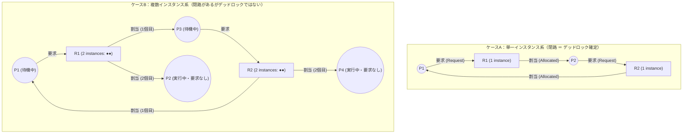
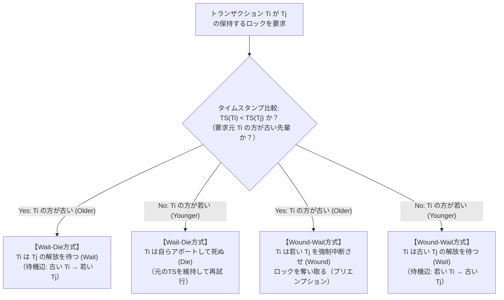
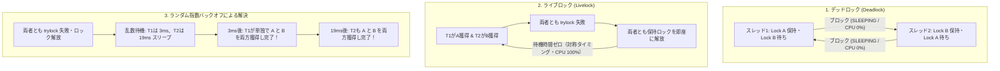

## 1. 導入：相互待機が生み出す計算機の完全停止

1905年、アメリカ合衆国カンザス州議会において、鉄道事故を防止するためのある法案が提出されたという有名な逸話がある。その条文の一節は次のようなものであった。

> <strong>「2本の列車が交差点（踏切）に同時に差し掛かった場合、双方の列車は完全に停止しなければならず、相手の列車が通過し終えるまで、いずれも再び発車してはならない。」</strong>

この規則を忠実に守る2人の機関士が交差点で鉢合わせした瞬間、何が起きるかは明白である。列車Aの機関士は列車Bが通り過ぎるのを待ち、列車Bの機関士は列車Aが通り過ぎるのを待つ。どちらの機関車もエンジンやブレーキに何ひとつ故障を抱えていないにもかかわらず、2本の列車は永遠にその場から一歩も動けなくなる。

この滑稽にも見える「規則の厳格な遵守ゆえに生じる永続的な相互停止」こそ、現代のオペレーティングシステム（OS）、マルチスレッドアプリケーション、リレーショナルデータベース（RDBMS）、そして分散システムにおいて最も厄介な病理の一つである<strong>デッドロック（Deadlock：膠着状態）</strong>の本質にほかならない。

### 1.1 ダイクストラの「食事する哲学者の問題」（1965年）

計算機科学において、この問題を最も純粋な形で定式化したのが、オランダの計算機科学者<strong>エドガー・ダイクストラ（Edsger W. Dijkstra）</strong>が1965年に考案した<strong>「食事する哲学者の問題（Dining Philosophers Problem）」</strong>である（当初ダイクストラは5台の磁気テープ装置を奪い合うプロセス間の同期問題として学生向けの試験に出題し、後にアントニー・ホーア（C. A. R. Hoare）が現在の哲学者の寓話へと仕立て直した）。

円卓の周りに5人の哲学者 $P_0, P_1, P_2, P_3, P_4$ が座っており、それぞれの目の前にはスパゲッティの皿が置かれている。隣り合う皿の間には1本ずつ、合計5本のフォーク $F_0, F_1, F_2, F_3, F_4$ が配置されている。哲学者 $P_i$（$i \in \{0, 1, 2, 3, 4\}$）の左手側にはフォーク $F_i$ があり、右手側にはフォーク $F_{(i+1)\bmod 5}$ がある。

哲学者の人生は<strong>「思索（Thinking）」</strong>と<strong>「食事（Eating）」</strong>の2つの状態の繰り返しで構成される。しかし、皿の上のスパゲッティは極めて絡みやすいため、食事をするには<strong>左右2本のフォーク $F_i$ と $F_{(i+1)\bmod 5}$ の両方を同時に手にする必要がある</strong>。一度に持ち上げられるフォークは1本ずつであり、他人が使っているフォークを力ずくで奪い取ることは許されない。そこで、各哲学者 $P_i$ に次のような直感的で対称的なアルゴリズムを与えてみよう。

```c
// 哲学者 P_i (i = 0, 1, 2, 3, 4) のナイーブな行動アルゴリズム
void philosopher(int i) {
    int left  = i;
    int right = (i + 1) % 5;
    while (true) {
        think();                     // 1. 思索に耽る
        acquire_fork(left);          // 2. 左手のフォーク F_i を掴む（取得できるまで待機）
        acquire_fork(right);         // 3. 右手のフォーク F_{(i+1) mod 5} を掴む（取得できるまで待機）
        eat();                       // 4. 両手のフォークを使って食事する
        release_fork(right);         // 5. 右手のフォークを置く
        release_fork(left);          // 6. 左手のフォークを置く
    }
}
```

普段、哲学者たちが別々のタイミングで空腹を覚えている限り、このプログラムは何事もなく何百万回でも正常に動作し続ける。ところが、たまたま5人の哲学者が<strong>完全に同じ瞬間に空腹を覚え、一斉に自分の左手のフォーク $F_i$ を掴んだ</strong>としたらどうなるだろうか。

- $P_0$ は $F_0$ を握りしめたまま、$P_1$ が持っている $F_1$ が空くのを待つ。
- $P_1$ は $F_1$ を握りしめたまま、$P_2$ が持っている $F_2$ が空くのを待つ。
- $P_2$ は $F_2$ を握りしめたまま、$P_3$ が持っている $F_3$ が空くのを待つ。
- $P_3$ は $F_3$ を握りしめたまま、$P_4$ が持っている $F_4$ が空くのを待つ。
- $P_4$ は $F_4$ を握りしめたまま、$P_0$ が持っている $F_0$ が空くのを待つ。

テーブル上の5本のフォークはすべて誰かの左手に握られており、自由に使えるフォークは1本も残っていない。そして誰もが「右手のフォークさえ手に入れば食事を終えて両方のフォークを置けるのに」と待ち続けるため、未来永劫誰一人としてフォークを置くことがない。5人の哲学者は皿を前にして餓死（システム全体の完全停止）に至る。

### 1.2 デッドロックの厳密な定義

並行システムにおけるプロセス（またはスレッド、トランザクション）の全体集合を $\mathcal{P} = \{P_1, P_2, \dots, P_n\}$ とする。ある空でない部分集合 $D \subseteq \mathcal{P}$ が<strong>デッドロック状態にある</strong>とは、次の条件が満たされることをいう。

> <strong>定義（デッドロック）</strong>：部分集合 $D \subseteq \mathcal{P}$（$D \neq \emptyset$）に属するすべてのプロセス $P_i \in D$ が、ある事象（資源の解放やメッセージの到着など）の発生を待ってブロック（休眠）しており、かつその事象を引き起こすことができる主体が<strong>同じ待機集合 $D$ に属する他のプロセス $P_j \in D$ のみである</strong>状態。

$D$ の全メンバーが休眠しているため、$D$ の内部から事象を発火させるプロセスは存在せず、外部からの強制介入（プロセスの強制終了や資源の強制剥奪）がない限り、$D$ に含まれるいかなるプロセスも二度と実行を再開できない。

---

## 2. コフマンの4条件（1971年）：デッドロック成立の必要十分構造

なぜ、そしてどのような条件下でデッドロックは発生するのか。1971年、<strong>エドワード・コフマン（Edward G. Coffman Jr.）</strong>、M. J. Elphick、および Arie Shoshani は、記念碑的論文 *"System Deadlocks"*（ACM Computing Surveys）において、資源をめぐるデッドロックが発生するためには<strong>以下の4つの条件が同時に成立していなければならない</strong>ことを定式化した。今日、これは<strong>コフマンの条件（Coffman Conditions）</strong>として知られている。

1. <strong>相互排他（Mutual Exclusion）</strong>
   少なくとも1つの資源が<strong>非共有モード（排他的モード）</strong>で保持されていること。すなわち、ある任意の時刻 $t$ において、その資源インスタンスを使用できるプロセスは高々1つだけであり、他のプロセスがその資源を要求した場合、現在の保持者が資源を解放するまで要求元プロセスは待機させられる。
2. <strong>保持と待ち（Hold and Wait）</strong>
   あるプロセスが、すでに少なくとも1つの資源を<strong>保持（Hold）した状態のまま</strong>、現在他のプロセスによって保持されている追加の資源を取得するために<strong>待機（Wait）</strong>していること。
3. <strong>横取り不可（No Preemption / 非プリエンプション）</strong>
   一度プロセスに割り当てられた資源は、OSや他プロセスによって<strong>強制的に剥奪（Preempt）することができない</strong>こと。資源は、それを保持しているプロセス自身のタスクが完了した後に、自発的にのみ解放される。
4. <strong>循環待ち（Circular Wait）</strong>
   待機中のプロセスの閉じた連鎖（有向閉路） $\{P_0, P_1, \dots, P_{k-1}\}$（$k \ge 2$）が存在し、すべての $i \in \{0, 1, \dots, k-1\}$ について、プロセス $P_i$ がプロセス $P_{(i+1)\bmod k}$ の保持している資源の解放を待っていること。すなわち、$P_0$ は $P_1$ を待ち、$P_1$ は $P_2$ を待ち、$\dots$、そして $P_{k-1}$ は $P_0$ を待っている状態である。

### 2.1 4条件の論理的関係とシステム設計上の意味

コフマンの4条件を理解する上で極めて重要な洞察は、<strong>第1〜第3条件（相互排他・保持と待ち・横取り不可）がシステムの「静的なルール（ポリシーや資源の性質）」であるのに対し、第4条件（循環待ち）はそれらのルールの下で特定のタイミングが重なったときに生じる「動的な実行時状態（Runtime State）」である</strong>という点である。

実際、第4条件（循環待ち）は他の3条件と完全に独立しているわけではなく、相互排他・保持と待ち・横取り不可の3つが前提となって初めて「解決不能な閉路」としての意味を持つ。逆に言えば、これら4つの条件はすべてデッドロック発生のための<strong>必要条件（Necessary Conditions）</strong>であるため、<strong>4つのうちどれか1つでも論理的に否定（破壊）することができれば、そのシステムにおいてデッドロックは数学的に100%発生し得ない</strong>。この性質こそが、第4節で詳述する「デッドロックの予防（Deadlock Prevention）」の理論的基盤となる。

---

## 3. 資源割当グラフ（RAG）と閉路定理の数理（Holt, 1972）

コフマンの条件をグラフ理論の言葉で厳密にモデル化し、デッドロックの解析を飛躍的に発展させたのが、1972年に<strong>リチャード・ホルト（Richard C. Holt）</strong>が導入した<strong>資源割当グラフ（Resource Allocation Graph: RAG）</strong>である。

### 3.1 2部有向グラフとしてのRAGの定式化

システムのある瞬間における資源の割り当てと要求の状態を、有向2部グラフ（Directed Bipartite Graph） $G = (V, E)$ として表現する。

- <strong>頂点集合 $V = \mathcal{P} \cup \mathcal{R}$</strong>（ただし $\mathcal{P} \cap \mathcal{R} = \emptyset$）：
  - $\mathcal{P} = \{P_1, P_2, \dots, P_n\}$ はシステム内の<strong>プロセス（またはスレッド）頂点</strong>の集合（図では円 $\bigcirc$ で表す）。
  - $\mathcal{R} = \{R_1, R_2, \dots, R_m\}$ はシステム内の<strong>資源タイプ（Resource Types）頂点</strong>の集合（図では長方形 $\square$ で表す）。各資源タイプ $R_j$ は、同等で区別できない $W_j = |R_j| \ge 1$ 個の<strong>インスタンス（Instances）</strong>を持つ（長方形の内部に $W_j$ 個の黒丸 $\bullet$ として描かれる）。たとえば、特定のミューテックスロックは $W_j = 1$（単一インスタンス）であり、同一仕様のワーカーコネクションプールやテープドライブ群は $W_j > 1$（複数インスタンス）である。
- <strong>有向辺集合 $E = E_{\text{req}} \cup E_{\text{alloc}}$</strong>：
  - <strong>要求辺（Request Edge） $P_i \to R_j \in E_{\text{req}}$</strong>：プロセス $P_i$ が資源タイプ $R_j$ のインスタンスを1つ要求し、現在それが割り当てられるのを待ってブロックしていることを示す（辺の先端は資源タイプ $R_j$ の外枠を指す）。
  - <strong>割当辺（Assignment / Allocation Edge） $R_j \to P_i \in E_{\text{alloc}}$</strong>：資源タイプ $R_j$ のうちの1つのインスタンス（黒丸 $\bullet$）が、現在プロセス $P_i$ に割り当てられて保持されていることを示す。

各資源タイプ $R_j$ から出る割当辺の総数（出次数 $d^+(R_j)$）は、常にそのインスタンス総数 $W_j$ 以下でなければならない：

$$\forall R_j \in \mathcal{R}, \quad d^+(R_j) = \left|\{P_i \in \mathcal{P} \mid (R_j \to P_i) \in E_{\text{alloc}}\}\right| \le W_j$$

プロセス $P_i$ が資源 $R_j$ を利用するライフサイクルは、グラフ $G$ 上の3つの局所操作に対応する。
1. <strong>要求（Request）</strong>：$P_i$ が $R_j$ を要求すると、要求辺 $P_i \to R_j$ がグラフに追加される。
2. <strong>獲得（Acquisition）</strong>：要求が認可されると、要求辺 $P_i \to R_j$ は即座に<strong>向きを反転させた割当辺 $R_j \to P_i$ へと変換</strong>される。
3. <strong>解放（Release）</strong>：$P_i$ が処理を終えて資源を返却すると、割当辺 $R_j \to P_i$ がグラフから削除される。

### 3.2 RAG閉路定理：単一インスタンスと複数インスタンスの決定的な違い

資源割当グラフ $G$ のトポロジー（有向閉路の有無）とデッドロックの有無の間には、次の3つの基本定理が成り立つ。

> <strong>定理 1（非巡回性とデッドロック不在）</strong>
> 資源割当グラフ $G$ に<strong>有向閉路（Directed Cycle）が1つも存在しない（すなわち $G$ が有向非巡回グラフ DAG である）ならば、システム内のいかなるプロセスもデッドロック状態にはない</strong>。
> 対偶をとれば、<strong>「システムがデッドロック状態にあるならば、$G$ には必ず少なくとも1つの有向閉路が存在する」</strong>（有向閉路の存在はデッドロックの<strong>必要条件</strong>である）。

> <strong>定理 2（単一インスタンス資源系における必要十分性）</strong>
> すべての資源タイプが<strong>ただ1つのインスタンスしか持たない（$\forall j, |R_j| = W_j = 1$）</strong>場合、資源割当グラフ $G$ に有向閉路が存在することは、デッドロックが発生するための<strong>必要十分条件（Necessary and Sufficient Condition）</strong>である。

<strong>【定理2の証明】</strong>
（必要性）デッドロックが存在すれば、コフマンの第4条件（循環待ち）より $G$ に有向閉路が存在する。
（十分性）逆に、$G$ に有向閉路 $P_0 \to R_0 \to P_1 \to R_1 \to \dots \to P_{k-1} \to R_{k-1} \to P_0$ が存在すると仮定する。各資源 $R_i$ のインスタンス数は $W_i = 1$ であり、その唯一のインスタンスはすでに割当辺 $R_i \to P_{(i+1)\bmod k}$ によってプロセス $P_{(i+1)\bmod k}$ に占有されている。したがって、要求辺 $P_i \to R_i$ が満たされるための唯一の方法は、プロセス $P_{(i+1)\bmod k}$ が $R_i$ を解放することである。しかし、$P_{(i+1)\bmod k}$ 自身も要求辺 $P_{(i+1)\bmod k} \to R_{(i+1)\bmod k}$ によってブロックされており、横取り不可条件のもとでは要求が満たされて実行が進まない限り保持資源を解放できない。この依存関係が閉路上のすべての $i \in \{0, \dots, k-1\}$ で成り立つため、閉路内の全プロセス $\{P_0, \dots, P_{k-1}\}$ は永久にブロックされ、デッドロックとなる。$\blacksquare$

> <strong>定理 3（複数インスタンス資源系における非十分性）</strong>
> 資源タイプが<strong>複数のインスタンスを持つ（$\exists j, |R_j| = W_j > 1$）</strong>場合、資源割当グラフ $G$ に有向閉路が存在することはデッドロックの<strong>必要条件ではあるが、十分条件ではない（有向閉路が存在してもデッドロックではないケースが存在する）</strong>。

### 3.3 具体的反例：有向閉路があるのにデッドロックではないRAG

定理3がなぜ成り立つのか、具体的な反例で確認しよう。システムに2種類の資源タイプ $R_1$（インスタンス数 $W_1 = 2$）と $R_2$（インスタンス数 $W_2 = 2$）、および4つのプロセス $\{P_1, P_2, P_3, P_4\}$ が存在し、以下の状態にあるとする。

- <strong>割当辺 $E_{\text{alloc}}$</strong>：
  - $R_1$ のインスタンス1個が $P_2$ に、もう1個が $P_3$ に割り当てられている（$R_1 \to P_2$, $R_1 \to P_3$）。
  - $R_2$ のインスタンス1個が $P_1$ に、もう1個が $P_4$ に割り当てられている（$R_2 \to P_1$, $R_2 \to P_4$）。
- <strong>要求辺 $E_{\text{req}}$</strong>：
  - $P_1$ は $R_1$ を要求して待機している（$P_1 \to R_1$）。
  - $P_3$ は $R_2$ を要求して待機している（$P_3 \to R_2$）。
  - $P_2$ と $P_4$ はいかなる資源も要求していない（出次数 $d^+(P_2) = 0, d^+(P_4) = 0$）。



上記の「ケースB」を観察してほしい。グラフの中には明らかに次の有向閉路が存在する。

$$P_1 \to R_1 \to P_3 \to R_2 \to P_1$$

しかし、<strong>このシステムはデッドロックしていない！</strong> なぜなら、資源 $R_1$ の2個目のインスタンスを保持している <strong>$P_2$</strong> と、資源 $R_2$ の2個目のインスタンスを保持している <strong>$P_4$</strong> は、どちらも他の資源を一切要求しておらず（$d^+(P_2) = d^+(P_4) = 0$）、現在CPU上で自由に処理を進めることができる<strong>シンク頂点（Sink Vertex）</strong>だからである。

有限時間の後、$P_4$ が自身の計算を終えて $R_2$ のインスタンスを解放すれば、割当辺 $R_2 \to P_4$ が消滅する。すると $R_2$ に空きインスタンスが1つ生まれるため、待機していた $P_3$ の要求辺 $P_3 \to R_2$ が即座に満たされて割当辺 $R_2 \to P_3$ へと変わる（同様に $P_2$ が $R_1$ を解放すれば $P_1$ も進行できる）。これにより閉路は自然に解消され、全プロセスが正常終了する。

このように、複数インスタンスを含む一般的なRAGにおいてデッドロックを正確に判定するには、単なる閉路探索ではなく、<strong>グラフ簡約法（Graph Reduction）</strong>——すなわち「要求辺を持たない非ブロック状態のプロセス $P_k$ を見つけ、その接続辺をすべて除去する操作」を反復し、最終的にグラフが完全に辺を持たない状態にまで簡約できるか（あるいは閉路から抜け出せない<strong>ノット（Knot）</strong>が残るか）を調べる必要がある。

---

## 4. 対策戦略1：デッドロックの予防（Deadlock Prevention）と全順序ロックの数学的証明

システムがデッドロックに陥るのを防ぐための第1のアプローチは、<strong>デッドロックの予防（Prevention）</strong>である。これは、資源要求のルールに構造的な制約を課すことで、<strong>コフマンの4条件のうち少なくとも1つが絶対に成立しないように設計する</strong>手法である。

### 4.1 第1〜第3条件の否定とその限界

まず、最初の3条件を否定するアプローチと、なぜそれらが汎用システムにおいて万能ではないのかを整理しよう。

1. <strong>第1条件「相互排他」の否定</strong>：
   データをイミュータブル（不変）にする、Linuxカーネルの <strong>RCU（Read-Copy-Update）</strong> のように読み取り側からロックを完全に排除する、あるいはハードウェアの原子的命令（`CAS: Compare-And-Swap`）を用いたロックフリー（Lock-Free）データ構造を採用すれば、相互排他そのものが消滅する。また、プリンタ出力をディスク上のスプール領域に一旦書き出す<strong>スプーリング（Spooling）</strong>も、物理資源の排他占有を避ける古典的技法である。しかし、データベースの行更新や複数の変数の不変条件（Invariant）を保護するミューテックスなど、<strong>本質的に同時書き込みを許せない資源からは相互排他を取り除くことができない</strong>。
2. <strong>第2条件「保持と待ち」の否定</strong>：
   - <strong>一括事前獲得プロトコル（All-or-Nothing）</strong>：プロセスが実行を開始する前に、将来必要となるすべての資源を一度にアトミックに要求・獲得させる方式。
   - <strong>全解放後再要求プロトコル</strong>：プロセスが新たな資源を要求する際には、現在保持しているすべての資源を一旦手放してからでなければ要求できないとする方式。
   - <strong>限界</strong>：大規模なプログラムでは実行時のデータ分岐によってどのロックが必要になるか事前に分からないことが多い。さらに、最後にほんの一瞬だけ使う資源をプログラム開始時から終了時まで抱え込むため<strong>資源利用率が劇的に悪化</strong>し、多数の人気資源を必要とするプロセスがいつまでも一括獲得できない<strong>飢餓（Starvation）</strong>を引き起こす。
3. <strong>第3条件「横取り不可」の否定</strong>：
   プロセス $P_i$ がロック $L_1$ を保持した状態でロック $L_2$ を要求した際（たとえば `pthread_mutex_trylock(&L2)`）、もし $L_2$ が他者に保持されていれば、ブロックして待つのではなく<strong>即座に保持中の $L_1$ も自ら解放して最初からやり直す</strong>方式である。
   - <strong>限界</strong>：CPUレジスタやメモリページのように状態を退避・復元できる資源や、ロールバック機構を備えたトランザクションには適用できるが、一般のミューテックス保護下のメモリ書き換え途中で勝手にロックを手放すとデータ構造が破損する。さらに、複数スレッドが同時に `trylock` と解放を繰り返すと、後述する<strong>ライブロック（Livelock）</strong>に直結する。

### 4.2 第4条件「循環待ち」の否定：ロックの全順序付け（Total Lock Ordering）

こうして実務のシステムプログラミング（OSカーネル、マルチスレッドC++/Rust/Goプログラムなど）において<strong>圧倒的なゴールドスタンダード</strong>として君臨しているのが、<strong>第4条件「循環待ち」の否定</strong>、すなわち<strong>ロック獲得順序の階層化・全順序付け（Lock Ordering / Lock Hierarchy）</strong>である。

システム内のすべてのロック（単一インスタンス資源）の集合を $\mathcal{L} = \{L_1, L_2, \dots, L_m\}$ とする。各ロック $L \in \mathcal{L}$ に対して、単射（または厳密な階層番号）となるグローバルな順位関数（ランキング関数） $\phi: \mathcal{L} \to \mathbb{N}$ を定義し、次のただ1つの規則を全スレッドに強制する。

> <strong>ロック順序規則（Lock Ordering Rule）</strong>：
> スレッドが複数のロックを同時に保持する場合、必ず順位関数 $\phi(L)$ の値が<strong>狭義単調増加（Strictly Increasing）する順序でのみロックを獲得しなければならない</strong>。すなわち、現在ロック集合 $\mathcal{H} \subset \mathcal{L}$ を保持しているスレッドが新たにロック $L_{\text{new}}$ を要求できるのは、次の条件を満たすときに限る。
> $$\forall L \in \mathcal{H}, \quad \phi(L) < \phi(L_{\text{new}})$$

なぜこの単純な規則だけで、どれだけ複雑な並行プログラムであってもデッドロック（循環待ち）が100%起こり得なくなるのか、背理法によって厳密に証明しよう。

> <strong>定理 4（ロック順序規則による循環待ち不可能定理）</strong>
> すべてのスレッドがロック順序規則 $\phi(L_{\text{held}}) < \phi(L_{\text{req}})$ に従ってロックを獲得するシステムにおいて、循環待ち（有向閉路）は数学的に存在し得ない。

<strong>【背理法による証明】</strong>
システム内に長さ $k \ge 2$ の循環待ち閉路 $\{P_0, P_1, \dots, P_{k-1}\}$ が発生したと仮定する。
循環待ちの定義より、各プロセス $P_i$（$i \in \{0, 1, \dots, k-1\}$）はあるロック $L_i \in \mathcal{L}$ を現在保持しつつ、次のプロセス $P_{(i+1)\bmod k}$ が現在保持しているロック $L_{(i+1)\bmod k} \in \mathcal{L}$ の獲得を要求して待機している。

各プロセス $P_i$ はロック順序規則を遵守しているため、「保持しているロック $L_i$ の順位」は「要求しているロック $L_{(i+1)\bmod k}$ の順位」よりも真に小さくなければならない。したがって、すべての $i \in \{0, 1, \dots, k-1\}$ に対して次の厳密な不等式が成り立つ：

$$\phi(L_i) < \phi(L_{(i+1)\bmod k})$$

これを $i = 0, 1, \dots, k-1$ について順に連結すると、次の不等式の鎖が得られる：

$$\phi(L_0) < \phi(L_1) < \phi(L_2) < \dots < \phi(L_{k-1}) < \phi(L_0)$$

自然数集合 $\mathbb{N}$ 上の大小関係 $<$ の推移律（Transitivity）より、左端と右端を比較すると次式が導かれる：

$$\phi(L_0) < \phi(L_0)$$

ある自然数が自分自身より真に小さいということはあり得ないため、これは<strong>矛盾（$\bot$）</strong>である（別表現として、有限非空集合 $\{\phi(L_0), \dots, \phi(L_{k-1})\} \subset \mathbb{N}$ には必ず最大元 $\phi(L_{i^*})$ が存在するが、その保持者 $P_{i^*}$ が $\phi(L_{i^*}) < \phi(L_{(i^*+1)\bmod k})$ を満たすことは不可能である）。ゆえに、循環待ち閉路は存在しない。$\blacksquare$

### 4.3 実装例：銀行口座送金のAB-BAデッドロック解消とLinuxカーネル `lockdep`

ロック順序規則の威力を最もよく示す実例が、銀行口座間の送金処理 `transfer(Account* from, Account* to, long amount)` である。もし単純に「引数の `from` をロックし、次に `to` をロックする」と実装すると、スレッド1が `transfer(A, B)` を呼び出し、同時にスレッド2が逆方向の `transfer(B, A)` を呼び出した瞬間、典型的な <strong>AB-BAデッドロック</strong> が発生する。

口座ID（またはメモリアドレス）を順位関数 $\phi$ として用い、常にIDの小さい口座から順にロックするように書き換えるだけで、AB-BAデッドロックは完全に消滅する。

```cpp
#include <mutex>
#include <utility>

struct Account {
    unsigned long id;      // 一意な口座ID（順位関数 φ(Account) として機能）
    long balance;
    std::mutex mtx;
};

void transfer_safe(Account& from, Account& to, long amount) {
    if (&from == &to) return; // 同一口座への送金はロック不要

    // 口座IDの昇順（φ(first) < φ(second)）になるようロック対象を並べ替える
    Account* first  = (from.id < to.id) ? &from : &to;
    Account* second = (from.id < to.id) ? &to   : &from;

    std::lock_guard<std::mutex> lock1(first->mtx);
    std::lock_guard<std::mutex> lock2(second->mtx);

    from.balance -= amount;
    to.balance   += amount;
    // C++17以降では std::scoped_lock lock(from.mtx, to.mtx); と書くことでも
    // 標準ライブラリ内部のデッドロック回避アルゴリズムにより安全に同時獲得できる
}
```

同様に、冒頭の<strong>「食事する哲学者の問題」</strong>も、フォーク $F_0 \dots F_4$ に番号 $\phi(F_i) = i$ を振り、「すべての哲学者は左右のフォークのうち<strong>番号の小さい方を先に掴み、番号の大きい方を後に掴む</strong>」というロック順序規則を導入するだけで解決する。
- $P_0, P_1, P_2, P_3$ は今まで通り左手の $F_i$ を先に掴み、右手の $F_{i+1}$ を後に掴む（$i < i+1$）。
- <strong>最後の哲学者 $P_4$ だけは</strong>、左手が $F_4$、右手が $F_0$ であるため、番号の小さい<strong>右手のフォーク $F_0$ を先に掴み、左手のフォーク $F_4$ を後に掴む</strong>（$0 < 4$）。

このたった1人の非対称性（Symmetry Breaking）によって円卓の対称性が破られ、全員が一斉に左手を伸ばす事態が阻止されるため、デッドロックは数学的に不可能となる。

#### Linuxカーネルの動的ロック検証器 `lockdep`（2006年〜）

数万個ものロックが存在するOSカーネルでは、人間がコードレビューだけでロック順序違反（Lock Order Inversion）を見つけ出すのは不可能に近い。そのためLinuxカーネルには、Ingo Molnarらが設計した<strong>`lockdep`（Lock Dependency Validator）</strong>という極めて精巧な実行時検証サブシステムが組み込まれている。

`lockdep` は個々のロックインスタンスではなく<strong>ロッククラス（Lock Class）</strong>単位で獲得順序を監視し、カーネル動作中に「ロッククラス $A$ を保持した状態でロッククラス $B$ を獲得した」という事象を観測するたびに、内部の有向グラフに依存辺 $A \to B$ を記録する。そして、実際にはまだデッドロックが起きていなくても（たとえシングルスレッドでテスト実行中であっても）、あるスレッドが $B \to A$ の順でロックを獲得しようとした瞬間にグラフ探索を実行し、<strong>「将来別スレッドと競合した際にデッドロックを引き起こす閉路が成立した」と判定して即座にカーネル警告（Lockdep Splat）とスタックトレースを出力する</strong>。さらに `lockdep` は、ハードウェア割り込みハンドラ（IRQ Context）と通常プロセス文脈（Process Context）の間のロック競合（割り込み無効化忘れによるシングルCPUデッドロック）までもグラフ理論的に検出している。

---

## 5. 対策戦略2：デッドロックの回避（Deadlock Avoidance）と銀行家のアルゴリズム

もしシステムの性質上、ロックの獲得順序を静的に固定することができない場合はどうすればよいか。第2の戦略である<strong>デッドロックの回避（Deadlock Avoidance）</strong>は、各プロセスが将来必要とする<strong>最大資源要求量（Maximum Claim）</strong>を事前に申告させ、資源の動的割り当て要求が来るたびに「この要求を今認めたとして、将来最悪の要求パターンが来ても全員が無事終了できるルート（安全系列）が少なくとも1つ残されているか？」をシミュレーションして可否を判断する手法である。

### 5.1 安全状態（Safe State）と不安全状態（Unsafe State）

デッドロック回避の核心概念は、システム状態の<strong>安全性（Safety）</strong>である。

> <strong>定義（安全状態と安全系列）</strong>：
> ある時点のシステム状態が<strong>安全状態（Safe State）</strong>であるとは、全プロセスの順列（並び替え）である<strong>安全系列（Safe Sequence）</strong> $\langle P_{\pi(1)}, P_{\pi(2)}, \dots, P_{\pi(n)} \rangle$ が少なくとも1つ存在し、任意の $k \in \{1, 2, \dots, n\}$ について、プロセス $P_{\pi(k)}$ が今後追加で要求し得る最大残余資源量（$\mathbf{Need}_{\pi(k)}$）が、<strong>「現在利用可能な空き資源（$\mathbf{Available}$）」と「系列内で $P_{\pi(k)}$ より前に位置するすべてのプロセス $P_{\pi(1)}, \dots, P_{\pi(k-1)}$ が現在保持している資源の合計」の和によって完全に満たされる</strong>ことをいう。
> 安全系列が1つも存在しない状態を<strong>不安全状態（Unsafe State）</strong>と呼ぶ。

ここで絶対に誤解してはならない重要な事実がある。

$$\text{デッドロック状態（Deadlocked）} \subsetneq \text{不安全状態（Unsafe）}$$

<strong>「不安全状態（Unsafe State）＝ デッドロック状態」ではない！</strong>
不安全状態とは、「もし今後、各プロセスが申告した最大要求量（$\mathbf{Max}$）まで一斉に資源を要求するという<strong>最悪のシナリオ（Worst-Case Adversary）</strong>が現実化した場合に、OSがどうスケジュールしてもデッドロックを防げなくなるリスク領域」を指す。仮に不安全状態に入ったとしても、プロセスが最大量まで要求せずに途中で自発的に資源を解放してくれれば、デッドロックを起こさずに終了できることもある。しかしOSはプロセスの善意に賭けることができないため、デッドロック回避アルゴリズムは<strong>「不安全状態への遷移をもたらす資源要求を一切認可せず、システムを常に安全状態の領域内だけに留め続ける」</strong>という保守的ポリシーを貫く。

### 5.2 ダイクストラの「銀行家のアルゴリズム」（Banker's Algorithm, 1965 / Habermann, 1969）

ダイクストラが単一資源向けに考案し、後に A. N. Habermann（1969年）が複数資源タイプへと拡張した<strong>銀行家のアルゴリズム（Banker's Algorithm）</strong>は、まさに地方銀行の頭取が複数の企業に融資枠（クレジットライン）を設定する際、「全企業が融資限度額まで引き出す権利を持っている中で、手元の現金準備高が枯渇して連鎖倒産（デッドロック）に陥らないように貸し出しを審査する」手続きをモデル化したものである。

プロセス数を $n$、資源タイプの種類数を $m$ とするとき、アルゴリズムは以下の4つのベクトル・行列データ構造を管理する（ベクトル間の比較 $\mathbf{X} \le \mathbf{Y}$ は、すべての成分 $j \in \{1, \dots, m\}$ について $X[j] \le Y[j]$ が成り立つことを意味する）。

1. <strong>利用可能資源ベクトル $\mathbf{Available} \in \mathbb{N}^m$</strong>：現在どのプロセスにも割り当てられていない空きインスタンス数を示す長さ $m$ のベクトル。
2. <strong>最大要求行列 $\mathbf{Max} \in \mathbb{N}^{n \times m}$</strong>：プロセス $P_i$ が実行完了までに同時に必要とする資源 $R_j$ の最大インスタンス数を格納する $n \times m$ 行列。
3. <strong>現在割当行列 $\mathbf{Allocation} \in \mathbb{N}^{n \times m}$</strong>：現在プロセス $P_i$ に割り当てられている資源 $R_j$ のインスタンス数を格納する $n \times m$ 行列。
4. <strong>残余必要行列 $\mathbf{Need} \in \mathbb{N}^{n \times m}$</strong>：プロセス $P_i$ が今後追加で要求する可能性がある残りの最大インスタンス数。定義より常に次式が成り立つ：
   $$\mathbf{Need}[i, j] = \mathbf{Max}[i, j] - \mathbf{Allocation}[i, j]$$

#### アルゴリズムA：資源要求処理（Resource-Request Algorithm）

プロセス $P_i$ が資源要求ベクトル $\mathbf{Request}_i \in \mathbb{N}^m$ を発行したとき、OSは次の4ステップを実行する。

1. <strong>最大申告枠チェック</strong>：$\mathbf{Request}_i \le \mathbf{Need}_i$ であるか確認する。もしそうでなければ、プロセスは事前の最大申告量を破ったためエラーとして拒絶する。
2. <strong>現在空き容量チェック</strong>：$\mathbf{Request}_i \le \mathbf{Available}$ であるか確認する。もし空きが足りなければ、$P_i$ を待機させる。
3. <strong>仮割り当て（Tentative Allocation / 試算）</strong>：要求を認可したと仮定して、状態変数を一時的に書き換える。
   $$\begin{aligned}
   \mathbf{Available} &\leftarrow \mathbf{Available} - \mathbf{Request}_i \\
   \mathbf{Allocation}_i &\leftarrow \mathbf{Allocation}_i + \mathbf{Request}_i \\
   \mathbf{Need}_i &\leftarrow \mathbf{Need}_i - \mathbf{Request}_i
   \end{aligned}$$
4. <strong>安全性判定の呼び出し</strong>：仮割り当て後の状態に対して下記の「安全性判定アルゴリズム」を実行する。
   - 結果が <strong>Safe（安全）</strong> であれば、仮割り当てを正式に確定（Commit）し、$P_i$ に資源を引き渡す。
   - 結果が <strong>Unsafe（不安全）</strong> であれば、ステップ3の仮割り当てをすべて元の値にロールバック（復元）し、十分な資源が解放されるまで $P_i$ をブロックして待たせる。

#### アルゴリズムB：安全性判定アルゴリズム（Safety Algorithm）と計算量 $O(m \cdot n^2)$

1. 作業用ベクトル $\mathbf{Work} \in \mathbb{N}^m$ と論理値配列 $\mathbf{Finish} \in \{\text{true}, \text{false}\}^n$ を次のように初期化する：
   $$\mathbf{Work} \leftarrow \mathbf{Available}, \qquad \mathbf{Finish}[i] \leftarrow \text{false} \quad (\forall i \in \{0, \dots, n-1\})$$
2. 次の2条件を同時に満たすプロセス添字 $i \in \{0, \dots, n-1\}$ を探索する：
   $$\mathbf{Finish}[i] == \text{false} \quad \land \quad \mathbf{Need}_i \le \mathbf{Work}$$
3. そのような $i$ が見つかった場合、プロセス $P_i$ に必要な残り資源をすべて与えて最後まで実行させ、完了後に $P_i$ が保持していた資源 $\mathbf{Allocation}_i$ をすべて回収したことをシミュレートする：
   $$\mathbf{Work} \leftarrow \mathbf{Work} + \mathbf{Allocation}_i, \qquad \mathbf{Finish}[i] \leftarrow \text{true}$$
   そしてステップ2へ戻る。
4. 条件を満たす $i$ が見つからなくなったとき、すべての $i$ について $\mathbf{Finish}[i] == \text{true}$ であればシステムは<strong>安全状態（Safe State）</strong>であり、完了した順番がそのまま<strong>安全系列</strong>となる。1つでも $\mathbf{Finish}[i] == \text{false}$ が残っていれば<strong>不安全状態（Unsafe State）</strong>と判定する。

<strong>【時間計算量の解析】</strong>：ステップ2〜3のループは、各反復で少なくとも1つのプロセスの $\mathbf{Finish}[i]$ を $\text{true}$ に変えるため、最大で $n$ 回反復する。1回の反復につき最大 $n$ 個のプロセスを走査し、各プロセスについて $m$ 次元ベクトルの比較（$\mathbf{Need}_i \le \mathbf{Work}$）および加算（$\mathbf{Work} + \mathbf{Allocation}_i$）に $O(m)$ ステップを要する。したがって、安全性判定アルゴリズムの最悪時間計算量は <strong>$O(m \cdot n^2)$</strong> である。

### 5.3 完全数値トレース例（5プロセス × 3資源タイプ）

5つのプロセス $\{P_0, P_1, P_2, P_3, P_4\}$（$n=5$）と、3種類の資源タイプ $A, B, C$（$m=3$）からなるシステムを考えよう。システム全体の総資源インスタンス数は次の通りであるとする。

$$\mathbf{Total} = (A=10, \; B=5, \; C=7)$$

ある時刻 $t_0$ における各プロセスの現在割当行列 $\mathbf{Allocation}$、最大要求行列 $\mathbf{Max}$、およびそこから算出される残余必要行列 $\mathbf{Need} = \mathbf{Max} - \mathbf{Allocation}$ を以下の表に示す。

| プロセス | $\mathbf{Allocation}$ $(A, B, C)$ | $\mathbf{Max}$ $(A, B, C)$ | $\mathbf{Need} = \mathbf{Max} - \mathbf{Allocation}$ $(A, B, C)$ |
| :--- | :---: | :---: | :---: |
| <strong>$P_0$</strong> | $(0, 1, 0)$ | $(7, 5, 3)$ | $(7, 4, 3)$ |
| <strong>$P_1$</strong> | $(2, 0, 0)$ | $(3, 2, 2)$ | $(1, 2, 2)$ |
| <strong>$P_2$</strong> | $(3, 0, 2)$ | $(9, 0, 2)$ | $(6, 0, 0)$ |
| <strong>$P_3$</strong> | $(2, 1, 1)$ | $(2, 2, 2)$ | $(0, 1, 1)$ |
| <strong>$P_4$</strong> | $(0, 0, 2)$ | $(4, 3, 3)$ | $(4, 3, 1)$ |
| <strong>合計（Total Allocated）</strong> | <strong>$(7, 2, 5)$</strong> | — | — |

現在割り当てられている資源の総和は $(7, 2, 5)$ であるため、初期の利用可能資源ベクトル $\mathbf{Available}$ は次のようになる。

$$\mathbf{Available} = \mathbf{Total} - \sum_{i=0}^{4} \mathbf{Allocation}_i = (10, 5, 7) - (7, 2, 5) = (3, 3, 2)$$

#### (1) 時刻 $t_0$ の状態は安全か？（安全性アルゴリズムの実行トレース）

初期状態 $\mathbf{Work} = \mathbf{Available} = (3, 3, 2)$、$\mathbf{Finish} = [\text{F}, \text{F}, \text{F}, \text{F}, \text{F}]$ からスタートして、$\mathbf{Need}_i \le \mathbf{Work}$ を満たすプロセスを順に探す。

1. <strong>ステップ1</strong>：
   - $P_0$ の残余必要量 $\mathbf{Need}_0 = (7, 4, 3) \not\le (3, 3, 2)$（$A, B, C$ いずれも不足）$\implies$ 不可。
   - <strong>$P_1$</strong> の残余必要量 $\mathbf{Need}_1 = (1, 2, 2) \le (3, 3, 2)$ $\implies$ <strong>実行可能！</strong>
   - $P_1$ が完了して保持資源 $\mathbf{Allocation}_1 = (2, 0, 0)$ を返却する：
     $$\mathbf{Work} \leftarrow (3, 3, 2) + (2, 0, 0) = (5, 3, 2), \qquad \mathbf{Finish}[1] \leftarrow \text{true}$$
2. <strong>ステップ2</strong>：
   - $P_2$ の残余必要量 $\mathbf{Need}_2 = (6, 0, 0) \not\le (5, 3, 2)$（$A$ が $6 > 5$ で不足）$\implies$ 不可。
   - <strong>$P_3$</strong> の残余必要量 $\mathbf{Need}_3 = (0, 1, 1) \le (5, 3, 2)$ $\implies$ <strong>実行可能！</strong>
   - $P_3$ が完了して保持資源 $\mathbf{Allocation}_3 = (2, 1, 1)$ を返却する：
     $$\mathbf{Work} \leftarrow (5, 3, 2) + (2, 1, 1) = (7, 4, 3), \qquad \mathbf{Finish}[3] \leftarrow \text{true}$$
3. <strong>ステップ3</strong>：
   - <strong>$P_4$</strong> の残余必要量 $\mathbf{Need}_4 = (4, 3, 1) \le (7, 4, 3)$ $\implies$ <strong>実行可能！</strong>
   - $P_4$ が完了して保持資源 $\mathbf{Allocation}_4 = (0, 0, 2)$ を返却する：
     $$\mathbf{Work} \leftarrow (7, 4, 3) + (0, 0, 2) = (7, 4, 5), \qquad \mathbf{Finish}[4] \leftarrow \text{true}$$
4. <strong>ステップ4</strong>：
   - 先ほど保留した <strong>$P_0$</strong> を再確認すると、$\mathbf{Need}_0 = (7, 4, 3) \le (7, 4, 5)$ $\implies$ <strong>実行可能！</strong>
   - $P_0$ が完了して保持資源 $\mathbf{Allocation}_0 = (0, 1, 0)$ を返却する：
     $$\mathbf{Work} \leftarrow (7, 4, 5) + (0, 1, 0) = (7, 5, 5), \qquad \mathbf{Finish}[0] \leftarrow \text{true}$$
5. <strong>ステップ5</strong>：
   - 残った <strong>$P_2$</strong> を確認すると、$\mathbf{Need}_2 = (6, 0, 0) \le (7, 5, 5)$ $\implies$ <strong>実行可能！</strong>
   - $P_2$ が完了して保持資源 $\mathbf{Allocation}_2 = (3, 0, 2)$ を返却する：
     $$\mathbf{Work} \leftarrow (7, 5, 5) + (3, 0, 2) = (10, 5, 7) = \mathbf{Total}, \qquad \mathbf{Finish}[2] \leftarrow \text{true}$$

すべてのプロセスが完了し、<strong>安全系列 $\langle P_1, P_3, P_4, P_0, P_2 \rangle$</strong> が発見されたため、時刻 $t_0$ の状態は<strong>安全状態（Safe State）</strong>であると証明された。

#### (2) 認可される要求と却下される要求の対比

- <strong>ケース1：$P_1$ が $\mathbf{Request}_1 = (1, 0, 2)$ を要求した場合</strong>
  1. $\mathbf{Request}_1 = (1, 0, 2) \le \mathbf{Need}_1 = (1, 2, 2)$ （OK）。
  2. $\mathbf{Request}_1 = (1, 0, 2) \le \mathbf{Available} = (3, 3, 2)$ （OK）。
  3. 仮割り当てを行うと、$\mathbf{Available} = (2, 3, 0)$、$\mathbf{Allocation}_1 = (3, 0, 2)$、$\mathbf{Need}_1 = (0, 2, 0)$ となる。
  4. 安全性アルゴリズムを走らせると、初期 $\mathbf{Work} = (2, 3, 0)$ に対して $\mathbf{Need}_1 = (0, 2, 0) \le (2, 3, 0)$ が成立し、以後も全く同様に安全系列 $\langle P_1, P_3, P_4, P_0, P_2 \rangle$ が成立するため、<strong>この要求は即座に認可される</strong>。

- <strong>ケース2：上記の認可直後（$\mathbf{Available} = (2, 3, 0)$）に、$P_0$ が $\mathbf{Request}_0 = (0, 2, 0)$ を要求した場合</strong>
  1. $\mathbf{Request}_0 = (0, 2, 0) \le \mathbf{Need}_0 = (7, 4, 3)$ （OK）。
  2. $\mathbf{Request}_0 = (0, 2, 0) \le \mathbf{Available} = (2, 3, 0)$ （手元の空き資源自体は足りている！）。
  3. ところが仮割り当てを行うと、残りの空き資源は <strong>$\mathbf{Available} = (2, 3, 0) - (0, 2, 0) = (2, 1, 0)$</strong> となる。
  4. この $\mathbf{Work} = (2, 1, 0)$ に対して各プロセスの残余必要量 $\mathbf{Need}$ を比較すると：
     - $\mathbf{Need}_0 = (7, 2, 3) \not\le (2, 1, 0)$
     - $\mathbf{Need}_1 = (0, 2, 0) \not\le (2, 1, 0)$（資源 $B$ が $2 > 1$ で不足！）
     - $\mathbf{Need}_2 = (6, 0, 0) \not\le (2, 1, 0)$
     - $\mathbf{Need}_3 = (0, 1, 1) \not\le (2, 1, 0)$（資源 $C$ が $1 > 0$ で不足！）
     - $\mathbf{Need}_4 = (4, 3, 1) \not\le (2, 1, 0)$
     なんと<strong>実行可能なプロセスが1つも存在しなくなり、不安全状態（Unsafe State）に陥る</strong>ことが判明する。したがって銀行家のアルゴリズムは、手元に $B$ が3個あるにもかかわらず、<strong>$P_0$ の要求 $(0, 2, 0)$ を却下して $P_0$ を待機させる</strong>。

### 5.4 なぜ汎用OSカーネルは銀行家のアルゴリズムを採用しないのか？

理論的に極めて美しい銀行家のアルゴリズムであるが、Linux、Windows、macOSといった現代の汎用OSカーネルで採用されている例は皆無に近い。その理由は実務上の4つの高い壁にある。

1. <strong>事前最大要求量（$\mathbf{Max}$）の予測不可能性</strong>：一般のプログラムは、ユーザーの入力データやネットワーク応答に応じて動的にメモリやファイル、ロックを確保するため、起動時に「最大でどの資源を何個使うか」を正確に申告することなど不可能である。
2. <strong>プロセス集合の激しい動的変動</strong>：バッチ処理時代とは異なり、現代のシステムではプロセスやスレッドが毎秒何百回も生成（`fork`/`clone`）・消滅しており、固定サイズ $n$ の行列を前提とすることができない。
3. <strong>資源総数の変動</strong>：ディスク障害やネットワーク分断などにより、利用可能資源 $\mathbf{Available}$ が突然減少することがある。
4. <strong>実行時オーバーヘッド</strong>：ナノ秒単位の高速性が求められるロック獲得のたびに $O(m \cdot n^2)$ の行列検査を実行することは、パフォーマンス上到底許容できない。

---

## 6. 対策戦略3：デッドロックの検出と回復（Detection & Recovery）とRDBMSの並行制御

ロック順序を静的に強制できず（予防不可）、最大要求量も事前に分からない（回避不可）代表的なシステムが、<strong>リレーショナルデータベース管理システム（PostgreSQL、MySQL InnoDB、Oracle、SQL Serverなど）</strong>である。

RDBMSでは、クライアントから対話的に送られてくる任意のSQL文（`BEGIN; UPDATE accounts SET ... WHERE id = 10; UPDATE accounts SET ... WHERE id = 5; COMMIT;`）を<strong>厳格な2相ロッキング（Strict Two-Phase Locking: SS2PL）</strong>に従って処理するため、トランザクションが次にどの行ロック（Row Lock）を要求するかはSQL文が到着するまで一切予測できない。そこでRDBMSが採用するのが、第3の戦略である<strong>デッドロックの検出と回復（Deadlock Detection and Recovery）</strong>、および分散環境における<strong>タイムスタンプ順序予防方式（Wait-Die / Wound-Wait）</strong>である。

### 6.1 待機グラフ（Wait-For Graph: WFG）と閉路検出アルゴリズム

データベースのロックマネージャは、トランザクションを頂点集合 $\mathcal{T} = \{T_1, T_2, \dots, T_n\}$ とし、「トランザクション $T_i$ が、トランザクション $T_j$ の保持しているロック（共有ロック `S` に対する排他ロック `X` 要求など、ロック互換性行列で競合するモード）の解放を待っている」ときに有向辺 $T_i \to T_j \in E_{\text{wait}}$ を張る<strong>待機グラフ（Wait-For Graph: WFG）</strong>をメモリ上に構築する。

WFGは資源割当グラフ（RAG）から資源頂点を縮約してプロセス頂点間の直接の有向辺に置き換えたグラフであり、<strong>WFGにおける有向閉路の存在はデッドロックの必要十分条件</strong>となる。

#### 閉路検出のタイミングとアルゴリズム（PostgreSQL vs. MySQL InnoDB）

WFG内の有向閉路は、<strong>深さ優先探索（DFS: Depth-First Search）</strong>における3色塗り分け法（未訪問 `WHITE`、現在の再帰スタック上 `GRAY`、探索完了 `BLACK` とし、`GRAY` 頂点への後退辺 Back-Edge を発見した瞬間に閉路と判定）、あるいは<strong>タージャンの強連結成分分解アルゴリズム（Tarjan's SCC Algorithm）</strong>によって、頂点数 $|V|$ と辺数 $|E|$ に対して線形時間 <strong>$O(|V| + |E|)$</strong> で検出できる。

興味深いのは、商用・オープンソースRDBMS間の「いつWFG探索を起動するか」という設計思想の違いである。

- <strong>即時検出方式（MySQL InnoDB）</strong>：トランザクションがロック競合によってブロックされた<strong>その瞬間に即座に</strong>WFGの深さ優先探索を実行する。デッドロック発生からマイクロ秒単位で即座に検知できる利点がある一方、超高負荷時に数千スレッドが同一行に殺到すると探索自体のCPU負荷が跳ね上がるため、探索深さやステップ数に上限を設けたり、近年のバージョンでは専用バックグラウンドスレッドへオフロードする最適化が導入されている。
- <strong>遅延・周期検出方式（PostgreSQLの `deadlock_timeout`、デフォルト1000ms）</strong>：実運用におけるロック待機の99.9%以上は数ミリ秒以内に自然解消される。そのためPostgreSQLは、ロック待ちが発生しても最初の1秒間（`deadlock_timeout = 1s`）は高価なデッドロック検出アルゴリズムを一切走らせずスリープし、<strong>1秒経ってもまだロックが解けていない場合に初めてWFG検査を起動する</strong>。さらにPostgreSQLの検出器は、単なる閉路検出にとどまらず、待機キューの順序を入れ替える（Wait Queue Rearrangement）ことで閉路を解消できる「ソフトな循環」であればロールバックなしに解決する高度なロジックを備えている。

### 6.2 回復（Recovery）：犠牲者選択（Victim Selection）とロールバック

WFG上で有向閉路 $T_1 \to T_2 \to \dots \to T_k \to T_1$ が検出されると、データベースエンジンは閉路を構成するトランザクションの中から1つを<strong>犠牲者（Victim）</strong>として選び出し、強制的にアボート（`ROLLBACK`）させて保持ロックをすべて解放させることで閉路を断ち切る（PostgreSQLではエラーコード `40P01: deadlock_detected`、MySQLでは `Error 1213 (40001): Deadlock found when trying to get lock; try restarting transaction` がクライアントへ返される）。

どのトランザクションを犠牲者に選ぶかは、<strong>ロールバックに伴う損失コストの最小化</strong>に基づいて決定される。
1. <strong>Undoログ量（更新行数）が最も少ないトランザクション</strong>：MySQL InnoDBなどは、これまでに書き換えたレコード数（Undoログの重み）が最も小さいトランザクションを優先的に犠牲者に選ぶ。100万行を更新したバッチ処理ではなく、1行しか更新していない軽量トランザクションをやり直させる方がシステム全体の損失が圧倒的に小さいからである。
2. <strong>経過時間・残り処理量・保持ロック数</strong>。
3. <strong>犠牲者の飢餓（Starvation）防止</strong>：コスト最小の基準だけで選び続けると、同じ軽量トランザクションが再試行のたびに毎回犠牲者に選ばれて永久にコミットできない恐れがある。そのため、過去にデッドロック犠牲者としてロールバックされた回数をコスト関数に組み込み、優先度を引き上げる対策がとられる。

### 6.3 分散データベースのデッドロック予防：Wait-Die方式とWound-Wait方式（Rosenkrantz et al., 1978）

Google SpannerやCockroachDBのような<strong>分散データベース</strong>では、トランザクションが複数のネットワークノードにまたがってロックを保持する。このような環境で各ノードのローカルな待機情報を集めてグローバルなWFGを構築しようとすると、ネットワーク遅延によって高コストになるだけでなく、通信のタイミングずれによって実際には存在しない閉路を誤検出する<strong>ファントムデッドロック（Phantom Deadlock）</strong>の問題が生じる。

これを解決するため、Daniel J. Rosenkrantz、Richard E. Stearns、Philip M. Lewis の3名が1978年の論文 *"System Level Concurrency Control for Distributed Database Systems"* で提案したのが、トランザクションの開始時刻タイムスタンプ $\text{TS}(T_i)$ を用いた2つのデッドロック予防プロトコル——<strong>Wait-Die（ウェイト・ダイ）方式</strong>と<strong>Wound-Wait（ウンド・ウェイト）方式</strong>である。

各トランザクション $T_i$ には開始時に一意なタイムスタンプ $\text{TS}(T_i)$ が付与される。<strong>古い（先に始まった）トランザクションほどタイムスタンプの数値が小さく、若い（後から始まった）トランザクションほど数値が大きい</strong>：

$$T_i \text{ が } T_j \text{ より古い（Older）} \iff \text{TS}(T_i) < \text{TS}(T_j)$$

いま、トランザクション $T_i$ が、別のトランザクション $T_j$ によって保持されているロックを要求して競合したとする。



#### (1) Wait-Die 方式（非プリエンプティブ / Non-Preemptive）
- <strong>$\text{TS}(T_i) < \text{TS}(T_j)$（要求元 $T_i$ の方が古い）場合</strong>：$T_i$ は $T_j$ がロックを解放するのを<strong>待つ（Wait）</strong>ことが許される。
- <strong>$\text{TS}(T_i) > \text{TS}(T_j)$（要求元 $T_i$ の方が若い）場合</strong>：若い $T_i$ は古い $T_j$ を待つことを許されず、<strong>即座に自らアボートして死ぬ（Die）</strong>。
- <strong>なぜ閉路が絶対にできないのか？</strong>：待機辺 $T_i \to T_j$ が張られるのは必ず $\text{TS}(T_i) < \text{TS}(T_j)$（タイムスタンプが単調増加する方向：<strong>老 $\to$ 若</strong>）のときだけである。したがって閉路が生じることは数学的にあり得ない。

#### (2) Wound-Wait 方式（プリエンプティブ / Preemptive）
- <strong>$\text{TS}(T_i) < \text{TS}(T_j)$（要求元 $T_i$ の方が古い）場合</strong>：古い $T_i$ は待つことなく、若い保持者 $T_j$ を<strong>負傷させて強制ロールバック（Wound / Preempt）</strong>させ、即座にロックを奪い取る！
- <strong>$\text{TS}(T_i) > \text{TS}(T_j)$（要求元 $T_i$ の方が若い）場合</strong>：若い $T_i$ は古い $T_j$ が終わるのを<strong>おとなしく待つ（Wait）</strong>ことが許される。
- <strong>なぜ閉路が絶対にできないのか？</strong>：待機辺 $T_i \to T_j$ が張られるのは必ず $\text{TS}(T_i) > \text{TS}(T_j)$（タイムスタンプが単調減少する方向：<strong>若 $\to$ 老</strong>）のときだけである。よって同様に閉路は絶対に発生しない。

#### (3) 最重要ルール：再試行時のタイムスタンプ維持とWound-Waitの優位性

どちらの方式においても、DieまたはWoundによってアボートされたトランザクションが再試行（Restart）される際には、<strong>新しいタイムスタンプを発行してはならず、必ず最初に付与された元のタイムスタンプ $\text{TS}(T_i)$ を引き継がなければならない</strong>。このルールにより、アボートされたトランザクションも時間の経過とともにシステム内で相対的にどんどん「年長者（Older）」へと昇格していき、最終的には誰からもアボートされない最長老（最小の $\text{TS}$）となるため、<strong>飢餓（Starvation）が数学的に100%防止される</strong>。

また、実務上は <strong>Wait-Die よりも Wound-Wait の方が無駄なアボート回数が少ない</strong>（ इसलिए Google Spanner 等の実装でも Wound-Wait が好まれる）。なぜなら、Wait-Die では若いトランザクション $T_{\text{young}}$ が古い $T_{\text{old}}$ のロックにぶつかって Die し、直後に再起動して再び同じロックを要求すると、まだ $T_{\text{old}}$ が実行中であるため<strong>何度も連続して Die を繰り返すループ</strong>に陥りやすい。これに対し Wound-Wait では、一度 $T_{\text{old}}$ に Wound されて再起動した $T_{\text{young}}$ が再び同じロックを要求したとき、今度は「若い $T_{\text{young}}$ が古い $T_{\text{old}}$ を要求する」構図になるため、<strong>アボートせずに静かに Wait（待機）できる</strong>からである。

| 比較項目 | Wait-Die 方式 | Wound-Wait 方式 |
| :--- | :--- | :--- |
| <strong>横取り（Preemption）の有無</strong> | <strong>非プリエンプティブ</strong>（他者のロックを奪わない） | <strong>プリエンプティブ</strong>（年長者が若年者からロックを強制剥奪） |
| <strong>古い $T_i$ が若い $T_j$ を要求</strong> | $T_i$ が <strong>Wait（待機）</strong> する | $T_i$ が $T_j$ を <strong>Wound（強制アボート）</strong> する |
| <strong>若い $T_i$ が古い $T_j$ を要求</strong> | $T_i$ が自ら <strong>Die（自己アボート）</strong> する | $T_i$ が <strong>Wait（待機）</strong> する |
| <strong>待機辺 $T_i \to T_j$ の向き</strong> | 常に $\text{TS}(T_i) < \text{TS}(T_j)$ （<strong>老 $\to$ 若</strong>） | 常に $\text{TS}(T_i) > \text{TS}(T_j)$ （<strong>若 $\to$ 老</strong>） |
| <strong>再起動後の連続アボート耐性</strong> | 低い（再起動した若年者が同じロックに再衝突して連続Dieしやすい） | <strong>高い</strong>（Woundされた若年者は再起動後、年長者の完了を静かにWaitできる） |

---

## 7. 対策戦略4：ダチョウのアルゴリズム（The Ostrich Algorithm）

デッドロックに対する第4の戦略は、OS教科書の著者として知られる<strong>アンドリュー・タネンバウム（Andrew S. Tanenbaum）</strong>が名付けた<strong>ダチョウのアルゴリズム（Ostrich Algorithm）</strong>——すなわち<strong>「砂の中に頭を突っ込んで、問題など最初から存在しないかのように完全に無視する」</strong>という戦略である。

一見すると冗談のように聞こえるが、UNIX、Linux、Windows、macOSといったすべての商用・汎用オペレーティングシステムは、カーネル内部のロックを除き、ユーザプロセス間の資源枯渇デッドロック（たとえばプロセステーブルの最大スロット数やファイルディスクリプタ上限をめぐるデッドロック）に対して、このダチョウのアルゴリズムを意図的に採用している。

ここには、<strong>「数学者の正義」と「システムエンジニアの経済合理性」の鮮やかな対립</strong>がある。
- <strong>数学者の視点</strong>：デッドロックは論理的破綻であり、発生確率が $0.0001\%$ であっても理論上起こり得るならばシステムとして欠陥である。あらゆる要求に対して銀行家のアルゴリズムやグラフ閉路検出を走らせてでも完全に排除すべきである。
- <strong>エンジニアの視点</strong>：あるPCやサーバにおいて、ハードウェア故障やカーネルバグ、電源喪失によって5年に1回システムがクラッシュする現実があるとする。もし「10年に1回だけ発生するプロセステーブルのデッドロック」を未然に防ぐために、毎秒何百万回も呼ばれるすべてのシステムコール（`fork()`, `open()`, `mmap()`）に対して毎回10%のCPUオーバーヘッド（ロック順序管理や安全性行列計算）を課したとしたら、ユーザーは毎日10%遅いコンピュータを強いられることになる。<strong>「10年に1度だけ手動で再起動（Reboot）や `kill -9` を打つコスト」の方が、「10年間毎日CPUの10%をドブに捨て続けるコスト」よりも圧倒的に安い</strong>のである。

このように、デッドロック対策は「常に最も厳密な手法を使えばよい」というものではなく、対象システムの性質（金融データベースなのか、OSのプロセス管理なのか、組み込みリアルタイム制御なのか）に応じた冷徹なトレードオフの産物なのである。

### 7.1 デッドロック対策4大戦略の総合比較

| 戦略 | 基本原理 | 代表的手法・アルゴリズム | メリット | デメリット・限界 | 主な適用領域 |
| :--- | :--- | :--- | :--- | :--- | :--- |
| <strong>1. 予防 (Prevention)</strong> | コフマンの4条件の少なくとも1つを静的に破壊する | <strong>ロックの全順序付け ($\prec$)</strong>、`lockdep`、RCU、ロックフリー構造 | 実行時の閉路探索コストがゼロ。数学的にデッドロック不発生を保証 | 動的な要求順序になるシステム（任意SQL等）には適用困難 | OSカーネル内部、マルチスレッドアプリケーション |
| <strong>2. 回避 (Avoidance)</strong> | 事前申告された最大要求量に基づき安全状態のみを遷移する | <strong>ダイクストラの銀行家のアルゴリズム</strong> ($O(m n^2)$) | 予防よりも資源利用率が高く、かつロールバックが不要 | 最大要求量 ($\mathbf{Max}$) の事前把握が不可欠。動的プロセス増減に弱い | 一部のリアルタイム制御系、定型バッチスケジューラ |
| <strong>3. 検出と回復 (Detection & Recovery)</strong> | デッドロックの発生を許容し、事後的に閉路を検出して犠牲者をロールバックする | <strong>Wait-Forグラフ (WFG)</strong> のDFS/Tarjan探索、トランザクションロールバック | 事前の最大量申告やロック順序制約が一切不要。並行性が極めて高い | ロールバック（Undo）機構が必須。犠牲者プロセスの処理が無駄になる | RDBMS（PostgreSQL, MySQL InnoDB, Oracle, SQL Server） |
| <strong>4. 無視 (Ostrich Algorithm)</strong> | 発生頻度が極めて低いデッドロックを無視し、発生時は人間やウォッチドッグが介入 | タイムアウト強制終了、プロセス `kill`、システム再起動 | 日常運用時のCPU・メモリオーバーヘッドが完全にゼロ | 万一発生した際に手動介入やデータ損失が生じる可能性がある | 汎用OSのユーザ空間資源管理、一般的なWebサーバ群 |

---

## 8. デッドロック・ライブロック・飢餓（Starvation）：活性（Liveness）障害の完全分類

並行システム理論（レスリー・ランポート / Leslie Lamport, 1977）において、プログラムの正しさは次の2つの性質に分類される。
1. <strong>安全性（Safety Property：「悪いことは決して起こらない」）</strong>：データ競合によるメモリ破壊や、銀行残高の不整合が絶対に発生しないこと。
2. <strong>活性（Liveness Property：「良いことがいずれ必ず起こる」）</strong>：要求された処理が永久に停滞することなく、有限時間内に必ず完了（Forward Progress）すること。

デッドロックは代表的な「活性の喪失（Liveness Failure）」であるが、実務の並行システムではデッドロックとよく似た症状を呈しながらメカニズムも対策も全く異なる2つの双子の病理——<strong>ライブロック（Livelock）</strong>と<strong>飢餓（Starvation）</strong>が存在する。これら3つを厳密に区別することは、障害解析における最重要スキルの一つである。

### 8.1 ライブロック（Livelock）：礼儀正しすぎるスレッドたちの無限ダンス

狭い廊下で2人の人間が正面から鉢合わせした場面を想像してほしい。相手を通そうとして、Aさんが右へ一歩避けると同時に、Bさんも同じ側（Aさんから見て右）へ一歩避けてしまい、再び正面から向かい合う。あわててAさんが左へ避けると、まったく同じタイミングでBさんも同じ側へ避ける。2人は静止しているのではなく、汗だくになって左右にステップを踏み続けている（活動している）にもかかわらず、<strong>誰一人として廊下を前へ進むことができない</strong>。これが<strong>ライブロック（Livelock）</strong>である。

計算機においてライブロックが起きる典型的な原因は、コフマンの第3条件（横取り不可）を破ろうとして導入した<strong>「ナイーブな `trylock` と即座のリトライ」</strong>である。

```c
// スレッド1とスレッド2が対称的なタイミングで実行するとライブロックに陥るコード
void thread_1() {
    while (true) {
         mutex_lock(&lock_A);
         if (mutex_trylock(&lock_B) == SUCCESS) {
             do_work();
             mutex_unlock(&lock_B);
             mutex_unlock(&lock_A);
             break;
         }
         // lock_B が取れなかったので、「礼儀正しく」lock_A を手放して即リトライ！
         mutex_unlock(&lock_A);
    }
}

void thread_2() {
    while (true) {
         mutex_lock(&lock_B);
         if (mutex_trylock(&lock_A) == SUCCESS) {
             do_work();
             mutex_unlock(&lock_A);
             mutex_unlock(&lock_B);
             break;
         }
         // lock_A が取れなかったので、「礼儀正しく」lock_B を手放して即リトライ！
         mutex_unlock(&lock_B);
    }
}
```

スレッド1が `lock_A` を取り、スレッド2が `lock_B` を同時に取る。直後に両者が `trylock` に失敗し、同時にロックを解放して、次のナノ秒に再び同じロックを掴む。

デッドロックとの決定的な違いは<strong>OS上のスレッド状態とCPU使用率</strong>にある。
- <strong>デッドロック</strong>では、関係するスレッドはすべてカーネルの待機キューに入って<strong>休眠状態（`SLEEPING` / `BLOCKED`）</strong>となるため、当該スレッド群の<strong>CPU使用率は $0\%$ に張り付く</strong>。
- <strong>ライブロック</strong>では、関係するスレッドは一度も休眠せず、CPUコア上で<strong>実行状態（`RUNNING` / `RUNNABLE`）のままループを回し続け、内部状態を激しく変化させ続けるため、CPU使用率が $100\%$ に跳ね上がる</strong>。それにもかかわらず、アプリケーションとしての有効な進行（Forward Progress）はゼロである。

#### ライブロックの処方箋：ランダム指数バックオフ（Randomized Exponential Backoff）による時間的対称性の破壊

ライブロックの本質は<strong>「複数主体の時間的対称性（Temporal Symmetry / Lockstep Synchronization）」</strong>にある。したがって、固定時間（たとえば `sleep(10ms)`）だけ待ってリトライしても、両者が同じ10ミリ秒後に再び正面衝突するため解決しない。

正解は、イーサネット（CSMA/CD）の衝突制御やAWS等の分散システムのリトライ戦略で標準となっている<strong>ランダム指数バックオフ（Randomized Exponential Backoff with Jitter）</strong>である。衝突（リトライ）回数を $c$ としたとき、次のリトライまでの待機時間を一様乱数によってランダムに選ぶ：

$$T_{\text{wait}} = \text{UniformRandom}\left(0, \; \min\left(T_{\max}, \; T_{\text{base}} \cdot 2^c\right)\right)$$

乱数（Jitter）によって2つのスレッドが再び同じ時刻にロックを取りに行く確率が指数関数的にゼロへと収束し、一方が待機している隙にもう一方が2つのロックを獲得して処理を完了できる。



### 8.2 飢餓（Starvation / Indefinite Postponement）

第3の活性障害である<strong>飢餓（Starvation）</strong>は、システム全体としては停止しておらず（他のスレッドは次々と処理を終えて進行しているにもかかわらず）、<strong>特定のスレッドだけが優先度やスケジューリングの偏りによって永久に資源を割り当ててもらえない状態</strong>を指す。

- <strong>典型例1（Readers-Writersロックのライター飢餓）</strong>：読み取りスレッド（Reader）同士は同時に入れるという単純なRead-Writeロックにおいて、Readerが絶え間なく到着し続けると、書き込みスレッド（Writer）はReader数がゼロになる瞬間を永遠に待ち続け、飢餓に陥る。
- <strong>典型例2（厳密な優先度スケジューリング）</strong>：高優先度タスクが絶えず到着するシステムで、低優先度タスクがいつまでもCPU時間を割り当てられない現象。
- <strong>飢餓の処方箋</strong>：到着順を保証する<strong>FIFOキューロック（MCSロックやCLHロック、Phase-Fair RWロック）</strong>の導入、または待機時間に比例して優先度を徐々に引き上げる<strong>エージング（Aging）</strong>（第6.3節で見た Wound-Wait のタイムスタンプ維持と同じ原理）によって解決される。

### 8.3 デッドロック・ライブロック・飢餓の徹底比較表

| 特性・比較軸 | デッドロック (Deadlock) | ライブロック (Livelock) | 飢餓 (Starvation) |
| :--- | :--- | :--- | :--- |
| <strong>一言での定義</strong> | 互いに相手の資源解放を待ち合って全員が完全停止する状態 | 互いに譲り合いやリトライを対称的に繰り返して前に進めない状態 | 他のスレッドは進行しているが、特定のスレッドだけが永遠に後回しにされる状態 |
| <strong>OS上のスレッド状態</strong> | <strong>休眠・待機状態 (`BLOCKED` / `SLEEPING`)</strong> | <strong>実行中・実行可能状態 (`RUNNING` / `RUNNABLE`)</strong> | 待機状態または実行可能キュー内で待機 |
| <strong>当該スレッドのCPU使用率</strong> | <strong>$0\%$</strong>（完全に眠っている） | <strong>$100\%$ 近く</strong>（無限ループでCPUを空回り消費） | 低い（他スレッドがCPUや資源を独占している） |
| <strong>システム全体の進行</strong> | 関与するプロセス集合 $D$ の進行が完全に停止 | 関与するプロセス集合の有効な進行が停止（状態遷移自体は毎秒発生） | <strong>システム全体としては処理が進行している</strong>（被害スレッドのみ停止） |
| <strong>自己解消の可能性</strong> | <strong>絶対に自然解消しない</strong>（外部からの強制アボート等が必須） | 偶発的なタイミングのズレ（OSの割り込み等）で稀に抜けることがあるが保証はない | 高負荷や高優先度タスクの流入が止まれば解消することがある |
| <strong>根本的な解決策</strong> | ロック順序付け ($\prec$)、銀行家のアルゴリズム、WFG閉路検出＋ロールバック | <strong>ランダム指数バックオフ (Jitter)</strong>、Wound-Wait等の非対称優先度の導入 | <strong>エージング (Aging)</strong>、公平なFIFOキューイング（MCSロック等） |

---

## 9. まとめ：並行システム設計者のための実践原則

全員が相手を待つことで時計の針が止まるデッドロックは、単なる実装ミスではなく、並行計算における資源競合と対称性が必然的に生み出す構造的現象である。本稿で展開した理論と対策を、システム設計における5つの実践原則として総括しよう。

1. <strong>共有と排他を最小化せよ（コフマン第1条件の抑制）</strong>：イミュータブルデータ構造、スレッドローカルストレージ、RCU、ロックフリーアルゴリズムを活用し、そもそも排他ロックが必要な領域（Critical Section）を極小化する。
2. <strong>ロックをネストさせるなら全順序 $\phi(L_1) < \phi(L_2)$ を厳守せよ（コフマン第4条件の破壊）</strong>：複数のミューテックスを獲得する場合は必ず一意な順序（ID順やアドレス順）を定義して昇順に獲得し、C++の `std::scoped_lock` やLinuxの `lockdep` などの静的・動的検証機構を味方につける。
3. <strong>ロックを保持したまま未知の外部コード（コールバックやネットワークI/O）を呼ぶな（コフマン第2条件とロック順序違反の防止）</strong>：ロック保持中に外部関数や別モジュールのメソッドを呼び出すと、呼び出し先がどのロックを獲得するか制御できず、容易に隠れたAB-BA閉路を形成する。
4. <strong>動的なロック順序が避けられないデータストアでは、WFG検出またはタイムスタンプ制御（Wound-Wait）と冪等なリトライを設計せよ</strong>：RDBMSを利用するアプリケーションは、「デッドロックエラー（`40P01` / `1213`）は異常ではなく起こり得る仕様である」という前提に立ち、トランザクション全体を安全に再実行するリトライループを実装しなければならない。
5. <strong>リトライには必ずランダムな揺らぎ（Jitter）を入れよ（ライブロックの防止）</strong>：デッドロックや競合から回復する際、固定間隔や即時リトライを行うとデッドロックがライブロックへと姿を変える。ランダム指数バックオフによって時間的対称性を破ることが、活性（Liveness）を取り戻す鍵となる。
