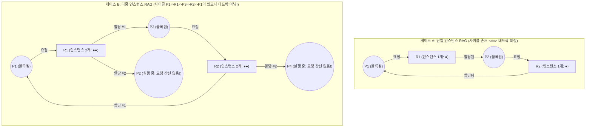
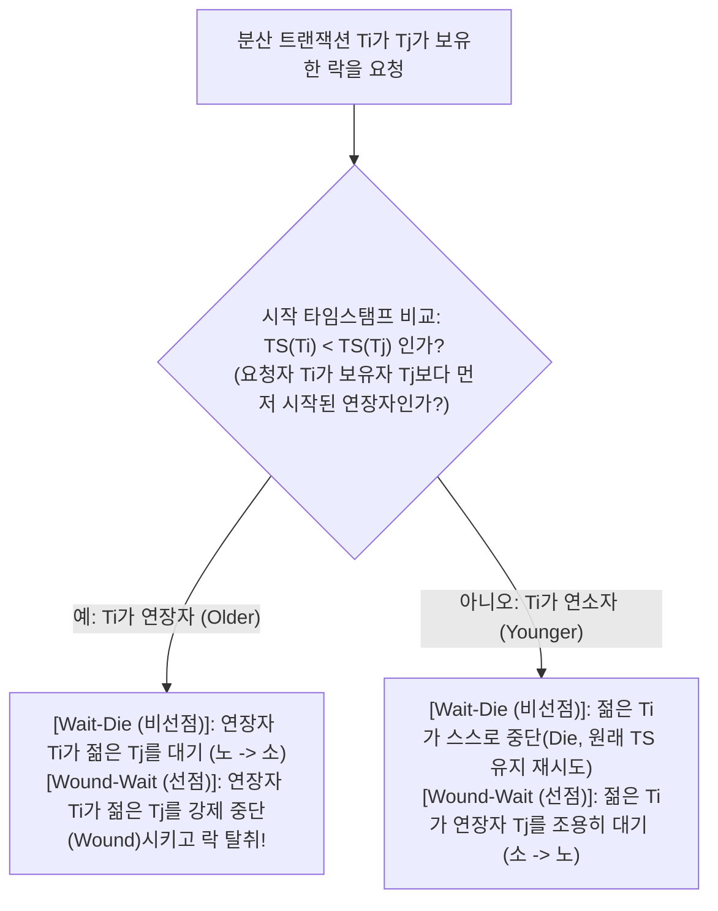

## 1. 서론: 식사하는 철학자 문제와 코프만(Coffman)의 데드락 4조건

1965년 네덜란드의 컴퓨터 과학자 <strong>에츠허르 다익스트라(Edsger W. Dijkstra)</strong>는 유명한 <strong>'식사하는 철학자 문제(Dining Philosophers Problem)'</strong>를 제시했다. 원탁에 앉은 5명의 철학자 $P_0 \dots P_4$ 사이에 포크 5개($F_0 \dots F_4$)가 놓여 있고, 양손의 포크 두 개를 동시에 잡아야만 스파게티를 먹을 수 있다. 만약 5명의 철학자가 정확히 같은 순간에 배고픔을 느끼고 일제히 자신의 왼쪽 포크 $F_i$를 집어 든다면, 모두가 오른쪽 포크가 비기를 영원히 기다리며 시스템 전체가 멈춰버린다. 이것이 바로 <strong>데드락(Deadlock, 교착 상태)</strong>이다.

형식적으로 프로세스 부분집합 $D \subseteq \mathcal{P}$($D \neq \emptyset$)가 데드락 상태에 있다는 것은, $D$에 속한 모든 프로세스 $P_i \in D$가 <strong>오직 같은 집합 $D$ 내의 다른 프로세스 $P_j \in D$만이 발생시킬 수 있는 이벤트(자원 해제 등)</strong>를 기다리며 영구히 블록된 상태를 뜻한다.

1971년 <strong>Edward G. Coffman Jr.</strong> 등은 자원 데드락이 발생하려면 다음 <strong>4가지 필요조건(코프만 조건)이 동시에 성립해야 함</strong>을 증명했다:
1. <strong>상호 배제(Mutual Exclusion)</strong>: 최소 하나 이상의 자원이 비공유(배타적) 모드로 점유되어야 한다.
2. <strong>점유와 대기(Hold and Wait)</strong>: 프로세스가 이미 최소 하나의 자원을 보유한 채로 다른 프로세스가 보유한 추가 자원을 기다려야 한다.
3. <strong>비선점(No Preemption)</strong>: 이미 할당된 자원을 OS나 다른 프로세스가 강제로 빼앗을 수 없으며, 보유자가 자발적으로만 해제한다.
4. <strong>순환 대기(Circular Wait)</strong>: 대기 중인 프로세스들의 닫힌 사슬 $\{P_0, P_1, \dots, P_{k-1}\}$이 존재하여 $P_i$가 $P_{(i+1)\bmod k}$의 자원을 기다려야 한다.

이 네 조건은 모두 필요조건이므로, 시스템 설계에서 <strong>단 하나의 조건만 논리적으로 부정(파괴)해도 데드락은 수학적으로 $100\%$ 불가능해진다</strong>.

---

## 2. 자원 할당 그래프(RAG)와 사이클 정리 (Holt, 1972)

1972년 Richard C. Holt는 정점 집합 $V = \mathcal{P} \cup \mathcal{R}$(프로세스 $P_i$와 $W_j \ge 1$개의 인스턴스를 가진 자원 타입 $R_j$) 및 <strong>요청 간선 $P_i \to R_j$</strong>, <strong>할당 간선 $R_j \to P_i$</strong>로 구성된 이분 유향 그래프인 <strong>자원 할당 그래프(Resource Allocation Graph, RAG)</strong>를 도입했다.

RAG 내의 <strong>유향 사이클(Directed Cycle)</strong>과 데드락 사이에는 세 가지 핵심 정리가 성립한다:
* <strong>정리 1 (비순환 무교착 정리)</strong>: RAG에 유향 사이클이 없으면(DAG이면) 데드락은 절대 존재하지 않는다.
* <strong>정리 2 (단일 인스턴스 필요충분 정리)</strong>: 모든 자원 타입이 <strong>단 1개의 인스턴스($\forall j, W_j = 1$)</strong>만 가질 때, <strong>유향 사이클 존재 $\iff$ 데드락 발생(필요충분조건)</strong>이다.
* <strong>정리 3 (다중 인스턴스 비충분 정리)</strong>: 자원 타입이 <strong>여러 개의 인스턴스($\exists j, W_j > 1$)</strong>를 가질 때, 유향 사이클은 데드락의 <strong>필요조건이지만 충분조건은 아니다</strong>!

케이스 B에서는 $P_1 \to R_1 \to P_3 \to R_2 \to P_1$ 사이클이 존재하지만, 두 번째 인스턴스를 쥔 $P_2$와 $P_4$가 아무런 요청 간선도 없는 싱크 정점(실행 중)이므로 작업 완료 후 자원을 반납하면 사이클이 자연스럽게 풀린다!

---

## 3. 전략 1 (데드락 예방): 전체 락 순서화(Total Lock Ordering)의 귀류법 증명

OS 커널(Linux `lockdep` 등)과 멀티스레드 프로그래밍에서 제4조건(순환 대기)을 깨뜨리는 표준 기법은 <strong>전체 락 순서화(Total Lock Ordering)</strong>다. 모든 락에 고유 순위 $\phi: \mathcal{L} \to \mathbb{N}$을 부여하고, 현재 락 집합 $\mathcal{H}$를 보유한 스레드는 반드시 순위가 엄격히 더 큰 락만 추가로 요청하도록 강제한다:

$$\forall L_{\text{held}} \in \mathcal{H}: \quad \phi(L_{\text{held}}) < \phi(L_{\text{new}})$$

<strong>【귀류법 증명】</strong>: 길이 $k \ge 2$인 순환 대기 사슬 $\{P_0, P_1, \dots, P_{k-1}\}$이 발생했다고 가정하자($P_i$는 $L_i$를 쥐고 $P_{(i+1)\bmod k}$가 쥔 $L_{(i+1)\bmod k}$를 대기). 모든 스레드가 락 순서 규칙을 준수하므로 다음 부등식이 성립한다:

$$\phi(L_0) < \phi(L_1) < \phi(L_2) < \cdots < \phi(L_{k-1}) < \phi(L_0) \implies \phi(L_0) < \phi(L_0)$$

어떤 자연수도 자기 자신보다 엄격히 작을 수 없으므로 모순($\bot$)이다! 따라서 계좌 이체 시 항상 계좌 ID가 작은 쪽부터 잠그거나, 마지막 철학자 $P_4$만 오른쪽 포크 $F_0$를 왼쪽 포크 $F_4$보다 먼저 집게($0 < 4$) 하면 데드락은 수학적으로 불가능해진다. $\blacksquare$

---

## 4. 전략 2 (데드락 회피): 다익스트라의 은행원 알고리즘과 5×3 행렬 추적

락 순서를 고정할 수 없을 때 사용하는 <strong>은행원 알고리즘(Banker's Algorithm, 1965 / Habermann, 1969)</strong>은 각 프로세스의 최대 요구량 행렬 $\mathbf{Max}$를 사전 신고받고, 자원 요청 시마다 <strong>$O(m \cdot n^2)$</strong> 안전성 알고리즘을 돌려 모든 프로세스가 무사히 종료할 수 있는 <strong>안전 순서열(Safe Sequence)</strong>이 존재하는지 검사한다(주의: $\text{데드락 상태} \subsetneq \text{불안전 상태(Unsafe State)}$).

$n=5$개 프로세스 $\{P_0 \dots P_4\}$와 총량 $\mathbf{Total} = (A=10, B=5, C=7)$인 시스템에서 시각 $t_0$의 상태가 아래와 같을 때, 현재 가용 자원은 $\mathbf{Available} = (10,5,7) - (7,2,5) = \mathbf{(3, 3, 2)}$이다:

| 프로세스 | 할당 $\mathbf{Allocation}$ $(A,B,C)$ | 최대 $\mathbf{Max}$ $(A,B,C)$ | 잔여 필요 $\mathbf{Need} = \mathbf{Max} - \mathbf{Allocation}$ | 안전 순서열 탐색 (초기 $\mathbf{Work} = (3,3,2)$) |
| :--- | :---: | :---: | :---: | :--- |
| <strong>$P_0$</strong> | $(0, 1, 0)$ | $(7, 5, 3)$ | $(7, 4, 3)$ | 4단계 충족: $(7,4,3) \le (7,4,5) \to \mathbf{Work}=(7,5,5)$ |
| <strong>$P_1$</strong> | $(2, 0, 0)$ | $(3, 2, 2)$ | $(1, 2, 2)$ | <strong>1단계 충족</strong>: $(1,2,2) \le (3,3,2) \to \mathbf{Work}=(5,3,2)$ |
| <strong>$P_2$</strong> | $(3, 0, 2)$ | $(9, 0, 2)$ | $(6, 0, 0)$ | 5단계 충족: $(6,0,0) \le (7,5,5) \to \mathbf{Work}=(10,5,7)$ |
| <strong>$P_3$</strong> | $(2, 1, 1)$ | $(2, 2, 2)$ | $(0, 1, 1)$ | <strong>2단계 충족</strong>: $(0,1,1) \le (5,3,2) \to \mathbf{Work}=(7,4,3)$ |
| <strong>$P_4$</strong> | $(0, 0, 2)$ | $(4, 3, 3)$ | $(4, 3, 1)$ | <strong>3단계 충족</strong>: $(4,3,1) \le (7,4,3) \to \mathbf{Work}=(7,4,5)$ |

안전 순서열 $\langle P_1, P_3, P_4, P_0, P_2 \rangle$이 존재하므로 $t_0$는 <strong>안전 상태(Safe State)</strong>다. 여기서 $P_1$이 $(1,0,2)$를 요청하면 가할당 후 $\mathbf{Available}=(2,3,0)$으로 여전히 안전하여 <strong>즉시 승인</strong>되지만, 직후 $P_0$가 $(0,2,0)$을 요청하면 가할당 후 $\mathbf{Available}=(2,1,0)$이 되어 단 하나의 프로세스도 $\mathbf{Need}$를 충족할 수 없는 <strong>불안전 상태(Unsafe)</strong>에 빠지므로 은행원 알고리즘은 이를 <strong>즉시 거부하고 $P_0$를 대기</strong>시킨다!

---

## 5. 전략 3 & 4 (탐지 및 회복 / 타조 알고리즘) 및 데드락 vs. 라이브락 vs. 기아

RDBMS(PostgreSQL, MySQL InnoDB 등)는 트랜잭션 간 <strong>대기 그래프(Wait-For Graph, WFG)</strong>에서 $O(|V|+|E|)$ DFS로 사이클을 탐지하여 Undo 로그가 가장 적은 희생자(Victim)를 롤백시킨다(MySQL은 즉시 탐지, PostgreSQL은 `deadlock_timeout = 1s` 대기 후 탐지). 분산 데이터베이스(Google Spanner 등)는 시작 타임스탬프 $\text{TS}(T_i)$(작을수록 연장자)를 이용한 <strong>Wait-Die(비선점)</strong>와 <strong>Wound-Wait(선점: 연장자가 젊은 트랜잭션을 강제 롤백시켜 불필요한 재시작이 적음)</strong> 프로토콜을 쓰며, 롤백 후 재시도 시 반드시 <strong>원래 타임스탬프를 유지</strong>하여 기아(Starvation)를 방지한다. 한편 극히 드문 OS 테이블 고갈 데드락에 대해서는 일상적 오버헤드를 피하기 위해 문제를 무시하는 <strong>타조 알고리즘(Ostrich Algorithm)</strong>이 쓰인다.

마지막으로 동시성 시스템의 3대 <strong>활성 장애(Liveness Failures)</strong>인 데드락, <strong>라이브락(Livelock)</strong>, <strong>기아(Starvation)</strong>의 차이는 다음과 같다:

| 비교 차원 | 데드락 (Deadlock) | 라이브락 (Livelock) | 기아 상태 (Starvation) |
| :--- | :--- | :--- | :--- |
| <strong>핵심 메커니즘</strong> | 블록된 스레드들이 서로 상대의 자원 해제를 기다리는 순환 대기 | 데드락을 피하려 대칭적으로 `trylock` 실패 및 해제를 무한 반복(좁은 복도에서 동시에 같은 쪽으로 비키기) | 다른 스레드는 정상 진행하나 특정 스레드만 우선순위/락 정책 때문에 영원히 밀려남 |
| <strong>OS 상태 및 CPU 사용률</strong> | <strong>`SLEEPING` / `BLOCKED` (CPU 사용률 $0\%$)</strong> | <strong>`RUNNING` (CPU 사용률 $100\%$ 폭주, 실질적 진행은 0)</strong> | 대기 큐에서 장기 체류 (피해 스레드 CPU $0\%$) |
| <strong>근본적 공학 해결책</strong> | 전체 락 순서화($\phi(L_1)<\phi(L_2)$), 은행원 알고리즘, WFG 롤백 | <strong>무작위 지수 백오프(Randomized Exponential Backoff with Jitter)로 시간적 대칭성 파괴</strong> | <strong>에이징(Aging, 대기 시간에 따른 우선순위 격상)</strong>, 공정한 FIFO 큐 락(MCS 락) |
