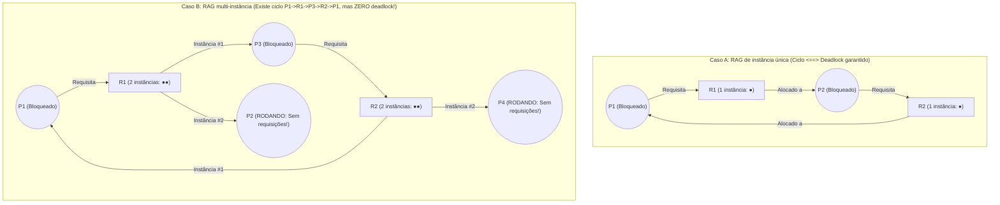
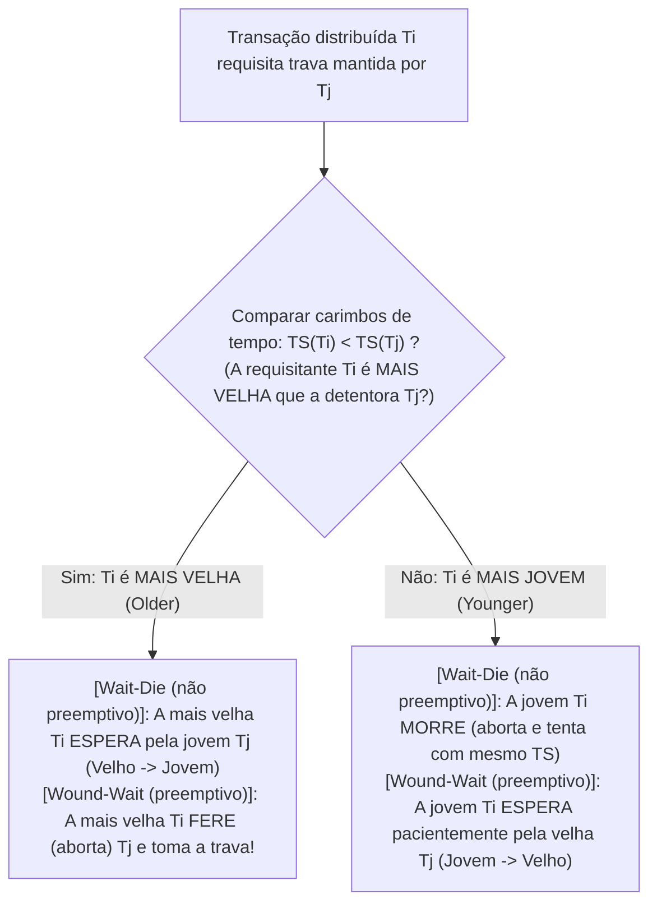

## 1. Introdução: O jantar dos filósofos e as quatro condições de Coffman (1971)

Em 1965, o cientista da computação holandês <strong>Edsger W. Dijkstra</strong> formulou o célebre <strong>problema do jantar dos filósofos (Dining Philosophers Problem)</strong>: cinco filósofos $P_0 \dots P_4$ sentam-se ao redor de uma mesa circular; entre cada prato de espaguete há um único garfo ($F_0 \dots F_4$). Para comer, cada filósofo precisa segurar simultaneamente seu garfo esquerdo $F_i$ e seu garfo direito $F_{(i+1)\bmod 5}$. Se todos os cinco filósofos sentirem fome no mesmo microssegundo e pegarem seu garfo esquerdo $F_i$, cada um esperará eternamente que seu vizinho da direita solte o segundo garfo: todo o sistema congela para sempre. Isso é um <strong>impasse ou bloqueio mútuo (Deadlock)</strong>.

Formalmente, um subconjunto não vazio de processos $D \subseteq \mathcal{P}$ está em deadlock se e somente se cada processo $P_i \in D$ está bloqueado aguardando um evento (como a liberação de uma trava) que <strong>só pode ser disparado por outro processo $P_j \in D$ pertencente ao mesmo conjunto de espera</strong>.

Em 1971, <strong>Edward G. Coffman Jr.</strong>, M. J. Elphick e Arie Shoshani provaram que um deadlock de recursos só pode ocorrer se <strong>quatro condições necessárias forem satisfeitas simultaneamente</strong>:
1. <strong>Exclusão mútua (Mutual Exclusion)</strong>: Pelo menos um recurso é mantido em modo exclusivo (não compartilhável).
2. <strong>Retenção e espera (Hold and Wait)</strong>: Um processo já retém pelo menos um recurso enquanto aguarda bloqueado para adquirir recursos adicionais retidos por outros processos.
3. <strong>Não preempção (No Preemption)</strong>: Recursos alocados não podem ser tomados à força; só são liberados voluntariamente pelo detentor.
4. <strong>Espera circular (Circular Wait)</strong>: Existe uma cadeia fechada de processos $\{P_0, P_1, \dots, P_{k-1}\}$ tal que cada $P_i$ aguarda um recurso retido por $P_{(i+1)\bmod k}$.

Como todas as quatro condições são individualmente necessárias, <strong>negar logicamente apenas uma delas torna o deadlock matematicamente impossível ($0\,\%$)</strong>.

---

## 2. Grafo de Alocação de Recursos (RAG) e teoremas de ciclos (Holt, 1972)

Em 1972, Richard C. Holt modelou o estado dos recursos como um grafo direcionado bipartido chamado <strong>Grafo de Alocação de Recursos (RAG)</strong> $G = (V, E)$, com vértices $V = \mathcal{P} \cup \mathcal{R}$ (processos $P_i$ e tipos de recursos $R_j$ com $W_j \ge 1$ instâncias idênticas), <strong>arestas de requisição $P_i \to R_j$</strong> e <strong>arestas de alocação $R_j \to P_i$</strong>.

Três teoremas fundamentais relacionam os ciclos direcionados de $G$ ao deadlock:
* <strong>Teorema 1 (Aciclicidade $\implies$ Ausência de deadlock)</strong>: Se $G$ não contém ciclos direcionados (é um DAG), nenhum processo está em deadlock.
* <strong>Teorema 2 (Condição necessária e suficiente em instância única)</strong>: Se cada tipo de recurso possui <strong>uma única instância ($\forall j, W_j = 1$)</strong>, então <strong>ciclo direcionado em $G \iff$ deadlock</strong>.
* <strong>Teorema 3 (Não suficiência em múltiplas instâncias)</strong>: Se algum recurso possui <strong>múltiplas instâncias ($\exists j, W_j > 1$)</strong>, a presença de um ciclo direcionado é condição <strong>necessária, mas NÃO suficiente</strong> para o deadlock!

No Caso B existe o ciclo $P_1 \to R_1 \to P_3 \to R_2 \to P_1$, mas $P_2$ e $P_4$ têm grau de saída $0$ (sorvedouros ativos): assim que terminarem e liberarem suas instâncias de $R_1$ e $R_2$, o ciclo será desfeito naturalmente.

---

## 3. Estratégia 1 (Prevenção): Prova por contradição da ordenação total de travas

Em núcleos de SO (como o validador `lockdep` do Linux) e sistemas multithread, a condição 4 (espera circular) é eliminada impondo uma <strong>ordenação total de travas (Total Lock Ordering)</strong>: atribui-se a cada mutex $L \in \mathcal{L}$ um posto global único $\phi(L) \in \mathbb{N}$, exigindo que qualquer thread que retenha o conjunto $\mathcal{H}$ só possa requisitar uma nova trava $L_{\text{new}}$ se seu posto for estritamente maior:

$$\forall L_{\text{held}} \in \mathcal{H}: \quad \phi(L_{\text{held}}) < \phi(L_{\text{new}})$$

<strong>【Prova por contradição】</strong>: Suponha que se forme um ciclo de espera $\{P_0, P_1, \dots, P_{k-1}\}$ ($k \ge 2$), onde $P_i$ retém $L_i$ e aguarda $L_{(i+1)\bmod k}$. Como todos obedecem à regra de ordem estrita, encadeando as desigualdades ao longo do ciclo obtemos:

$$\phi(L_0) < \phi(L_1) < \phi(L_2) < \cdots < \phi(L_{k-1}) < \phi(L_0) \implies \phi(L_0) < \phi(L_0)$$

Como nenhum número natural pode ser estritamente menor que si mesmo, chegamos a uma contradição ($\bot$)! Seja em transferências bancárias (travar sempre a conta de menor ID primeiro) ou no jantar dos filósofos (fazer $P_4$ pegar primeiro o garfo direito $F_0$ antes do esquerdo $F_4$, pois $0 < 4$), a espera circular torna-se impossível. $\blacksquare$

---

## 4. Estratégia 2 (Evitação): Algoritmo do banqueiro de Dijkstra (Rastreamento 5×3)

Quando a ordem de alocação é dinâmica, o <strong>algoritmo do banqueiro de Dijkstra (1965 / Habermann, 1969)</strong> exige a declaração prévia da demanda máxima $\mathbf{Max}$ e verifica em tempo <strong>$O(m \cdot n^2)$</strong> antes de cada concessão se o estado resultante permanece um <strong>estado seguro (Safe State)</strong> com pelo menos uma <strong>sequência segura (Safe Sequence)</strong> ($\text{Deadlock} \subsetneq \text{Estado inseguro}$).

Para $n=5$ processos $\{P_0 \dots P_4\}$ e $m=3$ recursos com $\mathbf{Total} = (A=10, B=5, C=7)$ e soma alocada $(7,2,5)$, o vetor disponível inicial é $\mathbf{Available} = (10,5,7) - (7,2,5) = \mathbf{(3, 3, 2)}$:

| Processo | Alocado $\mathbf{Allocation}$ $(A,B,C)$ | Máximo $\mathbf{Max}$ $(A,B,C)$ | Necessidade $\mathbf{Need} = \mathbf{Max} - \mathbf{Allocation}$ | Rastreamento de sequência segura ($\mathbf{Work}_0 = (3,3,2)$) |
| :--- | :---: | :---: | :---: | :--- |
| <strong>$P_0$</strong> | $(0, 1, 0)$ | $(7, 5, 3)$ | $(7, 4, 3)$ | Passo 4 atende: $(7,4,3) \le (7,4,5) \to \mathbf{Work}=(7,5,5)$ |
| <strong>$P_1$</strong> | $(2, 0, 0)$ | $(3, 2, 2)$ | $(1, 2, 2)$ | <strong>Passo 1 atende</strong>: $(1,2,2) \le (3,3,2) \to \mathbf{Work}=(5,3,2)$ |
| <strong>$P_2$</strong> | $(3, 0, 2)$ | $(9, 0, 2)$ | $(6, 0, 0)$ | Passo 5 atende: $(6,0,0) \le (7,5,5) \to \mathbf{Work}=(10,5,7)$ |
| <strong>$P_3$</strong> | $(2, 1, 1)$ | $(2, 2, 2)$ | $(0, 1, 1)$ | <strong>Passo 2 atende</strong>: $(0,1,1) \le (5,3,2) \to \mathbf{Work}=(7,4,3)$ |
| <strong>$P_4$</strong> | $(0, 0, 2)$ | $(4, 3, 3)$ | $(4, 3, 1)$ | <strong>Passo 3 atende</strong>: $(4,3,1) \le (7,4,3) \to \mathbf{Work}=(7,4,5)$ |

A sequência segura $\langle P_1, P_3, P_4, P_0, P_2 \rangle$ prova que $t_0$ é <strong>seguro</strong>. Se $P_1$ requisitar $(1,0,2)$, a alocação tentativa deixa $\mathbf{Available}=(2,3,0) \ge \mathbf{Need}_1=(0,2,0)$ (<strong>concedida imediatamente</strong>). Mas se logo a seguir $P_0$ requisitar $(0,2,0)$, o disponível cai para $(2,1,0)$, que não atende ao $\mathbf{Need}$ de nenhum processo (<strong>estado inseguro</strong>): o banqueiro <strong>rejeita o pedido e bloqueia $P_0$</strong>!

---

## 5. Estratégias 3 e 4 (Detecção WFG, Wait-Die/Wound-Wait, Avestruz) e Livelock vs. Inanição

SGBDs relacionais (PostgreSQL, MySQL InnoDB) constroem um <strong>grafo de espera (Wait-For Graph, WFG)</strong> e buscam ciclos via DFS em $O(|V|+|E|)$, abortando (*rollback*) a transação vítima com menor log Undo (detecção imediata no MySQL; após `deadlock_timeout = 1s` no PostgreSQL). Bancos distribuídos (Google Spanner) usam os protocolos baseados em carimbo de tempo $\text{TS}(T_i)$ de Rosenkrantz et al. (1978): <strong>Wait-Die (não preemptivo)</strong> e <strong>Wound-Wait (preemptivo, com menos reinícios)</strong>, mantendo sempre o <strong>carimbo de tempo original $\text{TS}(T_i)$ ao reiniciar</strong> para evitar inanição. Para raros esgotamentos de tabelas em SOs de uso geral, UNIX e Windows aplicam o <strong>algoritmo do avestruz (Ostrich Algorithm)</strong> ignorando o problema para não impor sobrecarga diária.

Por fim, comparemos as três falhas de <strong>vivacidade (Liveness)</strong>:

| Dimensão de diagnóstico | Deadlock (Impasse) | Livelock | Inanição (Starvation) |
| :--- | :--- | :--- | :--- |
| <strong>Mecanismo central</strong> | Espera circular entre threads bloqueadas retendo recursos | Laços simétricos de `trylock` e liberação imediata sem avanço (dança de cortesia no corredor) | O sistema global avança, mas uma thread de baixa prioridade é preterida indefinidamente |
| <strong>Estado no SO e uso de CPU</strong> | <strong>`SLEEPING` / `BLOCKED` ($0\,\%$ de CPU)</strong> | <strong>`RUNNING` ($\approx 100\,\%$ de CPU girando sem progresso)</strong> | Aguardando na fila ($0\,\%$ de CPU para a vítima) |
| <strong>Solução de engenharia</strong> | Ordenação total ($\phi(L_1)<\phi(L_2)$), Banqueiro, WFG rollback | <strong>Recuo exponencial aleatório com jitter (Random Exponential Backoff + Jitter)</strong> | <strong>Envelhecimento (Aging)</strong>, preservar TS original, travas FIFO justas (MCS lock) |
