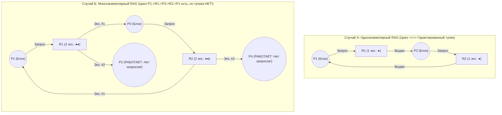
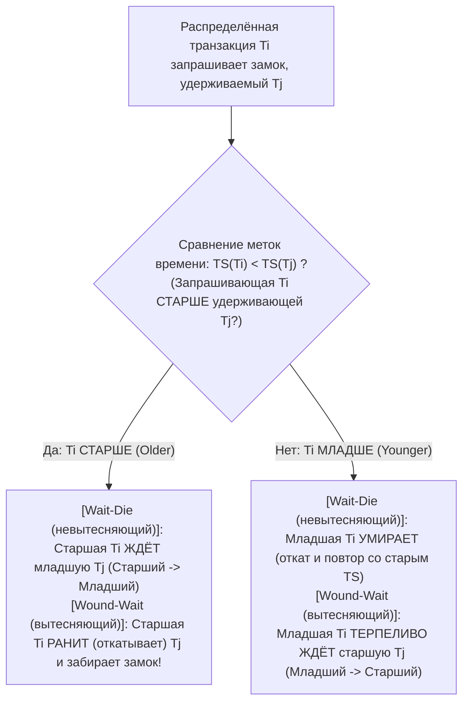

## 1. Введение: Задача об обедающих философах и четыре условия Коффмана (1971)

В 1965 году нидерландский информатик <strong>Эдсгер В. Дейкстра (Edsger W. Dijkstra)</strong> сформулировал знаменитую <strong>«задачу об обедающих философах» (Dining Philosophers Problem)</strong>: пять философов $P_0 \dots P_4$ сидят за круглым столом; между каждыми двумя тарелками спагетти лежит одна вилка ($F_0 \dots F_4$). Чтобы есть, каждому философу нужно одновременно держать левую вилку $F_i$ и правую вилку $F_{(i+1)\bmod 5}$. Если все пятеро проголодаются в одну и ту же микросекунду и одновременно возьмут левую вилку $F_i$, каждый будет вечно ждать, пока сосед справа положит вторую вилку — вся система навсегда замрёт. Это явление называется <strong>взаимной блокировкой или тупиком (Deadlock)</strong>.

Формально непустое подмножество процессов $D \subseteq \mathcal{P}$ находится в состоянии дедлока тогда и только тогда, когда каждый процесс $P_i \in D$ заблокирован в ожидании события (освобождения ресурса), которое <strong>может быть вызвано только другим процессом $P_j \in D$ из того же самого множества ожидания</strong>.

В 1971 году <strong>Эдвард Коффман (Edward G. Coffman Jr.)</strong>, М. Элфик и А. Шошани доказали, что ресурсный тупик возможен лишь при <strong>одновременном выполнении четырёх необходимых условий</strong>:
1. <strong>Взаимное исключение (Mutual Exclusion)</strong>: Хотя бы один ресурс удерживается в монопольном (неразделяемом) режиме.
2. <strong>Удержание и ожидание (Hold and Wait)</strong>: Процесс уже удерживает минимум один ресурс и одновременно блокируется, запрашивая дополнительные ресурсы, занятые другими процессами.
3. <strong>Отсутствие вытеснения (No Preemption)</strong>: Выделенные ресурсы нельзя принудительно отобрать у процесса; он освобождает их только добровольно.
4. <strong>Циклическое ожидание (Circular Wait)</strong>: Существует замкнутая цепь процессов $\{P_0, P_1, \dots, P_{k-1}\}$, где каждый $P_i$ ждёт ресурс, удерживаемый $P_{(i+1)\bmod k}$.

Поскольку все четыре условия необходимы, <strong>логическое отрицание хотя бы одного из них делает дедлок математически невозможным ($0\,\%$)</strong>.

---

## 2. Граф распределения ресурсов (RAG) и теоремы о циклах (Holt, 1972)

В 1972 году Ричард Холт представил состояние ресурсов в виде двудольного ориентированного <strong>графа распределения ресурсов (RAG)</strong> $G = (V, E)$, где $V = \mathcal{P} \cup \mathcal{R}$ (вершины процессов $P_i$ и типов ресурсов $R_j$ с $W_j \ge 1$ идентичными экземплярами), а дуги делятся на <strong>дуги запросов $P_i \to R_j$</strong> и <strong>дуги назначений $R_j \to P_i$</strong>.

Связь между ориентированными циклами в $G$ и тупиками определяют три теоремы:
* <strong>Теорема 1 (Ацикличность $\implies$ Отсутствие тупика)</strong>: Если в $G$ нет ориентированных циклов (граф является DAG), ни один процесс не находится в тупике.
* <strong>Теорема 2 (Критерий для единичных экземпляров)</strong>: Если каждый ресурс имеет <strong>ровно один экземпляр ($\forall j, W_j = 1$)</strong>, то <strong>ориентированный цикл в $G \iff$ тупик (необходимое и достаточное условие)</strong>.
* <strong>Теорема 3 (Недостаточность цикла при кратных экземплярах)</strong>: Если хотя бы один ресурс имеет <strong>несколько экземпляров ($\exists j, W_j > 1$)</strong>, наличие цикла является <strong>необходимым, но НЕ достаточным условием</strong> тупика!

В Случае Б есть цикл $P_1 \to R_1 \to P_3 \to R_2 \to P_1$, но процессы $P_2$ и $P_4$ имеют полустепень исхода $0$ (активные стоки): завершив работу и вернув свои экземпляры $R_1$ и $R_2$, они разрушат цикл!

---

## 3. Стратегия 1 (Предотвращение): Доказательство полного упорядочения блокировок

В ядрах ОС (валидатор `lockdep` в Linux) и многопоточном коде условие 4 (циклическое ожидание) устраняется <strong>полным упорядочением блокировок (Total Lock Ordering)</strong>: каждому мьютексу $L \in \mathcal{L}$ присваивается уникальный ранг $\phi(L) \in \mathbb{N}$, и поток, удерживающий множество $\mathcal{H}$, имеет право запрашивать новый замок $L_{\text{new}}$ только со строго большим рангом:

$$\forall L_{\text{held}} \in \mathcal{H}: \quad \phi(L_{\text{held}}) < \phi(L_{\text{new}})$$

<strong>【Доказательство от противного】</strong>: Допустим, возник цикл ожидания $\{P_0, P_1, \dots, P_{k-1}\}$ ($k \ge 2$), где $P_i$ удерживает $L_i$ и ждёт $L_{(i+1)\bmod k}$. Поскольку все потоки соблюдают правило строгого возрастания $\phi$, вдоль цикла получаем:

$$\phi(L_0) < \phi(L_1) < \phi(L_2) < \cdots < \phi(L_{k-1}) < \phi(L_0) \implies \phi(L_0) < \phi(L_0)$$

Ни одно число не может быть строго меньше самого себя — противоречие ($\bot$)! Будь то банковский перевод (всегда блокировать сначала счёт с меньшим ID) или обедающие философы ($P_4$ берёт сначала правую вилку $F_0$, а затем левую $F_4$, так как $0 < 4$), циклическое ожидание становится невозможным. $\blacksquare$

---

## 4. Стратегия 2 (Избежание): Алгоритм банкира Дейкстры (Трассировка 5×3)

Когда порядок захвата динамичен, <strong>алгоритм банкира Дейкстры (1965 / Habermann, 1969)</strong> требует заранее заявить максимальную потребность $\mathbf{Max}$ и перед каждой выдачей за время <strong>$O(m \cdot n^2)$</strong> проверяет, остаётся ли состояние <strong>безопасным (Safe State)</strong> с хотя бы одной <strong>безопасной последовательностью (Safe Sequence)</strong> ($\text{Тупик} \subsetneq \text{Небезопасное состояние}$).

Для $n=5$ процессов $\{P_0 \dots P_4\}$ и $m=3$ ресурсов с $\mathbf{Total} = (A=10, B=5, C=7)$ при сумме выданных $(7,2,5)$ начальный свободный вектор равен $\mathbf{Available} = (10,5,7) - (7,2,5) = \mathbf{(3, 3, 2)}$:

| Процесс | Выдано $\mathbf{Allocation}$ $(A,B,C)$ | Макс. $\mathbf{Max}$ $(A,B,C)$ | Остаток $\mathbf{Need} = \mathbf{Max} - \mathbf{Allocation}$ | Поиск безопасной последовательности ($\mathbf{Work}_0 = (3,3,2)$) |
| :--- | :---: | :---: | :---: | :--- |
| <strong>$P_0$</strong> | $(0, 1, 0)$ | $(7, 5, 3)$ | $(7, 4, 3)$ | Шаг 4 выполнен: $(7,4,3) \le (7,4,5) \to \mathbf{Work}=(7,5,5)$ |
| <strong>$P_1$</strong> | $(2, 0, 0)$ | $(3, 2, 2)$ | $(1, 2, 2)$ | <strong>Шаг 1 выполнен</strong>: $(1,2,2) \le (3,3,2) \to \mathbf{Work}=(5,3,2)$ |
| <strong>$P_2$</strong> | $(3, 0, 2)$ | $(9, 0, 2)$ | $(6, 0, 0)$ | Шаг 5 выполнен: $(6,0,0) \le (7,5,5) \to \mathbf{Work}=(10,5,7)$ |
| <strong>$P_3$</strong> | $(2, 1, 1)$ | $(2, 2, 2)$ | $(0, 1, 1)$ | <strong>Шаг 2 выполнен</strong>: $(0,1,1) \le (5,3,2) \to \mathbf{Work}=(7,4,3)$ |
| <strong>$P_4$</strong> | $(0, 0, 2)$ | $(4, 3, 3)$ | $(4, 3, 1)$ | <strong>Шаг 3 выполнен</strong>: $(4,3,1) \le (7,4,3) \to \mathbf{Work}=(7,4,5)$ |

Безопасная последовательность $\langle P_1, P_3, P_4, P_0, P_2 \rangle$ доказывает безопасность $t_0$. Если $P_1$ запросит $(1,0,2)$, пробная выдача оставит $\mathbf{Available}=(2,3,0) \ge \mathbf{Need}_1=(0,2,0)$ (<strong>одобрено мгновенно</strong>). Но если следом $P_0$ запросит $(0,2,0)$, остаток упадёт до $(2,1,0)$, чего не хватит ни одному процессу (<strong>небезопасное состояние</strong>): банкир <strong>отклонит запрос и заблокирует $P_0$</strong>!

---

## 5. Стратегии 3 и 4 (WFG, Wait-Die/Wound-Wait, Страус) и Livelock против голодания

Реляционные СУБД (PostgreSQL, MySQL InnoDB) строят <strong>граф ожидания (Wait-For Graph, WFG)</strong> и ищут циклы обходом в глубину (DFS) за $O(|V|+|E|)$, откатывая (*rollback*) транзакцию-жертву с наименьшим Undo-логом (MySQL проверяет мгновенно; PostgreSQL — через `deadlock_timeout = 1s`). Распределённые СУБД (Google Spanner) используют протоколы с временными метками $\text{TS}(T_i)$ Розенкранца и др. (1978): <strong>Wait-Die (невытесняющий)</strong> и <strong>Wound-Wait (вытесняющий, меньше холостых перезапусков)</strong>, обязательно <strong>сохраняя исходную метку $\text{TS}(T_i)$ при перезапуске</strong> для защиты от голодания. Для редчайших переполнений системных таблиц ОС общего назначения применяют <strong>алгоритм страуса (Ostrich Algorithm)</strong>, игнорируя проблему ради отсутствия ежедневных накладных расходов.

Наконец, сравним три вида отказов <strong>живучести (Liveness)</strong>:

| Критерий диагностики | Взаимная блокировка (Deadlock) | Активный тупик (Livelock) | Голодание (Starvation) |
| :--- | :--- | :--- | :--- |
| <strong>Механизм</strong> | Циклическое ожидание спящих потоков, удерживающих ресурсы | Симметричные циклы `trylock` и немедленного освобождения без продвижения («танец вежливости» в коридоре) | Система в целом работает, но низкоприоритетный поток вечно обходят в очереди |
| <strong>Статус ОС и загрузка CPU</strong> | <strong>`SLEEPING` / `BLOCKED` ($0\,\%$ CPU)</strong> | <strong>`RUNNING` ($\approx 100\,\%$ CPU вхолостую при нулевом прогрессе!)</strong> | Ожидание в очереди ($0\,\%$ CPU у жертвы) |
| <strong>Инженерное решение</strong> | Полный порядок ($\phi(L_1)<\phi(L_2)$), алгоритм банкира, откат по WFG | <strong>Случайная экспоненциальная задержка с джиттером (Random Exponential Backoff + Jitter)</strong> | <strong>Старение приоритета (Aging)</strong>, сохранение TS, честные FIFO-замки (MCS lock) |
