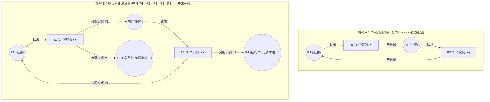
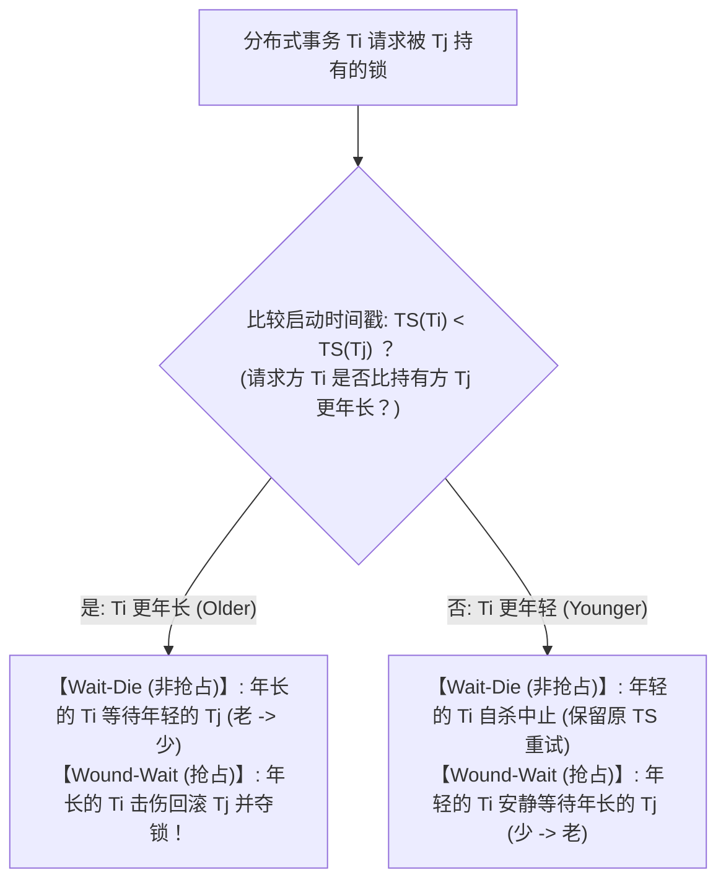

## 1. 引言：哲学家就餐问题与科夫曼（Coffman）死锁四条件

1965年，荷兰计算机科学家<strong>艾兹赫尔·迪杰斯特拉（Edsger W. Dijkstra）</strong>提出了著名的<strong>“哲学家就餐问题（Dining Philosophers Problem）”</strong>：五位哲学家 $P_0 \dots P_4$ 围坐圆桌，每人左右两侧各有一把叉子 $F_i$ 与 $F_{(i+1)\bmod 5}$（共5把叉子），必须同时拿起左右两把叉子才能进餐。如果五位哲学家在同一瞬间感到饥饿，并各自拿起左手的叉子 $F_i$，那么每个人都会握着左叉永远等待邻居释放右叉——没有任何硬件故障，整个系统却陷入了永久停滞，这便是<strong>死锁（Deadlock）</strong>。

形式化地说，进程集合 $D \subseteq \mathcal{P}$（$D \neq \emptyset$）处于死锁状态，当且仅当 $D$ 中的每一个进程 $P_i \in D$ 都在等待某个只能由<strong>同一集合 $D$ 中的其他进程 $P_j \in D$</strong> 触发的事件（如释放锁资源）。

1971年，<strong>Edward G. Coffman Jr.</strong> 等人证明了资源死锁发生必须<strong>同时满足四个必要条件（科夫曼条件）</strong>：
1. <strong>互斥（Mutual Exclusion）</strong>：至少有一种资源以排他（非共享）模式被单个进程独占。
2. <strong>占有并等待（Hold and Wait）</strong>：进程在已经持有至少一个资源的同时，阻塞等待获取其他进程持有的额外资源。
3. <strong>不可抢占（No Preemption）</strong>：已分配给进程的资源不能被操作系统或他者强行剥夺，只能由持有者主动释放。
4. <strong>循环等待（Circular Wait）</strong>：存在闭合的等待链 $\{P_0, P_1, \dots, P_{k-1}\}$，使得 $P_i$ 等待 $P_{(i+1)\bmod k}$ 持有的资源。

由于这四个条件均为必要条件，只要在系统设计中<strong>逻辑否定其中任意一个条件，死锁在数学上就 $100\%$ 不可能发生</strong>。

---

## 2. 资源分配图（RAG）与环路定理（Holt, 1972）

1972年，Richard C. Holt 引入了有向二分图——<strong>资源分配图（Resource Allocation Graph, RAG）</strong> $G = (V, E)$，其中顶点集 $V = \mathcal{P} \cup \mathcal{R}$（进程顶点 $P_i$ 与资源类型顶点 $R_j$，每个 $R_j$ 含 $W_j \ge 1$ 个实例），有向边分为<strong>请求边 $P_i \to R_j$</strong>（等待分配）与<strong>分配边 $R_j \to P_i$</strong>（已持有实例）。

关于 RAG 中的<strong>有向环（Directed Cycle）</strong>与死锁的关系，存在三大核心定理：
* <strong>定理 1（无环必无死锁）</strong>：若 RAG 中不存在有向环（即为 DAG），则系统中绝无死锁。
* <strong>定理 2（单实例充要定理）</strong>：若所有资源类型均<strong>只有一个实例（$\forall j, W_j = 1$）</strong>，则<strong>存在有向环 $\iff$ 发生死锁（充分必要条件）</strong>。
* <strong>定理 3（多实例非充分定理）</strong>：若某资源类型具有<strong>多个实例（$\exists j, W_j > 1$）</strong>，则有向环只是死锁的<strong>必要条件而非充分条件</strong>！

在情况 B 中，虽然存在环 $P_1 \to R_1 \to P_3 \to R_2 \to P_1$，但持有第二个实例的 $P_2$ 与 $P_4$ 出度为 $0$（汇点，正在运行），它们执行完毕释放 $R_1, R_2$ 后即可立即解开环路！

---

## 3. 策略1（死锁预防）：全序加锁规则的反证法证明

在操作系统内核（如 Linux `lockdep`）与多线程工程中，打破第4条件（循环等待）的黄金法则是<strong>全局锁排序（Total Lock Ordering）</strong>：为所有锁赋予唯一序号 $\phi: \mathcal{L} \to \mathbb{N}$，强制要求任何线程在持有锁集 $\mathcal{H}$ 时，只能请求序号严格更大的新锁：

$$\forall L_{\text{held}} \in \mathcal{H}: \quad \phi(L_{\text{held}}) < \phi(L_{\text{new}})$$

<strong>【反证法证明】</strong>：假设系统发生了长度为 $k \ge 2$ 的循环等待环 $\{P_0, P_1, \dots, P_{k-1}\}$，其中 $P_i$ 持有锁 $L_i$ 并等待 $P_{(i+1)\bmod k}$ 持有的锁 $L_{(i+1)\bmod k}$。由于每个线程均遵守全序加锁规则，必有：

$$\phi(L_0) < \phi(L_1) < \phi(L_2) < \cdots < \phi(L_{k-1}) < \phi(L_0) \implies \phi(L_0) < \phi(L_0)$$

自然数不可能严格小于自身，矛盾（$\bot$）！因此在全序加锁规则下（如银行转账始终先锁 ID 较小的账户，或让哲学家 $P_4$ 先拿右叉 $F_0$ 再拿左叉 $F_4$），循环等待在数学上绝不可能存在。$\blacksquare$

---

## 4. 策略2（死锁避免）：迪杰斯特拉银行家算法与 5×3 矩阵推演

当无法静态固定加锁顺序时，<strong>迪杰斯特拉银行家算法（Banker's Algorithm, 1965 / Habermann, 1969）</strong>要求进程预先申报最大需求矩阵 $\mathbf{Max}$，并在每次分配前通过复杂度为 <strong>$O(m \cdot n^2)$</strong> 的安全性算法检验系统是否仍存在至少一条<strong>安全序列（Safe Sequence）</strong>（注意：$\text{死锁状态} \subsetneq \text{不安全状态}$，不安全状态并非已死锁，而是存在未来可能死锁的风险）。

设系统有 $n=5$ 个进程 $\{P_0 \dots P_4\}$，3 类资源 $\mathbf{Total} = (A=10, B=5, C=7)$，时刻 $t_0$ 状态如下表所示，当前剩余可用资源为 $\mathbf{Available} = (10,5,7) - (7,2,5) = \mathbf{(3, 3, 2)}$：

| 进程 | 已分配 $\mathbf{Allocation}$ $(A,B,C)$ | 最大需求 $\mathbf{Max}$ $(A,B,C)$ | 剩余需求 $\mathbf{Need} = \mathbf{Max} - \mathbf{Allocation}$ | 安全序列推演（初始 $\mathbf{Work} = (3,3,2)$） |
| :--- | :---: | :---: | :---: | :--- |
| <strong>$P_0$</strong> | $(0, 1, 0)$ | $(7, 5, 3)$ | $(7, 4, 3)$ | 第 4 步满足：$(7,4,3) \le (7,4,5) \to \mathbf{Work}=(7,5,5)$ |
| <strong>$P_1$</strong> | $(2, 0, 0)$ | $(3, 2, 2)$ | $(1, 2, 2)$ | <strong>第 1 步满足</strong>：$(1,2,2) \le (3,3,2) \to \mathbf{Work}=(5,3,2)$ |
| <strong>$P_2$</strong> | $(3, 0, 2)$ | $(9, 0, 2)$ | $(6, 0, 0)$ | 第 5 步满足：$(6,0,0) \le (7,5,5) \to \mathbf{Work}=(10,5,7)$ |
| <strong>$P_3$</strong> | $(2, 1, 1)$ | $(2, 2, 2)$ | $(0, 1, 1)$ | <strong>第 2 步满足</strong>：$(0,1,1) \le (5,3,2) \to \mathbf{Work}=(7,4,3)$ |
| <strong>$P_4$</strong> | $(0, 0, 2)$ | $(4, 3, 3)$ | $(4, 3, 1)$ | <strong>第 3 步满足</strong>：$(4,3,1) \le (7,4,3) \to \mathbf{Work}=(7,4,5)$ |

由于存在安全序列 $\langle P_1, P_3, P_4, P_0, P_2 \rangle$，状态 $t_0$ 是<strong>安全状态</strong>。若此时 $P_1$ 请求 $(1,0,2)$，试分配后 $\mathbf{Available}=(2,3,0)$ 仍满足 $\mathbf{Need}_1=(0,2,0)$，<strong>立即批准</strong>；但若紧接着 $P_0$ 请求 $(0,2,0)$，试分配后 $\mathbf{Available}=(2,1,0)$ 将导致所有进程的 $\mathbf{Need}$ 均无法满足（进入<strong>不安全状态</strong>），银行家算法会<strong>立即回滚并阻塞 $P_0$</strong>！

---

## 5. 策略3 & 4（检测恢复与鸵鸟算法）以及死锁 vs. 活锁 vs. 饥饿

在关系型数据库（RDBMS）中，由于 SQL 语句动态到达，系统采用<strong>等待图（Wait-For Graph, WFG）</strong>通过 $O(|V|+|E|)$ 的 DFS 寻找环路（MySQL InnoDB 阻塞时立即检测并回滚 Undo 量最小的牺牲者；PostgreSQL 则睡眠等待 `deadlock_timeout = 1s` 后再检测）。而在分布式数据库（如 Google Spanner）中，则采用基于启动时间戳 $\text{TS}(T_i)$（越小越年长）的 <strong>Wait-Die（非抢占）</strong>与 <strong>Wound-Wait（抢占，年长者直接击伤回滚年轻者，重启次数更少）</strong>协议，且被中止事务重试时<strong>必须保留原时间戳</strong>以彻底防止饥饿。至于罕见的操作系统用户态表项耗尽，UNIX/Windows 则采用<strong>鸵鸟算法（Ostrich Algorithm）</strong>直接忽略，以免日常系统调用背负沉重的检测开销。

最后，在并发系统的<strong>活性故障（Liveness Failures）</strong>诊断中，必须严格区分死锁、<strong>活锁（Livelock）</strong>与<strong>饥饿（Starvation）</strong>：

| 诊断维度 | 死锁 (Deadlock) | 活锁 (Livelock) | 饥饿 (Starvation) |
| :--- | :--- | :--- | :--- |
| <strong>核心机制與定义</strong> | 阻塞线程形成循环等待链，彼此等待对方释放资源 | 线程为避开死锁而对称地不断执行 `trylock` 失败、释放并立即重试（走廊礼让死循环） | 系统整体正常推进，但特定低优先级线程永远抢不到资源 |
| <strong>OS 线程状态与 CPU 占用</strong> | <strong>`SLEEPING` / `BLOCKED`（CPU 占用 $0\%$）</strong> | <strong>`RUNNING`（CPU 飙升至 $100\%$ 空转，有效推进为 0）</strong> | 等待队列中长期停滞（受害者 CPU 为 $0\%$） |
| <strong>根本工程解药</strong> | 全序加锁（$\phi(L_1)<\phi(L_2)$）、银行家算法、WFG 回滚 | <strong>引入随机指数退避（Randomized Exponential Backoff with Jitter）打破时间对称性</strong> | <strong>优先级老化（Aging）</strong>、保留原时间戳、公平 FIFO 队列锁（MCS 锁） |
