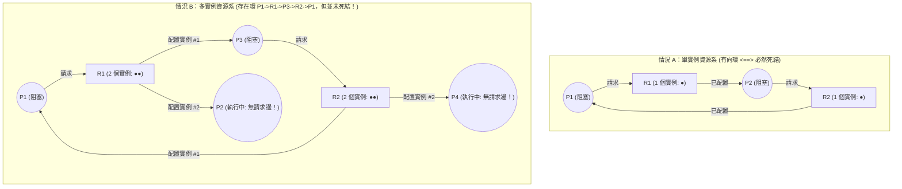
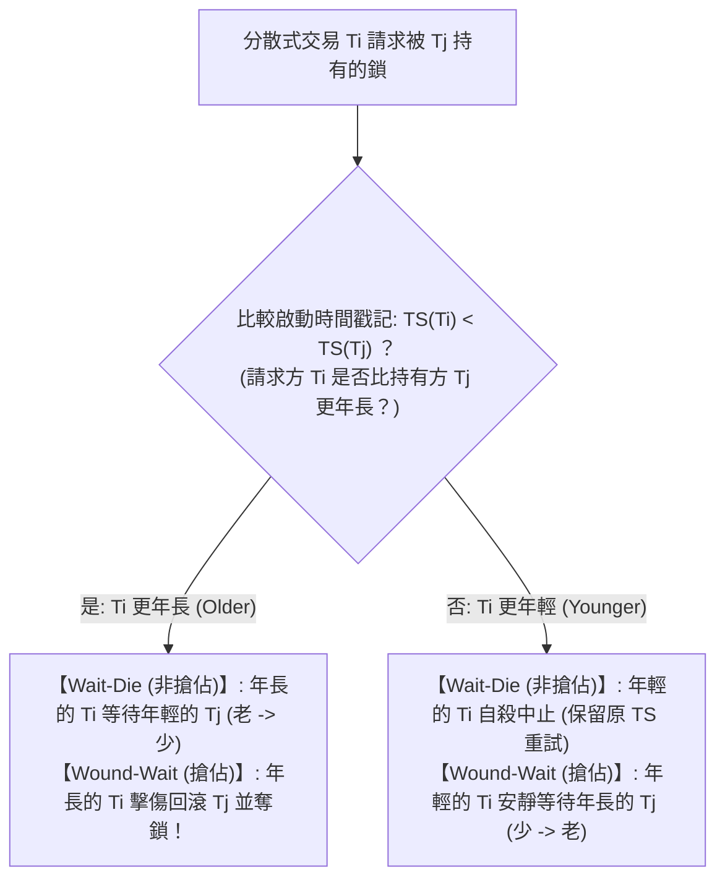

## 1. 引言：哲學家就餐問題與科夫曼（Coffman）死結四條件

1965年，荷蘭計算機科學家<strong>艾茲赫爾·迪傑斯特拉（Edsger W. Dijkstra）</strong>提出了著名的<strong>「哲學家就餐問題（Dining Philosophers Problem）」</strong>：五位哲學家 $P_0 \dots P_4$ 圍坐圓桌，每人左右兩側各有一把叉子 $F_i$ 與 $F_{(i+1)\bmod 5}$（共5把叉子），必須同時拿起左右兩把叉子才能進餐。如果五位哲學家在同一瞬間感到飢餓，並各自拿起左手的叉子 $F_i$，那麼每個人都會握著左叉永遠等待鄰居釋放右叉——沒有任何硬體故障，整個系統卻陷入了永久停滯，這便是<strong>死結（Deadlock）</strong>。

形式化地說，行程集合 $D \subseteq \mathcal{P}$（$D \neq \emptyset$）處於死結狀態，若且唯若 $D$ 中的每一個行程 $P_i \in D$ 都在等待某個只能由<strong>同一集合 $D$ 中的其他行程 $P_j \in D$</strong> 觸發的事件（如釋放鎖定資源）。

1971年，<strong>Edward G. Coffman Jr.</strong> 等人證明了資源死結發生必須<strong>同時滿足四個必要條件（科夫曼條件）</strong>：
1. <strong>互斥（Mutual Exclusion）</strong>：至少有一種資源以排他（非共享）模式被單個行程獨佔。
2. <strong>佔有並等待（Hold and Wait）</strong>：行程在已經持有至少一個資源的同時，阻塞等待取得其他行程持有的額外資源。
3. <strong>不可搶佔（No Preemption）</strong>：已配置給行程的資源不能被作業系統或他者強行剝奪，只能由持有者主動釋放。
4. <strong>循環等待（Circular Wait）</strong>：存在閉合的等待鏈 $\{P_0, P_1, \dots, P_{k-1}\}$，使得 $P_i$ 等待 $P_{(i+1)\bmod k}$ 持有的資源。

由於這四個條件均為必要條件，只要在系統設計中<strong>邏輯否定其中任意一個條件，死結在數學上就 $100\%$ 不可能發生</strong>。

---

## 2. 資源配置圖（RAG）與環路定理（Holt, 1972）

1972年，Richard C. Holt 引入了有向二分圖——<strong>資源配置圖（Resource Allocation Graph, RAG）</strong> $G = (V, E)$，其中頂點集 $V = \mathcal{P} \cup \mathcal{R}$（行程頂點 $P_i$ 與資源類型頂點 $R_j$，每個 $R_j$ 含 $W_j \ge 1$ 個實例），有向邊分為<strong>請求邊 $P_i \to R_j$</strong>（等待配置）與<strong>配置邊 $R_j \to P_i$</strong>（已持有實例）。

關於 RAG 中的<strong>有向環（Directed Cycle）</strong>與死結的關係，存在三大核心定理：
* <strong>定理 1（無環必無死結）</strong>：若 RAG 中不存在有向環（即為 DAG），則系統中絕無死結。
* <strong>定理 2（單實例充要定理）</strong>：若所有資源類型均<strong>只有一個實例（$\forall j, W_j = 1$）</strong>，則<strong>存在有向環 $\iff$ 發生死結（充分必要條件）</strong>。
* <strong>定理 3（多實例非充分定理）</strong>：若某資源類型具有<strong>多個實例（$\exists j, W_j > 1$）</strong>，則有向環只是死結的<strong>必要條件而非充分條件</strong>！

在情況 B 中，雖然存在環 $P_1 \to R_1 \to P_3 \to R_2 \to P_1$，但持有第二個實例的 $P_2$ 與 $P_4$ 出度為 $0$（匯點，正在執行），它們執行完畢釋放 $R_1, R_2$ 後即可立即解開環路！

---

## 3. 策略1（死結預防）：全序加鎖規則的反證法證明

在作業系統核心（如 Linux `lockdep`）與多執行緒工程中，打破第4條件（循環等待）的黃金法則是<strong>全域鎖排序（Total Lock Ordering）</strong>：為所有鎖賦予唯一序號 $\phi: \mathcal{L} \to \mathbb{N}$，強制要求任何執行緒在持有鎖集 $\mathcal{H}$ 時，只能請求序號嚴格更大的新鎖：

$$\forall L_{\text{held}} \in \mathcal{H}: \quad \phi(L_{\text{held}}) < \phi(L_{\text{new}})$$

<strong>【反證法證明】</strong>：假設系統發生了長度為 $k \ge 2$ 的循環等待環 $\{P_0, P_1, \dots, P_{k-1}\}$，其中 $P_i$ 持有鎖 $L_i$ 並等待 $P_{(i+1)\bmod k}$ 持有的鎖 $L_{(i+1)\bmod k}$。由於每個執行緒均遵守全序加鎖規則，必有：

$$\phi(L_0) < \phi(L_1) < \phi(L_2) < \cdots < \phi(L_{k-1}) < \phi(L_0) \implies \phi(L_0) < \phi(L_0)$$

自然數不可能嚴格小於自身，矛盾（$\bot$）！因此在全序加鎖規則下（如銀行轉帳始終先鎖 ID 較小的帳戶，或讓哲學家 $P_4$ 先拿右叉 $F_0$ 再拿左叉 $F_4$），循環等待在數學上絕不可能存在。$\blacksquare$

---

## 4. 策略2（死結避免）：迪傑斯特拉銀行家演算法與 5×3 矩陣推演

當無法靜態固定加鎖順序時，<strong>迪傑斯特拉銀行家演算法（Banker's Algorithm, 1965 / Habermann, 1969）</strong>要求行程預先申報最大需求矩陣 $\mathbf{Max}$，並在每次配置前透過複雜度為 <strong>$O(m \cdot n^2)$</strong> 的安全性演算法檢驗系統是否仍存在至少一條<strong>安全序列（Safe Sequence）</strong>（注意：$\text{死結狀態} \subsetneq \text{不安全狀態}$，不安全狀態並非已死結，而是存在未來可能死結的風險）。

設系統有 $n=5$ 個行程 $\{P_0 \dots P_4\}$，3 類資源 $\mathbf{Total} = (A=10, B=5, C=7)$，時刻 $t_0$ 狀態如下表所示，當前剩餘可用資源為 $\mathbf{Available} = (10,5,7) - (7,2,5) = \mathbf{(3, 3, 2)}$：

| 行程 | 已配置 $\mathbf{Allocation}$ $(A,B,C)$ | 最大需求 $\mathbf{Max}$ $(A,B,C)$ | 剩餘需求 $\mathbf{Need} = \mathbf{Max} - \mathbf{Allocation}$ | 安全序列推演（初始 $\mathbf{Work} = (3,3,2)$） |
| :--- | :---: | :---: | :---: | :--- |
| <strong>$P_0$</strong> | $(0, 1, 0)$ | $(7, 5, 3)$ | $(7, 4, 3)$ | 第 4 步滿足：$(7,4,3) \le (7,4,5) \to \mathbf{Work}=(7,5,5)$ |
| <strong>$P_1$</strong> | $(2, 0, 0)$ | $(3, 2, 2)$ | $(1, 2, 2)$ | <strong>第 1 步滿足</strong>：$(1,2,2) \le (3,3,2) \to \mathbf{Work}=(5,3,2)$ |
| <strong>$P_2$</strong> | $(3, 0, 2)$ | $(9, 0, 2)$ | $(6, 0, 0)$ | 第 5 步滿足：$(6,0,0) \le (7,5,5) \to \mathbf{Work}=(10,5,7)$ |
| <strong>$P_3$</strong> | $(2, 1, 1)$ | $(2, 2, 2)$ | $(0, 1, 1)$ | <strong>第 2 步滿足</strong>：$(0,1,1) \le (5,3,2) \to \mathbf{Work}=(7,4,3)$ |
| <strong>$P_4$</strong> | $(0, 0, 2)$ | $(4, 3, 3)$ | $(4, 3, 1)$ | <strong>第 3 步滿足</strong>：$(4,3,1) \le (7,4,3) \to \mathbf{Work}=(7,4,5)$ |

由於存在安全序列 $\langle P_1, P_3, P_4, P_0, P_2 \rangle$，狀態 $t_0$ 是<strong>安全狀態</strong>。若此時 $P_1$ 請求 $(1,0,2)$，試配置後 $\mathbf{Available}=(2,3,0)$ 仍滿足 $\mathbf{Need}_1=(0,2,0)$，<strong>立即批准</strong>；但若緊接著 $P_0$ 請求 $(0,2,0)$，試配置後 $\mathbf{Available}=(2,1,0)$ 將導致所有行程的 $\mathbf{Need}$ 均無法滿足（進入<strong>不安全狀態</strong>），銀行家演算法會<strong>立即回滾並阻塞 $P_0$</strong>！

---

## 5. 策略3 & 4（偵測恢復與鴕鳥演算法）以及死結 vs. 活結 vs. 飢餓

在關聯式資料庫（RDBMS）中，由於 SQL 語句動態到達，系統採用<strong>等待圖（Wait-For Graph, WFG）</strong>透過 $O(|V|+|E|)$ 的 DFS 尋找環路（MySQL InnoDB 阻塞時立即偵測並回滾 Undo 量最小的犧牲者；PostgreSQL 則睡眠等待 `deadlock_timeout = 1s` 後再偵測）。而在分散式資料庫（如 Google Spanner）中，則採用基於啟動時間戳記 $\text{TS}(T_i)$（越小越年長）的 <strong>Wait-Die（非搶佔）</strong>與 <strong>Wound-Wait（搶佔，年長者直接擊傷回滾年輕者，重啟次數更少）</strong>協定，且被中止交易重試時<strong>必須保留原時間戳記</strong>以徹底防止飢餓。至於罕見的作業系統使用者態表項耗盡，UNIX/Windows 則採用<strong>鴕鳥演算法（Ostrich Algorithm）</strong>直接忽略，以免日常系統呼叫背負沉重的偵測開銷。

最後，在並行系統的<strong>活性故障（Liveness Failures）</strong>診斷中，必須嚴格區分死結、<strong>活結（Livelock）</strong>與<strong>飢餓（Starvation）</strong>：

| 診斷維度 | 死結 (Deadlock) | 活結 (Livelock) | 飢餓 (Starvation) |
| :--- | :--- | :--- | :--- |
| <strong>核心機制與定義</strong> | 阻塞執行緒形成循環等待鏈，彼此等待對方釋放資源 | 執行緒為避開死結而對稱地不斷執行 `trylock` 失敗、釋放並立即重試（走廊禮讓死迴圈） | 系統整體正常推進，但特定低優先權執行緒永遠搶不到資源 |
| <strong>OS 執行緒狀態與 CPU 佔用</strong> | <strong>`SLEEPING` / `BLOCKED`（CPU 佔用 $0\%$）</strong> | <strong>`RUNNING`（CPU 飆升至 $100\%$ 空轉，有效推進為 0）</strong> | 等待佇列中長期停滯（受害者 CPU 為 $0\%$） |
| <strong>根本工程解藥</strong> | 全序加鎖（$\phi(L_1)<\phi(L_2)$）、銀行家演算法、WFG 回滾 | <strong>引入隨機指數退避（Randomized Exponential Backoff with Jitter）打破時間對稱性</strong> | <strong>優先權老化（Aging）</strong>、保留原時間戳記、公平 FIFO 佇列鎖（MCS 鎖） |
