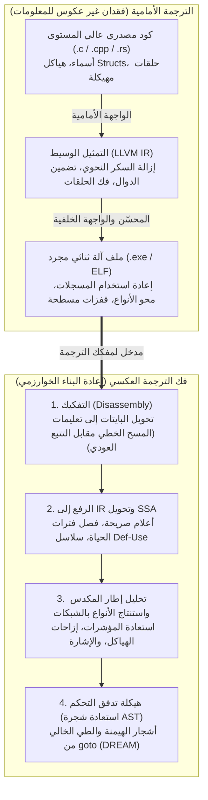
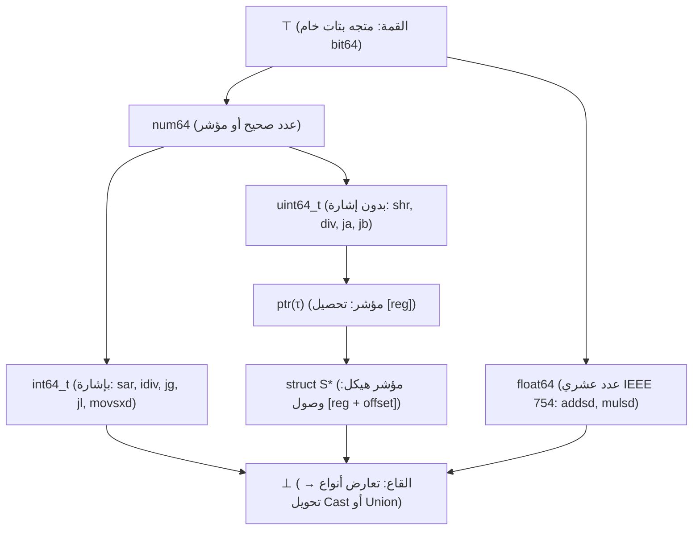

## 1. مقدمة: هل يمكنك إعادة «العجة» إلى «بيض نيئ» داخل قشرته؟

في تطوير البرمجيات اليومي، يقوم المترجم (Compiler مثل GCC أو Clang/LLVM أو MSVC) بتحويل الكود المصدري المقروء المكتوب بلغة C أو C++ أو Rust إلى ملف تنفيذي بلغة الآلة (ملف `.exe` بصيغة PE في ويندوز أو `ELF` في لينكس). ولكن ماذا يحدث عندما نحتاج إلى السير في الاتجاه المعاكس — مثلاً عندما يحلل باحث أمني برمجية فدية خبيثة، أو يدقق مهندس في برنامج تشغيل مغلق المصدر، أو تحتاج مؤسسة إلى صيانة نظام قديم عمره 25 عاماً فُقد كوده المصدري؟ هل يمكننا إدخال الملف الثنائي في <strong>مفكك ترجمة (Decompiler)</strong> لاستعادة كود C الأصلي؟

تُلخص مقولة شهيرة في مجتمع الهندسة العكسية هذا التحدي:
<strong>«الترجمة (Compilation) تشبه خفق البيض وقليه لصنع عجة (Omelet)؛ أما فك الترجمة (Decompilation) فهو محاولة إعادة العجة إلى بيض نيئ داخل قشرته».</strong>

من منظور الرياضيات ونظرية المعلومات، فإن دالة الترجمة $\mathcal{C}: \text{Source} \to \text{Binary}$ هي <strong>تطبيق متعدد-إلى-واحد (غير متباين) يفقد المعلومات</strong>. فعدد لا نهائي من البرامج المصدرية المختلفة — في أسماء المتغيرات، والتعليقات، وهياكل الحلقات (`for` مقابل `while`)، والدوال المضمنة (*inlined*) — تتحول بعد التحسين (`-O2` أو `-O3`) إلى نفس تسلسل البايتات حرفياً. وبما أن الإنتروبيا الشرطية $H(\text{Source} \mid \text{Binary}) > 0$ موجبة تماماً، فلا توجد دالة عكسية حتمية $\mathcal{C}^{-1}$ قادرة على استرداد ما مُحي فيزيائياً أثناء الترجمة وتجريد الرموز (`strip`). والأدهى من ذلك أنه بموجب <strong>مبرهنة رايس (Rice's Theorem)</strong> ومسألة التوقف لتورينغ، فإن الفصل الدقيق بين التعليمات والبيانات، وحل جميع وجهات القفز غير المباشر (`jmp rax`)، وتحليل تداخل المؤشرات (Pointer Aliasing) هي مسائل <strong>غير قابلة للحسم رياضياً (Undecidable)</strong> في الحالة العامة.

ومع ذلك، تنجح مفككات الترجمة الصناعية الحديثة — مثل <strong>IDA Pro (Hex-Rays)</strong> و<strong>Ghidra</strong> (المفتوح المصدر من وكالة NSA) و<strong>Binary Ninja</strong> و<strong>angr</strong> — يومياً في تحويل ميغابايتات من لغة التجميع الصماء إلى كود C شبه أصلي واضح ومهيكل. في هذه المقالة، نشرح المراحل الخوارزمية الست لمفكك الترجمة الحديث.

---

## 2. ماذا تدمر عملية الترجمة؟ : خط الأنابيب الأمامي

1. <strong>الواجهة الأمامية (التحليل اللغوي وفحص الأنواع $\to$ IR)</strong>: تختفي التعليقات، وماكرو `#define`، وأسماء `typedef`، وأسماء المتغيرات المحلية، والسكر النحوي عند النزول إلى التمثيل الوسيط (LLVM IR).
2. <strong>محسّن المستوى الأوسط (`-O2` / `-O3`)</strong>: يذيب <strong>تضمين الدوال (Function Inlining)</strong> الحدود بين الدوال؛ ويغير <strong>فك الحلقات (Loop Unrolling)</strong> و<strong>التوجيه الشعاعي (SIMD)</strong> بنية التحكم؛ ويستبدل <strong>تقليل القوة (Strength Reduction)</strong> قسمة الأعداد الصحيحة البسيطة `x / 10` بعملية ضرب في عدد سحري ثابت النقطة (`imul 0x66666667`).
3. <strong>تخصيص المسجلات وتجريد الرموز (`strip`)</strong>: تُسقط المسجلات الافتراضية اللانهائية عبر تلوين البيان على 16 مسجلاً فيزيائياً فقط في معمارية `x86-64`. ونتيجة لذلك، <strong>يُعاد استخدام نفس المسجل الفيزيائي مثل `rax` لعشرات المتغيرات غير المترابطة ذات الأنواع المختلفة</strong>، بينما يحذف أمر `strip` جدول الرموز (`.symtab`) ومعلومات تصحيح الأخطاء DWARF.

---

## 3. المرحلة الأولى: التفكيك (Disassembly) — فصل التعليمات عن البيانات

في المعماريات ذات أطوال التعليمات المتغيرة مثل `x86-64` (من $1$ إلى $15$ بايت)، يدمج المترجم غالباً بيانات للقراءة فقط — ولا سيما <strong>جداول القفز (Jump Tables)</strong> الخاصة بجمل `switch` — مباشرة داخل قسم الكود `.text`.

1. <strong>المسح الخطي (Linear Sweep، مثل `objdump -d`)</strong>: يفك تشفير البايتات بالتتابع من البداية للنهاية، لكنه يفسر جداول القفز المدمجة خطأً على أنها تعليمات زائفة.
2. <strong>التتبع العودي (Recursive Traversal، مثل IDA Pro وGhidra)</strong>: يبدأ من نقاط الدخول المعروفة (`main` والدوال المصدرة) ويتتبع بيان تدفق التحكم الفعلي عبر تعليمات التفرع (`je`, `jmp`, `call`). ولحل <strong>القفزات غير المباشرة (`jmp [rbx + rcx*8]`)</strong>، يستخدم مفكك الترجمة <strong>التشريح الخلفي (Backward Slicing)</strong> و<strong>تحليل مجموعات القيم (Value-Set Analysis, VSA)</strong> للعثور على فحص الحدود `cmp rcx, 12; ja default` واستنتاج حجم الجدول.

---

## 4. المرحلة الثانية: الرفع إلى التمثيل الوسيط (IR Lifting) وصيغة التعيين الأحادي الساكن (SSA)

تحمل تعليمات الآلة آثاراً جانبية ضمنية معقدة (فتعليمة `sub eax, ebx` واحدة في `x86` تعدل ستة أعلام حالة في آن واحد: `ZF, CF, SF, OF, PF, AF`). يرفع مفكك الترجمة (<strong>Lifting</strong>) الكود الأصلي أولاً إلى <strong>تمثيل وسيط مستقل عن المعالج (P-code في Ghidra، وMicrocode في Hex-Rays)</strong>، ثم يحوله إلى <strong>صيغة التعيين الأحادي الساكن (SSA Form)</strong> حيث يُعيَّن كل متغير مرة واحدة فقط (مع إدراج دوال $\phi$ $\text{rax}_3 = \phi(\text{rax}_1, \text{rax}_2)$ عند نقاط التقاء التفرعات):

- <strong>حذف الأعلام الميتة</strong>: يتم حذف أكثر من $90\%$ من حسابات الأعلام التي لا يقرؤها أي قفز شرطي فوراً عبر سلاسل Def-Use.
- <strong>نشر التعبيرات</strong>: يتم تعويض التعريف `ZF_2 = (eax_2 == 0)` مباشرة داخل `if (ZF_2)` لاستعادة الشرط `if (eax_2 == 0)`.
- <strong>فصل فترات الحياة (Live-Range Splitting)</strong>: تنفصل شبكات SSA غير المتصلة التي تشاركت نفس المسجل الفيزيائي `rax` تلقائياً إلى متغيرات محلية مستقلة في لغة C (`int v1;` مقابل `Node *v2;`)!

---

## 5. المرحلة الثالثة: تحليل المكدس واستنتاج الأنواع عبر الشبكات الرياضية (Lattice)

رغم أن كود الآلة يخلو من الأنواع الصريحة، فإن دلالات تعليمات المعالج تفرض <strong>قيوداً جبرية صارمة على الأنواع</strong>:

- <strong>التمييز بين الأعداد بإشارة (`int`) وبدون إشارة (`unsigned int`)</strong>: تثبت القفزات الشرطية `jg / jl` (*Greater/Less*) والقسمة بإشارة `idiv` والإزاحة الحسابية `sar` وتمديد الإشارة `movsxd` أن المعامل <strong>عدد صحيح بإشارة (`int`)</strong>؛ بينما تثبت `ja / jb` (*Above/Below*) و`div` والإزاحة المنطقية `shr` والتمديد الصفري `movzx` أنه <strong>عدد صحيح بدون إشارة (`unsigned int`)</strong>!
- <strong>إعادة بناء المؤشرات والهياكل (`struct`)</strong>: يولد تحصيل العنوان `[rbx]` قيد المؤشر $\text{ptr}(\tau)$. ويكشف الوصول إلى إزاحات ثابتة متعددة (`[rbx + 0]` و`[rbx + 8]` و`[rbx + 16]`) أن `rbx` مؤشر إلى هيكل مركب <strong>`struct S *`</strong>.
- <strong>شبكة الأنواع (Type Lattice) والتوحيد</strong>: استناداً إلى ألان مايكروفت (1999) ونظام <strong>TIE</strong> (جامعة كارنيغي ميلون)، ينظم مفكك الترجمة جميع الأنواع في <strong>شبكة مرتبة جزئياً $(\mathcal{L}, \sqsubseteq)$</strong> بين القمة $\top$ (متجه بتات خام) والقاع $\bot$ (تعارض أنواع / `union`)، ويحل متباينات الأنواع الفرعية عالمياً عبر الحد الأدنى الأكبر (Meet $\sqcap$).

---

## 6. المرحلة الرابعة: هيكلة تدفق التحكم — إزالة `goto` لاستعادة `if` و`while`

لطي بيان تدفق التحكم المسطح (CFG) في شجرة بناء نحوي مجردة (AST) مهيكلة (Cifuentes 1994)، يحسب مفكك الترجمة <strong>شجرة الهيمنة (Dominator Tree)</strong> و<strong>شجرة الهيمنة البعدية (Post-Dominator Tree)</strong>:

1. <strong>كشف الحلقات الطبيعية</strong>: أي حافة خلفية (*Back-Edge*) $n \to h$ يهيمن فيها الهدف $h$ على المصدر $n$ ($h \text{ dom } n$) تعرّف حلقة طبيعية رأسها $h$ (`while` أو `for` أو `do-while`).
2. <strong>كشف التفرعات (`if-then-else`)</strong>: يحدد المهيمن البعدي المباشر لعقدة التفرع نقطة التقاء معين `if-else` بدقة.
3. <strong>الهيكلة الخالية من `goto` (خوارزمية DREAM)</strong>: حتى مع البيانات غير القابلة للاختزال، تحسب خوارزمية <strong>DREAM («No More Gotos»، Yakdan et al. 2015)</strong> <strong>شروط الوصول المنطقية (Reaching Conditions)</strong> وتطبق تبسيط الدوال المنطقية لإنتاج كود C <strong>خالٍ بنسبة 100% من جمل `goto`</strong>!

---

## 7. حدود فك الترجمة: تمويه التحسين، والتعمية، ومفككات الترجمة العصبية (LLM)

| عنصر البرنامج | غير محسّن (`-O0 -g` مع DWARF) | إصدار مجرد (`-O3` + `strip`) | معمّى (OLLVM / VMProtect) |
| :--- | :--- | :--- | :--- |
| <strong>أسماء الدوال والمتغيرات والأنواع</strong> | مستعادة بنسبة $100\%$ من DWARF | <strong>ممحوة نهائياً</strong> (`sub_401120`, `v2`) | ممحوة + رموز مضللة زائفة |
| <strong>القسمة على ثابت (`x / 10`)</strong> | تعليمة `idiv` مباشرة | <strong>ضرب في عدد سحري</strong> (`0x66666667`) | كثيرات حدود منطقية-حسابية مختلطة (MBA) |
| <strong>تدفق التحكم (`if / while`)</strong> | شجرة AST مهيكلة نظيفة | فك الحلقات وتوجيه SIMD | <strong>تسطيح تدفق التحكم (CFF)</strong> في `switch` ضخم |
| <strong>دلالات التعليمات (ISA)</strong> | تعليمات `x86-64` / `ARM64` أصلية | تعليمات `x86-64` / `ARM64` أصلية | <strong>التعمية بالمحاكاة الافتراضية</strong>: آلة bytecode مخصصة |

بينما تهاجم أدوات التعمية (<strong>OLLVM</strong> و<strong>VMProtect</strong>) التحليل الساكن عبر <strong>تسطيح تدفق التحكم (CFF)</strong>، و<strong>المسندات المعتمة (Opaque Predicates)</strong>، و<strong>الحساب المنطقي المختلط (MBA، $x+y \equiv (x\oplus y) + 2(x\land y)$)</strong>، و<strong>التعمية بالمحاكاة الافتراضية</strong> (تحويل الكود إلى bytecode عشوائي خاص)، يشهد عقد العشرينيات ظهور <strong>فك الترجمة العصبي بالنماذج اللغوية الكبيرة (`LLM4Decompile`)</strong> الذي يجمع بين التحليل الرسمي والذكاء الاصطناعي الإحصائي لاستنتاج أسماء متغيرات ودوال ذات معنى وإعادة صياغة الكود المحسّن في لغة C طبيعية.
