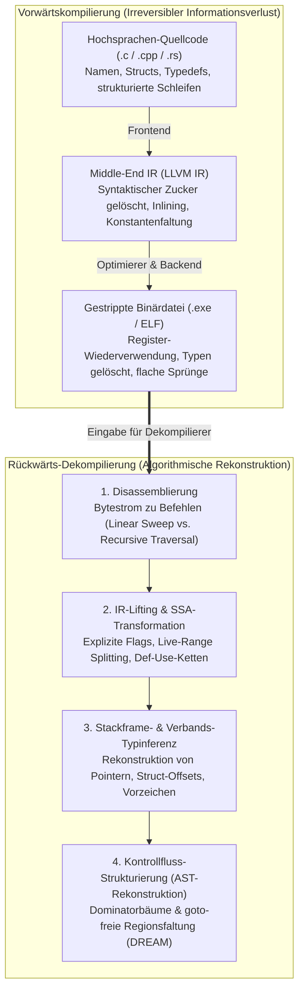
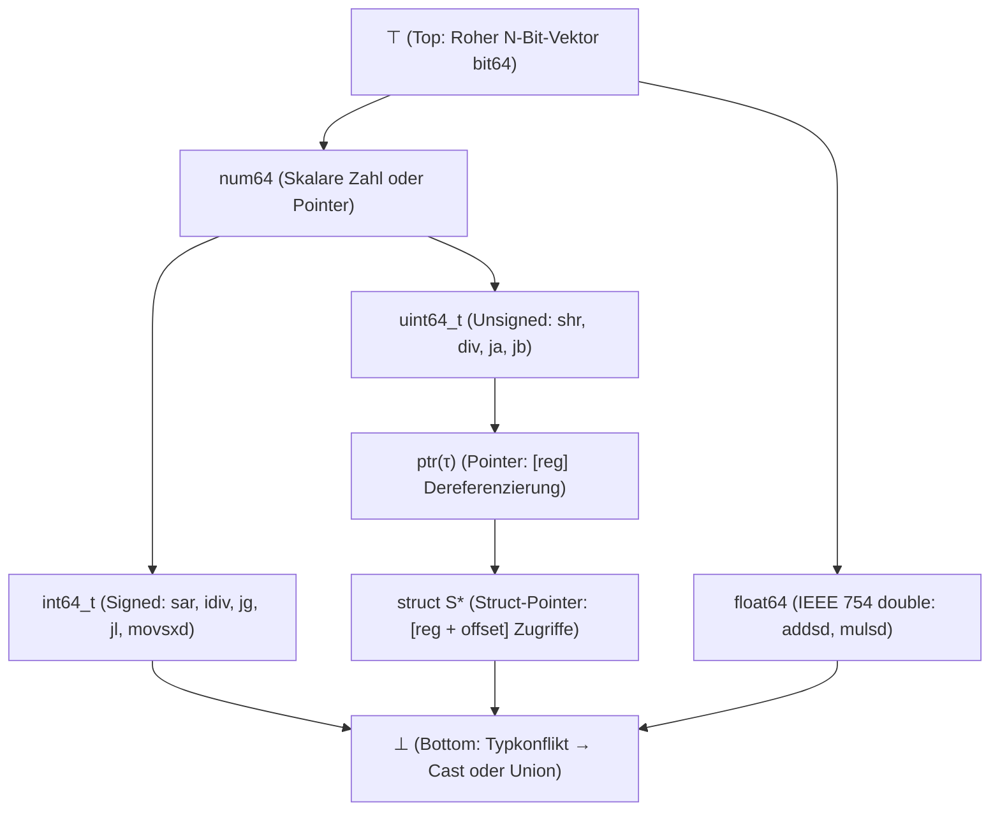

## 1. Einleitung: Kann man aus einem Omelett wieder ein rohes Ei machen?

In der Softwareentwicklung übersetzt ein Compiler (wie GCC, Clang/LLVM oder MSVC) menschenlesbaren Quellcode in C, C++ oder Rust in ausführbaren Maschinencode (eine Windows-`.exe`-PE-Datei oder eine Linux-`ELF`-Binärdatei). Doch was geschieht, wenn wir den umgekehrten Weg gehen müssen – etwa bei der Analyse von Malware, der Sicherheitsprüfung proprietärer Treiber oder der Wartung eines 25 Jahre alten Legacy-Systems, dessen Quellcode verloren gegangen ist? Kann ein <strong>Dekompilierer (Decompiler)</strong> aus dem reinen Maschinencode den ursprünglichen C-Quellcode rekonstruieren?

In der Reverse-Engineering-Gemeinschaft gilt ein klassisches Sprichwort:
<strong>„Kompilieren ist wie Eier aufschlagen und ein Omelett braten; Dekompilieren ist der Versuch, das Omelett wieder in rohe Eier mit Schale zurückzuverwandeln.“</strong>

Mathematisch und informationstheoretisch betrachtet ist die Kompilierungsfunktion $\mathcal{C}: \text{Source} \to \text{Binary}$ eine <strong>verlustbehaftete, nicht-injektive Viele-zu-Eins-Abbildung</strong>. Unzählige Quellprogramme mit unterschiedlichen Variablennamen, Kommentaren, Schleifenkonstrukten (`for` vs. `while`) und Inline-Funktionen erzeugen nach einer `-O2`- oder `-O3`-Optimierung exakt dieselbe Bytefolge. Da die bedingte Entropie $H(\text{Source} \mid \text{Binary}) > 0$ ist, existiert keine eindeutige Umkehrfunktion $\mathcal{C}^{-1}$. Hinzu kommt: Nach dem <strong>Satz von Rice (Rice's Theorem)</strong> und dem Halteproblem sind zentrale Teilprobleme der Dekompilierung – wie die exakte Trennung von Code und eingebetteten Daten, die Auflösung indirekter Sprünge (`jmp rax`) oder die Pointer-Alias-Analyse – im Allgemeinen <strong>mathematisch unentscheidbar (undecidable)</strong>.

Dennoch verwandeln moderne Dekompilierer wie <strong>IDA Pro (Hex-Rays)</strong>, <strong>Ghidra</strong> (NSA), <strong>Binary Ninja</strong> und <strong>angr</strong> täglich Millionen Zeilen Maschinencode in verblüffend lesbaren C-Pseudocode. Dieser Artikel analysiert die sechs algorithmischen Kernphasen moderner Dekompilierer.

---

## 2. Was beim Kompilieren verloren geht: Die Vorwärtspipeline

1. <strong>Frontend (Parsing & Typprüfung $\to$ IR)</strong>: Kommentare, Präprozessor-Makros (`#define`), `typedef`-Aliase, lokale Variablennamen und syntaktischer Zucker verschwinden beim Übergang in die Zwischenrepräsentation (LLVM IR).
2. <strong>Middle-End-Optimierer (`-O2` / `-O3`)</strong>: <strong>Function Inlining</strong> löst Funktionsgrenzen auf; <strong>Loop Unrolling</strong> und <strong>SIMD-Vektorisierung</strong> verändern die Schleifenstruktur radikal; <strong>Strength Reduction</strong> ersetzt eine einfache Ganzzahldivision `x / 10` durch eine kryptische Festkomma-Multiplikation mit einer magischen Konstante (`imul 0x66666667`).
3. <strong>Backend-Registerallokation & `strip`</strong>: Unendlich viele virtuelle Register werden per Graphfärbung auf die nur 16 Allzweckregister von `x86-64` abgebildet. Dadurch wird <strong>dasselbe physische Register `rax` innerhalb einer Funktion für völlig verschiedene Variablen unterschiedlicher Typen wiederverwendet</strong>, während `strip` die Symboltabelle (`.symtab`) und DWARF-Debug-Informationen restlos löscht.

---

## 3. Stufe 1: Disassemblierung — Trennung von Befehlen und Daten

Auf Architekturen mit variabler Befehlslänge wie `x86-64` ($1$ bis $15$ Bytes pro Befehl) betten Compiler häufig schreibgeschützte Daten – insbesondere <strong>Sprungtabellen (Jump Tables)</strong> für `switch`-Anweisungen – direkt in das `.text`-Codesegment ein.

1. <strong>Linear Sweep</strong> (`objdump -d`): Dekodiert stur Byte für Byte vom Anfang bis zum Ende und interpretiert eingebettete Sprungtabellen fälschlich als unsinnige Befehle.
2. <strong>Recursive Traversal</strong> (IDA Pro, Ghidra): Folgt ausgehend von bekannten Einstiegspunkten (`main`, Exportfunktionen) dem tatsächlichen Kontrollfluss entlang von Verzweigungsbefehlen (`je`, `jmp`, `call`). Um <strong>indirekte Sprünge (`jmp [rbx + rcx*8]`)</strong> aufzulösen, nutzt der Dekompilierer <strong>Backward Slicing</strong> und <strong>Value-Set Analysis (VSA)</strong>, um aus der vorangehenden Bereichsprüfung `cmp rcx, 12; ja default` die Größe der Sprungtabelle zu bestimmen.

---

## 4. Stufe 2: IR-Lifting und Static Single Assignment (SSA)

Maschinenbefehle besitzen zahllose implizite Seiteneffekte (ein einziges `sub eax, ebx` auf `x86` überschreibt sechs Status-Flags: `ZF, CF, SF, OF, PF, AF`). Der Dekompilierer übersetzt (<strong>Lifting</strong>) den nativen Code zunächst in eine architekturunabhängige <strong>Zwischenrepräsentation (Ghidra P-code, Hex-Rays Microcode)</strong> und überführt diese in die <strong>Static Single Assignment (SSA)-Form</strong>, in der jede Variable genau einmal zugewiesen wird (mit $\phi$-Funktionen $\text{rax}_3 = \phi(\text{rax}_1, \text{rax}_2)$ an Kontrollfluss-Zusammenführungen):

- <strong>Dead Flag Elimination</strong>: Über $90\%$ aller Status-Flag-Berechnungen werden nie gelesen und lassen sich über die Def-Use-Ketten sofort löschen.
- <strong>Expression Propagation</strong>: Definitionen wie `ZF_2 = (eax_2 == 0)` werden direkt in `if (ZF_2)` eingesetzt, wodurch komplexe C-Bedingungen entstehen.
- <strong>Live-Range Splitting (Register-Web-Trennung)</strong>: Unabhängige Lebensbereiche desselben physischen Registers `rax` zerfallen automatisch in getrennte lokale C-Variablen (`int v1;` vs. `Node *v2;`)!

---

## 5. Stufe 3: Stackframe-Analyse und verbandsbasierte Typinferenz

Obwohl Maschinencode keine expliziten Typen kennt, erzwingt die Semantik der CPU-Befehle präzise <strong>Typbedingungen (Type Constraints)</strong>:

- <strong>Vorzeichenbehaftet (`int`) vs. Vorzeichenlos (`unsigned int`)</strong>: Bedingte Sprünge wie `jg / jl` (*Greater/Less*), vorzeichenbehaftete Division `idiv`, arithmetischer Rechtsshift `sar` und Vorzeichenerweiterung `movsxd` beweisen einen <strong>`signed int`</strong>; Befehle wie `ja / jb` (*Above/Below*), `div`, logischer Shift `shr` und Nullerweiterung `movzx` beweisen einen <strong>`unsigned int`</strong>!
- <strong>Pointer- und `struct`-Rekonstruktion</strong>: Ein Speicherzugriff `[rbx]` erzeugt die Bedingung $\text{ptr}(\tau)$. Zugriffe auf konstante Offsets derselben Basisadresse (`[rbx + 0]`, `[rbx + 8]`, `[rbx + 16]`) enthüllen das Layout eines zusammengesetzten <strong>`struct S *`</strong>.
- <strong>Typverband (Type Lattice) und Unifikation</strong>: Nach Alan Mycroft (1999) und dem <strong>TIE</strong>-System (CMU) ordnet der Dekompilierer alle Typen in einem <strong>halbgeordneten Verband $(\mathcal{L}, \sqsubseteq)$</strong> zwischen $\top$ (roher Bitvektor) und $\bot$ (Typkonflikt / `union`) an und löst die Subtyp-Ungleichungen global über das Infimum (Meet $\sqcap$).

---

## 6. Stufe 4: Kontrollfluss-Strukturierung — Von `goto`-Graphen zurück zu `if` und `while`

Um den flachen Kontrollflussgraphen (CFG) in einen verschachtelten Syntaxbaum (AST) zu falten (Cifuentes 1994), berechnet der Dekompilierer den <strong>Dominatorbaum</strong> und <strong>Post-Dominatorbaum</strong>:

1. <strong>Natürliche Schleifen</strong>: Eine Rückwärtskante (*Back-Edge*) $n \to h$, bei der $h$ den Knoten $n$ dominiert ($h \text{ dom } n$), definiert eine Schleife mit Kopf $h$ (`while`, `for` oder `do-while`).
2. <strong>Verzweigungen (`if-then-else`)</strong>: Der unmittelbare Post-Dominator eines Verzweigungsknotens markiert exakt den Zusammenführungspunkt einer `if-else`-Verzweigung.
3. <strong>`goto`-freie Strukturierung (`DREAM`)</strong>: Selbst bei irreduziblen CFGs erzeugt der <strong>DREAM-Algorithmus ("No More Gotos", Yakdan et al. 2015)</strong> durch Berechnung boolescher <strong>Erreichbarkeitsbedingungen (Reaching Conditions)</strong> und Logikminimierung <strong>100% `goto`-freien C-Code</strong>!

---

## 7. Grenzen der Dekompilierung: Optimierung, Obfuskation und Neuronale LLM-Dekompilierer

| Programmmerkmal | Unoptimiert (`-O0 -g` mit DWARF) | Gestripptes Release (`-O3` + `strip`) | Obfuskiert (OLLVM / VMProtect) |
| :--- | :--- | :--- | :--- |
| <strong>Funktions-, Variablen- & Typnamen</strong> | $100\%$ aus DWARF/PDB rekonstruiert | <strong>Dauerhaft gelöscht</strong> (`sub_401120`, `v2`) | Gelöscht + irreführende Symbole |
| <strong>Konstantendivision (`x / 10`)</strong> | Direkter `idiv`-Befehl | <strong>Magic-Number-Multiplikation</strong> (`0x66666667`) | Mixed Boolean-Arithmetic (MBA) |
| <strong>Kontrollfluss (`if / while`)</strong> | Sauberer strukturierter AST | Loop Unrolling & AVX-512-Vektorisierung | <strong>Control-Flow Flattening (CFF)</strong> `switch` |
| <strong>Befehlssatz-Semantik (ISA)</strong> | Natives `x86-64` / `ARM64` | Natives `x86-64` / `ARM64` | <strong>Virtualisierung</strong>: Eigene Bytecode-VM |

Während Schutzwerkzeuge wie <strong>OLLVM</strong> und <strong>VMProtect</strong> die statische Analyse durch <strong>Control-Flow Flattening</strong>, <strong>Opaque Predicates</strong>, <strong>Mixed Boolean-Arithmetic ($x+y \equiv (x\oplus y) + 2(x\land y)$)</strong> und <strong>Virtualisierungs-Obfuskation</strong> (Übersetzung in zufälligen proprietären VM-Bytecode) bekämpfen, eröffnen <strong>Neuronale LLM-Dekompilierer (`LLM4Decompile`)</strong> in den 2020er Jahren eine neue Dimension: Sie kombinieren formale Programmstrukturierung mit statistischer KI, um sprechende Variablen- und Funktionsnamen zu rekonstruieren und hochgradig optimierten Code wieder in idiomatisches C zu übersetzen.
