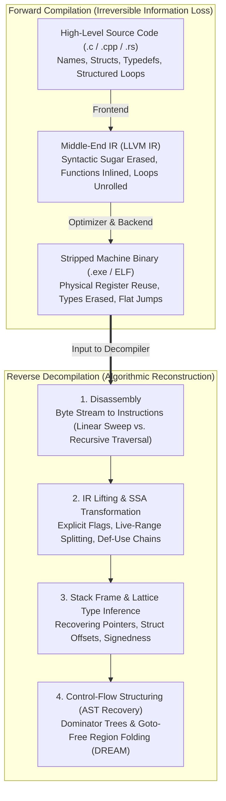
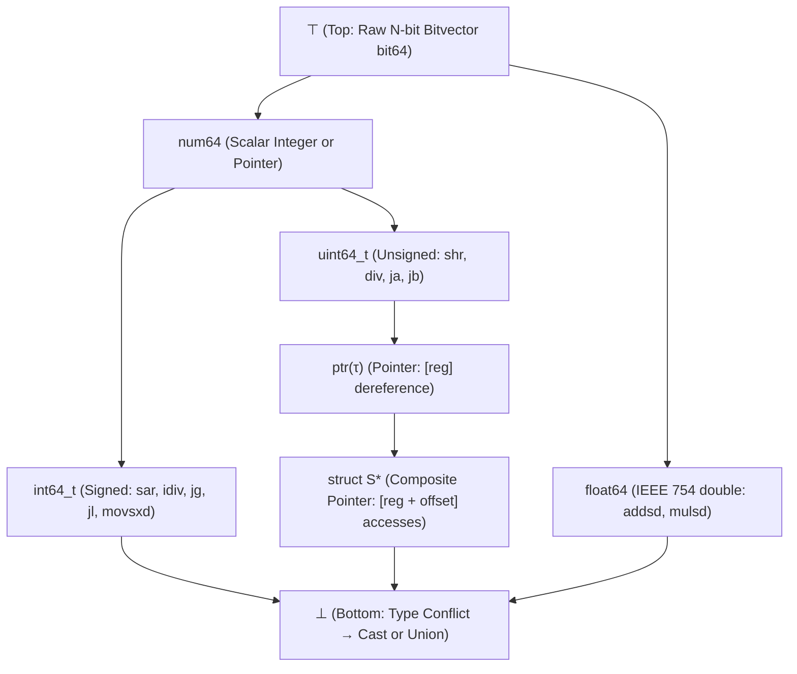

## 1. Introduction: Can You Unscramble an Omelet?

In everyday software development, we write human-readable source code in high-level languages like C, C++, or Rust, and feed it into a compiler (such as GCC, Clang/LLVM, or MSVC) to produce a native machine-code executable (a Windows `.exe` PE file or a Linux `ELF` binary). Compilation translates abstract syntax trees, rich algebraic data types, and expressive variable names into a flat stream of bytes encoding processor instructions (`x86-64`, `ARM64`, `RISC-V`).

What happens when we need to go in the opposite direction? Suppose a security analyst captures a mysterious ransomware binary, an aerospace engineer needs to audit a 25-year-old legacy controller whose source code was lost, or a vulnerability researcher wants to inspect a closed-source driver. Can we feed the raw machine-code executable into a program—a <strong>Decompiler</strong>—and recover the original C source code?

In the reverse-engineering community, a classic aphorism sums up the challenge:
<strong>"Compilation is like scrambling eggs to make an omelet; decompilation is trying to turn the omelet back into raw eggs inside their shells."</strong>

Formally, a compiler $\mathcal{C}: \text{Source} \to \text{Binary}$ is a <strong>lossy, many-to-one (non-injective) mapping</strong>. Infinitely many distinct source programs—differing in local variable names, comments, type aliases, macro expansions, loop constructs (`for` vs. `while`), and inlined helper functions—compile down under `-O2` or `-O3` optimization into the <em>exact same byte-for-byte machine executable</em>. From an information-theoretic standpoint, the conditional entropy $H(\text{Source} \mid \text{Binary}) > 0$ is strictly positive; no deterministic inverse function $\mathcal{C}^{-1}$ can uniquely recover information that was physically erased during compilation and symbol stripping (`strip`).

Even worse, by <strong>Rice's Theorem</strong> and reduction to Turing's Halting Problem, nearly every sub-problem required for exact decompilation—separating inline data bytes from instruction bytes in variable-length architectures, statically resolving all targets of an indirect jump `jmp rax`, or deciding whether two pointers alias in memory—is <strong>mathematically undecidable</strong> in the general case.

And yet, despite both information loss and theoretical undecidability, modern industrial decompilers—such as <strong>IDA Pro (Hex-Rays)</strong>, the NSA's open-source <strong>Ghidra</strong>, <strong>Binary Ninja</strong>, and <strong>angr</strong>—routinely transform megabytes of stripped assembly into clean, structured, readable C pseudocode. How do they pull off this seemingly impossible feat?

In this article, we dissect the complete six-stage architecture of a modern decompiler, tracing a raw binary byte stream through <strong>disassembly</strong>, <strong>intermediate representation (IR) lifting</strong>, <strong>Static Single Assignment (SSA) dataflow recovery</strong>, <strong>constraint-based type inference</strong>, <strong>dominator-tree control-flow structuring</strong>, and the ongoing arms race between <strong>code obfuscation</strong> and <strong>neural LLM decompilers</strong>.

---

## 2. What Compilation Destroys: The Forward Compiler Pipeline

To understand what a decompiler must reconstruct, let us trace what a modern optimizing compiler (such as Clang/LLVM) discards at each stage:

1. <strong>Frontend (Lexing, Parsing, Type Checking $\to$ IR)</strong>:
   Comments, `#ifdef` preprocessor macros, `typedef` names, and syntactic sugar (`for` loops, `switch` tables, C++ templates, and overloaded operators) are lowered into a typed Intermediate Representation (LLVM IR).
2. <strong>Middle-End Optimizer (`-O2` / `-O3`)</strong>:
   Dozens of transformation passes rewrite the program's structure: <strong>Function Inlining</strong> dissolves function boundaries by pasting callees directly into callers; <strong>Loop Unrolling</strong> and <strong>Vectorization (SIMD)</strong> replace simple loops with massive blocks of parallel arithmetic; <strong>Constant Propagation</strong> and <strong>Dead-Code Elimination</strong> erase entire branches; and <strong>Strength Reduction</strong> replaces readable arithmetic (like integer division `x / 10`) with cryptic fixed-point magic-number multiplications.
3. <strong>Backend Code Generation, Register Allocation & `strip`</strong>:
   Infinite SSA virtual registers are mapped onto a tiny set of physical CPU registers (16 general-purpose registers on `x86-64`) via graph coloring. Consequently, <strong>a single physical register like `rax` is reused across dozens of completely unrelated variables of different types</strong> at different points in the same function, while composite `struct` variables are shredded into individual scalars (<strong>SROA: Scalar Replacement of Aggregates</strong>). Finally, running `strip` deletes the symbol table (`.symtab`) and DWARF/PDB debug sections, leaving behind an anonymous sea of bytes.



---

## 3. Stage 1: Disassembly — Separating Instructions from Data

The first task of a decompiler is <strong>Disassembly</strong>: translating raw bytes in the `.text` segment into assembly instructions. While trivial in principle for fixed-width RISC architectures without inline data, <strong>exact disassembly of arbitrary binaries is undecidable</strong> (Horspool & Marovac, 1980), especially on <strong>variable-length instruction architectures like `x86-64`</strong> (where instructions range from $1$ to $15$ bytes and can start at any byte offset).

### 3.1 Inline Data and Overlapping Instructions

Compilers frequently embed read-only <strong>data bytes</strong> directly inside executable code sections—most notably <strong>jump tables</strong> (arrays of target addresses for `switch` statements), floating-point constants, or alignment padding bytes. Furthermore, `x86` byte streams are so dense that hampir any random sequence of data bytes decodes as a valid (though nonsensical) `x86` instruction! If a disassembler misinterprets a 4-byte jump-table address as an instruction whose opcode happens to consume 5 bytes, it will be <strong>desynchronized</strong> from the true instruction boundary and decode garbage for several instructions thereafter.

### 3.2 Linear Sweep vs. Recursive Traversal Disassembly

Decompilers rely on two primary disassembly strategies, augmented by heuristics:

1. <strong>Linear Sweep Disassembly</strong> (used by `objdump -d`):
   Starts at the first byte of the `.text` section and decodes instructions sequentially end-to-end. It is fast and covers $100\%$ of the buffer, but blindly decodes inline jump tables as bogus instructions.
2. <strong>Recursive Traversal (Control-Flow Following) Disassembly</strong> (used by IDA Pro, Ghidra, Binary Ninja):
   Starts at known code entry points (`_start`, `main`, exported symbols, and prologue patterns like `endbr64; push rbp; mov rbp, rsp`) and follows the <strong>actual control-flow graph</strong>—queueing target addresses of direct branches (`je 0x401250`), unconditional jumps (`jmp`), and function calls (`call`). Because execution jumps *around* inline data tables rather than falling into them, recursive traversal avoids decoding data as code.

The Achilles' heel of recursive traversal is the <strong>Indirect Jump (`jmp rax` or `jmp qword ptr [rbx + rcx*8]`)</strong> and <strong>Indirect Call (`call rdx`)</strong>. Because the target address depends on runtime register contents, the decompiler must perform <strong>backward slicing</strong> and <strong>Value-Set Analysis (VSA)</strong> (Balakrishnan & Reps, 2004): tracing `rcx` backward to find the boundary check `cmp rcx, 12; ja default_label`, thereby proving that the jump table at `rbx` has exactly $13$ valid target addresses (`0..12`).

---

## 4. Stage 2: IR Lifting and Static Single Assignment (SSA) Dataflow Recovery

Raw assembly language is hostile to mathematical analysis because machine instructions have complex, architecture-specific <strong>implicit side effects</strong>. On `x86-64`, a simple `sub eax, ebx` does not merely compute `eax = eax - ebx`; it simultaneously overwrites six processor status flags (`ZF`, `CF`, `SF`, `OF`, `PF`, `AF`). A `call` instruction implicitly decrements the stack pointer `rsp` by $8$ and writes the return address to memory `[rsp]`.

### 4.1 Lifting to Architecture-Independent Decompiler IR

To unify analysis across `x86`, `ARM`, `MIPS`, and `PowerPC`, the decompiler <strong>lifts</strong> every native instruction into a small, side-effect-free <strong>Intermediate Representation</strong>—such as Ghidra's <strong>P-code</strong>, Hex-Rays' <strong>Microcode (`mcode`)</strong>, Binary Ninja's <strong>LLIL/MLIL</strong>, or angr's <strong>VEX IR</strong>. In IR, every implicit flag update and stack pointer modification is spelled out as an explicit assignment.

### 4.2 The Magic of Static Single Assignment (SSA) Form

Lifting a single function into explicit IR initially causes an explosion: thousands of lines of dead flag computations (`CF = ...; OF = ...; PF = ...`) clutter the code, and every reference to physical register `rax` is tangled together even when `rax` holds completely unrelated variables across the function.

The decompiler solves both problems simultaneously by transforming the IR into <strong>Static Single Assignment (SSA) Form</strong> (Cytron et al., 1991), where <strong>every variable is assigned exactly once</strong>, and control-flow join points merge versions via <strong>$\phi$-functions ($\text{rax}_3 = \phi(\text{rax}_1, \text{rax}_2)$)</strong>:

```c
// [Before SSA: Physical register rax is overloaded for two unrelated variables]
mov eax, edi        // eax holds integer parameter 'count'
shl eax, 2          // eax = count * 4
mov [rbp-0x10], eax // spill to stack
mov rax, [rsi+0x8]  // NOW rax holds a 'struct Node *' pointer!
mov ecx, [rax+0x4]  // dereference pointer

// [After SSA Transformation: Live ranges are automatically split into distinct variables!]
eax_1 = edi_0
eax_2 = eax_1 << 2
stack_10_1 = eax_2
rax_3 = *(rsi_0 + 8)    // Completely disconnected from eax_1 and eax_2!
ecx_1 = *(rax_3 + 4)
```

Once in SSA form with explicit <strong>Def-Use (Definition-Use) chains</strong>:
1. <strong>Dead Flag Elimination</strong>: Any status-flag assignment (`OF_1 = ...`, `PF_1 = ...`) whose SSA variable has zero uses is deleted in $O(1)$ time, instantly stripping away $90\%$ of assembly noise!
2. <strong>Expression Propagation (Tree Folding)</strong>: If `ZF_2 = (eax_2 == 0)` is used only once inside `if (ZF_2) goto L4`, the decompiler substitutes the definition directly into the branch condition to yield `if (eax_2 == 0) goto L4`, reconstructing compound high-level expressions from dozens of low-level instructions.
3. <strong>Register Web Splitting</strong>: Disconnected SSA def-use webs that happened to share physical register `rax` become completely independent C local variables (`int v1;` vs. `Node *v2;`).

---

## 5. Stage 3: Stack Frame Analysis and Lattice-Based Type Inference

In machine code, there are no types—only $8$-, $16$-, $32$-, and $64$-bit bitvectors in registers and memory. How does a decompiler deduce that `rax_3` is a `struct PacketHeader *`, `ecx_1` is an `unsigned int`, and `xmm0_1` is a `double`?

### 5.1 Extracting Type Constraints from Instruction Semantics

Every CPU instruction imposes strict <strong>algebraic type constraints</strong> on its operands:

- <strong>Signed (`int`) vs. Unsigned (`unsigned int`) Discrimination</strong>:
  In two's-complement arithmetic, addition (`add`) and subtraction (`sub`) are identical for signed and unsigned integers. However, <strong>conditional branches, divisions, shifts, and widening loads explicitly encode signedness</strong>:
  - Branches `jg`, `jl`, `jge`, `jle` (*Greater / Less*), signed division `idiv`, arithmetic right shift `sar`, and sign-extension `movsxd` prove that the operand is a <strong>signed integer (`int32_t` / `int64_t`)</strong>!
  - Branches `ja`, `jb`, `jae`, `jbe` (*Above / Below*), unsigned division `div`, logical right shift `shr`, and zero-extension `movzx` prove that the operand is an <strong>unsigned integer (`uint32_t` / `uint64_t`)</strong>!
- <strong>Pointer and `struct` / Array Layout Reconstruction</strong>:
  - Dereferencing a variable in `mov eax, [rbx]` generates the constraint $\text{Type}(\text{rbx}) = \text{ptr}(\text{int32})$.
  - Accessing multiple constant offsets from the same base register—such as `mov eax, [rbx + 0]`, `mov rcx, [rbx + 8]`, `movzx edx, word ptr [rbx + 16]`—proves that `rbx` points to a <strong>composite `struct`</strong> with a 4-byte field at offset $0$, an 8-byte field at offset $8$, and a 2-byte `uint16_t` field at offset $16$!
  - Scaled indexed addressing `[rbx + rcx*4]` reveals an array of 4-byte elements indexed by `rcx`.
- <strong>External API & Calling Convention Propagation</strong>:
  By consulting type libraries (such as standard C library headers or Windows SDK signatures) under the platform's ABI (e.g., System V AMD64 ABI passing arguments in `rdi, rsi, rdx, rcx, r8, r9`), a call to `fwrite(ptr, size, nmemb, stream)` immediately types `rcx` as `FILE *` and `rsi`/`rdx` as `size_t`, propagating those types backward and forward along SSA Def-Use chains!

### 5.2 Solving Constraints Over a Type Lattice

Following Alan Mycroft's seminal 1999 paper (*"Type-Based Decompilation"*) and CMU's <strong>TIE (Type Inference on Executables)</strong> system, modern decompilers organize all types into a <strong>partially ordered Lattice $(\mathcal{L}, \sqsubseteq)$</strong> bounded by $\top$ (unconstrained $N$-bit value) at the top and $\bot$ (type conflict / `union`) at the bottom:



By collecting subtype inequalities $\tau_x \sqsubseteq \tau_y$ across all SSA instructions and computing the greatest lower bound (Meet $\sqcap$) via <strong>unification</strong>, the decompiler infers globally consistent C types for every variable.

---

## 6. Stage 4: Control-Flow Structuring — Eliminating `goto`s to Recover `if`, `while`, and `switch`

Even with clean SSA expressions and inferred types, the program is still a flat <strong>Control-Flow Graph (CFG)</strong> $G = (V, E, s_0)$ of basic blocks connected by conditional and unconditional jumps. Emitting a `goto` for every edge produces unreadable spaghetti code. The crowning algorithmic stage of decompilation—pioneered by <strong>Cristina Cifuentes</strong> in her classic 1994 dissertation *Reverse Compilation Techniques*—is <strong>Control-Flow Structuring</strong>: hierarchically collapsing regions of the CFG into a structured <strong>Abstract Syntax Tree (AST)</strong> of `if-then-else`, `while`, `do-while`, and `switch` statements.

### 6.1 Dominator Trees, Post-Dominators, and Natural Loops

In a directed CFG with entry node $s_0$:
- Node $d$ <strong>dominates</strong> node $n$ ($d \text{ dom } n$) if every path from $s_0$ to $n$ must pass through $d$. The <strong>Dominator Tree</strong> (computed in nearly linear time via the Lengauer-Tarjan algorithm) organizes the entire function into a hierarchy of single-entry regions.
- Node $p$ <strong>post-dominates</strong> node $b$ ($p \text{ pdom } b$) if every path from $b$ to the function's exit/return must pass through $p$. The <strong>Immediate Post-Dominator</strong> of a conditional branch $b$ is the exact merge point where an `if-then-else` diamond rejoins!
- <strong>Loop Detection via Back-Edges</strong>: A directed edge $n \to h$ whose target $h$ dominates its source $n$ ($h \text{ dom } n$) is a <strong>Back-Edge</strong> defining a <strong>Natural Loop</strong> with header $h$:
  - If the loop exit condition is tested at the header $h$ before the body executes, the region collapses into <strong>`while (cond) { ... }`</strong> (or <strong>`for (init; cond; step)`</strong>).
  - If the exit condition is tested at thelatch node $n$ at the bottom of the loop, it collapses into <strong>`do { ... } while (cond);`</strong>.
  - Edges jumping out of the loop body to the post-dominator become <strong>`break;`</strong>, while edges jumping back to $h$ early become <strong>`continue;`</strong>.

### 6.2 Irreducible Control Flow and `goto`-Free Structuring (`DREAM`)

Optimizing compilers often perform <strong>jump threading</strong> and <strong>tail duplication</strong>, producing <strong>irreducible CFGs</strong> (loops with multiple entry points) or tangled short-circuit boolean logic (`if (a && (b || c))`) where classic pattern matching fails and falls back to emitting ugly `goto` labels.

In 2015, Khaled Yakdan et al. introduced <strong>DREAM ("No More Gotos")</strong>, a breakthrough region-based structuring algorithm (further refined in <strong>Phoenix</strong>, <strong>rev.ng</strong>, and <strong>angr</strong>). Instead of relying on fixed graph templates, DREAM computes the symbolic boolean <strong>Reaching Condition</strong> $RC(u, v)$ under which execution flows from header $u$ to node $v$, applies Karnaugh-map / Quine-McCluskey logic minimization to reconstruct compound `&&`/`||` conditions, and introduces boolean state variables or code refinement only when mathematically necessary—guaranteeing <strong>100% `goto`-free output</strong> for any arbitrary binary!

---

## 7. The Limits of Decompilation: Compiler Camouflage, Obfuscation, and Neural LLM Decompilers

| Program Artifact | Unoptimized (`-O0 -g` with DWARF) | Stripped Production (`-O3` + `strip`) | Obfuscated (OLLVM / VMProtect) |
| :--- | :--- | :--- | :--- |
| <strong>Function, Variable & Type Names</strong> | $100\%$ recovered from DWARF/PDB | <strong>Permanently Erased</strong> (`sub_401120`, `a1`, `v2`) | Erased + bogus misleading symbols |
| <strong>Division by Constants (`x / 10`)</strong> | Literal `idiv` instruction | <strong>Magic-Number Multiplication</strong> (`imul 0x66666667`) | Mixed Boolean-Arithmetic (MBA) polynomials |
| <strong>Function Boundaries & Helpers</strong> | Clean $1\text{-to-}1$ boundaries | <strong>Inlined & Merged</strong> into caller functions | Shredded into non-contiguous jump chains |
| <strong>Control Flow (`if / while / for`)</strong> | Cleanly structured AST | Loop unrolling & AVX-512 SIMD vectorization | <strong>Control-Flow Flattening (CFF)</strong> state machine |
| <strong>Instruction Semantics (ISA)</strong> | Native `x86-64` / `ARM64` | Native `x86-64` / `ARM64` | <strong>Virtualization</strong>: Custom randomized bytecode VM |

### 7.1 Compiler Optimization Camouflage

Even without malice, `-O3` optimizations severely distort program structure:
- <strong>Division by Invariant Multiplication</strong>: Following Granlund & Montgomery (1994), compilers replace slow integer division `x / 10` with multiplication by the reciprocal fixed-point magic constant $\lceil 2^{34}/10 \rceil = \text{0x66666667}$:
  $$\left\lfloor \frac{x}{10} \right\rfloor = \left\lfloor \frac{\text{0x66666667} \cdot x}{2^{34}} \right\rfloor$$
  Modern decompilers include algebraic pattern-matching solvers that recognize `0x66666667 >> 34` and rewrite it back to `x / 10`, but aggressive <strong>SIMD auto-vectorization</strong> (unrolling a loop 16 times into AVX-512 intrinsics) and <strong>C++ STL template inlining</strong> (turning a 1-line `std::map` lookup into 300 lines of red-black tree pointer manipulation) remain formidable challenges.

### 7.2 Adversarial Anti-Decompilation: Code Obfuscation

Malware authors and DRM protectors (such as <strong>Obfuscator-LLVM (OLLVM)</strong>, <strong>Tigress</strong>, and <strong>VMProtect</strong>) weaponize the theoretical limits of static analysis against decompilers:

1. <strong>Control-Flow Flattening (CFF)</strong>: Destroys the dominator tree by placing every basic block of a function inside a single giant `switch (state_var)` statement wrapped in an infinite `while(1)` loop. Each block updates `state_var = 0x8F12A4` at the end and jumps back to the dispatcher, turning the CFG into a flat star graph.
2. <strong>Opaque Predicates</strong>: Inserts conditional branches based on number-theoretic identities (such as $7y^2 - 1 \ne x^2$ for all integers $x, y$) or pointer aliasing invariants whose outcome is known at compile time to always be `true`, but which static analyzers cannot simplify—polluting the decompiled code with massive dead branches.
3. <strong>Mixed Boolean-Arithmetic (MBA)</strong>: Replaces simple expressions like `x + y` with deeply nested algebraic identities mixing bitwise boolean operators (`^, &, |, ~`) and arithmetic (`+, -, *`), such as:
   $$x + y \equiv (x \oplus y) + 2(x \land y) \equiv (x \lor y) + (x \land y)$$
   defeating standard compiler constant folders and algebraic simplifiers.
4. <strong>Virtualization Obfuscation (VMProtect / Themida)</strong>: The ultimate defense against decompilation. The obfuscator compiles the original `x86` function into a <strong>randomly generated, proprietary bytecode instruction set</strong> and embeds a custom <strong>Virtual Machine (VM) interpreter loop</strong> inside the binary. Running Ghidra or IDA Pro on a virtualized binary only decompiles *the interpreter loop itself*, forcing reverse engineers to use dynamic symbolic execution (angr / Triton) and program synthesis to lift the custom VM bytecode back to LLVM IR!

### 7.3 The Frontier: Neural Decompilation with Large Language Models (`LLM4Decompile`)

In the 2020s, a new paradigm has emerged to complement formal program analysis: <strong>Neural Decompilation</strong> (exemplified by models such as <strong>LLM4Decompile</strong>, <strong>BTC</strong>, <strong>SLaDe</strong>, and <strong>Nova</strong>).

While classical algorithmic decompilers like Ghidra and Hex-Rays excel at preserving exact operational semantics, they can never recover human identifier names (`v1`, `v2`, `sub_401000`) or undo complex C++ template inlining. By training transformer models on hundreds of millions of paired `(Stripped Binary / Ghidra Pseudocode, Original Source Code)` examples, neural decompilers act as statistical denoisers: inferring meaningful variable and function names (`aes_key_schedule`, `packet_checksum`) from structural context, folding verbose SIMD/inlined idioms back into concise high-level loops, and bridging the final readability gap between machine semantics and human intent.

---

## 8. Conclusion: The Mirror Image of Computer Science

Can you recover the original program from an executable? Literally, byte-for-byte, no—information theory forbids recovering entropy destroyed by a many-to-one mapping. Yet functionally and structurally, <strong>yes</strong>: by combining <strong>recursive disassembly</strong>, <strong>SSA dataflow lifting</strong>, <strong>lattice type inference</strong>, <strong>dominator-tree structuring</strong>, and <strong>modern AI</strong>, decompilers achieve one of the most intellectually breathtaking feats in computer science—reading the mind of the programmer from the silent footprints of machine instructions.
