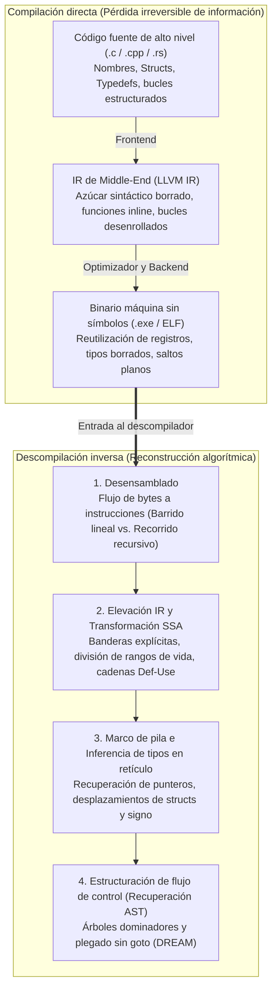
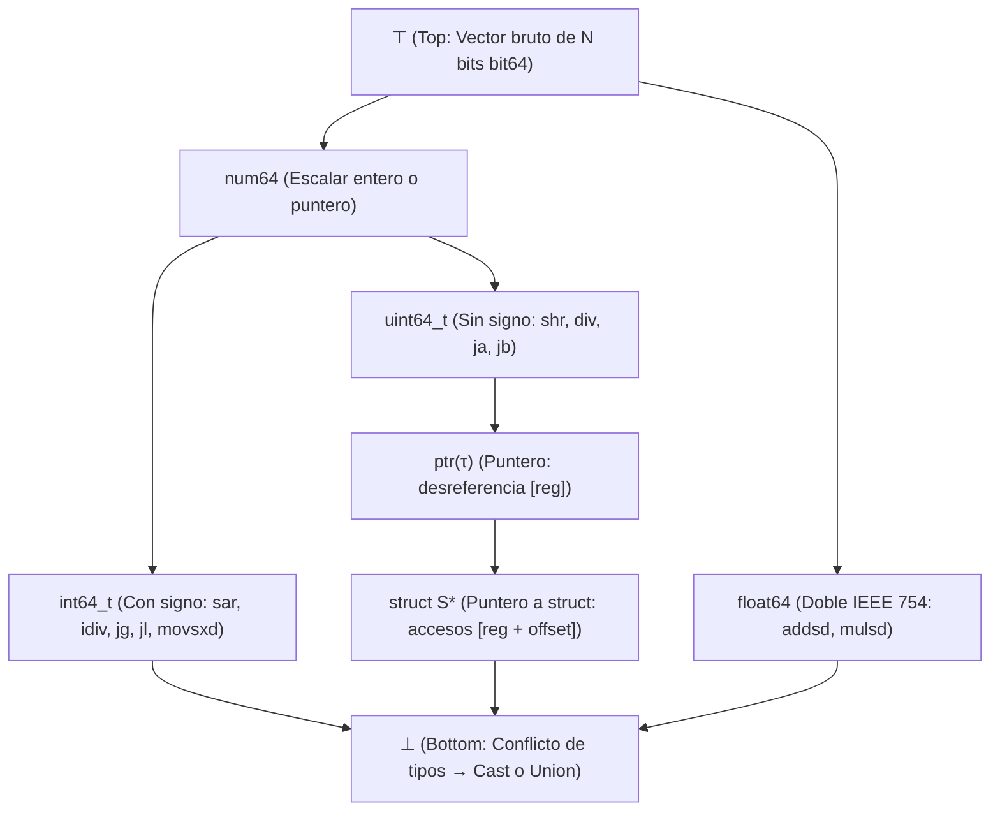

## 1. Introducción: ¿se puede convertir una tortilla de nuevo en huevos crudos?

En el desarrollo de software cotidiano, un compilador (como GCC, Clang/LLVM o MSVC) traduce código fuente legible en C, C++ o Rust a un ejecutable en código máquina (un archivo PE `.exe` en Windows o `ELF` en Linux). Pero ¿qué ocurre cuando necesitamos ir en sentido contrario: cuando un analista de seguridad disecciona un *ransomware*, un ingeniero audita un controlador propietario o una empresa necesita mantener un sistema crítico de hace 25 años cuyo código fuente se perdió? ¿Podemos introducir el binario en un <strong>descompilador (Decompiler)</strong> y recuperar el código fuente C original?

Un famoso aforismo de la ingeniería inversa resume el desafío:
<strong>«Compilar es como batir huevos para hacer una tortilla; descompilar es intentar convertir la tortilla de nuevo en huevos crudos dentro de su cáscara».</strong>

Desde la matemática y la teoría de la información, la función de compilación $\mathcal{C}: \text{Source} \to \text{Binary}$ es una <strong>aplicación muchos-a-uno (no inyectiva) con pérdida de información</strong>. Infinitos programas fuente distintos —que difieren en nombres de variables, comentarios, bucles (`for` frente a `while`) o funciones *inline*— producen tras la optimización (`-O2`, `-O3`) exactamente la misma secuencia de bytes. Como la entropía condicional es $H(\text{Source} \mid \text{Binary}) > 0$, no existe una función inversa única $\mathcal{C}^{-1}$ que recupere lo que fue físicamente borrado por la compilación y la eliminación de símbolos (`strip`). Más aún, por el <strong>teorema de Rice</strong> y el problema de la parada de Turing, separar con exactitud código y datos, resolver todos los destinos de un salto indirecto (`jmp rax`) o decidir el *aliasing* de punteros son problemas <strong>matemáticamente indecidibles</strong> en el caso general.

Sin embargo, los descompiladores industriales modernos —como <strong>IDA Pro (Hex-Rays)</strong>, <strong>Ghidra</strong> (publicado por la NSA), <strong>Binary Ninja</strong> y <strong>angr</strong>— transforman a diario megabytes de ensamblador en pseudocódigo C sorprendentemente limpio y estructurado. En este artículo analizamos las seis etapas algorítmicas de un descompilador moderno.

---

## 2. Qué destruye la compilación: la tubería directa

1. <strong>Frontend (Análisis léxico, sintáctico y de tipos $\to$ IR)</strong>: comentarios, macros `#define`, alias `typedef`, nombres de variables locales y azúcar sintáctico desaparecen al bajar a la representación intermedia (LLVM IR).
2. <strong>Optimizador Middle-End (`-O2` / `-O3`)</strong>: la <strong>expansión inline</strong> disuelve las fronteras entre funciones; el <strong>desenrollado de bucles (Loop Unrolling)</strong> y la <strong>vectorización SIMD</strong> transforman la estructura de control; la <strong>reducción de fuerza (Strength Reduction)</strong> sustituye una división entera `x / 10` por una multiplicación de punto fijo con una constante mágica (`imul 0x66666667`).
3. <strong>Asignación de registros Backend y `strip`</strong>: infinitos registros virtuales SSA se proyectan mediante coloración de grafos sobre apenas 16 registros físicos en `x86-64`. En consecuencia, <strong>un mismo registro físico como `rax` se reutiliza para docenas de variables inconexas de distintos tipos</strong>, mientras que `strip` borra la tabla de símbolos (`.symtab`) y la información DWARF.

---

## 3. Etapa 1: Desensamblado — separar instrucciones de datos

En arquitecturas de longitud de instrucción variable como `x86-64` ($1$ a $15$ bytes), los compiladores suelen incrustar datos de solo lectura —en especial <strong>tablas de salto (Jump Tables)</strong> para sentencias `switch`— directamente dentro de la sección de código `.text`.

1. <strong>Barrido lineal (Linear Sweep, `objdump -d`)</strong>: decodifica secuencialmente byte tras byte, pero interpreta erróneamente las tablas de salto incrustadas como instrucciones falsas.
2. <strong>Recorrido recursivo (Recursive Traversal, IDA Pro / Ghidra)</strong>: parte de los puntos de entrada conocidos (`main`, símbolos exportados) y sigue el grafo de flujo de control real a través de los saltos (`je`, `jmp`, `call`). Para resolver <strong>saltos indirectos (`jmp [rbx + rcx*8]`)</strong>, el descompilador emplea <strong>rebanado hacia atrás (Backward Slicing)</strong> y <strong>análisis de conjuntos de valores (Value-Set Analysis, VSA)</strong> para localizar la comprobación de límites `cmp rcx, 12; ja default` y deducir el tamaño de la tabla.

---

## 4. Etapa 2: Elevación a IR (Lifting) y forma SSA (Static Single Assignment)

Las instrucciones nativas tienen complejos efectos secundarios implícitos (un simple `sub eax, ebx` en `x86` modifica seis banderas de estado: `ZF, CF, SF, OF, PF, AF`). El descompilador eleva (<strong>Lifting</strong>) primero el código nativo a una <strong>representación intermedia independiente de la CPU (P-code en Ghidra, Microcode en Hex-Rays)</strong> y la transforma a <strong>forma SSA (Static Single Assignment)</strong>, donde cada variable se asigna exactamente una vez (insertando funciones $\phi$ $\text{rax}_3 = \phi(\text{rax}_1, \text{rax}_2)$ en las uniones de flujo):

- <strong>Eliminación de banderas muertas</strong>: más del $90\%$ de los cálculos de banderas no leídos por saltos condicionales se eliminan al instante mediante las cadenas Def-Use.
- <strong>Propagación de expresiones</strong>: la definición `ZF_2 = (eax_2 == 0)` se sustituye directamente dentro de `if (ZF_2)` para reconstruir `if (eax_2 == 0)`.
- <strong>División de rangos de vida (Live-Range Splitting)</strong>: las redes SSA disjuntas que compartían el registro físico `rax` se separan automáticamente en variables locales C independientes (`int v1;` frente a `Node *v2;`).

---

## 5. Etapa 3: Análisis de pila e inferencia de tipos mediante retículos (Lattice)

Aunque el código máquina carece de tipos explícitos, la semántica de las instrucciones impone <strong>restricciones algebraicas de tipo</strong>:

- <strong>Con signo (`int`) frente a sin signo (`unsigned int`)</strong>: los saltos condicionales `jg / jl` (*Greater/Less*), la división con signo `idiv`, el desplazamiento aritmético `sar` y la extensión de signo `movsxd` demuestran un entero <strong>con signo (`int`)</strong>; mientras que `ja / jb` (*Above/Below*), `div`, el desplazamiento lógico `shr` y la extensión con ceros `movzx` demuestran un entero <strong>sin signo (`unsigned int`)</strong>.
- <strong>Reconstrucción de punteros y `struct`</strong>: desreferenciar `[rbx]` genera la restricción $\text{ptr}(\tau)$. Acceder a múltiples desplazamientos constantes (`[rbx + 0]`, `[rbx + 8]`, `[rbx + 16]`) revela un puntero a una estructura compuesta <strong>`struct S *`</strong>.
- <strong>Retículo de tipos (Type Lattice) y unificación</strong>: siguiendo a Alan Mycroft (1999) y el sistema <strong>TIE</strong> (CMU), el descompilador organiza los tipos en un <strong>retículo parcialmente ordenado $(\mathcal{L}, \sqsubseteq)$</strong> entre $\top$ (vector de bits bruto) y $\bot$ (conflicto de tipos / `union`), resolviendo las desigualdades de subtipo mediante el ínfimo (Meet $\sqcap$).

---

## 6. Etapa 4: Estructuración del flujo de control — eliminar los `goto` para recuperar `if` y `while`

Para plegar el grafo de flujo de control (CFG) en un árbol sintáctico abstracto (AST) estructurado (Cifuentes 1994), el descompilador calcula el <strong>árbol dominador</strong> y el <strong>árbol post-dominador</strong>:

1. <strong>Detección de bucles naturales</strong>: una arista de retroceso (*Back-Edge*) $n \to h$ donde $h$ domina a $n$ ($h \text{ dom } n$) define un bucle natural con cabecera $h$ (`while`, `for` o `do-while`).
2. <strong>Detección de ramas (`if-then-else`)</strong>: el post-dominador inmediato de un nodo condicional marca el punto exacto donde converge el diamante `if-else`.
3. <strong>Estructuración sin `goto` (Algoritmo DREAM)</strong>: incluso ante grafos irreducibles generados por optimizaciones, el algoritmo <strong>DREAM («No More Gotos», Yakdan et al. 2015)</strong> calcula las <strong>condiciones booleanas de alcanzabilidad (Reaching Conditions)</strong> y aplica minimización lógica para garantizar código C <strong>100 % libre de `goto`</strong>.

---

## 7. Límites de la descompilación: camuflaje de optimización, ofuscación y descompiladores neuronales (LLM)

| Artefacto del programa | Sin optimizar (`-O0 -g` con DWARF) | Producción sin símbolos (`-O3` + `strip`) | Ofuscado (OLLVM / VMProtect) |
| :--- | :--- | :--- | :--- |
| <strong>Nombres de funciones, variables y tipos</strong> | $100\%$ recuperados de DWARF/PDB | <strong>Borrados permanentemente</strong> (`sub_401120`, `v2`) | Borrados + símbolos falsos engañosos |
| <strong>División por constante (`x / 10`)</strong> | Instrucción `idiv` literal | <strong>Multiplicación mágica</strong> (`0x66666667`) | Polinomios booleano-aritméticos (MBA) |
| <strong>Flujo de control (`if / while`)</strong> | AST estructurado limpio | Desenrollado de bucles y vectorización SIMD | <strong>Aplanamiento de flujo (CFF)</strong> en `switch` gigante |
| <strong>Semántica de instrucciones (ISA)</strong> | `x86-64` / `ARM64` nativo | `x86-64` / `ARM64` nativo | <strong>Virtualización</strong>: VM de bytecode propietario |

Mientras que los ofuscadores (<strong>OLLVM</strong>, <strong>VMProtect</strong>) atacan el análisis estático mediante <strong>aplanamiento del flujo de control (CFF)</strong>, <strong>predicados opacos</strong>, <strong>aritmética booleana mixta (MBA, $x+y \equiv (x\oplus y) + 2(x\land y)$)</strong> y <strong>ofuscación por virtualización</strong> (traducción a un bytecode aleatorio propio), en la década de 2020 los <strong>descompiladores neuronales basados en LLM (`LLM4Decompile`)</strong> combinan el análisis formal con inteligencia artificial estadística para inferir nombres significativos de variables y funciones y reescribir código altamente optimizado en C natural.
