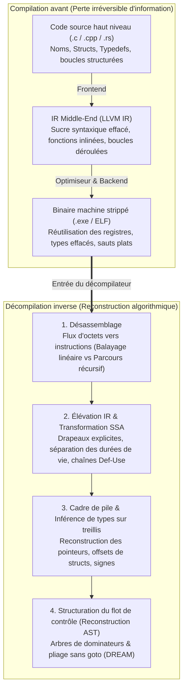
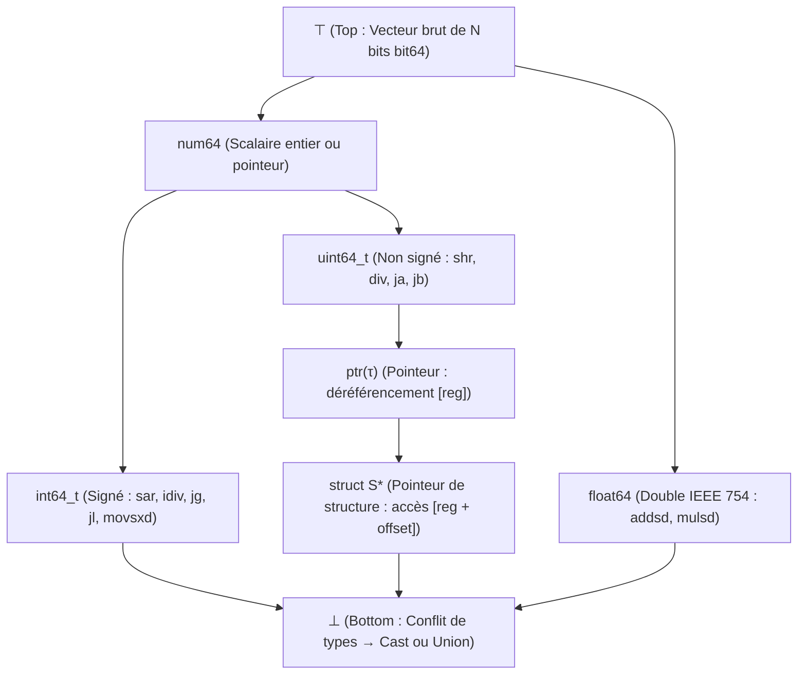

## 1. Introduction : peut-on refaire un œuf cru à partir d'une omelette ?

Dans le développement logiciel, un compilateur (tel que GCC, Clang/LLVM ou MSVC) traduit du code source lisible écrit en C, C++ ou Rust en un fichier exécutable binaire (un fichier PE `.exe` sous Windows ou `ELF` sous Linux). Mais que se passe-t-il lorsqu'il faut faire le chemin inverse — par exemple lorsqu'un analyste en cybersécurité dissèque un rançongiciel, qu'un ingénieur audite un pilote propriétaire ou qu'une entreprise doit maintenir un système critique vieux de 25 ans dont le code source a été perdu ? Peut-on confier le binaire à un <strong>décompilateur (Decompiler)</strong> pour retrouver le code source C d'origine ?

Un célèbre adage de la rétro-ingénierie résume le défi :
<strong>« Compiler, c'est casser des œufs pour faire une omelette ; décompiler, c'est essayer de retransformer l'omelette en œufs crus dans leur coquille. »</strong>

Sur le plan mathématique et de la théorie de l'information, la fonction de compilation $\mathcal{C}: \text{Source} \to \text{Binary}$ est une <strong>application plusieurs-à-un (non injective) avec perte d'information</strong>. Une infinité de programmes sources distincts — différant par leurs noms de variables, commentaires, boucles (`for` vs `while`) ou fonctions *inlinées* — produisent, après optimisation (`-O2`, `-O3`), exactement la même séquence d'octets. L'entropie conditionnelle $H(\text{Source} \mid \text{Binary}) > 0$ étant strictement positive, aucune fonction inverse $\mathcal{C}^{-1}$ ne peut retrouver de manière unique ce qui a été effacé par la compilation et la suppression des symboles (`strip`). De plus, en vertu du <strong>théorème de Rice</strong> et du problème de l'arrêt de Turing, la séparation exacte du code et des données, la résolution statique des sauts indirects (`jmp rax`) et l'analyse d'aliasing de pointeurs sont <strong>mathématiquement indécidables</strong> dans le cas général.

Pourtant, les décompilateurs industriels modernes — tels qu'<strong>IDA Pro (Hex-Rays)</strong>, <strong>Ghidra</strong> (publié par la NSA), <strong>Binary Ninja</strong> et <strong>angr</strong> — transforment quotidiennement des mégaoctets d'assembleur en pseudo-code C remarquablement lisible et structuré. Cet article décortique les six grandes étapes algorithmiques d'un décompilateur moderne.

---

## 2. Ce que la compilation détruit : le pipeline avant

1. <strong>Frontend (Analyse lexicale, syntaxique et typage $\to$ IR)</strong> : les commentaires, macros `#define`, alias `typedef`, noms de variables locales et le sucre syntaxique disparaissent lors de l'abaissement vers la représentation intermédiaire (LLVM IR).
2. <strong>Optimiseur Middle-End (`-O2` / `-O3`)</strong> : l'<strong>expansion inline</strong> dissout les frontières entre fonctions ; le <strong>déroulage de boucles (Loop Unrolling)</strong> et la <strong>vectorisation SIMD</strong> transforment la structure des boucles ; la <strong>réduction de force (Strength Reduction)</strong> remplace une simple division entière `x / 10` par une multiplication en virgule fixe par une constante magique (`imul 0x66666667`).
3. <strong>Allocation de registres Backend et `strip`</strong> : une infinité de registres virtuels SSA sont projetés par coloriage de graphe sur les 16 seuls registres généraux de l'architecture `x86-64`. Par conséquent, <strong>un même registre physique comme `rax` est réutilisé pour des dizaines de variables totalement indépendantes et de types différents</strong>, tandis que `strip` supprime la table des symboles (`.symtab`) et les informations de débogage DWARF.

---

## 3. Étape 1 : Désassemblage — séparer les instructions des données

Sur les architectures à longueur d'instruction variable comme `x86-64` ($1$ à $15$ octets), les compilateurs insèrent fréquemment des données en lecture seule — notamment les <strong>tables de sauts (Jump Tables)</strong> des instructions `switch` — directement au cœur de la section `.text`.

1. <strong>Balayage linéaire (Linear Sweep, `objdump -d`)</strong> : décode séquentiellement du premier au dernier octet, mais interprète à tort les tables de sauts intégrées comme des instructions invalides ou trompeuses.
2. <strong>Parcours récursif (Recursive Traversal, IDA Pro / Ghidra)</strong> : part des points d'entrée connus (`main`, symboles exportés) et suit le graphe de flot de contrôle le long des branchements (`je`, `jmp`, `call`). Pour résoudre les <strong>sauts indirects (`jmp [rbx + rcx*8]`)</strong>, le décompilateur utilise le <strong>slicing arrière</strong> et l'<strong>analyse d'ensembles de valeurs (Value-Set Analysis, VSA)</strong> afin d'identifier le test de borne `cmp rcx, 12; ja default` et d'en déduire les cibles valides.

---

## 4. Étape 2 : Élévation en IR (Lifting) et forme SSA (Static Single Assignment)

Les instructions machine comportent de nombreux effets de bord implicites (un simple `sub eax, ebx` sur `x86` modifie six drapeaux d'état : `ZF, CF, SF, OF, PF, AF`). Le décompilateur élève (<strong>Lifting</strong>) d'abord le code natif vers une <strong>représentation intermédiaire indépendante du processeur (P-code dans Ghidra, Microcode dans Hex-Rays)</strong>, puis la transforme sous <strong>forme SSA (Static Single Assignment)</strong> où chaque variable n'est assignée qu'une seule fois (avec des fonctions $\phi$ $\text{rax}_3 = \phi(\text{rax}_1, \text{rax}_2)$ aux points de jonction) :

- <strong>Élimination des drapeaux morts</strong> : plus de $90\%$ des calculs de drapeaux jamais utilisés par un saut conditionnel sont supprimés instantanément via les chaînes Def-Use.
- <strong>Propagation d'expressions</strong> : la définition `ZF_2 = (eax_2 == 0)` est injectée directement dans `if (ZF_2)` pour reconstruire `if (eax_2 == 0)`.
- <strong>Séparation des durées de vie (Live-Range Splitting)</strong> : les sous-graphes SSA disjoints qui partageaient le registre physique `rax` deviennent des variables locales C distinctes (`int v1;` vs `Node *v2;`) !

---

## 5. Étape 3 : Analyse de la pile et inférence de types sur treillis (Lattice)

Bien que le code machine ne possède pas de types explicites, la sémantique des instructions impose de fortes <strong>contraintes algébriques de typage</strong> :

- <strong>Distinction signé (`int`) vs non signé (`unsigned int`)</strong> : les sauts conditionnels `jg / jl` (*Greater/Less*), la division signée `idiv`, le décalage arithmétique `sar` et l'extension de signe `movsxd` prouvent un entier <strong>signé (`int`)</strong> ; tandis que `ja / jb` (*Above/Below*), `div`, le décalage logique `shr` et l'extension par zéros `movzx` prouvent un entier <strong>non signé (`unsigned int`)</strong> !
- <strong>Reconstruction des pointeurs et `struct`</strong> : un déréférencement `[rbx]` engendre la contrainte $\text{ptr}(\tau)$. Des accès à différents décalages constants (`[rbx + 0]`, `[rbx + 8]`, `[rbx + 16]`) révèlent un pointeur vers une structure composite <strong>`struct S *`</strong>.
- <strong>Treillis de types (Type Lattice) et unification</strong> : suivant Alan Mycroft (1999) et le système <strong>TIE</strong> (CMU), le décompilateur organise les types en un <strong>treillis partiellement ordonné $(\mathcal{L}, \sqsubseteq)$</strong> borné par $\top$ (vecteur de bits brut) et $\bot$ (conflit de types / `union`), résolvant globalement les inégalités de sous-typage par calcul de la borne inférieure maximale (Meet $\sqcap$).

---

## 6. Étape 4 : Structuration du flot de contrôle — éliminer les `goto` pour retrouver `if` et `while`

Pour replier le graphe de flot de contrôle (CFG) en un arbre syntaxique abstrait (AST) structuré (Cifuentes 1994), le décompilateur calcule l'<strong>arbre des dominateurs</strong> et l'<strong>arbre des post-dominateurs</strong> :

1. <strong>Détection des boucles naturelles</strong> : une arête arrière (*Back-Edge*) $n \to h$ où $h$ domine $n$ ($h \text{ dom } n$) identifie une boucle naturelle d'en-tête $h$ (`while`, `for` ou `do-while`).
2. <strong>Détection des branchements (`if-then-else`)</strong> : le post-dominateur immédiat d'un nœud conditionnel marque le point exact de reconvergence du losange `if-else`.
3. <strong>Structuration sans `goto` (Algorithme DREAM)</strong> : face aux graphes irréductibles produits par les optimisations, l'algorithme <strong>DREAM (« No More Gotos », Yakdan et al. 2015)</strong> calcule les <strong>conditions booléennes d'atteignabilité (Reaching Conditions)</strong> et applique une minimisation logique pour garantir un code C <strong>100 % sans `goto`</strong> !

---

## 7. Limites de la décompilation : camouflage d'optimisation, obfuscation et décompilateurs neuronaux (LLM)

| Artefact du programme | Non optimisé (`-O0 -g` avec DWARF) | Production strippée (`-O3` + `strip`) | Obfusqué (OLLVM / VMProtect) |
| :--- | :--- | :--- | :--- |
| <strong>Noms de fonctions, variables & types</strong> | $100\%$ récupérés depuis DWARF/PDB | <strong>Définitivement effacés</strong> (`sub_401120`, `v2`) | Effacés + faux symboles trompeurs |
| <strong>Division par constante (`x / 10`)</strong> | Instruction `idiv` explicite | <strong>Multiplication magique</strong> (`0x66666667`) | Polynômes booléens-arithmétiques (MBA) |
| <strong>Flot de contrôle (`if / while`)</strong> | AST structuré propre | Déroulage de boucles & vectorisation SIMD | <strong>Aplatissement du flot (CFF)</strong> en `switch` géant |
| <strong>Sémantique d'instructions (ISA)</strong> | `x86-64` / `ARM64` natif | `x86-64` / `ARM64` natif | <strong>Virtualisation</strong> : VM à bytecode propriétaire |

Tandis que les outils d'obfuscation (<strong>OLLVM</strong>, <strong>VMProtect</strong>) entravent l'analyse statique par l'<strong>aplatissement du flot de contrôle (CFF)</strong>, les <strong>prédicats opaques</strong>, l'<strong>arithmétique booléenne mixte (MBA, $x+y \equiv (x\oplus y) + 2(x\land y)$)</strong> et la <strong>virtualisation de code</strong> (compilation vers un jeu d'instructions virtuel aléatoire), la décennie 2020 voit l'essor de la <strong>décompilation neuronale par grands modèles de langage (`LLM4Decompile`)</strong>, capable de prédire statistiquement des noms de variables explicites et de réécrire les idiomes optimisés en code C naturel.
