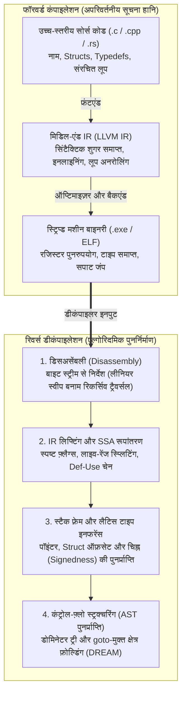
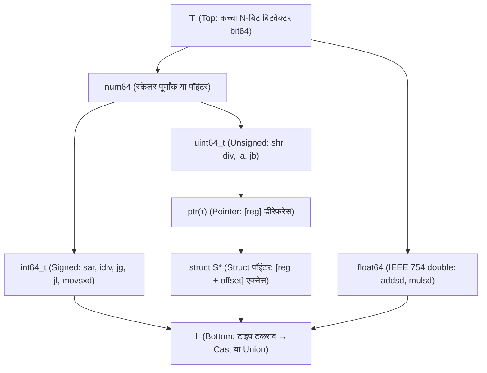

## 1. प्रस्तावना: क्या आप 'ऑमलेट' से वापस 'कच्चा अंडा' बना सकते हैं?

दैनिक सॉफ़्टवेयर विकास में, एक कंपाइलर (जैसे GCC, Clang/LLVM, या MSVC) मानव द्वारा पढ़े जा सकने वाले C, C++ या Rust सोर्स कोड को मशीन-कोड एक्ज़ीक्यूटेबल (Windows की `.exe` PE फ़ाइल या Linux की `ELF` बाइनरी) में बदलता है। लेकिन क्या हो जब हमें उल्टी दिशा में जाना पड़े—उदाहरण के लिए जब कोई सुरक्षा विश्लेषक रैनसमवेयर बाइनरी की जाँच करता है, या किसी 25 साल पुराने सिस्टम का सोर्स कोड खो जाने पर उसमें सुधार करना पड़ता है? क्या हम मशीन बाइनरी को किसी <strong>डीकंपाइलर (Decompiler)</strong> में डालकर मूल C सोर्स कोड वापस पा सकते हैं?

रिवर्स-इंजीनियरिंग जगत में एक प्रसिद्ध कहावत है:
<strong>"कंपाइलेशन अंडे फेंटकर ऑमलेट बनाने जैसा है; और डीकंपाइलेशन उस बने हुए ऑमलेट से वापस छिलके सहित कच्चे अंडे निकालने का प्रयास है।"</strong>

गणित और सूचना सिद्धांत (Information Theory) की दृष्टि से, कंपाइलेशन फ़ंक्शन $\mathcal{C}: \text{Source} \to \text{Binary}$ एक <strong>सूचना-ह्रास वाला अनेक-से-एक (Many-to-One, Non-injective) प्रतिचित्रण</strong> है। अलग-अलग वेरिएबल नाम, टिप्पणियों, लूप संरचनाओं (`for` बनाम `while`) और इनलाइन फ़ंक्शनों वाले अनंत सोर्स प्रोग्राम `-O2` या `-O3` ऑप्टिमाइज़ेशन के बाद बिल्कुल समान मशीन बाइट अनुक्रम उत्पन्न करते हैं। चूँकि सप्रतिबंध एन्ट्रॉपी $H(\text{Source} \mid \text{Binary}) > 0$ धनात्मक है, इसलिए कोई भी प्रतिलोम फ़ंक्शन $\mathcal{C}^{-1}$ उस सूचना को वापस नहीं ला सकता जो कंपाइलेशन और सिंबल स्ट्रिपिंग (`strip`) के दौरान मिटा दी गई है। इसके अलावा, <strong>राइस के प्रमेय (Rice's Theorem)</strong> और ट्यूरिंग की हॉल्टिंग समस्या के अनुसार, कोड और इनलाइन डेटा को पूर्णतः अलग करना, अप्रत्यक्ष जंप (`jmp rax`) के सभी लक्ष्यों को जानना और पॉइंटर एलियासिंग तय करना सामान्य स्थिति में <strong>गणितीय रूप से अनिर्धार्य (Undecidable)</strong> है।

फिर भी, आधुनिक औद्योगिक डीकंपाइलर—जैसे <strong>IDA Pro (Hex-Rays)</strong>, NSA का ओपन-सोर्स <strong>Ghidra</strong>, <strong>Binary Ninja</strong>, और <strong>angr</strong>—प्रतिदिन लाखों बाइट्स के मशीन कोड को अत्यंत पठनीय और सुव्यवस्थित C स्यूडोकोड में बदल देते हैं। इस लेख में हम आधुनिक डीकंपाइलर के छह मुख्य एल्गोरिदमिक चरणों का विश्लेषण करेंगे।

---

## 2. कंपाइलेशन क्या नष्ट करता है? : फॉरवर्ड कंपाइलर पाइपलाइन

1. <strong>फ्रंटएंड (पार्सिंग और टाइप चेकिंग $\to$ IR)</strong>: टिप्पणियाँ, `#define` मैक्रो, `typedef` उपनाम, लोकल वेरिएबल नाम और सिंटैक्टिक शुगर इंटरमीडिएट रिप्रेजेंटेशन (LLVM IR) में उतरते समय समाप्त हो जाते हैं।
2. <strong>मिडिल-एंड ऑप्टिमाइज़र (`-O2` / `-O3`)</strong>: <strong>फ़ंक्शन इनलाइनिंग (Function Inlining)</strong> फ़ंक्शन की सीमाओं को मिटा देता है; <strong>लूप अनरोलिंग</strong> और <strong>SIMD वेक्टराइज़ेशन</strong> नियंत्रण प्रवाह को बदल देते हैं; और <strong>स्ट्रेंथ रिडक्शन (Strength Reduction)</strong> साधारण पूर्णांक विभाजन `x / 10` को जादुई स्थिरांक गुणन (`imul 0x66666667`) में बदल देता है।
3. <strong>बैकएंड रजिस्टर आवंटन और `strip`</strong>: अनंत SSA वर्चुअल रजिस्टरों को ग्राफ कलरिंग द्वारा `x86-64` के मात्र 16 भौतिक रजिस्टरों पर मैप किया जाता है। परिणामस्वरूप, <strong>एक ही भौतिक रजिस्टर `rax` का उपयोग एक ही फ़ंक्शन के अलग-अलग हिस्सों में भिन्न प्रकार के दर्जनों असंबंधित वेरिएबल्स के लिए बार-बार किया जाता है</strong>, जबकि `strip` सिंबल टेबल (`.symtab`) और DWARF डीबग जानकारी को पूरी तरह मिटा देता है।

---

## 3. चरण 1: डिसअसेंबली (Disassembly) — निर्देशों को डेटा से अलग करना

`x86-64` जैसे परिवर्तनीय-लंबाई निर्देश आर्किटेक्चर ($1$ से $15$ बाइट्स) में, कंपाइलर अक्सर रीड-ओनली डेटा—विशेष रूप से `switch` स्टेटमेंट के <strong>जंप टेबल (Jump Tables)</strong>—को सीधे `.text` कोड सेक्शन के भीतर एम्बेड कर देते हैं।

1. <strong>लीनियर स्वीप (Linear Sweep, `objdump -d`)</strong>: पहले बाइट से अंत तक क्रमिक रूप से डिकोड करता है, किंतु बीच में आए जंप टेबल डेटा को गलतफ़हमी में फ़र्ज़ी निर्देश मान लेता है।
2. <strong>रिकर्सिव ट्रैवर्सल (Recursive Traversal, IDA Pro / Ghidra)</strong>: ज्ञात प्रवेश बिंदुओं (`main`, एक्सपोर्टेड सिंबल) से शुरू होकर ब्रांच निर्देशों (`je`, `jmp`, `call`) के वास्तविक नियंत्रण प्रवाह ग्राफ का अनुसरण करता है। <strong>अप्रत्यक्ष जंप (`jmp [rbx + rcx*8]`)</strong> को हल करने के लिए डीकंपाइलर <strong>बैकवर्ड स्लाइसिंग</strong> और <strong>वैल्यू-सेट एनालिसिस (VSA)</strong> का उपयोग करके सीमा जाँच `cmp rcx, 12; ja default` को खोजता है और जंप टेबल का आकार निकालता है।

---

## 4. चरण 2: IR लिफ्टिंग और स्टैटिक सिंगल असाइनमेंट (SSA) डेटाफ़्लो

मशीन निर्देशों में जटिल अंतर्निहित साइड इफ़ेक्ट्स होते हैं (`x86` का एक साधारण `sub eax, ebx` एक साथ छह स्टेटस फ़्लैग्स `ZF, CF, SF, OF, PF, AF` को बदल देता है)। डीकंपाइलर पहले नेतिव कोड को <strong>आर्किटेक्चर-स्वतंत्र इंटरमीडिएट रिप्रेजेंटेशन (Ghidra का P-code, Hex-Rays का Microcode)</strong> में <strong>लिफ्ट (Lift)</strong> करता है और फिर उसे <strong>SSA (Static Single Assignment) रूप</strong> में बदलता है, जहाँ प्रत्येक वेरिएबल को केवल एक बार मान दिया जाता है (जॉइन पॉइंट्स पर $\phi$-फ़ंक्शन $\text{rax}_3 = \phi(\text{rax}_1, \text{rax}_2)$ लगाकर):

- <strong>डेड फ़्लैग एलिमिनेशन</strong>: $90\%$ से अधिक स्टेटस-फ़्लैग गणनाएँ जो किसी कंडीशनल जंप में काम नहीं आतीं, Def-Use चेन द्वारा तुरंत हटा दी जाती हैं।
- <strong>एक्सप्रेशन प्रोपेगेशन</strong>: `ZF_2 = (eax_2 == 0)` परिभाषा को सीधे `if (ZF_2)` में रखकर उच्च-स्तरीय शर्त `if (eax_2 == 0)` बनाई जाती है।
- <strong>लाइव-रेंज स्प्लिटिंग</strong>: भौतिक रजिस्टर `rax` को साझा करने वाले असंबंधित SSA जाल (Webs) स्वतः ही स्वतंत्र C लोकल वेरिएबल्स (`int v1;` बनाम `Node *v2;`) में बँट जाते हैं!

---

## 5. चरण 3: स्टैक फ़्रेम विश्लेषण और लैटिस-आधारित टाइप इनफरेंस (Type Inference)

यद्यपि मशीन कोड में कोई स्पष्ट टाइप नहीं होता, फिर भी CPU निर्देशों का अर्थविज्ञान सख्त <strong>बीजीय टाइप बाधाएँ (Type Constraints)</strong> उत्पन्न करता है:

- <strong>चिह्नित (`int`) बनाम अचिह्नित (`unsigned int`) भेद</strong>: कंडीशनल ब्रांच `jg / jl` (*Greater/Less*), चिह्नित भाग `idiv`, अंकगणितीय राइट शिफ्ट `sar`, और साइन-एक्सटेंशन `movsxd` सिद्ध करते हैं कि ऑपरेंड <strong>चिह्नित पूर्णांक (`int`)</strong> है; जबकि `ja / jb` (*Above/Below*), `div`, लॉजिकल शिफ्ट `shr`, और ज़ीरो-एक्सटेंशन `movzx` सिद्ध करते हैं कि वह <strong>अचिह्नित पूर्णांक (`unsigned int`)</strong> है!
- <strong>पॉइंटर और `struct` लेआउट पुनर्निर्माण</strong>: मेमोरी डीरेफ़रेंस `[rbx]` पॉइंटर बाधा $\text{ptr}(\tau)$ बनाता है, और एक ही बेस रजिस्टर से कई स्थिर ऑफ़सेट्स (`[rbx + 0]`, `[rbx + 8]`, `[rbx + 16]`) तक पहुँच सिद्ध करती है कि `rbx` एक <strong>`struct S *`</strong> पॉइंटर है।
- <strong>टाइप लैटिस (Type Lattice) और यूनिफ़िकेशन</strong>: एलन मायक्रॉफ्ट (1999) और CMU के <strong>TIE</strong> सिस्टम के अनुसार, डीकंपाइलर सभी टाइप्स को $\top$ (कच्चा बिटवेक्टर) और $\bot$ (टाइप टकराव / `union`) के बीच एक <strong>आंशिक रूप से क्रमित लैटिस $(\mathcal{L}, \sqsubseteq)$</strong> में रखता है और मीट ($\sqcap$) द्वारा सभी वेरिएबल्स के सटीक C टाइप निकालता है।

---

## 6. चरण 4: कंट्रोल-फ़्लो स्ट्रक्चरिंग — `goto` हटाकर `if` और `while` वापस पाना

सपाट कंट्रोल-फ़्लो ग्राफ (CFG) को नेस्टेड एब्स्ट्रैक्ट सिंटैक्स ट्री (AST) में समेटने के लिए (Cifuentes 1994), डीकंपाइलर <strong>डोमिनेटर ट्री</strong> और <strong>पोस्ट-डोमिनेटर ट्री</strong> की गणना करता है:

1. <strong>प्राकृतिक लूप (Natural Loops)</strong>: कोई बैक-एज $n \to h$ जहाँ लक्ष्य $h$ स्रोत $n$ को डोमिनेट करता है ($h \text{ dom } n$), हेडर $h$ वाले एक लूप (`while`, `for` या `do-while`) को परिभाषित करता है।
2. <strong>शाखा मिलन बिंदु (`if-then-else`)</strong>: किसी ब्रांच नोड का तत्काल पोस्ट-डोमिनेटर `if-else` डायमंड का सटीक मिलन बिंदु होता है।
3. <strong>`goto`-मुक्त स्ट्रक्चरिंग (DREAM एल्गोरिदम)</strong>: जटिल और इर्रिड्यूसिबल CFG के लिए भी <strong>DREAM ("No More Gotos", Yakdan et al. 2015)</strong> एल्गोरिदम बूलियन <strong>रीचिंग कंडीशंस (Reaching Conditions)</strong> और लॉजिक मिनिमाइज़ेशन द्वारा <strong>100% `goto`-मुक्त</strong> साफ़ C कोड उत्पन्न करता है!

---

## 7. डीकंपाइलेशन की सीमाएँ: ऑप्टिमाइज़ेशन, ओब्फ़स्केशन और न्यूरल LLM डीकंपाइलर्स

| प्रोग्राम तत्व | बिना ऑप्टिमाइज़ेशन (`-O0 -g` DWARF सहित) | स्ट्रिप्ड रिलीज़ (`-O3` + `strip`) | ओब्फ़स्केटेड (OLLVM / VMProtect) |
| :--- | :--- | :--- | :--- |
| <strong>फ़ंक्शन, वेरिएबल व टाइप नाम</strong> | DWARF/PDB से $100\%$ प्राप्त | <strong>स्थायी रूप से नष्ट</strong> (`sub_401120`, `v2`) | नष्ट + भ्रामक फ़र्ज़ी सिंबल |
| <strong>स्थिरांक विभाजन (`x / 10`)</strong> | सीधा `idiv` निर्देश | <strong>मैजिक-नंबर गुणन</strong> (`0x66666667`) | मिक्स्ड बूलियन-अंकगणित (MBA) बहुपद |
| <strong>कंट्रोल फ़्लो (`if / while`)</strong> | साफ़ संरचित AST | लूप अनरोलिंग व SIMD वेक्टराइज़ेशन | <strong>कंट्रोल-फ़्लो फ़्लैटनिंग (CFF)</strong> विशाल `switch` |
| <strong>निर्देश अर्थविज्ञान (ISA)</strong> | मूल `x86-64` / `ARM64` | मूल `x86-64` / `ARM64` | <strong>वर्चुअलाइज़ेशन</strong>: कस्टम रैंडम बाइटकोड VM |

जहाँ <strong>OLLVM</strong> और <strong>VMProtect</strong> जैसे ओब्फ़स्केटर <strong>कंट्रोल-फ़्लो फ़्लैटनिंग (CFF)</strong>, <strong>ओपेक प्रेडिकेट्स</strong>, <strong>मिक्स्ड बूलियन-अंकगणित ($x+y \equiv (x\oplus y) + 2(x\land y)$)</strong> और <strong>वर्चुअलाइज़ेशन ओब्फ़स्केशन</strong> (कोड को कस्टम बाइटकोड VM में बदलना) से स्थैतिक विश्लेषण को रोकते हैं, वहीं 2020 के दशक में <strong>न्यूरल LLM डीकंपाइलर्स (`LLM4Decompile`)</strong> औपचारिक प्रोग्राम विश्लेषण को AI के साथ जोड़कर सार्थक वेरिएबल नामों का अनुमान लगा रहे हैं और जटिल मशीन कोड को स्वाभाविक मानव-सदृश C कोड में पुन: अनूदित कर रहे हैं।
