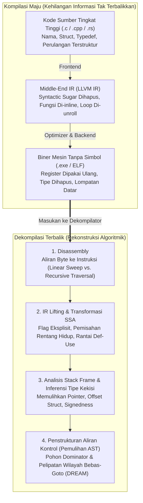
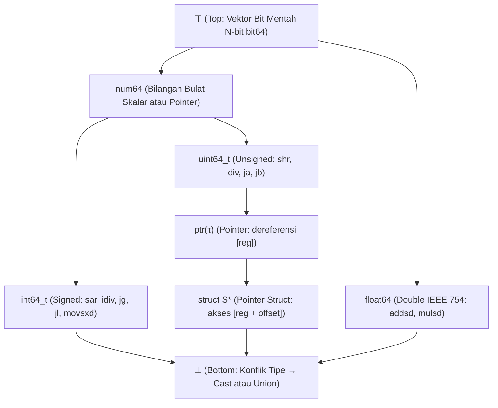

## 1. Pendahuluan: Bisakah Anda Mengubah Telur Dadar Kembali Menjadi Telur Mentah?

Dalam pengembangan perangkat lunak sehari-hari, kompiler (seperti GCC, Clang/LLVM, atau MSVC) menerjemahkan kode sumber C, C++, atau Rust yang mudah dibaca manusia menjadi file eksekusi kode mesin (`.exe` PE di Windows atau biner `ELF` di Linux). Namun, apa yang terjadi jika kita harus bergerak ke arah sebaliknya—misalnya ketika analis keamanan membedah *ransomware*, insinyur mengaudit *driver* tertutup, atau perusahaan harus memperbaiki sistem warisan berusia 25 tahun yang kode sumbernya telah hilang? Bisakah kita memasukkan biner mesin ke dalam <strong>Dekompilator (Decompiler)</strong> dan memulihkan kode sumber C aslinya?

Dalam komunitas rekayasa balik (*reverse engineering*), ada sebuah pepatah klasik:
<strong>"Kompilasi itu seperti mengocok dan menggoreng telur menjadi omelet (telur dadar); dekompilasi adalah usaha mengubah omelet tersebut kembali menjadi telur mentah utuh di dalam cangkangnya."</strong>

Secara matematis dan teori informasi, fungsi kompilasi $\mathcal{C}: \text{Source} \to \text{Binary}$ adalah <strong>pemetaan banyak-ke-satu (non-injektif) yang bersifat *lossy* (menghilangkan informasi)</strong>. Tak terhingga banyaknya program sumber yang berbeda—baik nama variabel, komentar, struktur perulangan (`for` vs. `while`), maupun fungsi *inline*—akan menghasilkan urutan byte mesin yang <em>persis sama</em> setelah optimasi (`-O2`, `-O3`). Karena entropi bersyarat $H(\text{Source} \mid \text{Binary}) > 0$, tidak ada fungsi invers deterministik $\mathcal{C}^{-1}$ yang dapat memulihkan informasi yang telah dihapus oleh kompilasi dan penghapusan simbol (`strip`). Lebih buruk lagi, menurut <strong>Teorema Rice</strong> dan Masalah Berhenti (*Halting Problem*) Turing, memisahkan byte instruksi dari data secara eksak, menyelesaikan semua target lompatan tak langsung (`jmp rax`), atau menentukan *aliasing* penunjuk bersifat <strong>tak terputuskan secara matematis (undecidable)</strong>.

Meski demikian, dekompilator industri modern—seperti <strong>IDA Pro (Hex-Rays)</strong>, <strong>Ghidra</strong> (dirilis oleh NSA), <strong>Binary Ninja</strong>, dan <strong>angr</strong>—secara rutin mengubah megabyte kode *assembly* menjadi *pseudocode* C yang bersih dan terstruktur. Artikel ini membedah enam tahapan algoritma utama di balik dekompilator modern.

---

## 2. Apa yang Dihancurkan oleh Kompilasi: Pipa Kompilasi Maju

1. <strong>Frontend (Parsing & Pemeriksaan Tipe $\to$ IR)</strong>: komentar, makro `#define`, alias `typedef`, nama variabel lokal, dan *syntactic sugar* lenyap saat diturunkan ke Representasi Menengah (LLVM IR).
2. <strong>Optimizer Middle-End (`-O2` / `-O3`)</strong>: <strong>Function Inlining</strong> melebur batas antarfungsi; <strong>Loop Unrolling</strong> dan <strong>vektorisasi SIMD</strong> merombak struktur perulangan; <strong>Strength Reduction</strong> mengganti pembagian bilangan bulat `x / 10` dengan perkalian titik-tetap konstanta ajaib (`imul 0x66666667`).
3. <strong>Alokasi Register Backend & `strip`</strong>: register virtual SSA yang tak terbatas dipetakan lewat pewarnaan graf ke hanya 16 register fisik pada `x86-64`. Akibatnya, <strong>satu register fisik seperti `rax` dipakai berulang kali untuk puluhan variabel berbeda dengan tipe berbeda</strong>, sementara `strip` menghapus tabel simbol (`.symtab`) dan informasi *debug* DWARF.

---

## 3. Tahap 1: Disassembly — Memisahkan Instruksi dari Data

Pada arsitektur panjang instruksi variabel seperti `x86-64` ($1$ hingga $15$ byte), kompiler sering menyisipkan data baca-saja—terutama <strong>tabel lompatan (Jump Tables)</strong> untuk pernyataan `switch`—langsung di dalam bagian kode `.text`.

1. <strong>Linear Sweep (`objdump -d`)</strong>: mendekode byte demi byte secara berurutan dari awal hingga akhir, tetapi salah mengartikan tabel lompatan sebagai instruksi palsu.
2. <strong>Recursive Traversal (IDA Pro / Ghidra)</strong>: mulai dari titik masuk yang diketahui (`main`, simbol ekspor) dan mengikuti graf aliran kontrol nyata вдоль instruksi percabangan (`je`, `jmp`, `call`). Untuk menyelesaikan <strong>lompatan tak langsung (`jmp [rbx + rcx*8]`)</strong>, dekompilator menggunakan <strong>Backward Slicing</strong> dan <strong>Value-Set Analysis (VSA)</strong> guna menemukan pemeriksaan batas `cmp rcx, 12; ja default` dan menyimpulkan ukuran tabel lompatan.

---

## 4. Tahap 2: IR Lifting dan Bentuk Static Single Assignment (SSA)

Instruksi mesin asli memiliki efek samping implisit yang rumit (satu instruksi `sub eax, ebx` pada `x86` menimpa enam *flag* status sekaligus: `ZF, CF, SF, OF, PF, AF`). Dekompilator pertama-tama mengangkat (<strong>Lifting</strong>) kode asli ke <strong>Representasi Menengah independen-arsitektur (P-code di Ghidra, Microcode di Hex-Rays)</strong>, lalu mengubahnya ke <strong>Bentuk SSA (Static Single Assignment)</strong> di mana setiap variabel hanya diberi nilai tepat satu kali (dengan fungsi $\phi$ $\text{rax}_3 = \phi(\text{rax}_1, \text{rax}_2)$ pada titik pertemuan cabang):

- <strong>Penghapusan Flag Mati (Dead Flag Elimination)</strong>: lebih dari $90\%$ perhitungan *flag* yang tidak pernah dibaca oleh lompatan bersyarat langsung dihapus lewat rantai Def-Use.
- <strong>Propagasi Ekspresi</strong>: definisi `ZF_2 = (eax_2 == 0)` disubstitusikan langsung ke dalam `if (ZF_2)` untuk membentuk `if (eax_2 == 0)`.
- <strong>Pemisahan Rentang Hidup (Live-Range Splitting)</strong>: jaring SSA terpisah yang kebetulan berbagi register fisik `rax` secara otomatis dipecah menjadi variabel lokal C yang independen (`int v1;` vs. `Node *v2;`)!

---

## 5. Tahap 3: Analisis Stack Frame dan Inferensi Tipe Berbasis Kekisi (Lattice)

Meskipun kode mesin tidak memiliki tipe eksplisit, semantik instruksi CPU memberikan <strong>batasan tipe aljabar (Type Constraints)</strong> yang ketat:

- <strong>Bertanda (`int`) vs. Tak Bertanda (`unsigned int`)</strong>: cabang bersyarat `jg / jl` (*Greater/Less*), pembagian bertanda `idiv`, geser kanan aritmetika `sar`, dan perluasan tanda `movsxd` membuktikan bilangan bulat <strong>bertanda (`int`)</strong>; sedangkan `ja / jb` (*Above/Below*), `div`, geser logika `shr`, dan perluasan nol `movzx` membuktikan bilangan bulat <strong>tak bertanda (`unsigned int`)</strong>!
- <strong>Rekonstruksi Pointer dan `struct`</strong>: dereferensi `[rbx]` menghasilkan batasan $\text{ptr}(\tau)$. Mengakses beberapa *offset* konstan (`[rbx + 0]`, `[rbx + 8]`, `[rbx + 16]`) mengungkap bahwa `rbx` adalah pointer ke <strong>`struct S *`</strong>.
- <strong>Kekisi Tipe (Type Lattice) dan Unifikasi</strong>: mengikuti Alan Mycroft (1999) dan sistem <strong>TIE</strong> (CMU), dekompilator menyusun semua tipe ke dalam <strong>kekisi terurut parsial $(\mathcal{L}, \sqsubseteq)$</strong> antara $\top$ (vektor bit mentah) dan $\bot$ (konflik tipe / `union`), menyelesaikan pertidaksamaan subtipe secara global melalui batas bawah terbesar (Meet $\sqcap$).

---

## 6. Tahap 4: Penstrukturan Aliran Kontrol — Menghapus `goto` untuk Memulihkan `if` dan `while`

Untuk melipat graf aliran kontrol (CFG) menjadi pohon sintaks abstrak (AST) terstruktur (Cifuentes 1994), dekompilator menghitung <strong>Pohon Dominator</strong> dan <strong>Pohon Pasca-Dominator</strong>:

1. <strong>Deteksi Perulangan Alami</strong>: tepi balik (*Back-Edge*) $n \to h$ di mana $h$ mendominasi $n$ ($h \text{ dom } n$) mendefinisikan perulangan alami dengan kepala $h$ (`while`, `for`, atau `do-while`).
2. <strong>Deteksi Percabangan (`if-then-else`)</strong>: pasca-dominator langsung dari simpul percabangan menandai titik temu eksak struktur berlian `if-else`.
3. <strong>Penstrukturan Bebas-`goto` (Algoritma DREAM)</strong>: bahkan untuk CFG tak tereduksi akibat optimasi, algoritma <strong>DREAM ("No More Gotos", Yakdan et al. 2015)</strong> menghitung <strong>Kondisi Ketercapaian (Reaching Conditions)</strong> boolean dan menerapkan minimisasi logika untuk menghasilkan kode C <strong>100% bebas `goto`</strong>!

---

## 7. Batas Dekompilasi: Kamuflase Optimasi, Obfuskasi, dan Dekompilator Neural (LLM)

| Artefak Program | Tanpa Optimasi (`-O0 -g` dengan DWARF) | Produksi Tanpa Simbol (`-O3` + `strip`) | Terobfuskasi (OLLVM / VMProtect) |
| :--- | :--- | :--- | :--- |
| <strong>Nama Fungsi, Variabel & Tipe</strong> | $100\%$ pulih dari DWARF/PDB | <strong>Terhapus Permanen</strong> (`sub_401120`, `v2`) | Terhapus + simbol palsu menyesatkan |
| <strong>Pembagian Konstanta (`x / 10`)</strong> | Instruksi `idiv` literal | <strong>Perkalian Angka Ajaib</strong> (`0x66666667`) | Polinomial Boolean-Aritmetika Campuran (MBA) |
| <strong>Aliran Kontrol (`if / while`)</strong> | AST terstruktur bersih | Loop unrolling & vektorisasi SIMD | <strong>Perataan Aliran Kontrol (CFF)</strong> `switch` raksasa |
| <strong>Semantik Instruksi (ISA)</strong> | `x86-64` / `ARM64` asli | `x86-64` / `ARM64` asli | <strong>Virtualisasi</strong>: VM bytecode acak kustom |

Sementara perangkat obfuskasi (<strong>OLLVM</strong>, <strong>VMProtect</strong>) menyerang analisis statis melalui <strong>Control-Flow Flattening (CFF)</strong>, <strong>Opaque Predicates</strong>, <strong>Mixed Boolean-Arithmetic (MBA, $x+y \equiv (x\oplus y) + 2(x\land y)$)</strong>, dan <strong>Virtualization Obfuscation</strong> (mengubah kode asli menjadi bytecode mesin virtual acak), dekade 2020-an menghadirkan <strong>Dekompilasi Neural berbasis LLM (`LLM4Decompile`)</strong> yang memadukan analisis program formal dengan kecerdasan buatan statistik untuk menebak kembali nama variabel yang bermakna dan menerjemahkan ulang kode teroptimasi menjadi bahasa C yang alami.
