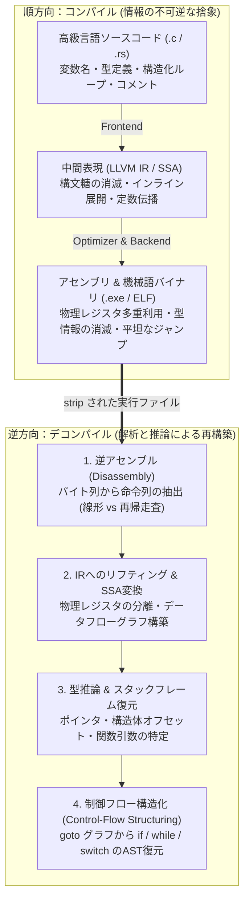
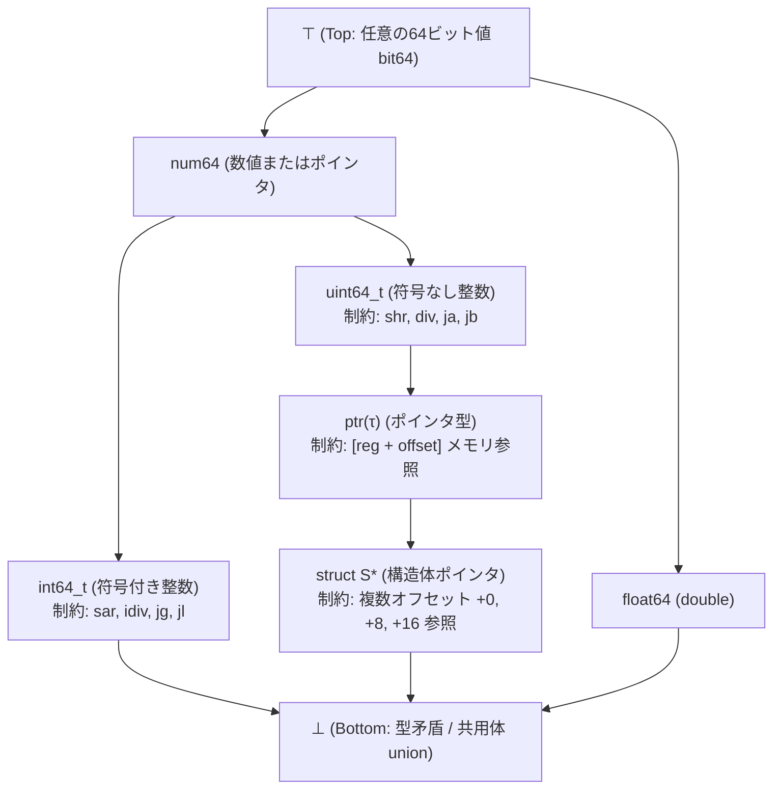

## 1. 序論：「卵焼きから生卵を取り戻す」ことはできるのか？

ソフトウェア開発において、私たちが書いたC言語やC++、Rustのソースコード（`.c`, `.rs`）は、コンパイラ（GCC, Clang/LLVM, MSVCなど）によって機械語の実行ファイル（Windowsの `.exe` / PE形式や、Linuxの `ELF` 形式）へと変換される。この<strong>コンパイル（Compilation）</strong>という過程は、人間にとって読みやすい抽象的な構文木・型システム・変数名を、CPUが直接実行できる $0$ と $1$ のバイト列（命令セットアーキテクチャ：x86-64やARM64）へと翻訳する作業である。

では、手元にソースコードが失われた実行ファイル（バイナリ）だけがあるとき——たとえばマルウェアの挙動を解析したいセキュリティ研究者、20年前に退職したエンジニアが作ったレガシーシステムのバグを直したい保守担当者、あるいは脆弱性診断を行うリバースエンジニア——は、<strong>その機械語バイナリから元のC言語ソースコードを完全に復元する「逆コンパイル（Decompilation）」</strong>を行うことができるのだろうか？

リバースエンジニアリングの世界には、古くから有名な格言がある。
<strong>「コンパイルとは、生卵をかき混ぜて焼いてオムレツ（卵焼き）を作るようなものだ。逆コンパイルとは、出来上がったオムレツから元の生卵と殻を復元しようとする試みである。」</strong>

数学および情報理論の言葉で言えば、コンパイル関数 $\mathcal{C}: \text{Source} \to \text{Binary}$ は<strong>決定的な「多対一（Many-to-One）」の非単射（Non-injective）写像であり、エントロピー（情報損失）を伴う不可逆圧縮過程</strong>である。異なる変数名、異なるループ構文（`for` と `while`）、異なるインライン関数やテンプレート階層を持つ無数のソースコードが、コンパイラの最適化パス（`-O2`, `-O3`）を通過すると、寸分違わぬ同一の機械語バイト列へと収束（Collision）してしまう。したがって、理論上「文字通り元のソースコードと100%同一のファイル」を一意に逆算する逆関数 $\mathcal{C}^{-1}$ は存在しない。

さらには、アラン・チューリングの停止性問題に還元される<strong>ライスの定理（Rice's Theorem）</strong>により、「任意のバイナリ中のどのバイトが命令でどのバイトがデータか」「間接ジャンプ命令 `jmp rax` が実行時にどこへ飛び得るか」「2つのポインタが同じメモリを指すか（エイリアシング）」といったプログラムの意味的性質を完全に決定することは、一般には<strong>計算不可能（Undecidable）</strong>であることが数学的に証明されている。

それにもかかわらず、現代の産業界では <strong>IDA Pro (Hex-Rays Decompiler)</strong>、NSA（米国国家安全保障局）が公開した <strong>Ghidra</strong>、あるいは <strong>Binary Ninja</strong> や <strong>angr</strong> といった高度なデコンパイラが日常的に稼働し、何百万行もの機械語を驚くほど人間が読めるC言語風の擬似コードへと見事に再構築している。

計算不可能性の壁と不可逆な情報損失に阻まれながら、現代のデコンパイラはいかなるアルゴリズムと数学的推論を駆使して「機械語の海」から「構造化されたプログラム」を救い出しているのか？本稿では、逆コンパイラの内部パイプライン全6段階を、コンパイラ理論・グラフ理論・型システム・抽象解釈の視点から徹底的に解剖する。

---

## 2. コンパイルで何が失われるのか？：順方向パイプラインと情報の消滅

逆コンパイルの難しさを理解するには、まず順方向のコンパイラ（たとえばClang/LLVM）がソースコードに対して何を行い、どの段階でどの情報を捨て去っているのかを確認する必要がある。

1. <strong>字句解析・構文解析・意味解析（Frontend）</strong>:
   ソースコードは抽象構文木（AST）に変換され、型検査が行われた後、LLVM IRなどの<strong>中間表現（Intermediate Representation: IR）</strong>へと変換される。この時点で、コメント、`#define` マクロ名、`typedef` の別名、ローカル変数の名前、そして `for` ループか `while` ループかといった糖衣構文（Syntactic Sugar）の区別はすべて消滅する。
2. <strong>中間表現レベルの最適化（Middle-end Optimizer: `-O2` / `-O3`）</strong>:
   定数畳み込み、デッドコード削除、関数インライン展開（Inlining）、ループアンローリング（Loop Unrolling）、共通部分式除去、テイルコール最適化などが適用される。関数 $f()$ が関数 $g()$ の中にインライン展開されると、元の関数境界そのものが消멸し、複数の関数のロジックが1つの巨大なスパゲッティ状の処理へと融合する。
3. <strong>コード生成・レジスタ割り当て・命令スケジューリング（Backend & Linker）</strong>:
   無限個の仮想レジスタを持つSSA形式のIRが、x86-64のわずか16個の汎用物理レジ（`rax`, `rbx`, `rcx`, ...）とスタックフレーム（`[rbp - 0x18]`）へと割り当てられる（グラフ彩色問題）。その結果、<strong>ソースコード上では全く別々だった複数のローカル変数が、生存期間（Live Range）が重ならないという理由で同じ `rax` レジスタを使い回す</strong>ようになり、逆に1つの構造体が複数のレジスタへとバラバラに分解（Scalar Replacement of Aggregates）される。さらに `strip` コマンドによってシンボルテーブルとDWARFデバッグ情報が削ぎ落とされると、残るのは「ただの16進数のバイト列」だけである。



---

## 3. ステージ1：逆アセンブル（Disassembly）——どこからどこまでが「命令」なのか？

デコンパイラが最初に直面する関門は、バイナリの `.text` セクションに並ぶバイト列を機械語命令（Mnemonic）へと変換する<strong>逆アセンブル（Disassembly）</strong>である。一見すると「機械語とアセンブリは1対1対応だから、辞書を引くだけで簡単に変換できるはずだ」と思われがちだが、実は<strong>「完璧な逆アセンブル」は一般には決定不能（Undecidable）</strong>である（Horspool & Marovac 1980）。なぜか？

### 3.1 可変長命令（x86-64）と「コードとデータの混在」

ARM64やRISC-Vのような固定長命令（すべて4バイト境界）のアーキテクチャと異なり、<strong>x86 / x86-64 は1バイトから最大15バイトまでの「可変長命令（Variable-Length Instruction）」</strong>を採用しており、しかも任意のバイト境界から命令を開始できる。さらに、コンパイラは高速化のために、機械語命令のすぐ隣（`.text` セクションの関数内部）に <strong>`switch` 文のジャンプテーブル（アドレス配列）</strong>や浮動小数点定数、文字列リテラルといった<strong>「データ」を直接埋め込む（Inline Data in Code）</strong>ことがある。

もし逆アセンブラがデータバイト列を誤って「命令」として解釈し始めたり、あるいは命令の開始位置をたった1バイトずれて読み始めたりすると、後続のバイト列が全く別の有効なx86命令として連鎖的にデコードされてしまう（<strong>命令の重なり：Overlapping Instructions</strong>）。

### 3.2 線形スイープ（Linear Sweep）vs. 再帰走査（Recursive Traversal）

逆アセンブルには大きく2つのアルゴリズムが存在する。

1. <strong>線形スイープ法（Linear Sweep：`objdump -d` や GDB が採用）</strong>:
   コードセクションの先頭バイトから順番に、前の命令が終わった直後のバイトを次の命令の先頭とみなして機械的に最後までデコードし続ける。単純で高速だが、コードの途中にジャンプテーブル（データ）が埋め込まれていると、データを無理やり命令としてデコードしてしまい、その直後の本物の命令との境界（同期）まで狂わせるという致命的な弱点がある。
2. <strong>再帰走査法（Recursive Traversal / Control-Flow Following：IDA Pro や Ghidra が採用）</strong>:
   プログラムのエントリポイント（`_start` や `main`）およびエクスポート関数からスタートし、<strong>CPUが実際に実行する制御フロー（分岐命令 `je`, `jmp` や関数呼び出し `call`）の飛び先アドレスをグラフ探索（深さ優先／幅優先）で追跡しながら、到達可能な場所だけを命令としてデコードする</strong>。無条件ジャンプ `jmp` や `ret` の直後に置かれたジャンプテーブルは直接実行されないため、データとして誤認することを防げる。

しかし、再帰走査法にも最大の天敵がある。それが<strong>「間接ジャンプ（Indirect Jump: `jmp [rax + rcx*8]`）」</strong>と<strong>「間接関数呼び出し（Indirect Call: `call rdx`、C++の仮想関数テーブル `vtable` や関数ポインタ）」</strong>である。レジスタ `rax` や `rdx` の値は実行時に計算されるため、静的に飛び先アドレスを知るには、後述する<strong>値集合解析（Value-Set Analysis）</strong>やスライシングによって「`rcx` が `cmp rcx, 7; ja default` でバウンドチェックされているから、このジャンプテーブルのエントリ数は8個である」と推論しなければならない。

---

## 4. ステージ2：中間表現へのリフティング（IR Lifting）とSSA形式への変換

逆アセンブルによって得られた生のアセンブリ命令列は、アーキテクチャ固有の癖（副作用）だらけでそのままでは数学的解析ができない。たとえばx86のたった1行の命令 `add eax, ebx` は、単に `eax` に `ebx` を足すだけでなく、ゼロフラグ `ZF`、キャリーフラグ `CF`、符号フラグ `SF`、オーバーフローフラグ `OF`、パリティフラグ `PF`、補助キャリーフラグ `AF` という<strong>6つものステータスフラグを暗黙的に書き換える副作用</strong>を持っている。さらに `push rbp` はスタックポインタ `rsp` を $8$ 減算してからメモリ `[rsp]` に書き込む複合操作である。

### 4.1 マイクロコード／中間表現（IR）へのリフティング

そこでデコンパイラは、x86やARM、MIPSといったあらゆるCPU命令を、副作用をすべて明示した少数の<strong>デコンパイラ中間表現（Ghidraの P-code、Hex-Raysの Microcode、Binary Ninjaの LLIL/MLIL/HLIL、angrの VEX IR）</strong>へと<strong>リフティング（Lifting：格上げ翻訳）</strong>する。すべての複雑な命令が、`STORE`, `LOAD`, `ADD`, `SUB`, `CBRANCH`（条件分岐）という十数種類の純粋な基本演算へと分解される。

### 4.2 静的単一代入（SSA: Static Single Assignment）形式とデッドコード除去

リフティングされた直後のIRには、2つの深刻な問題がある。
第一に、先述したステータスフラグ（`ZF`, `CF` など）の計算式が何万行も生成されるが、実際のプログラムでその直後に条件分岐 `je` などで参照されるフラグはごく一部であり、95%以上のフラグ更新は誰にも読まれずに次の命令で上書きされる。
第二に、コンパイラは1つの物理レジスタ `rax` を、関数の前半では「ループカウンタ `i`（整数）」として使い、中盤では「ファイルポインタ `fp`（構造体ポインタ）」として使い、後半では「戻り値のステータスコード」として使い回している。これらを全部同じ1つの変数 `rax` としてC言語に出力したら、型推論が完全に破綻してしまう！

この2つの問題を一挙に解決する魔法の数学的変換が、<strong>SSA形式（Static Single Assignment Form：静的単一代入形式）</strong>への変換である。

SSA形式では、<strong>「すべての変数はプログラム中でただ1回だけ代入される」</strong>というルールに従い、`rax` に新しい値が代入されるたびに `rax_1`, `rax_2`, `rax_3` と別々のバージョン番号（新しい変数）を割り振る。また、条件分岐の合流点（Join Node）では、どちらの経路から来たかに応じて値を選択する仮想関数<strong>$\phi$関数（Phi Function: $\text{rax}_3 = \phi(\text{rax}_1, \text{rax}_2)$）</strong>を挿入する。

```c
// 【変換前：物理レジスタ rax が異なる型・用途で使い回されている】
mov rax, 0          // ループカウンタとしての rax
add rax, 1
mov [rbp-8], rax
mov rax, [rdi+16]   // ポインタとしての rax (全く無関係な第2の寿命！)
mov ebx, [rax+4]

// 【SSA変換後：独立した変数バージョンに自動分離される！】
rax_1 = 0
rax_2 = rax_1 + 1
stack_var_1 = rax_2
rax_3 = *(rdi_0 + 16)   // rax_1, rax_2 とは完全に独立したポインタ変数 rax_3 になる！
ebx_1 = *(rax_3 + 4)
```

一度SSA形式に変換して<strong>定義-使用連鎖（Def-Use Chain）</strong>のグラフを構築すれば：
1. <strong>不要なフラグ計算の完全消去（Dead Code Elimination）</strong>: 定義されたのにどこからも参照されていないフラグ変数（`CF_1`, `OF_1`, `PF_1` など）は、グラフ上で出次数 $0$ の頂点となるため、ワンパスで100%綺麗に削除できる！
2. <strong>式の伝播（Expression Propagation）</strong>: `ZF_2 = (rax_2 == 0)` というフラグ定義を、それを使用する条件分岐 `if (ZF_2) goto L1` の中へ直接代入（コピー伝播）することで、アセンブリ特有のステータスフラグを完全に消し去り、`if (rax_2 == 0) goto L1` という高水準な条件式を復元できる。
3. <strong>レジスタの寿命分離（Live-Range Splitting）</strong>: 同じ `rax` でも互いに $\phi$ 関数で繋がっていない独立した連結成分（Webs）を別々のC言語ローカル変数 `v1`, `v2` として分離できる！

---

## 5. ステージ3：スタックフレーム解析と「型推論（Type Inference）」の数学

SSA形式によって変数が分離できても、機械語の上ではすべての変数は単なる「32ビットまたは64ビットのビット列（レジスタまたはメモリアドレス）」にすぎない。それが符号付き整数 `int` なのか、符号なし整数 `unsigned int` なのか、浮動小数点数 `float` なのか、文字ポインタ `char *` なのか、あるいは構造体 `struct User *` なのかをどうやって見分けるのだろうか？

### 5.1 命令の意味論から型制約（Type Constraints）を抽出する

実は、CPUの機械語命令そのものの中に、元の型に関する豊富なヒント（制約条件）が刻み込まれている！

- <strong>符号付き（Signed）vs. 符号なし（Unsigned）の判別</strong>:
  x86において、通常の加減算 `add`, `sub` は2の補数表現のおかげで符号付きでも符号なしでも全く同じ命令が使われる。しかし、<strong>比較分岐命令、乗除算命令、ビットシフト命令、拡張代入命令では、符号の有無によって明確に異なる機械語命令が使われる</strong>！
  - 条件分岐が `jg / jl / jge / jle`（Greater / Less）ならオペランドは<strong>符号付き整数（`int`）</strong>であり、`ja / jb / jae / jbe`（Above / Below）なら<strong>符号なし整数（`unsigned int` またはポインタ）</strong>である。
  - 右シフトが算術シフト `sar` なら符号付き、論理シフト `shr` なら符号なし。拡張ロードが符号拡張 `movsxd` なら符号付き、ゼロ拡張 `movzx` なら符号なしである。
- <strong>ポインタと構造体・配列の判別</strong>:
  もしある変数 `v1` がメモリアクセス命令 `mov eax, [v1]` のベースアドレスとして使われていれば、`v1` の型は単なる整数ではなく<strong>ポインタ型 $\text{ptr}(\tau)$</strong> でなければならない。
  さらに、`mov eax, [v1 + 0]; mov rbx, [v1 + 8]; mov ecx, [v1 + 16]` のように、同じベースポインタ `v1` に対して定数オフセット $+0, +8, +16$ で異なるサイズのメモリアクセスが行われていれば、`v1` は<strong>「オフセット $0$ に4バイト型、オフセット $8$ に8バイト型、オフセット $16$ に4バイト型のフィールドを持つ構造体へのポインタ（`struct S *`）」</strong>であると推論できる！また、`[v1 + rcx*4]` のようにスケール付きインデックスアドレッシングが使われていれば、要素サイズ4バイトの配列（`int[]`）であることが分かる。
- <strong>既知のライブラリ関数シグネチャからの伝播</strong>:
  バイナリが動的リンクされている場合、`fopen`, `memcpy`, `printf`, `malloc` といった標準Cライブラリ（libc）やOS APIの呼び出し箇所では、引数の型と戻り値の型が既知である。たとえば `call strlen` の第1引数レジスタ `rdi`（System V AMD64 ABI）に渡された変数は、確実に `const char *` 型であるという制約が与えられる。

### 5.2 束（Lattice）と単一化（Unification）による型制約ソルバ

Alan Mycroft（1999年）の先駆的論文や、CMUの <strong>TIE（Type Inference on Executables）</strong>、Hex-Rays / Ghidra の型推論エンジンは、プログラム中のすべての変数と式から上記のような<strong>型制約（Type Constraints / サブタイプ不等式 $\tau_1 \sqsubseteq \tau_2$）</strong>を収集し、<strong>束論（Lattice Theory）</strong>またはヒンドリー・ミルナー（Hindley-Milner）型の<strong>単一化（Unification）アルゴリズム</strong>を用いて大域的に連立方程式を解く。



最上位の $\top$（ただのNビットデータ）からスタートし、命令から得られる制約によって型束（Type Lattice）を下方向へと絞り込んでいく。もしある変数が前半で `int64_t` として使われ、後半で `struct S *` として使われて型が衝突（$\bot$）した場合は、SSAの寿命分離が不足しているか、あるいは元のCコードで `union`（共用体）や強制型キャストが使われていたと判定する。

---

## 6. ステージ4：制御フローの構造化（Control-Flow Structuring）——`goto` の塊から `if` と `while` を取り戻す

型と式が復元できても、まだプログラムの骨格は「基本ブロック（Basic Block）同士が条件ジャンプと無条件ジャンプ（`goto`）で複雑に絡み合った有向グラフ——<strong>制御フローグラフ（CFG: Control-Flow Graph）</strong>」のままである。もしデコンパイラがすべてのジャンプをそのまま `goto LABEL_4012A0;` として出力したら、人間には到底読めない。

デコンパイラの最も華麗なクライマックスは、この平坦なCFGを解析して、C言語の<strong>構造化制御構文（`if-then-else`, `while`, `do-while`, `for`, `switch-case`, `break`, `continue`）の入れ子構造（抽象構文木 AST）へと折りたたむ「制御フロー構造化（Control-Flow Structuring）」</strong>（Christina Cifuentesの1994年の博士論文『Reverse Compilation Techniques』で確立）である。

### 6.1 ドミネータ木（Dominator Tree）と自然ループ（Natural Loop）の検出

グラフ理論において、開始ノード $s_0$ からノード $n$ へ至るすべての経路が必ずノード $d$ を通過するとき、「$d$ は $n$ を<strong>支配する（Dominate: $d \text{ dom } n$）</strong>」と言う。すべてのノードの直近の支配者（Immediate Dominator）を親として繋ぐと、CFGから<strong>ドミネータ木（Dominator Tree）</strong>が一意に構築できる（Lengauer-Tarjanアルゴリズム）。

- <strong>ループの特定</strong>: CFGのある辺 $n \to h$ において、行き先のノード $h$ が元のノード $n$ を支配している（$h \text{ dom } n$）とき、この辺を<strong>バックエッジ（Back-Edge：後退辺）</strong>と呼び、$h$ をループヘッダとする強連結部分グラフが<strong>自然ループ（Natural Loop）</strong>として一意に抽出される！
  - ループの脱出条件（Exit Condition）がループヘッダ $h$（先頭）にあれば <strong>`while (cond) { ... }`</strong>（または初期化と増分式があれば <strong>`for`</strong>）。
  - 脱出条件がバックエッジの始点 $n$（末尾）にあれば <strong>`do { ... } while (cond);`</strong>。
  - ループの途中からループ外へ飛び出す辺は <strong>`break;`</strong>、ループの途中からヘッダ $h$ へ戻る辺は <strong>`continue;`</strong> へと変換される。
- <strong>条件分岐（`if-then-else`）と短絡評価（`&&`, `||`）の特定</strong>:
  分岐ノード $b$ から2つの枝が分かれ、後続の合流点（Post-Dominator：逆向きのドミネータ）$m$ で再び合流するひし形の部分グラフ（Diamond Region）は <strong>`if (cond) { ... } else { ... }`</strong> に折りたたまれる。また、連続する条件ジャンプが同じ飛び先を共有しているパターンは、C言語の<strong>短絡論理演算子（Short-circuit evaluation: `if (a && b || c)`）</strong>として1つの論理式へと統合される。

### 6.2 可約グラフ（Reducible CFG）と「`goto` ゼロ」デコンパイルの最前線（DREAM）

コンパイラが攻撃的な最適化（末尾重複やジャンプスレッディング）を行うと、複数の入り口を持つループ（<strong>非可約グラフ：Irreducible CFG</strong>）や、通常の `if/while` パターンに当てはまらない複雑な分岐が生じる。従来のデコンパイラは、パターンマッチに失敗した箇所にやむを得ず `goto` 文を残していた。

これに対し、2015年にYakdanらが発表した <strong>DREAM（No More Gotos）</strong> アルゴリズム（およびその改良版であるPhoenix / rev.ng / angrのRegion-based Structuring）は、CFG上の任意の2ノード間の<strong>到達可能性条件（Reaching Conditions：ブール論理式）</strong>を計算し、カルノー図／クワイン・マクラスキー法のような論理式簡単化を適用することで、<strong>いかなる複雑なCFGからでも `goto` 文を1つも使わない（`goto`-free な）最小構造の高級言語ASTを再構築できる</strong>ことを実証した！

---

## 7. デコンパイルの限界：コンパイラ最適化・難読化・そしてAIデコンパイラの登場

| ソースコード上の要素 | 非最適化 (`-O0` + Debug Info) | リリース最適化 (`-O2/-O3` + `strip`) | 高度な難読化 (OLLVM / VMProtect) |
| :--- | :--- | :--- | :--- |
| <strong>関数名・変数名・型名</strong> | DWARF/PDBから100%完全復元 | <strong>完全消滅</strong>（`sub_401000`, `v1` に退化） | 完全消滅＋ダミーシンボル注入 |
| <strong>算術式（例：`x / 10`）</strong> | `idiv` 命令からそのまま復元 | <strong>マジックナンバー乗算</strong> `imul 0x66666667` に変形 | Mixed Boolean-Arithmetic (MBA) で巨大式化 |
| <strong>関数境界とインライン関数</strong> | 1対1で明確に分離 | <strong>インライン展開</strong>で呼び出し元と完全融合 | ジャンプチェインで複数関数を意図的に断片化 |
| <strong>制御フロー（`if / while`）</strong> | 綺麗に構造化ASTへ復元 | ループ展開・ベクトル化（SIMD）で変形 | <strong>制御フロー平坦化 (CFF)</strong> で単一巨大 `switch` 化 |
| <strong>命令の意味（CPU ISA）</strong> | 標準x86/ARM命令 | 標準x86/ARM命令 | <strong>仮想化難読化</strong>: 独自バイトコードインタプリタ化 |

### 7.1 コンパイラ最適化が引き起こす「数学的カモフラージュ」

人間がデコンパイル結果を読む際、最も頭を悩ませるのがコンパイラの<strong>強度削減最適化（Strength Reduction）</strong>である。
たとえば、C言語で書かれた何気ない割り算 `int y = x / 10;` を `-O2` でコンパイルすると、コンパイラは遅い除算命令 `idiv` を嫌い、Granlund & Montgomery（1994）のアルゴリズムを使って<strong>「逆数の固定小数点マジックナンバー（$\lceil 2^{34}/10 \rceil = \text{0x66666667}$）を掛けてから上位ビットを右シフトする」</strong>という命令列に変換してしまう。

$$\left\lfloor \frac{x}{10} \right\rfloor = \left\lfloor \frac{\text{0x66666667} \cdot x}{2^{34}} \right\rfloor$$

もしデコンパイラがこの数学的恒等式の逆変換パターンを知らなければ、`y = (int)((((int64_t)x * 1717986919) >> 34) - (x >> 31));` という暗号のようなCコードを出力してしまう（現代のHex-RaysやGhidraは、このマジックナンバーから元の除数 $10$ を逆算する代数ソルバを内蔵している）。しかし、自動ベクトル化（AVX-512 SIMD命令への展開）やC++の何重ものテンプレート展開（`std::vector`, `std::string` のインライン展開）が行われると、たった1行の `str1 + str2` が数百行のポインタ・ビット演算へと膨れ上がる。

### 7.2 ソフトウェア保護と難読化（Obfuscation）の攻防

逆に、知的財産の保護やDRM、あるいはマルウェアがデコンパイラの解析を意図的に破壊するために用いる技術が<strong>コード難読化（Code Obfuscation）</strong>である。

1. <strong>制御フロー平坦化（Control-Flow Flattening: OLLVM）</strong>:
   関数内のすべての基本ブロックの親子関係を破壊し、1つの巨大な `while` ループと `switch (state_var)` ディスパッチャの中に全ブロックを並列に並べる。各ブロックの末尾で次の状態番号 `state_var = 0x3A8F12;` を書き換えてループ先頭に戻すため、ドミネータ木が完全に平坦な星型グラフに潰れ、元の `if` や `while` の階層構造が完全に消滅する。
2. <strong>不透明述語（Opaque Predicates）</strong>:
   たとえば整数 $x$ に対して $7y^2 - 1 \ne x^2$ のように、数論的には「常に真（または常に偽）」であるにもかかわらず、デコンパイラの静的解析器にはそれが見抜けない複雑な条件分岐を挿入し、決して実行されない偽のデッドコード（Bogus Control Flow）で解析グラフを爆発させる。
3. <strong>混合ブール算術（MBA: Mixed Boolean-Arithmetic）</strong>:
   単純な加算 $x + y$ を、ビット論理演算と算術演算の恒等式
   $$x + y = (x \oplus y) + 2 \cdot (x \land y) = (x \lor y) + (x \land y)$$
   を何重にも再帰的に合成した数十項の多項式へと置き換え、SSA式の簡単化エンジンを麻痺させる。
4. <strong>仮想化難読化（Virtualization Obfuscation: VMProtect / Themida）</strong>:
   究極の難読化手法であり、元のx86やARMの機械語を完全に消し去り、<strong>実行時に毎回ランダム生成される独自命令セット（カスタムバイトコード）</strong>へとコンパイルした上で、そのバイトコードを解釈実行する<strong>仮想マシン（VMインタプリタ）</strong>をバイナリ内に埋め込む。デコンパイラをそのままかけると、「元のプログラムのロジック」ではなく「仮想マシンのディスパッチループのコード」しか見えないため、シンボリック実行（Symbolic Execution）や動的トレースで仮想命令セット自体をリバースエンジニアリングしなければならない。

### 7.3 ニューラル・デコンパイル（LLM4Decompile）の新時代

そして2020年代に入り、デコンパイルの世界には劇的なパラダイムシフトが起きている。それが<strong>大規模言語モデル（LLM）を用いたニューラル・デコンパイル（Neural Decompilation：LLM4Decompile、BTC、Novaなど）</strong>である。

従来の決定的アルゴリズム（GhidraやHex-Rays）は、「機械語の意味（Semantics）を100%正確に保つこと」には長けているが、一度 `strip` されて消滅した「人間らしい変数名・関数名（たとえば `v1, v2` ではなく `aes_encrypt_block(uint8_t *key, ...)`）」や「インライン展開される前の慣用的なC++構文」を取り戻すことは原理的に不可能であった。
これに対し、オープンソースの何億もの「ソースコードとコンパイル済みバイナリ（またはGhidra出力）のペア」で学習された特化型LLMは、プログラムの制御構造と定数・API呼び出しの統計的文脈から、<strong>失われた変数名・構造体名・関数名を高精度に推論（デノイジング）し、さらに最適化で歪んだマジックナンバーやインライン展開コードを人間が書いたような自然なCコードへと再翻訳する</strong>ことに成功しつつある。

---

## 8. 結論：不可逆な変換に挑む「計算機科学の総合格闘技」

「実行ファイルから元のプログラムを取り戻せるのか？」という問いに対する答えは、いまや明確である。

情報理論が教える通り、コンパイルによって一度捨て去られたシンボル名や糖衣構文を「文字通り100%元通りに」復元する魔法は存在しない。しかし、機械語の中に残されたわずかな意味的痕跡——レジスタの生存区間、符号付き分岐命令と符号なし分岐命令の差異、メモリアクセスのオフセット規則、そしてCFGのドミネータ位相構造——を、<strong>SSA変換・束理論による型推論・グラフ構造化アルゴリズム・そして現代の深層学習</strong>によって極限まで繋ぎ合わせることで、人類は「オムレツから生卵の構造をほぼ完璧に再結晶化させる」技術を手にしているのである。

逆コンパイラとは、コンパイラ理論を鏡写しにした単なる逆変換器ではない。それは計算不可能性の境界線上で、形式論理と統計的推論のすべてを動員して「機械の言葉」を「人間の知性」へと架橋する、計算機科学の最もスリリングな結晶なのである。
