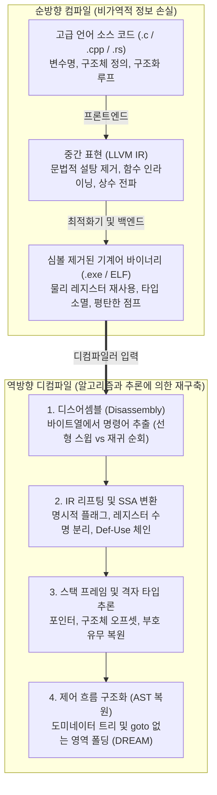
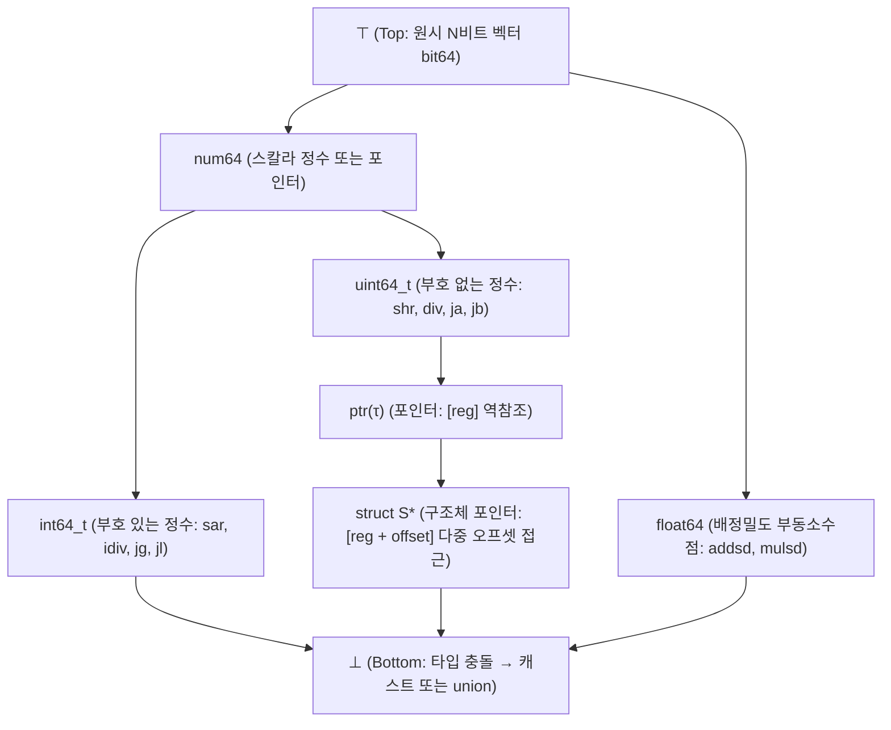

## 1. 서론: '스크램블 에그'를 다시 '날달걀'로 되돌릴 수 있을까?

소프트웨어 개발에서 우리가 작성한 C, C++, Rust 소스 코드는 컴파일러(GCC, Clang/LLVM, MSVC)를 거쳐 기계어 실행 파일(Windows의 `.exe` PE 파일이나 Linux의 `ELF` 바이너리)로 변환된다. 그렇다면 반대로 소스 코드가 유실되고 심볼까지 제거(`strip`)된 실행 파일만 남아 있을 때—예컨대 보안 분석가가 악성코드를 분석하거나 20년 전 레거시 시스템의 버그를 패치해야 할 때—기계어 바이너리로부터 원본 C 소스 코드를 완벽히 복원하는 <strong>디컴파일(Decompilation, 역컴파일)</strong>은 가능할까?

리버스 엔지니어링 업계에는 유명한 격언이 있다:
<strong>"컴파일은 날달걀을 깨서 오믈렛(스크램블 에그)을 만드는 것이고, 디컴파일은 완성된 오믈렛에서 원래의 날달걀과 껍데기를 복원하려는 시도다."</strong>

수학 및 정보이론의 관점에서 컴파일 함수 $\mathcal{C}: \text{Source} \to \text{Binary}$는 정보를 비가역적으로 손실하는 <strong>다대일(Many-to-One) 비단사(Non-injective) 사상</strong>이다. 서로 다른 변수명, 주석, 루프 구문(`for` 대 `while`), 인라인 함수를 가진 수많은 소스 코드가 `-O2`/`-O3` 최적화를 거치면 바이트 단위로 완전히 동일한 기계어로 수렴한다. 게다가 <strong>라이스의 정리(Rice's Theorem)</strong>와 튜링의 정지 문제에 의해, 가변 길이 명령어 집합에서 코드와 인라인 데이터를 완벽히 구분하거나 간접 점프 `jmp rax`의 모든 목적지를 정적으로 알아내는 문제는 수학적으로 <strong>결정 불가능(Undecidable)</strong>하다.

그럼에도 불구하고 현대 산업계에서는 <strong>IDA Pro(Hex-Rays)</strong>, 미국 국가안보국(NSA)이 공개한 <strong>Ghidra</strong>, <strong>Binary Ninja</strong>, <strong>angr</strong> 같은 첨단 디컴파일러가 수백만 줄의 기계어를 놀라울 정도로 읽기 쉬운 C 의사코드로 재구축해낸다. 본 글에서는 현대 디컴파일러의 내부 파이프라인 6단계를 해부한다.

---

## 2. 컴파일 과정에서 무엇이 사라지는가? : 순방향 파이프라인과 정보 소실

1. <strong>프론트엔드(구문 분석 $\to$ IR)</strong>: 주석, `#define` 매크로, `typedef` 별칭, 지역 변수 이름, 그리고 `for`/`while` 같은 문법적 설탕(Syntactic Sugar)이 중간 표현(LLVM IR) 생성 단계에서 사라진다.
2. <strong>미들엔드 최적화기(`-O2` / `-O3`)</strong>: <strong>함수 인라이닝(Inlining)</strong>이 함수 경계를 허물어 호출자 내부에 피호출자 코드를 녹여버리고, <strong>루프 언롤링(Loop Unrolling)</strong>과 <strong>SIMD 벡터화</strong>가 제어 흐름을 변형하며, <strong>강도 감소(Strength Reduction)</strong>가 정수 나눗셈 `x / 10`을 역수 매직 넘버 곱셈 `imul 0x66666667`로 바꾸어 놓는다.
3. <strong>백엔드 레지스터 할당 및 `strip`</strong>: 무한한 가상 레지스터가 그래프 채색을 통해 `x86-64`의 16개 물리 레지스터에 할당된다. 그 결과 <strong>동일한 물리 레지스터 `rax`가 함수 전반부에서는 정수 루프 카운터로, 중반부에서는 구조체 포인터로 재사용</strong>되며, `strip` 명령이 심볼 테이블과 DWARF 디버그 정보를 완전히 삭제한다.

---

## 3. 1단계: 디스어셈블(Disassembly) — 명령어와 데이터의 분리

명령어 길이가 $1 \sim 15$바이트로 가변적인 `x86-64` 아키텍처에서는 컴파일러가 `.text` 코드 섹션 내부에 `switch` 문의 <strong>점프 테이블(Jump Table)</strong> 같은 읽기 전용 데이터를 직접 삽입한다.

1. <strong>선형 스윕(Linear Sweep, `objdump -d`)</strong>: 첫 바이트부터 순차적으로 끝까지 디코딩한다. 빠르지만 코드 중간의 점프 테이블 데이터를 가짜 명령어로 오인하여 이후 명령어 경계 동기화가 깨진다.
2. <strong>재귀 순회(Recursive Traversal, IDA Pro / Ghidra)</strong>: 진입점(`main` 등)에서 출발하여 분기 명령어(`je`, `jmp`, `call`)의 실제 제어 흐름을 따라가며 도달 가능한 주소만 디코딩한다. 단, <strong>간접 점프(`jmp [rbx + rcx*8]`)</strong>를 만나면 역방향 슬라이싱과 <strong>값 집합 분석(Value-Set Analysis, VSA)</strong>을 통해 앞선 경계 검사 `cmp rcx, 12; ja default`를 추적하여 점프 테이블 크기를 추론해야 한다.

---

## 4. 2단계: 중간 표현 리프팅(IR Lifting)과 정적 단일 대입(SSA) 변환

네이티브 어셈블리 명령어는 암묵적 부작용이 너무 많다(예컨대 `x86`의 `sub eax, ebx` 한 줄은 `ZF, CF, SF, OF, PF, AF` 6개 플래그를 동시에 덮어쓴다). 디컴파일러는 모든 명령어를 아키텍처 독립적인 <strong>중간 표현(Ghidra의 P-code, Hex-Rays의 Microcode)</strong>으로 <strong>리프팅(Lifting)</strong>한 뒤, 모든 변수가 단 한 번만 대입되는 <strong>정적 단일 대입(SSA: Static Single Assignment)</strong> 형태로 변환한다(합류점에는 $\phi$ 함수 $\text{rax}_3 = \phi(\text{rax}_1, \text{rax}_2)$ 삽입):

- <strong>불필요한 플래그 계산 제거(Dead Flag Elimination)</strong>: 조건 분기에 쓰이지 않는 90% 이상의 플래그 연산을 Def-Use 체인에서 즉시 삭제한다.
- <strong>수식 전파(Expression Propagation)</strong>: `ZF_2 = (eax_2 == 0)` 정의를 `if (ZF_2)` 내부로 대입하여 고급 수식 `if (eax_2 == 0)`을 복원한다.
- <strong>레지스터 수명 분리(Live-Range Splitting)</strong>: 물리 레지스터 `rax`를 공유하더라도 서로 연결되지 않은 SSA 웹(Web)들을 독립된 C 지역 변수 `int v1;`, `Node *v2;`로 완벽히 분리해낸다!

---

## 5. 3단계: 스택 프레임 분석과 격자(Lattice) 기반 타입 추론

기계어에는 타입이 없지만, CPU 명령어의 연산 의미론 자체가 강력한 <strong>타입 제약 조건(Type Constraints)</strong>을 제공한다:

- <strong>부호 있는 정수(`int`) 대 부호 없는 정수(`unsigned int`) 구별</strong>: 조건 분기 `jg / jl`(Greater/Less), 부호 나눗셈 `idiv`, 산술 우시프트 `sar`, 부호 확장 `movsxd`는 피연산자가 <strong>`signed int`</strong>임을 증명하며, `ja / jb`(Above/Below), 무부호 나눗셈 `div`, 논리 우시프트 `shr`, 제로 확장 `movzx`는 <strong>`unsigned int`</strong>임을 증명한다!
- <strong>포인터 및 구조체(`struct`) 레이아웃 복원</strong>: `[rbx]` 역참조는 포인터 제약 $\text{ptr}(\tau)$를 생성하고, 동일한 베이스 레지스터에 대한 다중 오프셋 접근 `[rbx + 0]`, `[rbx + 8]`, `[rbx + 16]`은 `rbx`가 구조체 포인터 `struct S *`임을 밝혀낸다.
- <strong>타입 격자(Type Lattice)와 단일화(Unification)</strong>: 디컴파일러는 최상위 $\top$(N비트 값)에서 최하위 $\bot$(타입 충돌/`union`)에 이르는 <strong>부분 순서 격자 $(\mathcal{L}, \sqsubseteq)$</strong> 위에서 모든 SSA 명령어의 서브타입 부등식을 수집하고 최대 하한(Meet $\sqcap$)을 계산하여 일관된 C 타입을 추론한다.

---

## 6. 4단계: 제어 흐름 구조화(Control-Flow Structuring) — `goto` 없는 AST 복원

평탄한 제어 흐름 그래프(CFG)에서 `if-then-else`, `while`, `switch`의 중첩 추상 구문 트리(AST)를 복원하기 위해 디컴파일러(Cristina Cifuentes 1994)는 <strong>도미네이터 트리(Dominator Tree)</strong>와 <strong>포스트 도미네이터 트리(Post-Dominator Tree)</strong>를 사용한다:

1. <strong>자연 루프(Natural Loop) 검출</strong>: 간선 $n \to h$의 목적지 $h$가 출발지 $n$을 지배($h \text{ dom } n$)하면 이는 <strong>백엣지(Back-Edge)</strong>이며, $h$를 헤더로 하는 루프(`while` 또는 `do-while`)로 접힌다.
2. <strong>조건 분기 병합점 검출</strong>: 분기 노드 $b$의 직속 포스트 도미네이터가 `if-then-else` 다이아몬드의 정확한 합류점이 된다.
3. <strong>`goto` 없는 구조화(DREAM 알고리즘)</strong>: 컴파일러 최적화로 생성된 비가약 그래프(Irreducible CFG)에 대해서도, <strong>DREAM("No More Gotos", Yakdan et al. 2015)</strong> 알고리즘은 부울 <strong>도달 조건(Reaching Conditions)</strong>과 논리식 최소화를 통해 <strong>단 하나의 `goto`도 없는</strong> 깔끔한 C 코드를 복원한다!

---

## 7. 디컴파일의 한계: 최적화 위장, 코드 난독화, 그리고 신경망 디컴파일러(LLM4Decompile)

| 프로그램 요소 | 비최적화 디버그 빌드 (`-O0 -g`) | 릴리스 최적화 (`-O3` + `strip`) | 고도 난독화 (OLLVM / VMProtect) |
| :--- | :--- | :--- | :--- |
| <strong>함수·변수·타입 이름</strong> | DWARF/PDB에서 100% 복원 | <strong>영구 소멸</strong> (`sub_401000`, `v1`) | 소멸 + 가짜 심볼 주입 |
| <strong>상수 나눗셈 (`x / 10`)</strong> | `idiv` 명령어로 직관적 복원 | <strong>매직 넘버 곱셈</strong> (`imul 0x66666667`) | 혼합 부울-산술(MBA) 다항식 |
| <strong>제어 흐름 (`if / while`)</strong> | 깔끔한 구조화 AST 복원 | 루프 언롤링 및 AVX-512 벡터화 | <strong>제어 흐름 평탄화 (CFF)</strong> 단일 `switch`화 |
| <strong>명령어 집합 (ISA)</strong> | 표준 `x86-64` / `ARM64` | 표준 `x86-64` / `ARM64` | <strong>가상화 난독화</strong>: 자체 랜덤 바이트코드 VM |

상용 보호기(<strong>OLLVM</strong>, <strong>VMProtect</strong>)는 <strong>제어 흐름 평탄화(CFF)</strong>, <strong>불투명 술어(Opaque Predicates)</strong>, <strong>혼합 부울-산술(MBA, $x+y \equiv (x\oplus y) + 2(x\land y)$)</strong>, 그리고 원래 기계어를 독자적인 가상머신 바이트코드로 바꾸는 <strong>가상화 난독화(Virtualization Obfuscation)</strong>로 디컴파일러를 무력화한다. 반면 2020년대에는 <strong>LLM4Decompile</strong> 등 대규모 언어 모델(LLM)을 결합한 <strong>신경망 디컴파일(Neural Decompilation)</strong>이 등장하여, 정적 분석이 복원한 구조 위에 의미 있는 변수명·함수명을 통계적으로 추론해내고 복잡한 인라인·벡터화 코드를 자연스러운 C 코드로 재번역하는 새로운 지평을 열고 있다.
