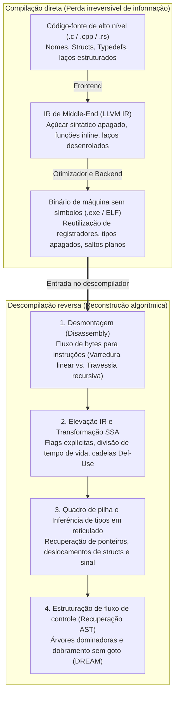
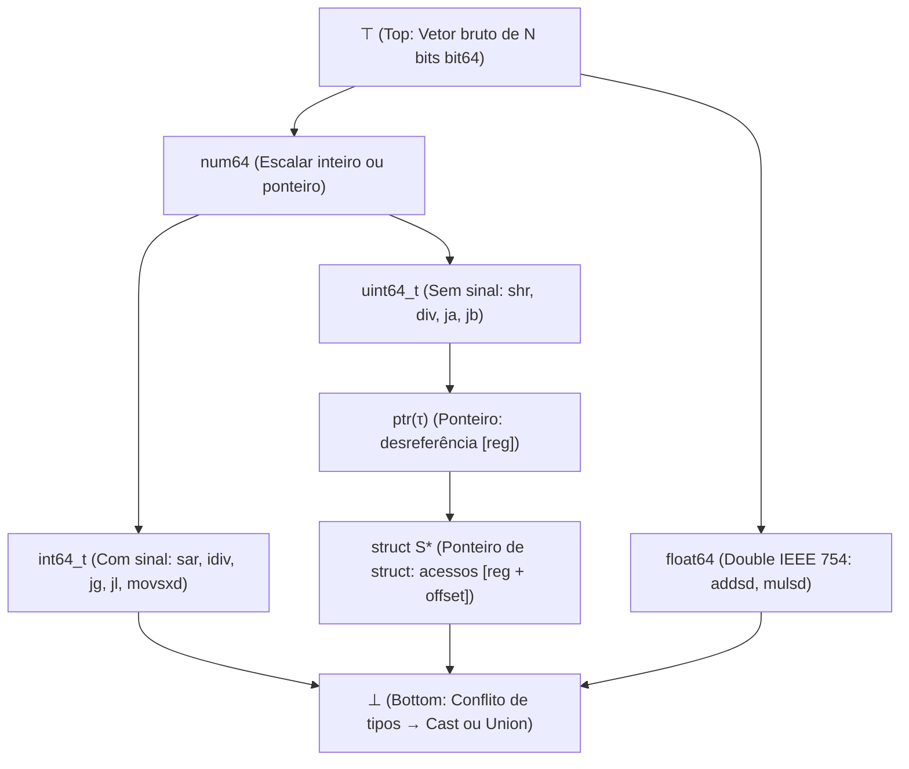

## 1. Introdução: é possível transformar uma omelete de volta em ovos crus?

No desenvolvimento de software cotidiano, um compilador (como GCC, Clang/LLVM ou MSVC) traduz código-fonte legível em C, C++ ou Rust para um executável nativo em código de máquina (um arquivo PE `.exe` no Windows ou `ELF` no Linux). Mas o que acontece quando precisamos seguir na direção oposta — quando um analista de segurança disseca um *ransomware*, um engenheiro audita um driver proprietário ou uma empresa precisa manter um sistema legado de 25 anos cujo código-fonte foi perdido? Podemos alimentar o binário em um <strong>descompilador (Decompiler)</strong> e recuperar o código-fonte C original?

Um famoso aforismo da engenharia reversa resume o desafio:
<strong>"Compilar é como quebrar ovos para fazer uma omelete; descompilar é tentar transformar a omelete de volta em ovos crus dentro da casca."</strong>

Do ponto de vista da matemática e da teoria da informação, a função de compilação $\mathcal{C}: \text{Source} \to \text{Binary}$ é um <strong>mapeamento muitos-para-um (não injetivo) com perda de informação</strong>. Infinitos programas-fonte distintos — diferindo em nomes de variáveis, comentários, laços (`for` vs. `while`) ou funções *inline* — compilam sob otimização (`-O2`, `-O3`) para exatamente a mesma sequência de bytes. Como a entropia condicional é $H(\text{Source} \mid \text{Binary}) > 0$, não existe uma função inversa única $\mathcal{C}^{-1}$ capaz de recuperar o que foi fisicamente apagado pela compilação e pela remoção de símbolos (`strip`). Pior ainda: pelo <strong>teorema de Rice</strong> e pelo problema da parada de Turing, separar com exatidão código e dados, resolver estaticamente todos os destinos de um salto indireto (`jmp rax`) ou decidir o *aliasing* de ponteiros são problemas <strong>matematicamente indecidíveis</strong> no caso geral.

Ainda assim, descompiladores industriais modernos — como <strong>IDA Pro (Hex-Rays)</strong>, <strong>Ghidra</strong> (lançado pela NSA), <strong>Binary Ninja</strong> e <strong>angr</strong> — transformam diariamente megabytes de assembly em pseudocódigo C surpreendentemente limpo e estruturado. Neste artigo, dissecamos os seis estágios algorítmicos de um descompilador moderno.

---

## 2. O que a compilação destrói: o pipeline direto

1. <strong>Frontend (Análise léxica, sintática e de tipos $\to$ IR)</strong>: comentários, macros `#define`, apelidos `typedef`, nomes de variáveis locais e açúcar sintático desaparecem ao descer para a representação intermediária (LLVM IR).
2. <strong>Otimizador Middle-End (`-O2` / `-O3`)</strong>: a <strong>expansão inline</strong> dissolve as fronteiras entre funções; o <strong>desenrolamento de laços (Loop Unrolling)</strong> e a <strong>vetorização SIMD</strong> transformam a estrutura de controle; a <strong>redução de força (Strength Reduction)</strong> substitui uma divisão inteira `x / 10` por uma multiplicação em ponto fixo por uma constante mágica (`imul 0x66666667`).
3. <strong>Alocação de registradores Backend e `strip`</strong>: infinitos registradores virtuais SSA são mapeados via coloração de grafos nos apenas 16 registradores físicos do `x86-64`. Consequentemente, <strong>um mesmo registrador físico como `rax` é reutilizado para dezenas de variáveis desconexas de tipos diferentes</strong>, enquanto `strip` apaga a tabela de símbolos (`.symtab`) e as informações DWARF.

---

## 3. Estágio 1: Desmontagem — separando instruções de dados

Em arquiteturas de instruções de tamanho variável como `x86-64` ($1$ a $15$ bytes), os compiladores frequentemente embutem dados somente leitura — especialmente <strong>tabelas de salto (Jump Tables)</strong> de comandos `switch` — diretamente dentro da seção de código `.text`.

1. <strong>Varredura linear (Linear Sweep, `objdump -d`)</strong>: decodifica sequencialmente byte a byte, mas interpreta erroneamente tabelas de salto embutidas como instruções falsas.
2. <strong>Travessia recursiva (Recursive Traversal, IDA Pro / Ghidra)</strong>: parte dos pontos de entrada conhecidos (`main`, símbolos exportados) e segue o grafo de fluxo de controle real através dos desvios (`je`, `jmp`, `call`). Para resolver <strong>saltos indiretos (`jmp [rbx + rcx*8]`)</strong>, o descompilador usa <strong>fatiamento reverso (Backward Slicing)</strong> e <strong>análise de conjuntos de valores (Value-Set Analysis, VSA)</strong> para localizar a verificação de limites `cmp rcx, 12; ja default` e deduzir o tamanho da tabela.

---

## 4. Estágio 2: Elevação para IR (Lifting) e forma SSA (Static Single Assignment)

As instruções nativas possuem efeitos colaterais implícitos complexos (um simples `sub eax, ebx` em `x86` modifica seis *flags* de estado: `ZF, CF, SF, OF, PF, AF`). O descompilador eleva (<strong>Lifting</strong>) primeiro o código nativo para uma <strong>representação intermediária independente de CPU (P-code no Ghidra, Microcode no Hex-Rays)</strong> e a transforma para a <strong>forma SSA (Static Single Assignment)</strong>, onde cada variável recebe atribuição exatamente uma vez (inserindo funções $\phi$ $\text{rax}_3 = \phi(\text{rax}_1, \text{rax}_2)$ nas junções de fluxo):

- <strong>Eliminação de flags mortas</strong>: mais de $90\%$ dos cálculos de *flags* não lidos por saltos condicionais são eliminados instantaneamente via cadeias Def-Use.
- <strong>Propagação de expressões</strong>: a definição `ZF_2 = (eax_2 == 0)` é substituída diretamente dentro de `if (ZF_2)` para reconstruir `if (eax_2 == 0)`.
- <strong>Divisão de tempo de vida (Live-Range Splitting)</strong>: redes SSA disjuntas que compartilhavam o registrador físico `rax` são separadas automaticamente em variáveis locais C independentes (`int v1;` vs. `Node *v2;`).

---

## 5. Estágio 3: Análise de pilha e inferência de tipos via reticulados (Lattice)

Embora o código de máquina não tenha tipos explícitos, a semântica das instruções impõe <strong>restrições algébricas de tipo</strong>:

- <strong>Com sinal (`int`) vs. sem sinal (`unsigned int`)</strong>: saltos condicionais `jg / jl` (*Greater/Less*), divisão com sinal `idiv`, deslocamento aritmético `sar` e extensão de sinal `movsxd` provam um inteiro <strong>com sinal (`int`)</strong>; enquanto `ja / jb` (*Above/Below*), `div`, deslocamento lógico `shr` e extensão com zeros `movzx` provam um inteiro <strong>sem sinal (`unsigned int`)</strong>.
- <strong>Reconstrução de ponteiros e `struct`</strong>: desreferenciar `[rbx]` gera a restrição $\text{ptr}(\tau)$. Acessar múltiplos deslocamentos constantes (`[rbx + 0]`, `[rbx + 8]`, `[rbx + 16]`) revela um ponteiro para uma estrutura composta <strong>`struct S *`</strong>.
- <strong>Reticulado de tipos (Type Lattice) e unificação</strong>: seguindo Alan Mycroft (1999) e o sistema <strong>TIE</strong> (CMU), o descompilador organiza os tipos em um <strong>reticulado parcialmente ordenado $(\mathcal{L}, \sqsubseteq)$</strong> entre $\top$ (vetor de bits bruto) e $\bot$ (conflito de tipos / `union`), resolvendo as desigualdades de subtipo pelo ínfimo (Meet $\sqcap$).

---

## 6. Estágio 4: Estruturação do fluxo de controle — eliminando `goto` para recuperar `if` e `while`

Para dobrar o grafo de fluxo de controle (CFG) em uma árvore sintática abstrata (AST) estruturada (Cifuentes 1994), o descompilador calcula a <strong>árvore dominadora</strong> e a <strong>árvore pós-dominadora</strong>:

1. <strong>Detecção de laços naturais</strong>: uma aresta de retorno (*Back-Edge*) $n \to h$ onde $h$ domina $n$ ($h \text{ dom } n$) define um laço natural com cabeçalho $h$ (`while`, `for` ou `do-while`).
2. <strong>Detecção de ramos (`if-then-else`)</strong>: o pós-dominador imediato de um nó condicional marca o ponto exato onde o diamante `if-else` converge.
3. <strong>Estruturação sem `goto` (Algoritmo DREAM)</strong>: mesmo diante de grafos irredutíveis gerados por otimizações, o algoritmo <strong>DREAM ("No More Gotos", Yakdan et al. 2015)</strong> calcula as <strong>condições booleanas de alcançabilidade (Reaching Conditions)</strong> e aplica minimização lógica para garantir código C <strong>100% livre de `goto`</strong>.

---

## 7. Limites da descompilação: camuflagem de otimização, ofuscação e descompiladores neurais (LLM)

| Artefato do programa | Sem otimização (`-O0 -g` com DWARF) | Produção sem símbolos (`-O3` + `strip`) | Ofuscado (OLLVM / VMProtect) |
| :--- | :--- | :--- | :--- |
| <strong>Nomes de funções, variáveis e tipos</strong> | $100\%$ recuperados do DWARF/PDB | <strong>Apagados permanentemente</strong> (`sub_401120`, `v2`) | Apagados + símbolos falsos enganosos |
| <strong>Divisão por constante (`x / 10`)</strong> | Instrução `idiv` literal | <strong>Multiplicação mágica</strong> (`0x66666667`) | Polinômios booleano-aritméticos (MBA) |
| <strong>Fluxo de controle (`if / while`)</strong> | AST estruturada limpa | Desenrolamento de laços e vetorização SIMD | <strong>Achatamento de fluxo (CFF)</strong> em `switch` gigante |
| <strong>Semântica de instruções (ISA)</strong> | `x86-64` / `ARM64` nativo | `x86-64` / `ARM64` nativo | <strong>Virtualização</strong>: VM de bytecode proprietário |

Enquanto ofuscadores (<strong>OLLVM</strong>, <strong>VMProtect</strong>) atacam a análise estática via <strong>achatamento do fluxo de controle (CFF)</strong>, <strong>predicados opacos</strong>, <strong>aritmética booleana mista (MBA, $x+y \equiv (x\oplus y) + 2(x\land y)$)</strong> e <strong>ofuscação por virtualização</strong> (tradução para um bytecode aleatório próprio), na década de 2020 os <strong>descompiladores neurais baseados em LLMs (`LLM4Decompile`)</strong> combinam análise formal com inteligência artificial estatística para inferir nomes significativos de variáveis e funções e reescrever código altamente otimizado em C idiomático.
