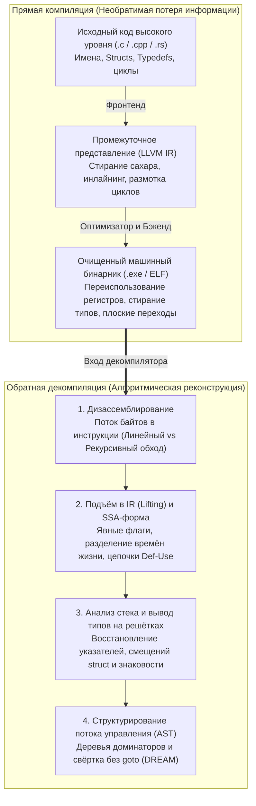
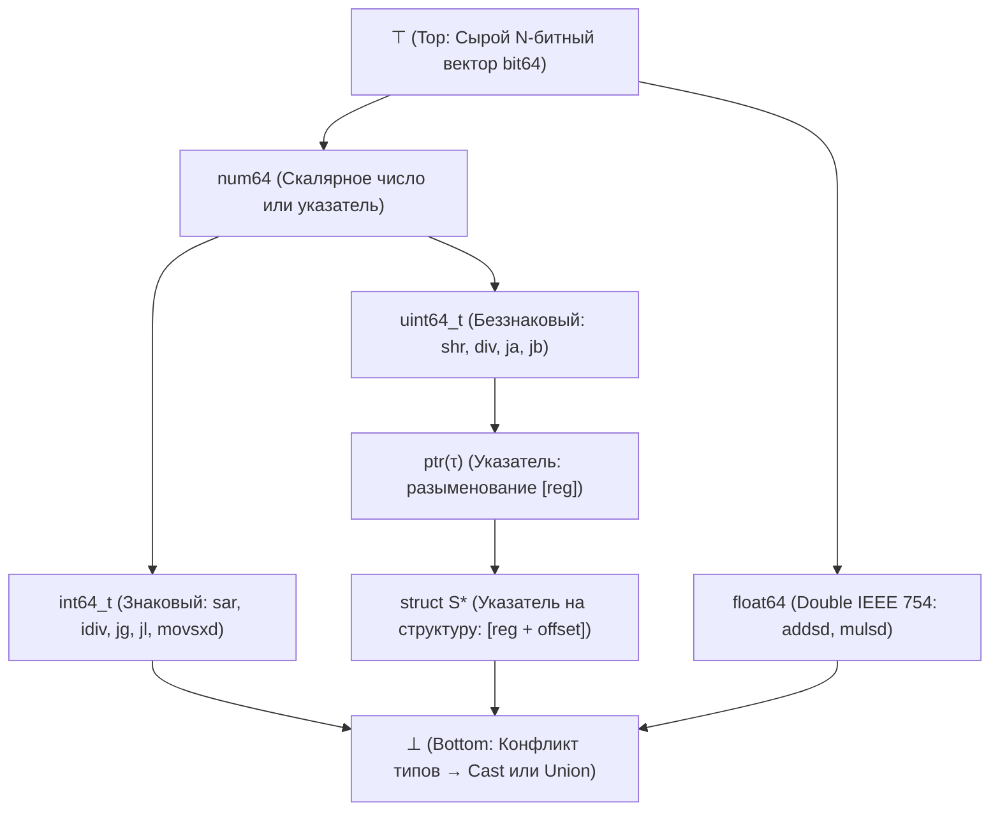

## 1. Введение: можно ли превратить омлет обратно в сырое яйцо?

В повседневной разработке компилятор (GCC, Clang/LLVM, MSVC) переводит понятный человеку исходный код на C, C++ или Rust в машинный исполняемый файл (PE-файл `.exe` в Windows или `ELF` в Linux). Но что, если нужно пройти этот путь в обратном направлении — например, когда вирусолог исследует шифровальщик, аудитор безопасности проверяет закрытый драйвер или инженеры поддерживают 25-летнюю систему, исходный код которой утерян? Можно ли подать машинный бинарник на вход <strong>декомпилятору (Decompiler)</strong> и получить исходный код на C?

В мире реверс-инжиниринга есть знаменитый афоризм:
<strong>«Компиляция похожа на взбивание и жарку яиц для приготовления омлета; декомпиляция — это попытка превратить готовый омлет обратно в сырые яйца в скорлупе».</strong>

С точки зрения математики и теории информации функция компиляции $\mathcal{C}: \text{Source} \to \text{Binary}$ представляет собой <strong>неинъективное отображение «многие-к-одному» с потерей информации</strong>. Бесконечное множество различных исходных программ — отличающихся именами переменных, комментариями, конструкциями циклов (`for` против `while`) и встроенными (*inlined*) функциями — после оптимизации (`-O2`, `-O3`) компилируются в абсолютно идентичную последовательность байтов. Поскольку условная энтропия $H(\text{Source} \mid \text{Binary}) > 0$ строго положительна, однозначной обратной функции $\mathcal{C}^{-1}$ не существует. Более того, согласно <strong>теореме Райса</strong> и проблеме остановки Тьюринга, точное отделение кода от данных, статическое разрешение косвенных переходов (`jmp rax`) и анализ алиасинга указателей в общем случае <strong>математически неразрешимы (undecidable)</strong>.

И всё же современные промышленные декомпиляторы — <strong>IDA Pro (Hex-Rays)</strong>, открытая Агентством национальной безопасности США <strong>Ghidra</strong>, <strong>Binary Ninja</strong> и <strong>angr</strong> — ежедневно превращают мегабайты машинного кода в чистый, структурированный псевдокод на C. В этой статье мы разберём шесть ключевых алгоритмических этапов современного декомпилятора.

---

## 2. Что уничтожает компиляция: прямой конвейер

1. <strong>Фронтенд (лексический/синтаксический анализ и проверка типов $\to$ IR)</strong>: комментарии, макросы `#define`, псевдонимы `typedef`, имена локальных переменных и синтаксический сахар исчезают при переводе в промежуточное представление (LLVM IR).
2. <strong>Оптимизатор среднего уровня (`-O2` / `-O3`)</strong>: <strong>подстановка функций (Inlining)</strong> стирает границы между функциями; <strong>размотка циклов (Loop Unrolling)</strong> и <strong>SIMD-векторизация</strong> меняют структуру управления; <strong>снижение стоимости операций (Strength Reduction)</strong> заменяет целочисленное деление `x / 10` умножением на магическую константу с фиксированной точкой (`imul 0x66666667`).
3. <strong>Распределение регистров и `strip`</strong>: бесконечное число виртуальных SSA-регистров отображается путём раскраски графа всего на 16 физических регистров общего назначения `x86-64`. В результате <strong>один и тот же физический регистр `rax` многократно переиспользуется для совершенно разных переменных разных типов</strong>, а утилита `strip` удаляет таблицу символов (`.symtab`) и отладочную информацию DWARF.

---

## 3. Этап 1: Дизассемблирование — отделение инструкций от данных

В архитектурах с переменной длиной инструкций, таких как `x86-64` (от $1$ до $15$ байт), компиляторы часто размещают неизменяемые данные — в частности, <strong>таблицы переходов (Jump Tables)</strong> для операторов `switch` — прямо внутри кодовой секции `.text`.

1. <strong>Линейный проход (Linear Sweep, `objdump -d`)</strong>: декодирует байты подряд от начала до конца и ошибочно интерпретирует встроенные таблицы переходов как ложные инструкции.
2. <strong>Рекурсивный обход (Recursive Traversal, IDA Pro / Ghidra)</strong>: стартует с известных точек входа (`main`, экспортируемые функции) и следует по реальному графу потока управления вдоль переходов (`je`, `jmp`, `call`). Для разрешения <strong>косвенных переходов (`jmp [rbx + rcx*8]`)</strong> декомпилятор использует <strong>обратный слайсинг</strong> и <strong>анализ множеств значений (Value-Set Analysis, VSA)</strong>, находя проверку границ `cmp rcx, 12; ja default` и определяя размер таблицы.

---

## 4. Этап 2: Подъём в IR (Lifting) и статическое однократное присваивание (SSA)

Машинные инструкции полны неявных побочных эффектов (одна инструкция `sub eax, ebx` в `x86` перезаписывает сразу шесть флагов состояния: `ZF, CF, SF, OF, PF, AF`). Декомпилятор сначала поднимает (<strong>Lifting</strong>) нативный код в <strong>архитектурно-независимое промежуточное представление (P-code в Ghidra, Microcode в Hex-Rays)</strong>, а затем переводит его в <strong>SSA-форму (Static Single Assignment)</strong>, где каждой переменной значение присваивается ровно один раз (с $\phi$-функциями $\text{rax}_3 = \phi(\text{rax}_1, \text{rax}_2)$ в узлах слияния):

- <strong>Удаление мёртвых флагов</strong>: более $90\%$ вычислений флагов, которые нигде не читаются, мгновенно удаляются по цепочкам Def-Use.
- <strong>Продвижение выражений</strong>: определение `ZF_2 = (eax_2 == 0)` подставляется прямо в `if (ZF_2)`, восстанавливая условие `if (eax_2 == 0)`.
- <strong>Разделение времён жизни регистров (Live-Range Splitting)</strong>: несвязанные SSA-сети, использовавшие один физический регистр `rax`, автоматически распадаются на независимые локальные переменные C (`int v1;` и `Node *v2;`)!

---

## 5. Этап 3: Анализ кадра стека и вывод типов на решётках (Lattice Type Inference)

Хотя в машинном коде нет явных типов, семантика инструкций процессора накладывает строгие <strong>алгебраические ограничения на типы</strong>:

- <strong>Знаковые (`int`) против беззнаковых (`unsigned int`)</strong>: условные переходы `jg / jl` (*Greater/Less*), знаковое деление `idiv`, арифметический сдвиг `sar` и знаковое расширение `movsxd` доказывают <strong>знаковый тип (`int`)</strong>; переходы `ja / jb` (*Above/Below*), `div`, логический сдвиг `shr` и нулевое расширение `movzx` доказывают <strong>беззнаковый тип (`unsigned int`)</strong>!
- <strong>Восстановление указателей и структур (`struct`)</strong>: разыменование `[rbx]` порождает ограничение $\text{ptr}(\tau)$, а обращения по константным смещениям (`[rbx + 0]`, `[rbx + 8]`, `[rbx + 16]`) раскрывают структуру составного типа <strong>`struct S *`</strong>.
- <strong>Решётка типов (Type Lattice) и унификация</strong>: следуя работе Алана Майкрофта (1999) и системе <strong>TIE</strong> (CMU), декомпилятор упорядочивает все типы в <strong>частично упорядоченную решётку $(\mathcal{L}, \sqsubseteq)$</strong> между $\top$ (сырой битовый вектор) и $\bot$ (конфликт типов / `union`), глобально решая систему неравенств через точную нижнюю грань (Meet $\sqcap$).

---

## 6. Этап 4: Структурирование потока управления — от графа `goto` к `if` и `while`

Чтобы свернуть плоский граф потока управления (CFG) во вложенное абстрактное синтаксическое дерево (AST) (Cifuentes 1994), декомпилятор строит <strong>дерево доминаторов</strong> и <strong>дерево постдоминаторов</strong>:

1. <strong>Выделение естественных циклов</strong>: обратная дуга (*Back-Edge*) $n \to h$, где $h$ доминирует над $n$ ($h \text{ dom } n$), определяет цикл с заголовком $h$ (`while`, `for` или `do-while`).
2. <strong>Слияние ветвлений (`if-then-else`)</strong>: непосредственный постдоминатор условного узла указывает точную вершину слияния ромба `if-else`.
3. <strong>Структурирование без `goto` (алгоритм DREAM)</strong>: даже для неприводимых графов (Irreducible CFG) алгоритм <strong>DREAM («No More Gotos», Yakdan et al. 2015)</strong> вычисляет булевы <strong>условия достижимости (Reaching Conditions)</strong> и минимизирует логические формулы, гарантируя генерацию кода на C <strong>на 100 % без операторов `goto`</strong>!

---

## 7. Пределы декомпиляции: оптимизации, обфускация и нейросетевые LLM-декомпиляторы

| Артефакт программы | Без оптимизации (`-O0 -g` с DWARF) | Очищенный релиз (`-O3` + `strip`) | Обфускация (OLLVM / VMProtect) |
| :--- | :--- | :--- | :--- |
| <strong>Имена функций, переменных и типов</strong> | $100\%$ из DWARF/PDB | <strong>Безвозвратно стёрты</strong> (`sub_401120`, `v2`) | Стёрты + ложные имена |
| <strong>Деление на константу (`x / 10`)</strong> | Прямая инструкция `idiv` | <strong>Умножение на магическое число</strong> (`0x66666667`) | Смешанная булево-арифметическая (MBA) форма |
| <strong>Поток управления (`if / while`)</strong> | Чистое структурное AST | Размотка циклов и SIMD-векторизация | <strong>Выпрямление потока (CFF)</strong> в единый `switch` |
| <strong>Семантика инструкций (ISA)</strong> | Нативный `x86-64` / `ARM64` | Нативный `x86-64` / `ARM64` | <strong>Виртуализация</strong>: собственная байткод-ВМ |

В то время как обфускаторы (<strong>OLLVM</strong>, <strong>VMProtect</strong>) разрушают статический анализ с помощью <strong>выпрямления потока управления (CFF)</strong>, <strong>непрозрачных предикатов</strong>, <strong>смешанной булевой арифметики (MBA, $x+y \equiv (x\oplus y) + 2(x\land y)$)</strong> и <strong>виртуализации кода</strong> (компиляции в случайный проприетарный байткод), в 2020-х годах появились <strong>нейросетевые LLM-декомпиляторы (`LLM4Decompile`)</strong>, которые объединяют формальный анализ со статистическим ИИ для восстановления осмысленных имён переменных и перевода агрессивно оптимизированного кода в естественный C.
