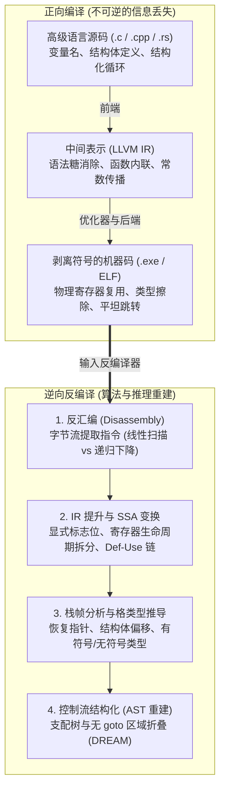
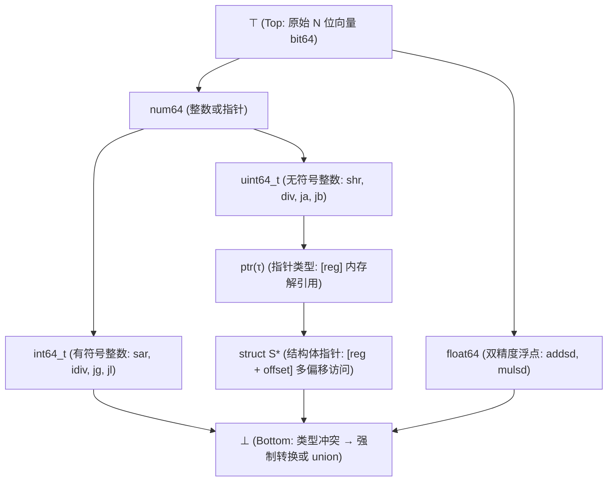

## 1. 引言：能把“炒鸡蛋”还原回“生鸡蛋”吗？

在日常软件开发中，我们用 C、C++ 或 Rust 编写人类易读的高级语言源代码，并通过编译器（GCC、Clang/LLVM、MSVC）将其编译为机器码可执行文件（Windows 的 `.exe` PE 文件或 Linux 的 `ELF` 二进制文件）。编译过程将抽象语法树（AST）、丰富的类型系统和富有表现力的变量名翻译为处理器直接执行的字节流（如 `x86-64` 或 `ARM64` 指令集）。

那么，当我们只有一份丢失了源代码并剥离了符号表（`strip`）的二进制文件时——例如安全研究员分析勒索软件样本、工程师维护 20 年前的遗产系统、或漏洞挖掘人员审计闭源驱动——我们能否将机器码输入<strong>反编译器（Decompiler）</strong>，完整还原出最初的 C 语言源代码？

逆向工程界有一句名言：
<strong>“编译就像把鸡蛋打碎炒成煎蛋卷（Omelet）；而反编译则是试图把煎蛋卷重新还原成带壳的生鸡蛋。”</strong>

从数学与信息论的角度来看，编译函数 $\mathcal{C}: \text{Source} \to \text{Binary}$ 是一个<strong>有损的“多对一（Many-to-One）”非单射映射</strong>。无数份变量名不同、注释不同、循环写法不同（`for` 与 `while`）甚至内联函数结构不同的源代码，在经过 `-O2` 或 `-O3` 优化编译后，会生成<strong>完全相同的字节序列</strong>。由于条件熵 $H(\text{Source} \mid \text{Binary}) > 0$，理论上不存在唯一的逆函数 $\mathcal{C}^{-1}$ 能百分之百恢复被抹去的信息。更严峻的是，根据<strong>莱斯定理（Rice's Theorem）</strong>与图灵停机问题，精确区分代码与内联数据、静态解析间接跳转 `jmp rax` 的全部目标地址、以及判定任意指针别名（Pointer Aliasing），在数学上都是<strong>不可判定的（Undecidable）</strong>。

然而，在现代工业界，<strong>IDA Pro (Hex-Rays)</strong>、美国国家安全局（NSA）开源的 <strong>Ghidra</strong>、<strong>Binary Ninja</strong> 和 <strong>angr</strong> 等反编译器每天都在创造奇迹，将数百万字节的机器码还原为结构清晰、可读性极高的类 C 伪代码。本文将深入剖析现代反编译器的六大核心算法阶段。

---

## 2. 编译过程抹去了什么？：正向编译流水线与信息坍缩

1. <strong>前端（词法/语法/语义分析 $\to$ IR）</strong>：注释、`#define` 宏名、`typedef` 别名、局部变量名以及 `for`/`while` 等语法糖在生成中间表示（LLVM IR）时首先消失。
2. <strong>中端优化器（`-O2` / `-O3`）</strong>：<strong>函数内联（Inlining）</strong>抹去了被调用函数的边界；<strong>循环展开（Loop Unrolling）</strong>与 <strong>SIMD 向量化</strong>改变了控制流结构；<strong>强度折减（Strength Reduction）</strong>将直观的整数除法 `x / 10` 替换为难以辨认的定点魔数乘法 `imul 0x66666667`。
3. <strong>后端寄存器分配与符号剥离（`strip`）</strong>：无限个虚拟寄存器通过图着色算法映射到 `x86-64` 仅有的 16 个通用物理寄存器上。<strong>同一个物理寄存器 `rax` 在同一函数的不同阶段被反复复用于完全无关的整数、指针甚至结构体字段</strong>；而 `strip` 命令则彻底删去了 `.symtab` 符号表与 DWARF 调试信息。

---

## 3. 阶段一：反汇编（Disassembly）——如何区分指令与数据？

在 `x86-64` 这样指令长度从 $1$ 到 $15$ 字节不等的<strong>变长指令集架构</strong>中，编译器常在 `.text` 代码段内部直接嵌入只读数据（如 `switch` 语句的<strong>跳转表 Jump Table</strong>）。一旦反汇编器错把 4 字节地址数据当成指令解码，就会破坏后续真实指令的边界同步（重叠指令问题）。

1. <strong>线性扫描法（Linear Sweep，如 `objdump -d`）</strong>：从代码段首字节顺序向后解码，简单快速，但会把代码中间嵌入的跳转表错误解码为伪指令。
2. <strong>递归下降法（Recursive Traversal，如 IDA Pro、Ghidra）</strong>：从入口点（`main`、导出函数）出发，沿着<strong>控制流分支指令（`je`, `jmp`, `call`）</strong>的目标地址进行图遍历解码，自动跳过不会直接顺序执行的跳转表数据。为了解决<strong>间接跳转（`jmp [rbx + rcx*8]`）</strong>，反编译器需结合后向程序切片（Backward Slicing）与<strong>值集分析（Value-Set Analysis, VSA）</strong>，找到前方的边界检查 `cmp rcx, 12; ja default` 来推导出跳转表的大小。

---

## 4. 阶段二：中间表示提升（IR Lifting）与静态单赋值（SSA）

原生汇编指令充满了隐式副作用（例如 `x86` 的一行 `sub eax, ebx` 会同时改写 `ZF, CF, SF, OF, PF, AF` 六个状态标志位）。反编译器首先将不同架构的机器码翻译（Lifting）为统一的<strong>微代码/中间表示（如 Ghidra 的 P-code 或 Hex-Rays 的 Microcode）</strong>，随后将其转换为<strong>静态单赋值形式（SSA Form）</strong>——每个变量仅被赋值一次，控制流汇合处插入 $\phi$ 函数 $\text{rax}_3 = \phi(\text{rax}_1, \text{rax}_2)$：

- <strong>死标志位消除（Dead Flag Elimination）</strong>：90% 以上未被后续条件跳转引用的状态标志位计算在 Def-Use 图上出度为 $0$，可在 $O(1)$ 时间内全部清除。
- <strong>表达式传播（Expression Propagation）</strong>：将标志位定义 `ZF_2 = (eax_2 == 0)` 直接代入 `if (ZF_2)`，还原出高级条件表达式 `if (eax_2 == 0)`。
- <strong>寄存器生命周期拆分（Live-Range Splitting）</strong>：将复用同一个物理寄存器 `rax` 但互不连通的 SSA 定义-使用网（Webs）自动拆分为独立的 C 语言局部变量 `int v1;` 和 `struct Node *v2;`！

---

## 5. 阶段三：栈帧重建与基于格（Lattice）的类型推导

虽然机器码没有显式类型，但 CPU 指令本身的语义蕴含着严格的<strong>代数类型约束（Type Constraints）</strong>：

- <strong>有符号（Signed）与无符号（Unsigned）判定</strong>：条件跳转 `jg / jl`（Greater/Less）、有符号除法 `idiv`、算术右移 `sar` 和符号扩展 `movsxd` 证明操作数为<strong>有符号整数（`int`）</strong>；而 `ja / jb`（Above/Below）、无符号除法 `div`、逻辑右移 `shr` 和零扩展 `movzx` 则证明操作数为<strong>无符号整数（`unsigned int`）</strong>。
- <strong>指针、结构体与数组重建</strong>：内存解引用 `[rbx]` 产生指针约束 $\text{ptr}(\tau)$；对同一基址寄存器的多个常数偏移访问 `[rbx + 0]`, `[rbx + 8]`, `[rbx + 16]` 揭示出 `rbx` 是指向<strong>复合结构体 `struct S *`</strong> 的指针；而比例变址 `[rbx + rcx*4]` 则对应元素大小为 4 字节的数组。
- <strong>格理论与合一求解器（Lattice Type Inference）</strong>：反编译器（参考 Mycroft 1999 与 CMU TIE 系统）将所有类型组织为从顶元 $\top$（未约束位向量）到底元 $\bot$（类型冲突/`union`）的<strong>偏序格 $(\mathcal{L}, \sqsubseteq)$</strong>，收集全函数 SSA 指令的子类型不等式并求最大下界（Meet $\sqcap$），从而全局一致地推导出每个局部变量与函数参数的类型。

---

## 6. 阶段四：控制流结构化（Control-Flow Structuring）——从 `goto` 图还原 `if` 与 `while`

为了将平坦的控制流图（CFG）折叠回嵌套的高级语言抽象语法树（AST），反编译器（源自 Cristina Cifuentes 1994 年的奠基性工作）利用图论中的<strong>支配树（Dominator Tree）</strong>与<strong>后支配树（Post-Dominator Tree）</strong>：

1. <strong>自然循环识别</strong>：若边 $n \to h$ 的目标节点 $h$ 支配源节点 $n$（$h \text{ dom } n$），则该边为<strong>回边（Back-Edge）</strong>，定义了以 $h$ 为头节点的自然循环（出口在头部为 `while`/`for`，出口在尾部为 `do-while`）。
2. <strong>分支合并点识别</strong>：条件分支节点 $b$ 的<strong>直接后支配者（Immediate Post-Dominator）</strong>恰好是 `if-then-else` 菱形区域的汇合点。
3. <strong>无 `goto` 结构化（DREAM 算法）</strong>：针对编译器激进优化产生的多入口不可约图（Irreducible CFG），现代 <strong>DREAM ("No More Gotos", Yakdan et al. 2015)</strong> 算法通过计算节点间的布尔<strong>可达条件（Reaching Conditions）</strong>并进行逻辑化简，能够生成 <strong>100% 不含 `goto` 语句</strong>的整洁 C 代码！

---

## 7. 反编译的极限：优化伪装、代码混淆与大语言模型（LLM4Decompile）

| 程序特征维度 | 未优化带调试信息 (`-O0 -g`) | 发行版优化剥离 (`-O3` + `strip`) | 强代码混淆 (OLLVM / VMProtect) |
| :--- | :--- | :--- | :--- |
| <strong>函数名、变量名与类型名</strong> | 从 DWARF/PDB 100% 完整恢复 | <strong>永久擦除</strong>（退化为 `sub_401000`, `v1`） | 擦除 + 注入误导性伪符号 |
| <strong>常数除法（如 `x / 10`）</strong> | 直接对应 `idiv` 指令 | <strong>魔数乘法</strong>（$\lfloor \text{0x66666667} \cdot x / 2^{34} \rfloor$） | 混合布尔算术（MBA）多项式展开 |
| <strong>控制流结构（`if / while`）</strong> | 完美折叠为结构化 AST | 循环展开与 AVX-512 向量化变形 | <strong>控制流平坦化 (CFF)</strong> 变成单一 `switch` |
| <strong>指令集语义（ISA）</strong> | 原生 `x86-64` / `ARM64` | 原生 `x86-64` / `ARM64` | <strong>虚拟化保护</strong>：随机自定义字节码解释器 |

恶意软件与商业壳（如 <strong>OLLVM</strong>、<strong>VMProtect</strong>）通过<strong>控制流平坦化（Control-Flow Flattening）</strong>、数论<strong>不透明谓词（Opaque Predicates）</strong>、<strong>混合布尔算术（MBA，$x+y \equiv (x\oplus y) + 2(x\land y)$）</strong>以及将原生指令编译为自定义随机字节码的<strong>虚拟机保护（Virtualization Obfuscation）</strong>来对抗静态反编译。而在 2020 年代，以 <strong>LLM4Decompile</strong> 为代表的<strong>神经反编译器（Neural Decompilation）</strong>正将传统形式化分析与大语言模型相结合：利用数亿对源码-二进制样本训练的模型，不仅能将晦涩的优化代码重述为自然的 C 惯用写法，还能根据上下文高概率地“猜回”富有语义的函数名与变量名，将逆向工程推向全新的智能时代。
