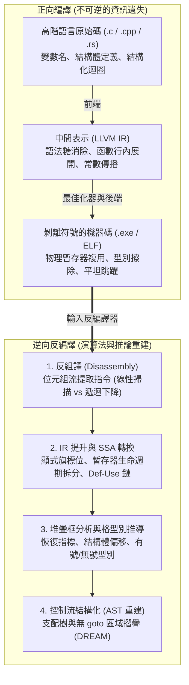
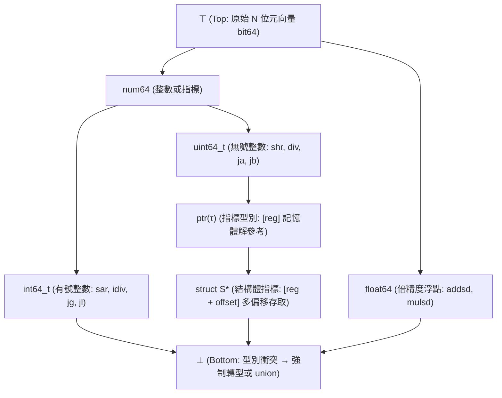

## 1. 引言：能把「炒雞蛋」還原回「生雞蛋」嗎？

在日常軟體開發中，我們用 C、C++ 或 Rust 編寫人類易讀的高階語言原始碼，並透過編譯器（GCC、Clang/LLVM、MSVC）將其編譯為機器碼執行檔（Windows 的 `.exe` PE 檔或 Linux 的 `ELF` 二進位檔）。編譯過程將抽象語法樹（AST）、豐富的型別系統和具表現力的變數名稱翻譯為處理器直接執行的位元組流（如 `x86-64` 或 `ARM64` 指令集）。

那麼，當我們只有一份遺失了原始碼並剝離了符號表（`strip`）的二進位檔時——例如資安研究員分析勒索軟體樣本、工程師維護 20 年前的遺留系統、或漏洞挖掘人員審計閉源驅動程式——我們能否將機器碼輸入<strong>反編譯器（Decompiler）</strong>，完整還原出最初的 C 語言原始碼？

逆向工程界有一句名言：
<strong>「編譯就像把雞蛋打碎炒成歐姆蛋（Omelet）；而反編譯則是試圖把歐姆蛋重新還原成帶殼的生雞蛋。」</strong>

從數學與資訊理論的角度來看，編譯函數 $\mathcal{C}: \text{Source} \to \text{Binary}$ 是一個<strong>有損的「多對一（Many-to-One）」非單射映射</strong>。無數份變數名稱不同、註解不同、迴圈寫法不同（`for` 與 `while`）甚至行內函數結構不同的原始碼，在經過 `-O2` 或 `-O3` 最佳化編譯後，會生成<strong>完全相同的位元組序列</strong>。由於條件熵 $H(\text{Source} \mid \text{Binary}) > 0$，理論上不存在唯一的逆函數 $\mathcal{C}^{-1}$ 能百分之百恢復被抹去的資訊。更嚴峻的是，根據<strong>萊斯定理（Rice's Theorem）</strong>與圖靈停機問題，精確區分程式碼與行內資料、靜態解析間接跳躍 `jmp rax` 的全部目標位址、以及判定任意指標別名（Pointer Aliasing），在數學上都是<strong>不可判定的（Undecidable）</strong>。

然而，在現代工業界，<strong>IDA Pro (Hex-Rays)</strong>、美國國家安全局（NSA）開源的 <strong>Ghidra</strong>、<strong>Binary Ninja</strong> 和 <strong>angr</strong> 等反編譯器每天都在創造奇蹟，將數百萬位元組的機器碼還原為結構清晰、可讀性極高的類 C 虛擬碼。本文將深入剖析現代反編譯器的六大核心演算法階段。

---

## 2. 編譯過程抹去了什麼？：正向編譯管線與資訊坍縮

1. <strong>前端（詞法/語法/語義分析 $\to$ IR）</strong>：註解、`#define` 巨集名稱、`typedef` 別名、區域變數名稱以及 `for`/`while` 等語法糖在生成中間表示（LLVM IR）時首先消失。
2. <strong>中端最佳化器（`-O2` / `-O3`）</strong>：<strong>函數行內展開（Inlining）</strong>抹去了被呼叫函數的邊界；<strong>迴圈展開（Loop Unrolling）</strong>與 <strong>SIMD 向量化</strong>改變了控制流結構；<strong>強度折減（Strength Reduction）</strong>將直觀的整數除法 `x / 10` 替換為難以辨認的定點魔數乘法 `imul 0x66666667`。
3. <strong>後端暫存器分配與符號剝離（`strip`）</strong>：無限個虛擬暫存器透過圖著色演算法映射到 `x86-64` 僅有的 16 個通用物理暫存器上。<strong>同一個物理暫存器 `rax` 在同一函數的不同階段被反覆複用於完全無關的整數、指標甚至結構體欄位</strong>；而 `strip` 命令則徹底刪去了 `.symtab` 符號表與 DWARF 除錯資訊。

---

## 3. 階段一：反組譯（Disassembly）——如何區分指令與資料？

在 `x86-64` 這樣指令長度從 $1$ 到 $15$ 位元組不等的<strong>變長指令集架構</strong>中，編譯器常在 `.text` 程式碼區段內部直接嵌入唯讀資料（如 `switch` 敘述的<strong>跳躍表 Jump Table</strong>）。一旦反組譯器錯把 4 位元組位址資料當成指令解碼，就會破壞後續真實指令的邊界同步（重疊指令問題）。

1. <strong>線性掃描法（Linear Sweep，如 `objdump -d`）</strong>：從程式碼區段首位元組順序向後解碼，簡單快速，但會把程式碼中間嵌入的跳躍表錯誤解碼為偽指令。
2. <strong>遞迴下降法（Recursive Traversal，如 IDA Pro、Ghidra）</strong>：從進入點（`main`、匯出函數）出發，沿著<strong>控制流分支指令（`je`, `jmp`, `call`）</strong>的目標位址進行圖遍歷解碼，自動跳過不會直接順序執行的跳躍表資料。為了解決<strong>間接跳躍（`jmp [rbx + rcx*8]`）</strong>，反編譯器需結合後向程式切片（Backward Slicing）與<strong>值集分析（Value-Set Analysis, VSA）</strong>，找到前方的邊界檢查 `cmp rcx, 12; ja default` 來推導出跳躍表的大小。

---

## 4. 階段二：中間表示提升（IR Lifting）與靜態單賦值（SSA）

原生組合語言指令充滿了隱式副作用（例如 `x86` 的一行 `sub eax, ebx` 會同時改寫 `ZF, CF, SF, OF, PF, AF` 六個狀態旗標位）。反編譯器首先將不同架構的機器碼翻譯（Lifting）為統一的<strong>微碼/中間表示（如 Ghidra 的 P-code 或 Hex-Rays 的 Microcode）</strong>，隨後將其轉換為<strong>靜態單賦值形式（SSA Form）</strong>——每個變數僅被賦值一次，控制流匯合處插入 $\phi$ 函數 $\text{rax}_3 = \phi(\text{rax}_1, \text{rax}_2)$：

- <strong>死旗標位消除（Dead Flag Elimination）</strong>：90% 以上未被後續條件跳躍引用的狀態旗標計算在 Def-Use 圖上出度為 $0$，可在 $O(1)$ 時間內全部清除。
- <strong>運算式傳播（Expression Propagation）</strong>：將旗標定義 `ZF_2 = (eax_2 == 0)` 直接代入 `if (ZF_2)`，還原出高階條件運算式 `if (eax_2 == 0)`。
- <strong>暫存器生命週期拆分（Live-Range Splitting）</strong>：將複用同一個物理暫存器 `rax` 但互不連通的 SSA 定義-使用網（Webs）自動拆分為獨立的 C 語言區域變數 `int v1;` 和 `struct Node *v2;`！

---

## 5. 階段三：堆疊框重建與基於格（Lattice）的型別推導

雖然機器碼沒有顯式型別，但 CPU 指令本身的語義蘊含著嚴格的<strong>代數型別約束（Type Constraints）</strong>：

- <strong>有號（Signed）與無號（Unsigned）判定</strong>：條件跳躍 `jg / jl`（Greater/Less）、有號除法 `idiv`、算術右移 `sar` 和符號擴展 `movsxd` 證明運算元為<strong>有號整數（`int`）</strong>；而 `ja / jb`（Above/Below）、無號除法 `div`、邏輯右移 `shr` 和零擴展 `movzx` 則證明運算元為<strong>無號整數（`unsigned int`）</strong>。
- <strong>指標、結構體與陣列重建</strong>：記憶體解參考 `[rbx]` 產生指標約束 $\text{ptr}(\tau)$；對同一基址暫存器的多個常數偏移存取 `[rbx + 0]`, `[rbx + 8]`, `[rbx + 16]` 揭示出 `rbx` 是指向<strong>複合結構體 `struct S *`</strong> 的指標；而比例變址 `[rbx + rcx*4]` 則對應元素大小為 4 位元組的陣列。
- <strong>格理論與合一求解器（Lattice Type Inference）</strong>：反編譯器（參考 Mycroft 1999 與 CMU TIE 系統）將所有型別組織為從頂元 $\top$（未約束位元向量）到底元 $\bot$（型別衝突/`union`）的<strong>偏序格 $(\mathcal{L}, \sqsubseteq)$</strong>，收集全函數 SSA 指令的子型別不等式並求最大下界（Meet $\sqcap$），從而全域一致地推導出每個區域變數與函數參數的型別。

---

## 6. 階段四：控制流結構化（Control-Flow Structuring）——從 `goto` 圖還原 `if` 與 `while`

為了將平坦的控制流圖（CFG）摺疊回巢狀的高階語言抽象語法樹（AST），反編譯器（源自 Cristina Cifuentes 1994 年的奠基性工作）利用圖論中的<strong>支配樹（Dominator Tree）</strong>與<strong>後支配樹（Post-Dominator Tree）</strong>：

1. <strong>自然迴圈識別</strong>：若邊 $n \to h$ 的目標節點 $h$ 支配源節點 $n$（$h \text{ dom } n$），則該邊為<strong>回邊（Back-Edge）</strong>，定義了以 $h$ 為頭節點的自然迴圈（出口在頭部為 `while`/`for`，出口在尾部為 `do-while`）。
2. <strong>分支合併點識別</strong>：條件分支節點 $b$ 的<strong>直接後支配者（Immediate Post-Dominator）</strong>恰好是 `if-then-else` 菱形區域的匯合點。
3. <strong>無 `goto` 結構化（DREAM 演算法）</strong>：針對編譯器激進最佳化產生的多入口不可約圖（Irreducible CFG），現代 <strong>DREAM ("No More Gotos", Yakdan et al. 2015)</strong> 演算法透過計算節點間的布林<strong>可達條件（Reaching Conditions）</strong>並進行邏輯化簡，能夠生成 <strong>100% 不含 `goto` 敘述</strong>的整潔 C 程式碼！

---

## 7. 反編譯的極限：最佳化偽裝、程式碼混淆與大型語言模型（LLM4Decompile）

| 程式特徵維度 | 未最佳化帶除錯資訊 (`-O0 -g`) | 發行版最佳化剝離 (`-O3` + `strip`) | 強程式碼混淆 (OLLVM / VMProtect) |
| :--- | :--- | :--- | :--- |
| <strong>函數名、變數名與型別名</strong> | 從 DWARF/PDB 100% 完整恢復 | <strong>永久擦除</strong>（退化為 `sub_401000`, `v1`） | 擦除 + 注入誤導性偽符號 |
| <strong>常數除法（如 `x / 10`）</strong> | 直接對應 `idiv` 指令 | <strong>魔數乘法</strong>（$\lfloor \text{0x66666667} \cdot x / 2^{34} \rfloor$） | 混合布林算術（MBA）多項式展開 |
| <strong>控制流結構（`if / while`）</strong> | 完美摺疊為結構化 AST | 迴圈展開與 AVX-512 向量化變形 | <strong>控制流平坦化 (CFF)</strong> 變成單一 `switch` |
| <strong>指令集語義（ISA）</strong> | 原生 `x86-64` / `ARM64` | 原生 `x86-64` / `ARM64` | <strong>虛擬化保護</strong>：隨機自訂位元組碼直譯器 |

惡意軟體與商業殼（如 <strong>OLLVM</strong>、<strong>VMProtect</strong>）透過<strong>控制流平坦化（Control-Flow Flattening）</strong>、數論<strong>不透明謂詞（Opaque Predicates）</strong>、<strong>混合布林算術（MBA，$x+y \equiv (x\oplus y) + 2(x\land y)$）</strong>以及將原生指令編譯為自訂隨機位元組碼的<strong>虛擬機器保護（Virtualization Obfuscation）</strong>來對抗靜態反編譯。而在 2020 年代，以 <strong>LLM4Decompile</strong> 為代表的<strong>神經反編譯器（Neural Decompilation）</strong>正將傳統形式化分析與大型語言模型相結合：利用數億對原始碼-二進位樣本訓練的模型，不僅能將晦澀的最佳化程式碼重述為自然的 C 慣用寫法，還能根據上下文高機率地「猜回」富有語義的函數名與變數名，將逆向工程推向全新的智慧時代。
