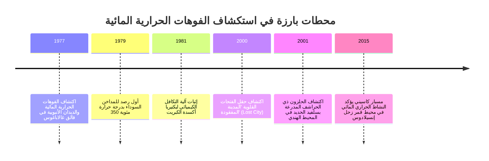
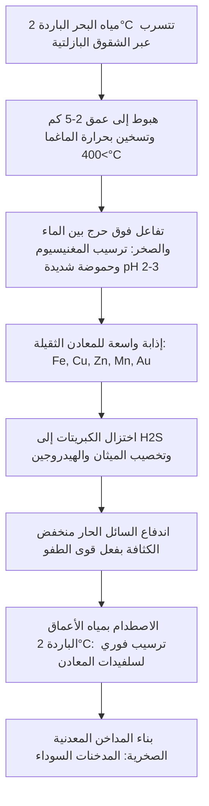

طوال قرون طويلة، ظلت البيولوجيا متمسكة بقاعدة غير قابلة للنقاش: كل حياة معقدة على كوكب الأرض تعتمد في النهاية على طاقة أشعة الشمس عبر التركيب الضوئي. غير أن هذا النموذج انهار تماماً في عام 1977 عندما هبطت الغواصة المأهولة *ألفين (Alvin)* إلى عمق 2500 متر في فالق غالاباغوس بالمحيط الهادئ.

في قلب الظلام الدامس وتحت ضغط هائل يتجاوز 250 ضغطاً جوياً، اكتشف العلماء مداخن معدنية عملاقة تقذف سوائل سوداء داكنة تزيد حرارتها عن 350 درجة مئوية (المدخنات السوداء). وحول هذه الفوهات، ازدهرت واحة حيوية غنية بالديدان الأنبوبية العملاقة وسرطانات البحر البيضاء والرخويات الضخمة.

أثبت هذا الكشف وجود **النظم البيئية المعتمدة على التخليق الكيميائي (Chemosynthetic Ecosystems)**، وهي عوالم بيولوجية لا تتغذى على فوتونات الشمس، بل على الطاقة الكيميائية الجوفية المنبعثة من باطن الأرض.



---

## 1. الفيزياء الجيولوجية للدورة الحرارية المائية

تتشكل الفوهات الحرارية على امتداد الحدود التباعدية للصفائح التكتونية (أعراف منتصف المحيط) حيث تصعد الماغما بالقرب من القشرة المحيطية.



---

## 2. الكيمياء الحيوية للتخليق الكيميائي

تستغل البكتيريا والعتائق ذاتية التغذية الطاقة الكيميائية الحرة ($\Delta G^\circ$) الناتجة عن أكسدة المواد غير العضوية لإنتاج جزيئات الطاقة ATP و NADH:

### التفاعلات الرئيسية:
- **أكسدة كبريتيد الهيدروجين**:
  $$H_2S + 2O_2 \rightarrow SO_4^{2-} + 2H^+ \quad (\Delta G^\circ = -792\text{ kJ/mol})$$
- **أكسدة الهيدروجين الجزيئي**:
  $$2H_2 + O_2 \rightarrow 2H_2O \quad (\Delta G^\circ = -474\text{ kJ/mol})$$
- **أكسدة الميثان الهوائية**:
  $$CH_4 + 2O_2 \rightarrow CO_2 + 2H_2O \quad (\Delta G^\circ = -820\text{ kJ/mol})$$

```mermaid
graph LR
    subgraph التركيب الضوئي
        Sun[ضوء الشمس] --> PS[الأنظمة الضوئية]
        PS --> ATP1[ATP + NADPH]
        CO2_1[CO2] + ATP1 --> Bio1[السكريات والكتلة الحيوية]
    end

    subgraph التخليق الكيميائي
        Inorg[مركبات غير عضوية H2S / H2] --> ETS[سلسلة نقل الإلكترون]
        ETS --> ATP2[القوة الدافعة للبروتونات -> ATP + NADH]
        CO2_2[CO2] + ATP2 --> Bio2[الكتلة الحيوية الخلوية]
    end
```

---

## 3. تكيف الكائنات المتطرفة وأصل الحياة

- ***Riftia pachyptila***: الديدان الأنبوبية تفتقر تماماً إلى الفم والجهاز الهضمي، وتعتمد كلياً على مليارات البكتيريا التكافلية داخل نسيج "التروفوسوم"، مع هيموغلوبين عملاق يحمل الأكسجين وغاز $H_2S$ السام بأمان تام.
- ***Chrysomallon squamiferum***: الحلزون ذو القدم الحرشفية يبني درعاً من بلورات كبريتيد الحديد النانوية لمقاومة هجمات المفترسات.
- **فرضية الفتحات القلوية لنشأة الحياة**: أتاح التدرج الطبيعي للبروتونات ($\Delta \text{pH} \approx 4$) بين السوائل القلوية لحقول مثل *Lost City* (pH 9-11) والمحيط البدائي الحمضي (pH 5-6) بطارية كيميائية جيولوجية ولدت أولى العمليات الحيوية على الأرض.
