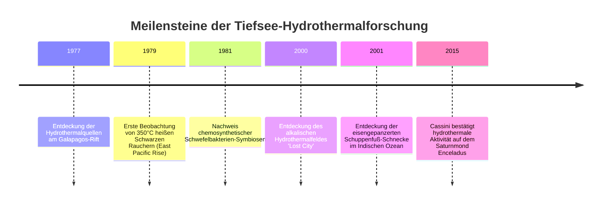
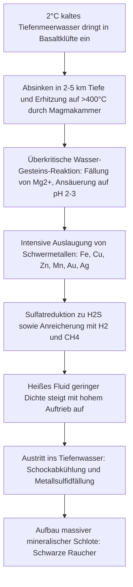

Bis ins späte 20. Jahrhundert galt in der Biologie das unerschütterliche Dogma, dass jegliches komplexe Leben auf der Erde direkt oder indirekt von der Sonnenenergie über die Photosynthese angetrieben wird. Dieser Grundsatz wurde 1977 im östlichen Pazifik am Galapagos-Rift in 2.500 Metern Tiefe durch das bemannte Forschungs-U-Boot *Alvin* spektakulär widerlegt.

In einer Welt ewiger Finsternis, eisigen Wassers und eines Drucks von über 250 Atmosphären entdeckten die Forscher gigantische Mineralschlote, die über 350°C heiße, tiefschwarze metallhaltige Flüssigkeiten ausstießen. Um diese Schlote florierte ein dichtes, farbenprächtiges Ökosystem: zwei Meter lange Röhrenwürmer mit leuchtend roten Kiemen, weiße Krebse und Riesenmuscheln.

Dies war der Beweis für die Existenz **chemosynthetischer Ökosysteme** – biologische Oasen, die sich ausschließlich aus der geochemischen Energie des Erdinneren speisen.



---

## 1. Geophysik und Geochemie hydrothermaler Schlote

Hydrothermale Schlote entstehen primär an divergenten tektonischen Plattengrenzen, wie mittelozeanischen Rücken und Backarc-Becken, wo heißes Magma bis dicht unter den Ozeanboden aufsteigt.



### Der hydrothermale Kreislauf:
1. **Infiltration**: Kaltes Meerwasser sickert entlang tektonischer Klüfte bis zu 5 km in die ozeanische Kruste.
2. **Metamorphose bei Extremtemperaturen**: Nahe der Magmakammer heizt sich das Wasser auf über 400°C auf. Magnesium ($Mg^{2+}$) wird in Schichtsilikaten gebunden, Protonen ($H^+$) werden freigesetzt, wodurch die Lösung stark sauer (pH 2–3) wird.
3. **Erzauslaugung**: Die saure, reduzierende Lösung löst beträchtliche Mengen an Übergangsmetallen (Kupfer, Zink, Eisen, Gold).
4. **Schornsteinbildung**: Beim Austritt in das 2°C kalte Meerwasser fallen Sulfidminerale (Chalkopyrit, Pyrit, Sphalerit) schlagartig aus und wachsen zu Schornsteinen empor.

---

## 2. Biochemie der Chemosynthese

Chemoautotrophe Bakterien und Archaeen oxidieren anorganische Moleküle und nutzen die freigesetzte Gibbs-Energie ($\Delta G^\circ$) zur Synthese von ATP und NADH:

### Zentrale Redoxreaktionen:
- **Schwefelwasserstoff-Oxidation** (primäre Energiequelle der Röhrenwurm-Symbionten):
  $$H_2S + 2O_2 \rightarrow SO_4^{2-} + 2H^+ \quad (\Delta G^\circ = -792\text{ kJ/mol})$$
- **Wasserstoff-Oxidation**:
  $$2H_2 + O_2 \rightarrow 2H_2O \quad (\Delta G^\circ = -474\text{ kJ/mol})$$
- **Methan-Oxidation**:
  $$CH_4 + 2O_2 \rightarrow CO_2 + 2H_2O \quad (\Delta G^\circ = -820\text{ kJ/mol})$$

```mermaid
graph LR
    subgraph Photosynthese
        Sonne[Lichtenergie] --> Chl[Chloroplasten]
        Chl --> ATP1[ATP + NADPH]
        CO2_1[CO2] + ATP1 --> Zucker1[Biomasse]
    end

    subgraph Chemosynthese
        Inorg[H2S / H2 / CH4] --> ETS[Elektronentransportkette]
        ETS --> ATP2[Protonenmotorische Kraft -> ATP + NADH]
        CO2_2[CO2] + ATP2 --> Zucker2[Biomasse]
    end
```

Für die Kohlenstofffixierung nutzen Tiefsee-Hyperthermophile oft den **reduktiven Citratzyklus (rTCA-Zyklus)**, der wesentlich energieeffizienter ist als der Calvin-Zyklus von Landpflanzen und als evolutionärer Vorläufer aller Stoffwechselwege gilt.

---

## 3. Extremophile Anpassungen

- **Riftia pachyptila (Riesenröhrenwurm)**: Besitzt weder Mund noch Darm. Im Trophosom beherbergt der Wurm Milliarden Schwefelbakterien. Ein spezielles riesiges Hämoglobinmolekül bindet gleichzeitig Sauerstoff und giftiges $H_2S$, ohne Schaden zu nehmen.
- **Chrysomallon squamiferum (Schuppenfuß-Schnecke)**: Mineralisiert Nanokristalle aus Eisensulfid (Greigit $Fe_3S_4$ und Pyrit) in ihrer dreischichtigen Schale und den Fußschuppen als mechanischen Schutz gegen Raubkrebse.

---

## 4. Ursprung des Lebens und Astrobiologie

Die **alkalische Schlot-Hypothese** postuliert, dass das irdische Leben in porösen Carbonattürmen (Typ *Lost City*) entstand. Der natürliche Protonengradient ($\Delta \text{pH} \approx 4$) zwischen alkalischem Schlotfluid (pH 9–11) und saurem Urozean (pH 5–6) bildete eine natürliche anorganische Brennstoffzelle zur Bildung erster organischer Moleküle.

Die Entdeckung hydrothermaler Silizium-Nanopartikel und molekularen Wasserstoffs in den Fontänen des Saturnmondes Enceladus durch die *Cassini*-Sonde beweist, dass diese Prozesse auch auf Eismonden unseres Sonnensystems ablaufen.
