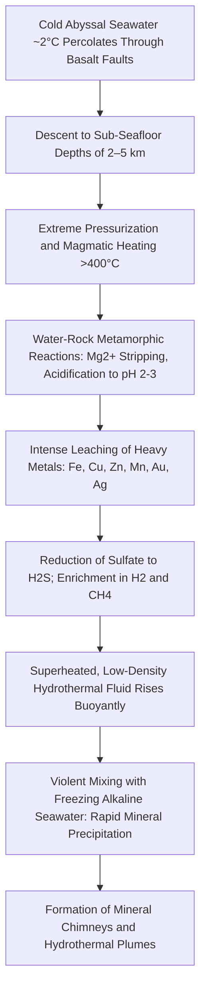
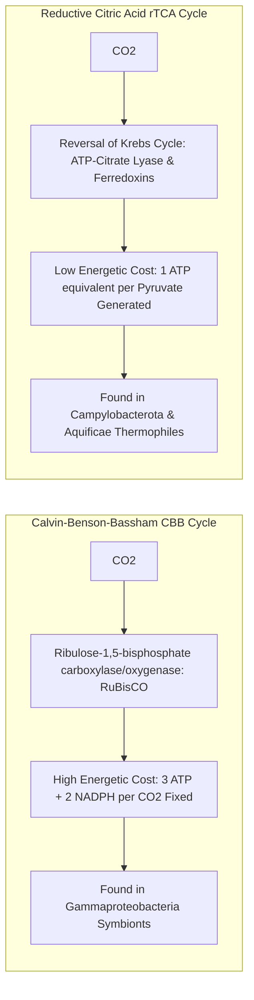
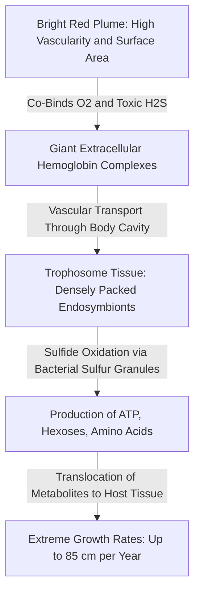
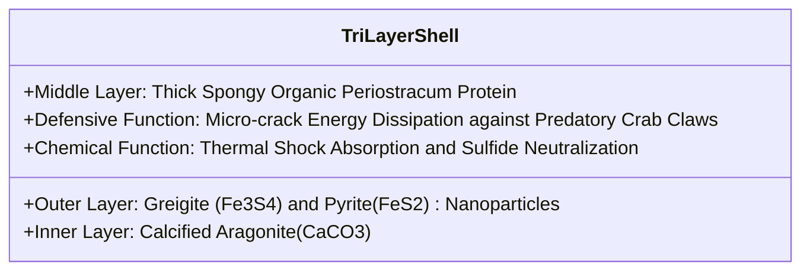
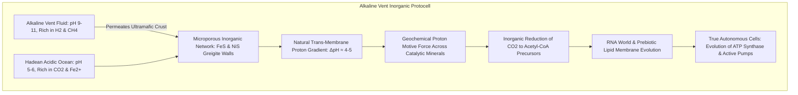
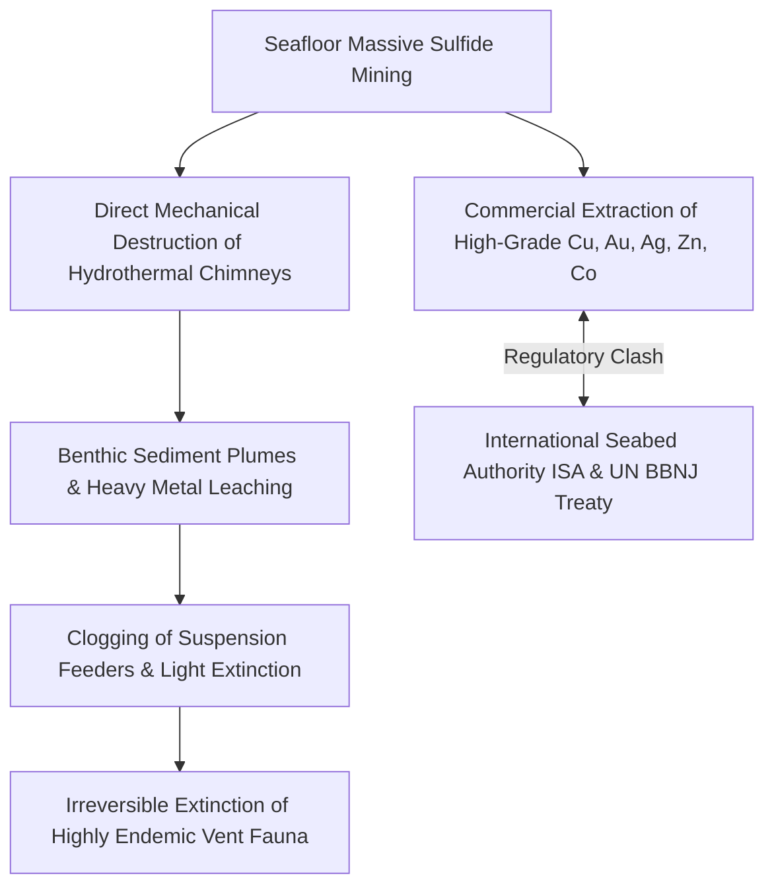

For centuries, biology was anchored by an unwavering dogma: all complex life on Earth is fundamentally driven by sunlight via photosynthetic primary production. That foundational paradigm was shattered in 1977.

At a depth of 2,500 meters along the Galapagos Rift in the Eastern Pacific, researchers aboard the deep-submergence vehicle *Alvin* made a discovery that redefined science. In an abyssal realm of complete darkness, near-freezing ambient water, and crushing pressures exceeding 250 atmospheres, they discovered towering mineral spires spewing billowing black clouds of superheated mineral fluid exceeding 350°C. 

Surrounding these chimneys were dense, thriving oases of life: giant red-plumed tube worms over two meters long, blind ghost crabs, giant clams, and swarming caridean shrimp. 

This marked the discovery of the **chemosynthetic ecosystem**—a biological realm fueled not by solar photons, but by geothermal and chemical energy harvested from the Earth's interior. This article provides an exhaustive, multidisciplinary breakdown of hydrothermal vent systems, from geophysical mechanics to chemosynthetic biochemistry, extraordinary extremophile adaptations, the alkaline vent origin-of-life hypothesis, and the search for extraterrestrial life on icy moons.

---

## 1. Geophysics and Geochemistry of Hydrothermal Vents

### 1.1 The Mechanics of Seafloor Hydrothermal Circulation

Hydrothermal vent systems develop predominantly along divergent tectonic plate boundaries, such as mid-ocean ridge (MOR) spreading centers and back-arc basins, where magma ascends close to the oceanic crust.



The hydrothermal cycle operates via a continuous four-stage thermodynamic cycle:

1. **Recharge and Infiltration**:
   Cold, oxygenated oceanic bottom water (~2°C) enters tectonic fractures and permeable volcanic rock fissures across the ocean floor, percolating downward to depths of several kilometers.
2. **High-Temperature Water-Rock Alteration**:
   As the fluid nears magmatic chambers, temperatures soar past 400°C under hydrostatic pressures of 200–400 atmospheres, placing the fluid into a supercritical or near-critical state. Magnesium ions ($Mg^{2+}$) precipitate into smectite and chlorite clays, releasing hydrogen ions ($H^+$) and driving the pH down to an intensely acidic 2 to 3.
3. **Metal Leaching and Gas Enrichment**:
   This superheated, hyper-acidic, reducing fluid aggressively strips transition metals from basaltic crust—including iron ($Fe$), copper ($Cu$), zinc ($Zn$), manganese ($Mn$), lead, and precious metals. Dissolved sulfate ($SO_4^{2-}$) is reduced to toxic hydrogen sulfide ($H_2S$), while mantle degasification and organic cracking charge the fluid with methane ($CH_4$), molecular hydrogen ($H_2$), and carbon dioxide ($CO_2$).
4. **Discharge and Chimney Genesis**:
   Due to its vastly reduced density, the fluid surges upward through hydrothermal conduits, erupting into the freezing abyssal water. Instantaneous thermal shock and chemical mixing precipitate fine-grained metal sulfide minerals, which crystallize and accrete into hollow chimney edifices.

---

### 1.2 Black Smokers vs. White Smokers vs. Alkaline Serpentinite Vents

Hydrothermal vents exhibit remarkable geochemical diversity based on underlying geological host rocks and fluid temperature profiles:

| Diagnostic Feature | Black Smokers | White Smokers | Alkaline Vents (Lost City Type) |
| :--- | :--- | :--- | :--- |
| **Fluid Temperature** | 320°C to >400°C | 150°C to 300°C | 40°C to 90°C |
| **Fluid pH** | Strongly Acidic (pH 2 – 3) | Moderately Acidic (pH 3 – 5) | Strongly Alkaline (pH 9 – 11) |
| **Precipitate Composition** | Polymetallic sulfides: Chalcopyrite ($CuFeS_2$), Pyrrhotite ($Fe_{1-x}S$), Sphalerite ($ZnS$) | Silica ($SiO_2$), Anhydrite ($CaSO_4$), Barite ($BaSO_4$) | Carbonates (Calcite, Aragonite), Brucite ($Mg(OH)_2$) |
| **Primary Energy Driver** | Magmatic volcanism | Sub-surface fluid mixing/cooling | **Serpentinization** (Exothermic olivine hydration) |
| **Key Chemical Species** | Abundant $H_2S$, $Fe^{2+}$, $Cu$, $Zn$, $Mn$ | High $SiO_2$, low heavy metals | Hyper-rich in $H_2$, $CH_4$, negligible toxic metals |
| **Geological Setting** | Fast/slow mid-ocean spreading axes | Flanks of hydrothermal fields | Off-axis ultramafic massifs (Atlantis Massif) |

While black smokers are volcanic and transient, alkaline serpentinization fields can remain active for hundreds of thousands of years, producing vast, porous carbonate towers up to 60 meters tall.

---

## 2. Biochemistry of Chemosynthesis

### 2.1 Bioenergetics: Chemosynthesis vs. Photosynthesis

Photosynthesis harnesses solar radiation to photolyze water ($H_2O$), releasing molecular oxygen ($O_2$) and driving carbon reduction. Chemotrophic autotrophs, by contrast, utilize the exergonic free energy released by inorganic redox reactions to phosphorylate ADP into ATP and reduce $NAD(P)^+$ into $NAD(P)H$.

```mermaid
graph TD
    subgraph Photosynthesis
        Light[Solar Photons] --> PS[Photophosphorylation: PSI / PSII]
        H2O_1[Water H2O] -->|Oxidation| O2_1[Oxygen O2]
        PS --> ATP_1[ATP + NADPH]
        CO2_1[CO2] + ATP_1 --> Bio_1[Glucose & Organic Biomass]
    end

    subgraph Chemolithoautotrophy
        RedoxInorg[Inorganic Donors: H2S, H2, CH4, Fe2+] --> ChemChain[Membrane Electron Transport Chain]
        TerminalAcc[Terminal Acceptors: O2, NO3-, SO4 2-] --> ReducedProd[H2O, N2, S0]
        ChemChain --> ATP_2[Proton Motive Force -> ATP + NADH]
        CO2_2[CO2 / HCO3-] + ATP_2 --> Bio_2[Cellular Carbon Macromolecules]
    end
```

---

### 2.2 Core Metabolic Pathways and Thermodynamics

The thermodynamic viability of chemosynthesis is governed by the Gibbs free energy change ($\Delta G^\circ$) of primary redox reactions:

#### (1) Sulfide Oxidation (Thiotrophy)
The most widespread metabolic strategy at hydrothermal vents, practiced by endosymbionts of tube worms, bivalves, and free-living microbial mats:

$$H_2S + 2O_2 \rightarrow SO_4^{2-} + 2H^+ \quad (\Delta G^\circ = -792\text{ kJ/mol})$$

$$2H_2S + O_2 \rightarrow 2S^0 + 2H_2O \quad (\Delta G^\circ = -418\text{ kJ/mol})$$

Elemental sulfur ($S^0$) is often stored in intracellular sulfur globules and further oxidized when ambient sulfide drops.

#### (2) Molecular Hydrogen Oxidation (Hydrogenotrophy)
Common among hyperthermophilic archaea and ancestral bacterial lineages:

$$2H_2 + O_2 \rightarrow 2H_2O \quad (\Delta G^\circ = -474\text{ kJ/mol})$$

Under anoxic conditions, sulfate-reducing bacteria couple hydrogen oxidation with sulfate reduction:

$$4H_2 + SO_4^{2-} + 2H^+ \rightarrow H_2S + 4H_2O \quad (\Delta G^\circ = -152\text{ kJ/mol})$$

#### (3) Methane Oxidation (Methanotrophy)
Aerobic methanotrophy:
$$CH_4 + 2O_2 \rightarrow CO_2 + 2H_2O \quad (\Delta G^\circ = -820\text{ kJ/mol})$$

Anaerobic Oxidation of Methane (AOM):
Executed via syntrophic consortia of anaerobic methanotrophic archaea (ANME) and sulfate-reducing bacteria:
$$CH_4 + SO_4^{2-} \rightarrow HCO_3^- + HS^- + H_2O \quad (\Delta G^\circ = -16.6\text{ kJ/mol})$$

---

### 2.3 Carbon Fixation Pathways: The Calvin Cycle vs. The Reductive TCA Cycle

Chemolithoautotrophs assimilate inorganic carbon ($CO_2$) through distinct biochemical routes:



The **Reductive Tricarboxylic Acid (rTCA) cycle** is ancient, exceptionally energy-efficient, and operates anaerobically or microaerophilically. It directly synthesizes acetyl-CoA from $CO_2$ and $H_2$, representing the likely ancestral pathway of autotrophy on prebiotic Earth.

---

## 3. Extremophile Adaptations and Symbiotic Masterpieces

### 3.1 Riftia pachyptila: The Gutless Giant

The giant hydrothermal tube worm *Riftia pachyptila* exhibits one of the most astonishing evolutionary trajectories in the animal kingdom. Adults completely lack a mouth, digestive tract, and anus.



#### Biochemical Marvels of *Riftia*:
1. **Bi-Functional Giant Hemoglobins**:
   In most animals, hydrogen sulfide ($H_2S$) binds irreversibly to cytochrome c oxidase, terminating cellular respiration. *Riftia* synthesizes massive extracellular hemoglobin molecules (3.5 MDa 24-mers and 400 kDa species) containing unique cysteine-mediated sulfide-binding sites. These hemoglobins simultaneously transport oxygen ($O_2$) and toxic sulfide ($H_2S$) without competitive inhibition, protecting host tissues while supplying reactants to symbionts.
2. **Trophosome Architecture**:
   Over 50% of *Riftia*'s body weight consists of the trophosome, home to billions of gammaproteobacterial endosymbionts. The worm functions as a living bioreactor, shielding and feeding its internal bacterial farm.

---

### 3.2 Chrysomallon squamiferum: The Scaly-Foot Snail

Discovered in 2001 at the Kairei vent field in the Indian Ocean (depth 2,420 m), the scaly-foot gastropod *Chrysomallon squamiferum* is the only known animal to integrate **iron sulfides into its external skeleton**.



The shell's outer layer dissipates crushing loads through microcracking around iron sulfide grains, arresting fracture propagation before it can breach the brittle calcium carbonate inner layer.

---

### 3.3 Molecular Survival at 120°C: Hyperthermophilic Archaea

The maximum confirmed temperature limit for cellular life stands at **122°C**, established by the methanogenic archaeon *Methanopyrus kandleri* Strain 116 under high hydrostatic pressure.

| Cellular Component | Thermal Challenge | Molecular Adaptation Strategy |
| :--- | :--- | :--- |
| **Cell Membrane** | Fluidization, bilayer disintegration | Ether linkages, tetraether monolayer lipids (spanning the entire membrane), cyclopentane rings |
| **Chromosomal DNA** | Thermal denaturation, depurination | **Reverse DNA Gyrase** (induces positive supercoiling), histone-like packaging proteins, high GC content |
| **Proteins & Enzymes** | Denaturation, unfolding | Maximized core hydrophobicity, extensive salt-bridge networks, shortened flexible loops, increased proline residues |
| **Metabolites** | Thermal decomposition | High intracellular concentrations of cyclic 2,3-diphosphoglycerate (cDPG) and di-myo-inositol phosphate chaperones |

---

## 4. The Alkaline Hydrothermal Vent Origin-of-Life Theory

Where did the first cellular life emerge? Darwin envisioned a "warm little pond," while 20th-century models focused on prebiotic atmospheric synthesis via lightning discharges. Both frameworks suffer from severe thermodynamic and chemical stumbling blocks, including ultraviolet photolysis and dilution in open water.

Today, the leading paradigm, championed by Michael Russell, William Martin, and Nick Lane, identifies **alkaline hydrothermal vents** as the primordial crucibles of terrestrial life.



### 4.1 The Geochemical Battery
In the Hadean Eon (4.0–4.3 billion years ago), the atmosphere was saturated with $CO_2$, creating mildly acidic oceans (pH ~5.5–6.0). Serpentinizing alkaline vents, conversely, discharged fluids at pH 9–11.

Across the thin, semi-permeable inorganic micro-compartments of iron sulfide (FeS) and nickel sulfide (NiS), **a natural, sustained proton gradient ($\Delta \text{pH} \approx 4$) existed across the mineral membrane**. This natural electrochemical proton-motive force drove the reduction of $CO_2$ by $H_2$ through inorganic catalysis, mirroring modern biochemical pathways long before the evolution of enzymes and organic cell membranes.

---

## 5. Astrobiology: Ocean Worlds of the Outer Solar System

Hydrothermal vent science completely revitalized astrobiology. We now recognize that habitable environments in the cosmos do not require proximity to a host star. Instead, gravitational tidal dissipation can sustain warm, liquid oceans beneath icy crusts across the outer Solar System.


### 5.1 Enceladus (Saturn) and Europa (Jupiter)
- **Enceladus**:
  During flybys of Saturn's moon Enceladus, the *Cassini* spacecraft sampled cryovolcanic plumes erupting from south polar fractures. Analysis identified water vapor, salts, complex macromolecular organics, and crucially, **molecular hydrogen ($H_2$) alongside nanoscale silica particles ($SiO_2$)**. In experimental laboratories, silica nanoparticles of this morphology only form when alkaline water reacts with magnesium-iron silicates at temperatures above 90°C. Enceladus possesses active seafloor hydrothermal venting.
- **Europa**:
  Europa harbors an ocean containing more liquid water than all of Earth's oceans combined, capped by a dynamic ice shell. NASA's *Europa Clipper* mission is poised to analyze the habitability and chemical exchange of this profound global abyss.

---

## 6. Seafloor Mining vs. Abyssal Conservation

Hydrothermal vents are not merely scientific sanctuaries; they are premier targets for global mining consortia seeking **Seafloor Massive Sulfides (SMS)**.



Vent ecosystems occupy less than 0.001% of the ocean floor, yet harbor thousands of endemic species adapted to hyper-localized thermal niches. Industrial seafloor scraping threatens irreversible ecological destruction. The balance between critical green-transition mineral demands (copper, cobalt) and abyssal biosphere conservation represents one of the most critical environmental governance dilemmas of the 21st century.

---

## 7. Conclusion: The Deep-Sea Legacy

Deep-sea hydrothermal vents illuminate the fundamental boundaries of biology:

1. **Energetic Independence**: Life does not necessitate sunlight; planetary geodynamics can sustain thriving, complex biospheres.
2. **The Cradle of Life**: Earth's rocky crust and ancient waters naturally formed electrochemical batteries capable of sparking prebiotic metabolism.
3. **Cosmic Universality**: Vent science establishes that anywhere liquid water meets heated, fractured silicate rock—across moons, wandering rogue planets, and exoplanetary systems—life has a viable physical foundation to emerge and flourish.
