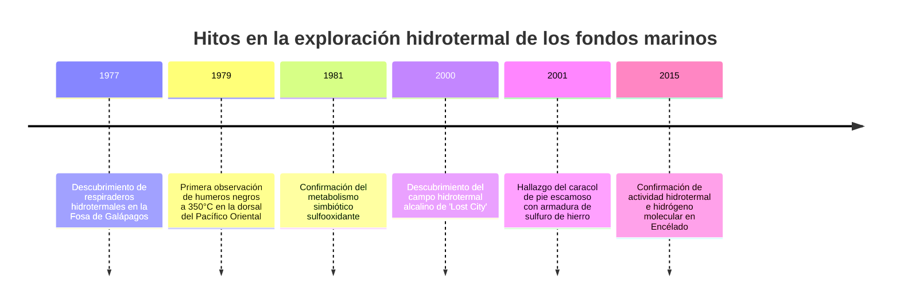
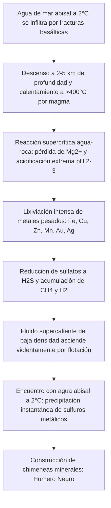

Hasta finales del siglo XX, la ciencia biológica sostenía el dogma inamovible de que toda vida compleja en la Tierra dependía indefectiblemente de la energía solar mediante la fotosíntesis. Ese axioma fue pulverizado en 1977 cuando el sumergible tripulado *Alvin* descendió a 2.500 metros en la fosa de Galápagos.

En la oscuridad absoluta del abismo oceánico, bajo presiones aplastantes de más de 250 atmósferas, los científicos hallaron chimeneas minerales expulsando fluidos negros a más de 350°C («fumarolas negras»). A su alrededor prosperaba un oasis extraordinario: gusanos de tubo de más de dos metros de longitud, cangrejos albinos y almejas gigantes.

Fue la demostración definitiva de los **ecosistemas quimiosintéticos**: comunidades impulsadas no por radiación solar, sino por la energía química y geotérmica del interior terrestre.



---

## 1. Geofísica de la circulación hidrotermal marina

Los respiraderos se originan en los bordes de placas divergentes, como las dorsales centrooceánicas, donde el magma asciende cerca de la corteza.



### Proceso de cuatro fases:
1. **Recarga e infiltración**: El agua abisal gélida se introduce en fallas geológicas.
2. **Alteración hidrotermal a alta temperatura**: Cerca de la cámara magmática, el fluido alcanza 400°C, precipita magnesio y expulsa protones ($H^+$), volviéndose fuertemente ácido (pH 2-3).
3. **Lixiviación de metales**: El fluido extrae concentraciones masivas de hierro, cobre y zinc.
4. **Descarga y chimeneas**: Al mezclarse con el agua fría de fondo, los sulfuros metálicos precipitan instantáneamente construyendo las chimeneas.

---

## 2. Bioquímica de la quimiosíntesis

Las bacterias y arqueas quimiolitoautótrofas aprovechan la energía libre de Gibbs ($\Delta G^\circ$) liberada por la oxidación inorgánica:

### Reacciones principales:
- **Oxidación de sulfuro de hidrógeno**:
  $$H_2S + 2O_2 \rightarrow SO_4^{2-} + 2H^+ \quad (\Delta G^\circ = -792\text{ kJ/mol})$$
- **Oxidación de hidrógeno molecular**:
  $$2H_2 + O_2 \rightarrow 2H_2O \quad (\Delta G^\circ = -474\text{ kJ/mol})$$
- **Oxidación de metano**:
  $$CH_4 + 2O_2 \rightarrow CO_2 + 2H_2O \quad (\Delta G^\circ = -820\text{ kJ/mol})$$

```mermaid
graph LR
    subgraph Fotosíntesis
        Sol[Fotones solares] --> Foto[Fotofosforilación]
        Foto --> ATP1[ATP + NADPH]
        CO2_1[CO2] + ATP1 --> Bio1[Glucosa y biomasa]
    end

    subgraph Quimiosíntesis
        Inorg[Donantes inorgánicos H2S / H2] --> ETS[Cadena transportadora de electrones]
        ETS --> ATP2[Fuerza protón-motriz -> ATP + NADH]
        CO2_2[CO2] + ATP2 --> Bio2[Biomasa celular]
    end
```

---

## 3. Adaptaciones extremas y el origen de la vida

- ***Riftia pachyptila***: Carece por completo de boca, estómago o intestinos. Su trofosoma contiene miles de millones de bacterias simbióticas alimentadas por una hemoglobina gigante que transporta simultáneamente oxígeno y sulfuro tóxico.
- ***Chrysomallon squamiferum***: El caracol escamoso mineraliza nanopartículas de sulfuro de hierro (greigita y pirita) en su concha trilaminar para resistir el aplastamiento de cangrejos depredadores.
- **Teoría de las fuentes alcalinas**: El gradiente de protones natural ($\Delta \text{pH} \approx 4$) entre las emanaciones alcalinas tipo *Lost City* (pH 9-11) y el océano primitivo ácido (pH 5-6) funcionó como una pila química natural, impulsando el surgimiento del metabolismo celular antes de la evolución de las enzimas orgánicas.
